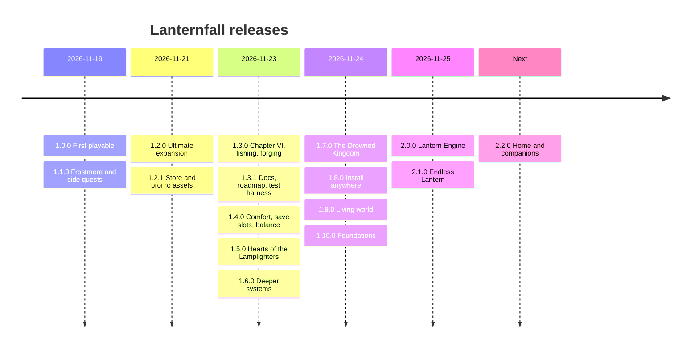
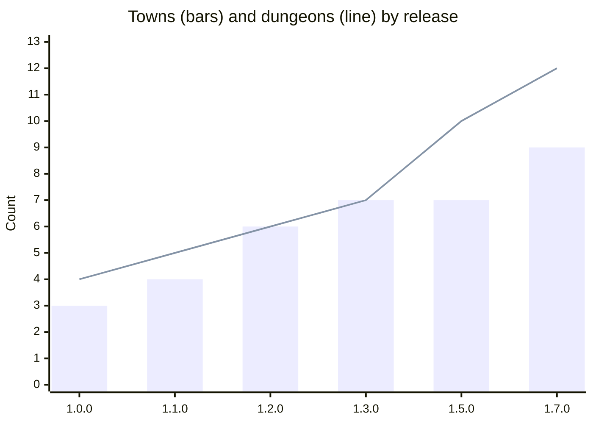

# Changelog

All notable changes to Lanternfall are recorded here. The format follows [Keep a Changelog](https://keepachangelog.com/en/1.1.0/), and versions follow [Semantic Versioning](https://semver.org/) as applied to a game:

- **Major**: a save-breaking change, or a new game built on the engine.
- **Minor**: new content or systems (chapters, towns, dungeons, quests, mechanics).
- **Patch**: fixes, balance, documentation and store assets.

> Versions before 1.4.0 were assigned after the fact, from the merged pull requests. They were tagged afterwards, and every version from 1.0.0 on has a tag and a [GitHub Release](https://github.com/CptNope/Laternfall/releases) with its `index.html` attached. [ROADMAP.md](ROADMAP.md#release-process) explains how to tag from now on.

| Version | Date | Towns | Dungeons (floors) | Monsters (bosses) | Side quests | Playable heroes | Pull request |
| --- | --- | --- | --- | --- | --- | --- | --- |
| 1.0.0 | 2026-11-19 | 3 | 4 | — | — | 4 | [#1](https://github.com/CptNope/Laternfall/pull/1) |
| 1.1.0 | 2026-11-19 | 4 | 5 | +7 | 6 | 4 | [#1](https://github.com/CptNope/Laternfall/pull/1) |
| 1.2.0 | 2026-11-21 | 6 | 6 (16) | 52 (8) | 8 | 5 | [#2](https://github.com/CptNope/Laternfall/pull/2) |
| 1.2.1 | 2026-11-21 | 6 | 6 (16) | 52 (8) | 8 | 5 | [#3](https://github.com/CptNope/Laternfall/pull/3) |
| 1.3.0 | 2026-11-23 | 7 | 7 (20) | 63 (10) | 10 | 5 | [#4](https://github.com/CptNope/Laternfall/pull/4) |
| 1.3.1 | 2026-11-23 | 7 | 7 (20) | 63 (10) | 10 | 5 | [#5](https://github.com/CptNope/Laternfall/pull/5) |
| 1.4.0 | 2026-11-23 | 7 | 7 (20) | 63 (10) | 10 | 5 | [#6](https://github.com/CptNope/Laternfall/pull/6) |
| 1.5.0 | 2026-11-23 | 7 | 10 (26) | 75 (15) | 16 | 5 | [#7](https://github.com/CptNope/Laternfall/pull/7) |
| 1.6.0 | 2026-11-23 | 7 | 10 (26) | 75 (15) | 17 | 5 | [#8](https://github.com/CptNope/Laternfall/pull/8) |
| 1.7.0 | 2026-11-24 (not yet tagged) | 9 | 12 (32) | 89 (17) | 21 | 5 | [#13](https://github.com/CptNope/Laternfall/pull/13) |
| 1.8.0 | 2026-11-24 (not yet tagged) | 9 | 12 (32) | 89 (17) | 21 | 5 | [#14](https://github.com/CptNope/Laternfall/pull/14) |
| 1.9.0 | 2026-11-24 (not yet tagged) | 9 | 12 (32) | 94 (17) | 23 | 5 | [#15](https://github.com/CptNope/Laternfall/pull/15) |
| 1.10.0 | 2026-11-24 (not yet tagged) | 9 | 12 (32) | 94 (17) | 23 | 5 | [#16](https://github.com/CptNope/Laternfall/pull/16) |
| 2.0.0 | 2026-11-25 (not yet tagged) | 9 | 12 (32) | 94 (17) | 23 | 5 | [#17](https://github.com/CptNope/Laternfall/pull/17), [#19](https://github.com/CptNope/Laternfall/pull/19), [#20](https://github.com/CptNope/Laternfall/pull/20), [#21](https://github.com/CptNope/Laternfall/pull/21) |
| 2.1.0 | 2026-11-25 (not yet tagged) | 9 | 13 (32 + endless) | 94 (17) | 23 | 5 | [#22](https://github.com/CptNope/Laternfall/pull/22) |
| 2.2.0 | next | 9 | 13 (32 + endless) | 94 (17) | 23 | 5 | in progress |

---

## [Unreleased]

Planned as **2.2.0 · *Home and companions***: four small things from the ideas parking lot that make Brightwater feel like home (see the [roadmap](ROADMAP.md#22--home-and-companions)).

### Added
- **Corwin the carpenter**, beside Arin's house in Brightwater, builds four upgrades into the house (new `src/home.js`):
  - **A bed for Mittens** (250 G, after The Lost Cat);
  - **a trophy shelf** (400 G, after a trophy), which shows your trophies and opens the trophy list;
  - **a fish tank** (1,200 G, after a fish), where every kind you've caught swims;
  - **a music box** (1,500 G, after the first Lantern).
- **The music box** plays any song you've heard, whenever you're home. The game now records each song as it plays (`heard:<track>` flags). Older saves count the songs their progress implies.
- **Mittens follows you everywhere** after The Lost Cat, if you ask her: towns, houses, the world map, dungeons and the sea floor, where she wears a bubble. Aboard the ship, the airship or a moth she rides along out of sight. She walks one step behind, never blocks the way, and catches up at once when a cutscene moves you. (#23 kept her in Brightwater; #25 lets her go anywhere.)
- **Compass hints.** With the Sailor's Compass carried or worn, a needle in dungeons points to the nearest unopened chest. A new Config switch, *Compass hints*, turns it off.
- `home` play-test scenario (21 checks), in CI.
- The guide has a section on Arin's house.

### Changed
- The Sailor's Compass description mentions the chests.
- `tools/load_check.js` (run by `build.py`) now fails when two files declare a top-level function with the same name. That isn't an error in JavaScript: the later one silently replaces the earlier. It caught this release's carpenter, first named Tobin, whose `talkTobin` had replaced the existing Brightwater NPC's; he is Corwin now.

---

## [2.1.0] — 2026-11-25, merged (#22) but not yet tagged · *Endless Lantern*

Something to come back to after the ending (see the [roadmap](ROADMAP.md#21--endless-lantern)).

### Added
- **The Endless Lantern**, a post-game dungeon with no bottom. After the ending, Hesper waits by the well in Brightwater. Each floor is built by the existing floor generator from a seed, and each band of five floors borrows the look and monsters of an old dungeon (Whisperwood Hollow first, the Crownfall Abyss tenth, then round again).
- **Foes scaled to the depth** (`foeScale()` in the new `src/endless.js`). On 1F a band's monsters are rescaled so their average matches the Crownfall Abyss; then HP and EXP/gold grow 6% a floor, ATK and MAG 1.2%, DEF 1%. Every fifth floor holds an echo of an old boss, rescaled to the Hollow Crown and growing the same way.
- **Checkpoints and a record.** Beating an echo pays gold and lets you start the next descent from the floor after it. The deepest floor you've reached is saved and carries into New Game+. There is no way back up: the stairs up end the descent.
- **Rewards that rise**: chests hold more gold and better items the deeper you go, and the first echo beaten on 25F or deeper leaves the **Endless Wick** (All +14, HP +400, regen).
- **Hollow mode**, chosen when a New Game or New Game+ starts. Inns let the night pass but heal nobody, and neither does your bed at home. You can't run, and every boss rises a third time below 20% HP, acting once more each turn. Save slots show "Hollow".
- Three trophies: *Down the Well* (10F), *The Long Dark* (30F) and *Hollow Walker* (finish the story in Hollow mode).
- `endless` play-test scenario (22 checks), in CI: 120 floors generated and walked for stairs and bosses, the keeper, scaling, a boss and its checkpoint, climbing out, Hollow inns, battles and boss phases, and the New Game mode menu.
- Balance-sim scenarios for the Endless Lantern and Hollow mode. A scenario can now pass battle options and flags.
- The guide has sections for both, with a generated table of the floor cycle.

---

## [2.0.0] — 2026-11-25, merged (#17, #19, #20, #21) but not yet tagged · *Lantern Engine*

Separating the engine from Lanternfall's content (see the [roadmap](ROADMAP.md#20--lantern-engine)). It arrived in parts: EN-1 (content as data, #17), EN-4 (mods, #19), EN-3 (the town editor, #20) and EN-6 (languages, #21). The game plays exactly the same.

### Added
- **Languages** (EN-6). Every line a player reads goes through `tl()`, with the English as the key: the code stays readable, an untranslated line falls back to English, and ``tl`${name} reached level ${n}!` `` becomes `{0} reached level {1}!`, so a translation can put the values in any order. A language is one file, `content/lang/<code>.json`; Settings → **Language** switches (the game restarts). `tools/strings.js` writes `content/lang/template.json`, about 2,200 lines for translators, and its check stops a translation that drops a value. Mods can add a language, or reword the English with `lang/en.json`. No translation ships yet; `content/lang/README.md` says how to make one.
- **A pseudo language** for testing (`?lang=pseudo`): every translated line comes out accented and a third longer, so English left on screen, and text too long for its box, stand out. The `i18n` play-test plays in it and fails on any untranslated line it draws; it also builds a French test mod and checks its lines, reordered values and English fallback.
- `tools/wrap_strings.py`, which wrapped about 2,180 strings across 18 files. The English game is unchanged: all 70 tables of game data compare byte for byte, and the guide is identical.
- **The town editor** (EN-3). Open `index.html?edit`: the town is drawn with the game's own art, its people stand where the game puts them, and a side panel holds the tools. Move, add and delete buildings (and set their kind, colours, sign, shop or inn price); paint paths, water, piers and twelve kinds of decoration; add or remove exits; show who's in town at night or after the ending; undo and redo; **Walk around** in the edited town and press Esc to come back. Edits are kept in the browser. **Save as a mod file** downloads a `towns.json` for a mod; **Copy for content/towns.json** gives the entry to paste into the game.
- **Town layouts are content**: `content/towns.json`, with a schema, moved out of `src/maps.js` (every town builds tile for tile as before). Mods can change towns; the content check covers a building's shop and the town's music.
- **A walk check for every town**, shared by the editor and the build (`townProblems()` in `src/editor.js`, run by `tools/load_check.js`): from the way in, every door and every townsperson must be reachable, by day and night, early and late in the story, with the game's own walking rules and NPC placement; buildings mustn't overlap or touch the edge; decorations mustn't hide under buildings. All ten towns pass; a broken layout, in the game or in a mod, fails the build with what's wrong and where.
- `editor` play-test scenario (14 checks), in CI; the content self-test grows to 25 cases.
- **Mods** (EN-4). A mod is a folder in `mods/` with a `mod.json`, the content it adds or changes, and optionally code (a new monster drawing). `python3 build.py --mod mods/example` builds the game with it into `build/lanternfall-modded.html`; `index.html` is never touched. New items and monsters are added, existing ones patched field by field (`"goblin": {"steal": "hipotion"}`), and shop and encounter lists replaced or edited with `add` / `remove`. The merged content goes through the same checker, and a problem names the mod it came from. See `mods/README.md`.
- **An example mod**, *The Ember Fox*: a new monster with its own drawing roaming the Ashen Isle, a new accessory sold in Lastlight, and a one-field change to Goblins.
- The title screen of a modded game says which mods are in it, and saves record them. Loading a save in a game without its mods leaves the mods' items out (gear returns to the hero's starting gear) and tells the player, instead of breaking a menu later.
- `mods` play-test scenario (11 checks), in CI; the content self-test now also plants 6 mod mistakes and checks a good mod merges.
- **Content as data files.** Items, monsters, shops and random-battle tables moved out of `src/data.js` into `content/items.json`, `monsters.json`, `shops.json` and `encounters.json`, one entry per line. `build.py` writes them back into `index.html`, so the game is still one file. The tables the game sees are byte-for-byte the same as before, and the generated game guide is unchanged.
- **A schema for each file** in `content/schema/`, describing every field. Editors that understand JSON Schema (VS Code and most others) underline mistakes and show what a field means as you type.
- **A content checker** (`tools/content.js`, no packages needed). `build.py` runs it first and builds nothing if it finds a problem. It checks each file against its schema, then every reference: drops and shop stock are real items, encounter groups are real monsters, moves exist, every monster family has a drawing, every night table has a day table. It also checks what the code names: a town's shop, a dungeon's encounter table, the monsters in `startBattle([...])`, items in `addItem` / `hasItem`, recipes, treasure maps, meals, the arena and the black market. `--selftest` plants 15 typical mistakes and fails unless each is caught; CI runs both.
- `content/README.md`: the format, comments (keys starting with `//`), and how checking works.

### Changed
- `docs/MODDING.md`: adding a monster, item, shop, dungeon, boss phase or fish now edits `content/`, with JSON examples. The accessory table now lists all seven statuses an accessory can block.

---

## [1.10.0] — 2026-11-24, merged (#16) but not yet tagged · *Foundations*

Groundwork for 2.0 and for phones. It finishes EN-5 and TD-4 from the [roadmap](ROADMAP.md#20--lantern-engine), and TD-7. The game plays the same; it draws faster.

### Added
- **Tile cache** (`src/tilecache.js`). The field used to redraw every tile on screen every frame. Now each map is drawn once into 8×8-tile chunks, and each frame only the squares that move (water, lamps, braziers, kelp, palms) are redrawn. With the CPU slowed 4× to stand in for a phone, a frame on the world map takes about 4 ms instead of 17, a town 6.5 instead of 14, and a dungeon half as long. The sea floor, which is mostly moving kelp, gains little. Add `?nocache` to the URL to turn it off.
- **Load-order check** (`tools/load_check.js`). `build.py` now runs the joined script once in Node and fails if it throws while loading, naming the file and line. It catches the bug class behind 1.9's `LOOKS` crash: a top-level value that reads a name declared in a later file. CI runs it with every build.
- `tiles` play-test scenario: cached tiles compared with tiles drawn one by one, on 18 maps at scales 1, 2 and 1.37; a changed tile rebuilding the cache; and a speed check. Added to CI.

### Changed
- **Monster art and battle backgrounds have one file each**: 21 families in `src/monsters/` and 15 backgrounds in `src/backgrounds/`, each registering itself in `MONSTER_ART` / `MONSTER_SIZE` / `BATTLE_BGS`. `art.js` went from 1,520 lines to about 960. Every monster and background was checked to draw pixel for pixel as before. `build.py` takes every file in those folders.
- The field camera snaps to whole screen pixels, so cached tiles line up exactly.
- Desert palms and glowing ground follow the game's clock instead of the wall clock, so they hold still while the field is paused.

### Fixed
- Tiles no longer change slightly depending on which tile was drawn before them (some left a rounded line cap behind), so mountain outlines no longer shift as the camera moves.
- The diving bell's line on the sea floor no longer pops in as you scroll down to it.

---

## [1.9.0] — 2026-11-24, merged (#15) but not yet tagged · *Living world*

It delivers the rest of the 1.6 *Deeper systems* list from the [roadmap](ROADMAP.md#16--deeper-systems): DS-4 (Berserk and Stop), DS-8 (day and night), DS-9 (weather), DS-10 (*Lanterns & Lies*) and DS-11 (stealth).

### Added
- **Day and night.** A clock runs while you explore (a full day is 24 minutes of play). Evenings turn the world amber, nights a moonlit blue, and windows, lamps and braziers glow in the dark. The time and day are shown in the field menu. An inn wakes you at 7:00, or at 21:00 with the new **Stay until night**, and a Tent passes eight hours.
- **Night encounters**: five new monsters that only come out after dark (Moonmoth, Gravewight, Ghostlight, Frostwraith, Night Jackal), on every continent and at sea. Wandering townsfolk go home at night, and a few people only appear then: a watchman in Brightwater, a fisher in Port Halden, a stargazer in Frostmere, a vendor in Mirage, and some of the card players.
- **Weather** by region, rolled every six game hours: rain in the west, the northern lowlands and at sea, snow around Frostmere, sandstorms in the Sunscar, fog on the Isle of Dusk, ash on the Ashen Isle. It's drawn over the field and carried into battle, for both sides: rain strengthens water and lightning and dampens fire, snow favours ice, ash favours fire, and sand and fog make physical attacks miss more often. Aerie sits above the weather.
- **Berserk and Stop.** Berserk (ATK ×1.5, but the hero attacks on their own) and Stop (lose your turns) for heroes and enemies. Chimeras, Night Jackals and Ogres can madden you; Deepgazers and Starspawn can stop you. Bosses can't be stopped. Selene learns **Stop** at Lv 30, Ironhold sells the **Rage Tonic**, and the **Calm Charm** and **Clockwork Charm** prevent them. Remedy and Purify cure both.
- ***Lanterns & Lies***, a card game against eight players around the world, some only by day and some only at night. Lay five cards on a 3×3 board; a card turns every weaker enemy card next to it, and its flame gives +2 against the one it beats (Ember beats Stone beats Tide beats Ember). Once per game you can lay a card face down as a **Lie**: it captures nothing when it lands, then turns over at the end and takes everything weaker around it. Win a card from each opponent you beat. Tess in Brightwater teaches the rules and gives you a starter deck; 36 cards to collect, and beating everyone earns the **Joker's Lantern**.
- ***The Sunset Opal***, a night heist for Kestrel: Mags in the Undermarket has a job in the Mirage palace vaults. Sneak past four patrolling guards whose sight lines are shown on the floor; if one sees you, you're thrown out. Reward: the **Night Cloak**.
- 4 new trophies (34 in all): *Night Owl*, *Card Sharp*, *Collector* and a hidden one.
- `living` play-test scenario: 26 named checks covering the clock and the inn, night encounters and NPCs, weather in battle, Berserk and Stop, a full card game, the deck screen, the heist (including a search proving there is an unseen route in and out) and saving the clock and the cards. Added to CI.

### Changed
- Saves now keep the time of day, your card collection and your last deck. Older saves start at 8 in the morning with no cards.
- The game guide has new sections for day, night and weather, *Lanterns & Lies* (every card and player) and the heist.

---

## [1.8.0] — 2026-11-24, merged (#14) but not yet tagged · *Install anywhere*

Delivers PL-1 to PL-4 from the [roadmap](ROADMAP.md#18--install-anywhere), and the first part of TD-4.

### Added
- **Install as an app (PWA).** `build.py` now also writes `manifest.webmanifest` and an offline service worker (`sw.js`) beside `index.html`, and `tools/make_icons.py` draws the app icons with the game's own drawing helpers. Served from GitHub Pages, the game installs to a home screen or desktop and plays offline. **Install** on the title screen opens the browser's install prompt, or explains how (Share → Add to Home Screen on iOS). `index.html` is still one self-contained file that runs when opened directly.
- **Desktop builds** for Windows, macOS (universal) and Linux, using Tauri (`src-tauri/`). A new `Desktop builds` workflow builds all three on every version tag and attaches the installers to the GitHub Release; pull requests that touch the desktop files get a Linux compile check.
- **Transfer saves** on the title screen: export every save slot, your settings, trophies and best splits to one file, and import it in another browser, the installed app or the desktop build.
- **30 trophies** for the story, side stories, collecting and growing, one of them hidden. They're kept outside the save slots, so they carry across every slot and New Game+. See them on the title screen or from Scribe Tam in Brightwater's hall.
- **Speedrun timer** (Config): play time on screen, with a split at each main Lantern showing the difference from your best run.
- **Battery saver** (Config): draws at 30 frames a second instead of 60.
- `platform` play-test scenario: 13 checks covering trophies, splits, battle play time, the battery saver, save export and import, and the installed app (service worker, manifest, an offline reload over a local web server). Added to CI.

### Changed
- **Play time now counts during battles**, in real time, so faster battle speeds really are faster. Saves keep the time they already had.
- CI also checks that `manifest.webmanifest` and `sw.js` match the build.

---

## [1.7.0] — 2026-11-24, merged but not yet tagged · *The Drowned Kingdom*

It delivers WD-1 to WD-6 from the [roadmap](ROADMAP.md#17--the-drowned-kingdom).

### Added
- **The diving bell and the sea floor.** After Oswin's quest, Sister Wenna finds Tessaly's Chart and Brann fits the *Dawnrunner* with a diving bell (2 Frost Crystals and 1 Sun Gold). Sail onto one of four patches of black water and press Enter to dive to a new map under the sea, lit only by the bell's lamp. Walk onto a bell line to surface. The Map screen gets a Sea Floor view (Shift).
- **Nerith**, the Sea Mother's sunken city: a town of gentle memories with its own inn, temple, archive and the best shop gear in the game (five weapons, three armours, the Pressure Ring).
- **The Drowned Palace** (4 floors) and its boss, **Nereus, the Drowned King**, who acts twice, absorbs water and changes tactics at half HP. He gives the **Crown of Nerith**.
- **The Hadal Rift** (2 floors) and the secret superboss **The Tide That Remembers** (acts twice, two phases, heals itself), which gives **Tidesong**.
- **The Undermarket** under Ironhold, reached through the jail trapdoor after Kestrel's quest: an inn, the Thieves' Guild, Whisper the map-seller, and a black market selling forge materials and rare goods at triple price.
- **Treasure maps**: five maps, each marking a dig spot on the world map. Whisper sells the first, bandits and anglers drop the next three, and the last lies in a sunken wreck. All five earn 50,000 gold from Whisper.
- **Lanternmoths**: after Arin's twelve roadside lamps are lit, Old Ivy in Brightwater gives you the Moth Whistle. Talk to any lit lamp to ride a moth: twice walking speed, no encounters, land only.
- 14 monsters (3 new art families: the jelly, the angler and the Tide itself), 8 enemy moves, 3 forge recipes using the new **Deep Pearl** material, 7 accessories and 3 music tracks (the sea floor, Nerith and the Undermarket).
- `drowned` play-test scenario: 22 checks covering the whole quest line, diving and surfacing, digging, map drops, moth riding, the Undermarket and saving on the sea floor. Added to CI.

### Changed
- Art registries (`MONSTER_ART`, `MONSTER_SIZE`, `BATTLE_BGS`) let new content draw itself from its own file. The 1.7 art lives in `src/deep_art.js` and its logic in `src/deep.js`, so `art.js` and `story.js` barely grew (a first step on EN-5).
- The bestiary now has 89 creatures, so the Bestiary Seal asks for more. Saves that already earned it keep it.
- The simulator has 1.7 scenarios: Nereus wins 92% at Lv 46 in Nerith's gear and 75% at Lv 48 in main-story gear; the Tide wins 42% at Lv 50 with the hero weapons (no Lantern Board or meal in the simulator) and almost never in shop gear.

### Fixed
- The Map screen crashed when opened inside a building; it now finds the party's position from any map.
- A save made on the sea floor shows "The Sea Floor" in the slot list.
- Donation links now go to the game's itch.io donation page (`/donate`). They pointed at `/purchase`, which itch.io shows as page not found for a free game.

---

## [1.6.0] — 2026-11-23 · *Deeper systems*

It delivers DS-1 to DS-7 from the [roadmap](ROADMAP.md#16--deeper-systems).

### Added
- **Support links across the repository**: a Sponsor button (`.github/FUNDING.yml`) and a README badge and section pointing to the [itch.io donation page](https://cptnope.itch.io/lanternfall/donate), links to the [project write-up](https://jeremyanderson.tech/project/lanternfall-browser-jrpg/), `.github/SUPPORT.md`, and issue forms for bug reports and ideas with links to play, donate and read more.
- **The Lantern Board**: from level 30 each level-up gives an **Ember** (and at the cap, one per 20,000 EXP). Spend them on a 12-node board per hero (Status → Enter): stat nodes, a Great Flame, three passives and a capstone. Eleven passives in all, including Counter, Quick Limit, Auto-Regen, Auto-Haste, MP Saver, Lookout, Ghost Step, Wildfire, Twilight, Tidal Grace and Lamplighter's Resolve.
- **Cooking**: innkeepers cook your fish into 11 meals that buff the party for the next 3 battles (ATK, DEF, MAG, SPD, Regen, Haste, no ailments, +EXP, +gold, or everything). The active meal shows under the menu.
- **New statuses**: **Blind** (attacks miss half the time), **Slow** and **Haste**. New skills: Oswin's **Haste** (Lv 24), Kestrel's **Flash Powder** (Lv 18) and Selene's **Slow**. Seven monsters and 11 bosses use the new statuses; Remedy and Purify cure them.
- **Resistances and absorbs**: 23 monsters now resist or absorb an element (Magma Slimes drink fire, the Leviathan drinks water). Absorbed hits heal the monster and say so.
- **Smarter enemies**: monsters that hunt the wounded, hunt casters, or heal their allies (the healer now mends the most hurt monster, not just itself).
- **Boss phases**: all 15 bosses change tactics when hurt, announce it, and some start acting twice.
- **Rare steals**: 13 monsters carry a rare item (★), including four new accessories from bosses: the Thief's Gloves (Vane), Starlit Cloak (Astral Wyrm), King's Signet (Hollow King) and Sun Circlet (Ozymar).
- **The Complete Bestiary** quest: Sable gives the **Scholar's Monocle** at 45 creatures and the **Bestiary Seal** for all 75.
- New shop accessories: **Eye Charm** (prevents blind) and **Hourglass Pin** (prevents slow).
- The bestiary shows resistances, absorbs, AI, rare steals and the skills a boss gains when hurt. The game guide has new Lantern Board, Cooking, Elements and Enemy behaviour sections.
- `depth` play-test scenario (19 checks: save migration, the board by keyboard, passives, cooking, absorb, Haste and Slow, a boss phase, a rare steal, Sable's rewards, save round trip).

### Changed
- **Save version 3.** Older saves upgrade automatically, and heroes above level 30 get the Embers they would have earned.
- Gold and EXP rewards now include the meal bonus; the Silk Ribbon and other all-ailment accessories also block Blind and Slow.
- Balance: boss phases swap moves rather than adding damage, so the simulator's numbers stay where 1.5 left them (Chapter VI finale at Lv 42: 83% with shop gear, 92% with mid gear; every Hearts boss 83–100%). The Lantern Board and meals are not in the simulator, so real players are stronger than these numbers.

---

## [1.5.0] — 2026-11-23 · *Hearts of the Lamplighters*

It finishes the 1.4 *Comfort* milestone and delivers 1.5 from the [roadmap](ROADMAP.md).

### Added
- **Hearts of the Lamplighters**: five post-game personal quests, one per hero. Each ends in a Limit and an ultimate weapon.
  - **Arin, *The Lamplighter's Road***: relight 12 roadside lamps across the world (shown on the world map). The last one wakes **the Lamp-Eater**. Reward: Sunbearer.
  - **Lyra, *Mother's Grimoire***: the **Ember Caves** (new location `8`), with riddle braziers in Lyra's mother's voice and the **Hearth Warden**. Reward: Hearthstaff.
  - **Oswin, *The Drowned Priesthood***: the **Sea Mother's Grotto** (new location `9`) and **the Drowned Abbot**, Oswin's old teacher. Reward: Abbot's Bell.
  - **Kestrel, *Old Debts***: a trapdoor in the Ironhold jail leads to **the Undercity** and **Guildmaster Vane**. Reward: Pickpocket's Prize.
  - **Selene, *Echo of Vesper***: rest at an inn to face **Vesper's Echo** in a solo dream duel. Losing just wakes her up. Reward: Duskstar.
  - **The Festival of Lanterns** after all five, with the **Heartlight** accessory.
- **Limits**: a gauge for each hero that fills as they take damage and carries over between battles. When it's full, a ★ command appears: First Light, Phoenix Rite, High Tide, Grand Larceny and Long Night.
- **Campfire talks**: eight one-time party conversations when you rest with a Tent on the world map.
- 12 new monsters: Kiln Imp, Cinder Serpent, Deep One, Pearl Guard, Guild Cutpurse, Guild Enforcer, Sewer Ooze, and the five bosses.
- **Controls** page in Config: rebind any key; Confirm and Back can't be left unbound; there's a reset option.
- **Large text** and **high-contrast windows** options in Config.
- `hearts` play-test scenario (all five quests, Limits, a campfire talk, the festival); boss scenarios for the simulator.
- Battles can use a custom party (`opts.party`), and dungeons can exit to a map other than the world (`exitTo`) or skip the Lantern (`noLantern`).

### Changed
- World location codes now run `1`–`9`.
- Once Chapter VI is done, the main objective points to the Hearts quests, then the festival.
- The simulator's AI saves Gravity for very large bosses, which changed the finale's simulated numbers slightly (they're still in range).

### Fixed
- Losing a battle that isn't a game over (Selene's dream) left the battle as the active scene, so the next battle crashed while drawing.

---

## [1.4.0] — 2026-11-23 · *Comfort*

It covers the 1.3.x *Stabilise* milestone and most of 1.4 *Comfort* from the [roadmap](ROADMAP.md).

### Added
- **Three save slots plus an auto-save slot.** Menu → Save opens a slot picker that shows the place, chapter, party levels, play time, gold, Lanterns lit and when it was saved. Inns offer a one-press "Save to slot N".
- **Auto-save** to the Auto slot whenever you enter a town or dungeon (Config → Auto-save).
- **Title screen:** *Continue* loads the newest save, the new *Load Game* picks a slot, and *New Game+* lets you choose which finished save to carry over.
- **Save versioning.** Saves now carry a `version`, and `MIGRATIONS` upgrade older formats step by step when a slot is read.
- **Battle speed** (1×, 2×, 4×) in Config. Battle animations and pauses speed up; messages still wait for you.
- **Repeat last turn.** Press Shift, R or the gamepad's X at the first command menu to reuse last round's commands.
- **Gamepad support** (standard mapping): D-pad or stick, A, B, X to run or repeat, Y or Start for the menu, Select to mute.
- **A touch R button**: hold it to run (or to walk, with auto-dash on), and tap it in battle to repeat the last turn.
- **Equip → Optimise** puts on the best weapon and armour you own for that hero.
- **Menu → Log** shows the last 40 lines of dialogue.
- **Config → Encounters** turns random battles off after the ending.
- **`tools/balance_sim.py`**: a boss balance simulator that runs the real battle code instantly with an AI party and reports win rate, rounds, knockouts and items used.
- **Continuous integration** (`.github/workflows/playtest.yml`): every pull request is built, `index.html` and the game guide are checked for staleness, and four play-test scenarios run headlessly.
- A `comfort` play-test scenario covering saves, migration, battle speed, repeat, optimise, the Log, gamepad input and the encounter toggle.
- Monsters can act more than once per round (`actions` in `MONSTERS`).

### Changed
- **The Chapter VI finale was rebalanced** using the simulator. The Hollow Crown (HP 11,000 → 8,000) and Orun (12,500 → 9,500) now **act twice per round**. Before, the fight took 25–28 rounds with no real danger. Now it's roughly a 70–80% win at the recommended Lv 42 and about 20 rounds, while a Lv 50 party finishes in about 13.
- The world map labels Lastlight and the Crownfall Abyss as soon as the isle rises.
- The field menu gained *Log*. Config gained *Battle speed*, *Auto-save* and *Encounters*.
- Sound pauses while the browser tab is hidden.

### Decided
- *Eclipse Cup rematch EXP* (roadmap ST-7): kept. Rematches only matter once you're near the level cap.
- *Abyss Ash in Lastlight's barrels* (roadmap ST-6): kept. It's a one-time find that gives the forge a head start.

### Compatibility
- Saves from 1.0–1.3 are copied into **slot 1** the first time 1.4 runs. The original save key is left untouched as a backup.

---

## [1.3.1] — 2026-11-23 · *Documentation*

### Added
- `ROADMAP.md`, with planned milestones, themes, a prioritised backlog and the release process.
- `CHANGELOG.md` (this file).
- A documentation set in `docs/`:
  - [Game guide](docs/GAME_GUIDE.md): walkthrough, every monster, boss, item, shop, quest and recipe.
  - [Architecture](docs/ARCHITECTURE.md): modules, scenes, the script runner, rendering, audio and the save format.
  - [Modding guide](docs/MODDING.md): how to add quests, monsters, towns, dungeons, music and items.
  - [Testing guide](docs/TESTING.md): how to use the headless play-test harness.
- `tools/playtest.py`, the Playwright harness used to play-test 1.3.0.
- `tools/gentables.py` and `tools/extract.js`, which regenerate the guide's data tables from `src/data.js`.
- An expanded README with diagrams, a feature tour and a documentation index.

---

## [1.3.0] — 2026-11-23 · *Chapter VI: The Crownless King*

A post-game story chapter, two new side systems, and fixes.

### Added
- **Chapter VI: The Crownless King.** After the credits, the next step onto the world map raises the **Ashen Isle** in the far northeast sea. It can be reached by ship or by airship.
  - **Lastlight**, the 7th town: home of the Ashen Order, Orun's old household, sealed under the sea by Ozymar for a thousand years. It has six NPCs, an inn, a chapel, the Ward Hall, an item shop and an endgame armory.
  - **Crownfall Abyss**, the 7th dungeon: four floors with an ash-and-ember theme and its own lighting and music. Two **memory scenes** show Ozymar and Orun as brothers.
  - **A two-phase finale**: *The Hollow Crown*, a new drawn monster family, then *Orun, the Night-Bearer*. Victory lights the **Night Lantern** and plays a short epilogue.
  - The **Crown of Dusk & Dawn** accessory (all +25, regen, prevents all ailments).
- **11 new monsters**: Ash Hound, Cinder Wisp, Cinder Knight, Ash Colossus, Crown Shard, Nightmare, Abyss Ooze, Hollow Herald, Gloam Knight, plus the two bosses.
- **New skills**: Dawnbreak (Arin, Lv 42), Supernova (Lyra, Lv 44), Sanctuary (Oswin, Lv 42), Mug (Kestrel, Lv 26), Thousand Cuts (Kestrel, Lv 42), Eventide (Selene, Lv 44).
- **New combos**: Shadow Waltz (Kestrel + Selene), Twilight Psalm (Oswin + Selene) and Last Light (Arin + Lyra + Selene). Warden Ione teaches Last Light.
- **Fishing**: a rod from the Ice Fisher in Frostmere, a bite-and-reel timing mini-game, 13 fish across 9 kinds of water, and the quest *The Ones That Got Away* (Angler's Ring, Moonfin Charm). The Lantern Koi appears only after the ending.
- **Orrin's Forge**: monsters drop six materials (Ember Core, Frost Crystal, Sun Gold, Star Shard, Dusk Silk, Abyss Ash). Orrin forges nine items from them, including each hero's best weapon. Quest: *Orrin's Forge* (Orrin's Seal).
- **The Eclipse Cup**: the 6th Aerie Arena cup, unlocked after Chapter VI. Prize: the Eclipse Mantle.
- **Config menu** with sound, auto-dash and text speed (Normal / Fast / Instant). Settings are saved separately from the game.
- **New music**: `ash` (Ashen Isle), `ashtown` (Lastlight), `abyss` (dungeon) and `crown` (final boss).
- **New sound effects**: `splash`, `bite`, `reel`, `forge`.
- New art: ash terrain, a crater ring, location icons for Lastlight and the Abyss, a town brazier, and *ash* and *crownfall* battle backgrounds.
- Star Bomb (holy damage to all foes), plus endgame shop gear (the Ashsteel Blade, the Ash Mail and other Ash items).

### Changed
- **The level cap is now 50** (was 40).
- The field menu's *Sound* entry is now *Config*. The **M** key still toggles sound.
- The bestiary lists material drops next to item drops.
- The item menu sorts and colours the new kinds (materials, fish).
- Location tile codes are shared through `isLoc()`. Towns use `A`–`G` and dungeons `1`–`7`.
- The quest log's *Arena Legend* counts only the original five cups.

### Fixed
- The Grand Champion cup recommended **Lv 42+**, which the old Lv 40 cap made impossible.
- Loading a save now clamps HP and MP to their maximums.
- Lastlight interiors use the stone palette instead of wood.

### Compatibility
- **Saves from 1.2.x load unchanged.** The Ashen Isle is generated with the world, then sunk until `G.flags.isle` is set. Players who already finished the game see it rise the next time they reach the world map.

---

## [1.2.1] — 2026-11-21 · *Store and promo assets*

### Added
- itch.io promo images: social card, wide cover, favicon and logo.
- Devlog cover images.

---

## [1.2.0] — 2026-11-21 · *Ultimate expansion*

The game's code changes are dated 2026-11-19. The store assets followed on 2026-11-20, and the pull request was merged on 2026-11-21.

### Added
- **The Sunscar Desert**, a new continent, with the oasis town **Mirage** and the 3-floor **Tomb of the First King** (new monsters, the boss Ozymar, and lore).
- **The airship *Aurora***: fly anywhere and land on open ground.
- **Aerie**, a valley town walled in by mesas and reachable only by air, with the **5-cup Arena**.
- **Selene** joins as the 5th playable hero, a Duskmage. A **Formation** menu chooses the four who fight; the reserve earns half EXP.
- **9 combo techs**, dual and triple attacks.
- An auto-revive accessory and the **Gravity** spell.
- **Walk-in interiors** for every building, with counters, beds and furniture, and barrels, pots and crates to search.
- **New Game+**, which carries levels, gear and items while enemies scale up.
- Desert and sky music.
- itch.io store assets (cover, banner, hero image, page copy).
- WebP images for the jeremyanderson.tech project page.
- README links to the itch.io release and the project page.

### Changed
- The README and all screenshots were refreshed.
- New bosses and the Arena cups were balance-tested by simulation.

### Fixed
- Battle layout: the horizon was raised so the whole party stands on the ground.
- The main loop no longer freezes after a drawing error.

---

## [1.1.0] — 2026-11-19 · *Frostmere and side quests*

Shipped together with 1.0.0 in pull request #1.

### Added
- **Frostmere**, a snowbound town.
- A hidden island with the optional 3-floor **Starfall Observatory** and the **Astral Wyrm** superboss.
- **Six side quests** and a **quest log**: The Lost Cat, Nell's Locket, The Stonebrand, the Leviathan sea bounty, Stars Over Frostmere and Monster Scholar.
- An **accessory slot** with 14 accessories.
- **Sleep, silence and regen** statuses, with immunities. Lyra learns Sleep and Oswin learns Renew.
- A **bestiary**, a **world map** with an objective marker, and the Remedy item.
- 7 new monsters, plus new dragon, cat, whirlpool and astral art.

### Changed
- New bosses were balance-tested by simulation.

---

## [1.0.0] — 2026-11-19 · *First playable*

### Added
- Lanternfall: a classic JRPG in a single file. Everything is drawn with Canvas 2D paths and scored by a Web Audio chiptune sequencer, with no image or audio files.
- A party of four, an overworld with a ship, three towns and four dungeons.
- Turn-based battles, shops, equipment, and saving and loading.
- The full main story, with an ending.

[Unreleased]: https://github.com/CptNope/Laternfall/compare/v1.6.0...HEAD
[1.10.0]: https://github.com/CptNope/Laternfall/pull/16
[1.9.0]: https://github.com/CptNope/Laternfall/pull/15
[1.8.0]: https://github.com/CptNope/Laternfall/pull/14
[1.7.0]: https://github.com/CptNope/Laternfall/pull/13
[1.6.0]: https://github.com/CptNope/Laternfall/releases/tag/v1.6.0
[1.5.0]: https://github.com/CptNope/Laternfall/releases/tag/v1.5.0
[1.4.0]: https://github.com/CptNope/Laternfall/releases/tag/v1.4.0
[1.3.1]: https://github.com/CptNope/Laternfall/releases/tag/v1.3.1
[1.3.0]: https://github.com/CptNope/Laternfall/releases/tag/v1.3.0
[1.2.1]: https://github.com/CptNope/Laternfall/releases/tag/v1.2.1
[1.2.0]: https://github.com/CptNope/Laternfall/releases/tag/v1.2.0
[1.1.0]: https://github.com/CptNope/Laternfall/releases/tag/v1.1.0
[1.0.0]: https://github.com/CptNope/Laternfall/releases/tag/v1.0.0
