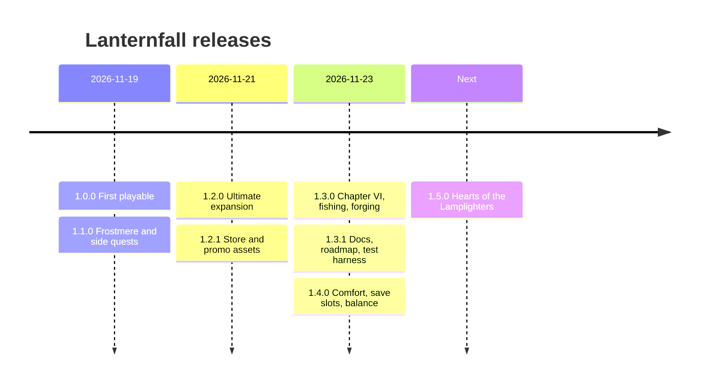
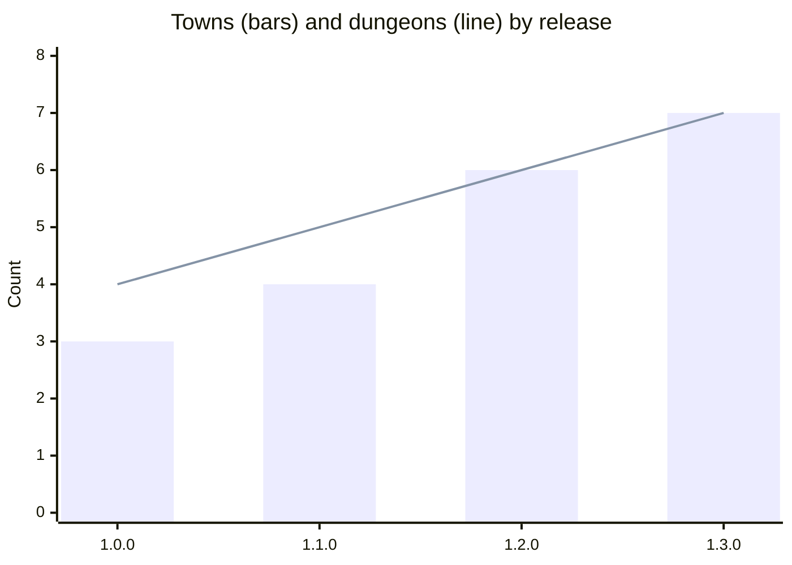

# Changelog

All notable changes to Lanternfall are recorded here. The format follows [Keep a Changelog](https://keepachangelog.com/en/1.1.0/), and versions follow [Semantic Versioning](https://semver.org/) as applied to a game:

- **Major**: a save-breaking change, or a new game built on the engine.
- **Minor**: new content or systems (chapters, towns, dungeons, quests, mechanics).
- **Patch**: fixes, balance, documentation and store assets.

> Versions before 1.4.0 were assigned after the fact, from the merged pull requests. The repository had no tags when this file was written. [ROADMAP.md](ROADMAP.md#release-process) explains how to tag from now on.

| Version | Date | Towns | Dungeons (floors) | Monsters (bosses) | Side quests | Playable heroes | Pull request |
| --- | --- | --- | --- | --- | --- | --- | --- |
| 1.0.0 | 2026-11-19 | 3 | 4 | — | — | 4 | [#1](https://github.com/CptNope/Laternfall/pull/1) |
| 1.1.0 | 2026-11-19 | 4 | 5 | +7 | 6 | 4 | [#1](https://github.com/CptNope/Laternfall/pull/1) |
| 1.2.0 | 2026-11-21 | 6 | 6 (16) | 52 (8) | 8 | 5 | [#2](https://github.com/CptNope/Laternfall/pull/2) |
| 1.2.1 | 2026-11-21 | 6 | 6 (16) | 52 (8) | 8 | 5 | [#3](https://github.com/CptNope/Laternfall/pull/3) |
| 1.3.0 | 2026-11-23 | 7 | 7 (20) | 63 (10) | 10 | 5 | [#4](https://github.com/CptNope/Laternfall/pull/4) |
| 1.3.1 | 2026-11-23 | 7 | 7 (20) | 63 (10) | 10 | 5 | [#5](https://github.com/CptNope/Laternfall/pull/5) |
| 1.4.0 | 2026-11-23 | 7 | 7 (20) | 63 (10) | 10 | 5 | [#6](https://github.com/CptNope/Laternfall/pull/6) |
| 1.5.0 | next | 7 | 10 (26) | 75 (15) | 16 | 5 | this release |

---

## [Unreleased]

Planned as **1.5.0 · *Hearts of the Lamplighters***. It finishes the 1.4 *Comfort* milestone and delivers 1.5 from the [roadmap](ROADMAP.md).

### Added
- **Hearts of the Lamplighters**: five post-game personal quests, one per hero. Each ends in a Limit and an ultimate weapon.
  - **Arin, *The Lamplighter's Road***: relight 12 roadside lamps across the world (shown on the world map). The last one wakes **the Lamp-Eater**. Reward: Sunbearer.
  - **Lyra, *Mother's Grimoire***: the **Ember Caves** (new location `8`), with riddle braziers in Lyra's mother's voice and the **Hearth Warden**. Reward: Hearthstaff.
  - **Oswin, *The Drowned Priesthood***: the **Sea Mother's Grotto** (new location `9`) and **the Drowned Abbot**, Oswin's old teacher. Reward: Abbot's Bell.
  - **Kestrel, *Old Debts***: a trapdoor in the Ironhold jail leads to **the Undercity** and **Guildmaster Vane**. Reward: Pickpocket's Prize.
  - **Selene, *Echo of Vesper***: rest at an inn to face **Vesper's Echo** in a solo dream duel. Losing just wakes her up. Reward: Duskstar.
  - **The Festival of Lanterns** after all five, with the **Heartlight** accessory.
- **Limits**: a gauge for each hero that fills as they take damage and carries over between battles. When it's full, a ★ command appears: First Light, Phoenix Rite, High Tide, Grand Larceny and Long Night.
- **Campfire talks**: eight one-time party conversations when you rest with a Tent on the world map.
- 12 new monsters: Kiln Imp, Cinder Serpent, Deep One, Pearl Guard, Guild Cutpurse, Guild Enforcer, Sewer Ooze, and the five bosses.
- **Controls** page in Config: rebind any key; Confirm and Back can't be left unbound; there's a reset option.
- **Large text** and **high-contrast windows** options in Config.
- `hearts` play-test scenario (all five quests, Limits, a campfire talk, the festival); boss scenarios for the simulator.
- Battles can use a custom party (`opts.party`), and dungeons can exit to a map other than the world (`exitTo`) or skip the Lantern (`noLantern`).

### Changed
- World location codes now run `1`–`9`.
- Once Chapter VI is done, the main objective points to the Hearts quests, then the festival.
- The simulator's AI saves Gravity for very large bosses, which changed the finale's simulated numbers slightly (they're still in range).

### Fixed
- Losing a battle that isn't a game over (Selene's dream) left the battle as the active scene, so the next battle crashed while drawing.

---

## [1.4.0] — 2026-11-23 · *Comfort*

It covers the 1.3.x *Stabilise* milestone and most of 1.4 *Comfort* from the [roadmap](ROADMAP.md).

### Added
- **Three save slots plus an auto-save slot.** Menu → Save opens a slot picker that shows the place, chapter, party levels, play time, gold, Lanterns lit and when it was saved. Inns offer a one-press "Save to slot N".
- **Auto-save** to the Auto slot whenever you enter a town or dungeon (Config → Auto-save).
- **Title screen:** *Continue* loads the newest save, the new *Load Game* picks a slot, and *New Game+* lets you choose which finished save to carry over.
- **Save versioning.** Saves now carry a `version`, and `MIGRATIONS` upgrade older formats step by step when a slot is read.
- **Battle speed** (1×, 2×, 4×) in Config. Battle animations and pauses speed up; messages still wait for you.
- **Repeat last turn.** Press Shift, R or the gamepad's X at the first command menu to reuse last round's commands.
- **Gamepad support** (standard mapping): D-pad or stick, A, B, X to run or repeat, Y or Start for the menu, Select to mute.
- **A touch R button**: hold it to run (or to walk, with auto-dash on), and tap it in battle to repeat the last turn.
- **Equip → Optimise** puts on the best weapon and armour you own for that hero.
- **Menu → Log** shows the last 40 lines of dialogue.
- **Config → Encounters** turns random battles off after the ending.
- **`tools/balance_sim.py`**: a boss balance simulator that runs the real battle code instantly with an AI party and reports win rate, rounds, knockouts and items used.
- **Continuous integration** (`.github/workflows/playtest.yml`): every pull request is built, `index.html` and the game guide are checked for staleness, and four play-test scenarios run headlessly.
- A `comfort` play-test scenario covering saves, migration, battle speed, repeat, optimise, the Log, gamepad input and the encounter toggle.
- Monsters can act more than once per round (`actions` in `MONSTERS`).

### Changed
- **The Chapter VI finale was rebalanced** using the simulator. The Hollow Crown (HP 11,000 → 8,000) and Orun (12,500 → 9,500) now **act twice per round**. Before, the fight took 25–28 rounds with no real danger. Now it's roughly a 70–80% win at the recommended Lv 42 and about 20 rounds, while a Lv 50 party finishes in about 13.
- The world map labels Lastlight and the Crownfall Abyss as soon as the isle rises.
- The field menu gained *Log*. Config gained *Battle speed*, *Auto-save* and *Encounters*.
- Sound pauses while the browser tab is hidden.

### Decided
- *Eclipse Cup rematch EXP* (roadmap ST-7): kept. Rematches only matter once you're near the level cap.
- *Abyss Ash in Lastlight's barrels* (roadmap ST-6): kept. It's a one-time find that gives the forge a head start.

### Compatibility
- Saves from 1.0–1.3 are copied into **slot 1** the first time 1.4 runs. The original save key is left untouched as a backup.

---

## [1.3.1] — 2026-11-23 · *Documentation*

### Added
- `ROADMAP.md`, with planned milestones, themes, a prioritised backlog and the release process.
- `CHANGELOG.md` (this file).
- A documentation set in `docs/`:
  - [Game guide](docs/GAME_GUIDE.md): walkthrough, every monster, boss, item, shop, quest and recipe.
  - [Architecture](docs/ARCHITECTURE.md): modules, scenes, the script runner, rendering, audio and the save format.
  - [Modding guide](docs/MODDING.md): how to add quests, monsters, towns, dungeons, music and items.
  - [Testing guide](docs/TESTING.md): how to use the headless play-test harness.
- `tools/playtest.py`, the Playwright harness used to play-test 1.3.0.
- `tools/gentables.py` and `tools/extract.js`, which regenerate the guide's data tables from `src/data.js`.
- An expanded README with diagrams, a feature tour and a documentation index.

---

## [1.3.0] — 2026-11-23 · *Chapter VI: The Crownless King*

A post-game story chapter, two new side systems, and fixes.

### Added
- **Chapter VI: The Crownless King.** After the credits, the next step onto the world map raises the **Ashen Isle** in the far northeast sea. It can be reached by ship or by airship.
  - **Lastlight**, the 7th town: home of the Ashen Order, Orun's old household, sealed under the sea by Ozymar for a thousand years. It has six NPCs, an inn, a chapel, the Ward Hall, an item shop and an endgame armory.
  - **Crownfall Abyss**, the 7th dungeon: four floors with an ash-and-ember theme and its own lighting and music. Two **memory scenes** show Ozymar and Orun as brothers.
  - **A two-phase finale**: *The Hollow Crown*, a new drawn monster family, then *Orun, the Night-Bearer*. Victory lights the **Night Lantern** and plays a short epilogue.
  - The **Crown of Dusk & Dawn** accessory (all +25, regen, prevents all ailments).
- **11 new monsters**: Ash Hound, Cinder Wisp, Cinder Knight, Ash Colossus, Crown Shard, Nightmare, Abyss Ooze, Hollow Herald, Gloam Knight, plus the two bosses.
- **New skills**: Dawnbreak (Arin, Lv 42), Supernova (Lyra, Lv 44), Sanctuary (Oswin, Lv 42), Mug (Kestrel, Lv 26), Thousand Cuts (Kestrel, Lv 42), Eventide (Selene, Lv 44).
- **New combos**: Shadow Waltz (Kestrel + Selene), Twilight Psalm (Oswin + Selene) and Last Light (Arin + Lyra + Selene). Warden Ione teaches Last Light.
- **Fishing**: a rod from the Ice Fisher in Frostmere, a bite-and-reel timing mini-game, 13 fish across 9 kinds of water, and the quest *The Ones That Got Away* (Angler's Ring, Moonfin Charm). The Lantern Koi appears only after the ending.
- **Orrin's Forge**: monsters drop six materials (Ember Core, Frost Crystal, Sun Gold, Star Shard, Dusk Silk, Abyss Ash). Orrin forges nine items from them, including each hero's best weapon. Quest: *Orrin's Forge* (Orrin's Seal).
- **The Eclipse Cup**: the 6th Aerie Arena cup, unlocked after Chapter VI. Prize: the Eclipse Mantle.
- **Config menu** with sound, auto-dash and text speed (Normal / Fast / Instant). Settings are saved separately from the game.
- **New music**: `ash` (Ashen Isle), `ashtown` (Lastlight), `abyss` (dungeon) and `crown` (final boss).
- **New sound effects**: `splash`, `bite`, `reel`, `forge`.
- New art: ash terrain, a crater ring, location icons for Lastlight and the Abyss, a town brazier, and *ash* and *crownfall* battle backgrounds.
- Star Bomb (holy damage to all foes), plus endgame shop gear (the Ashsteel Blade, the Ash Mail and other Ash items).

### Changed
- **The level cap is now 50** (was 40).
- The field menu's *Sound* entry is now *Config*. The **M** key still toggles sound.
- The bestiary lists material drops next to item drops.
- The item menu sorts and colours the new kinds (materials, fish).
- Location tile codes are shared through `isLoc()`. Towns use `A`–`G` and dungeons `1`–`7`.
- The quest log's *Arena Legend* counts only the original five cups.

### Fixed
- The Grand Champion cup recommended **Lv 42+**, which the old Lv 40 cap made impossible.
- Loading a save now clamps HP and MP to their maximums.
- Lastlight interiors use the stone palette instead of wood.

### Compatibility
- **Saves from 1.2.x load unchanged.** The Ashen Isle is generated with the world, then sunk until `G.flags.isle` is set. Players who already finished the game see it rise the next time they reach the world map.

---

## [1.2.1] — 2026-11-21 · *Store and promo assets*

### Added
- itch.io promo images: social card, wide cover, favicon and logo.
- Devlog cover images.

---

## [1.2.0] — 2026-11-21 · *Ultimate expansion*

The game's code changes are dated 2026-11-19. The store assets followed on 2026-11-20, and the pull request was merged on 2026-11-21.

### Added
- **The Sunscar Desert**, a new continent, with the oasis town **Mirage** and the 3-floor **Tomb of the First King** (new monsters, the boss Ozymar, and lore).
- **The airship *Aurora***: fly anywhere and land on open ground.
- **Aerie**, a valley town walled in by mesas and reachable only by air, with the **5-cup Arena**.
- **Selene** joins as the 5th playable hero, a Duskmage. A **Formation** menu chooses the four who fight; the reserve earns half EXP.
- **9 combo techs**, dual and triple attacks.
- An auto-revive accessory and the **Gravity** spell.
- **Walk-in interiors** for every building, with counters, beds and furniture, and barrels, pots and crates to search.
- **New Game+**, which carries levels, gear and items while enemies scale up.
- Desert and sky music.
- itch.io store assets (cover, banner, hero image, page copy).
- WebP images for the jeremyanderson.tech project page.
- README links to the itch.io release and the project page.

### Changed
- The README and all screenshots were refreshed.
- New bosses and the Arena cups were balance-tested by simulation.

### Fixed
- Battle layout: the horizon was raised so the whole party stands on the ground.
- The main loop no longer freezes after a drawing error.

---

## [1.1.0] — 2026-11-19 · *Frostmere and side quests*

Shipped together with 1.0.0 in pull request #1.

### Added
- **Frostmere**, a snowbound town.
- A hidden island with the optional 3-floor **Starfall Observatory** and the **Astral Wyrm** superboss.
- **Six side quests** and a **quest log**: The Lost Cat, Nell's Locket, The Stonebrand, the Leviathan sea bounty, Stars Over Frostmere and Monster Scholar.
- An **accessory slot** with 14 accessories.
- **Sleep, silence and regen** statuses, with immunities. Lyra learns Sleep and Oswin learns Renew.
- A **bestiary**, a **world map** with an objective marker, and the Remedy item.
- 7 new monsters, plus new dragon, cat, whirlpool and astral art.

### Changed
- New bosses were balance-tested by simulation.

---

## [1.0.0] — 2026-11-19 · *First playable*

### Added
- Lanternfall: a classic JRPG in a single file. Everything is drawn with Canvas 2D paths and scored by a Web Audio chiptune sequencer, with no image or audio files.
- A party of four, an overworld with a ship, three towns and four dungeons.
- Turn-based battles, shops, equipment, and saving and loading.
- The full main story, with an ending.

[Unreleased]: https://github.com/CptNope/Laternfall/compare/main...HEAD
[1.4.0]: https://github.com/CptNope/Laternfall/pull/6
[1.3.1]: https://github.com/CptNope/Laternfall/pull/5
[1.3.0]: https://github.com/CptNope/Laternfall/pull/4
[1.2.1]: https://github.com/CptNope/Laternfall/pull/3
[1.2.0]: https://github.com/CptNope/Laternfall/pull/2
[1.1.0]: https://github.com/CptNope/Laternfall/pull/1
[1.0.0]: https://github.com/CptNope/Laternfall/pull/1
