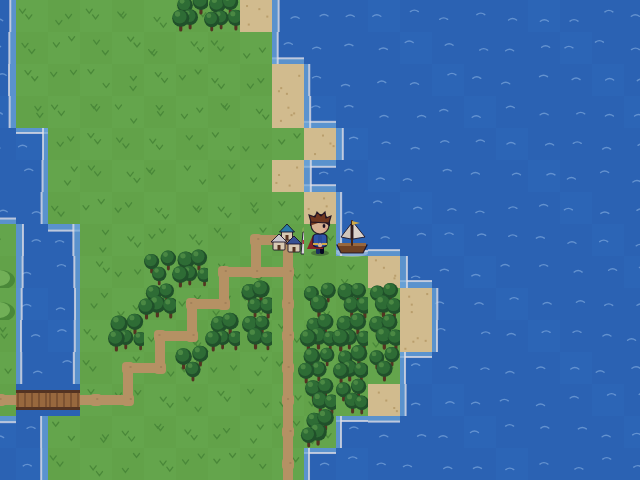
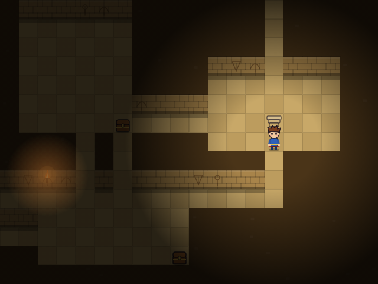
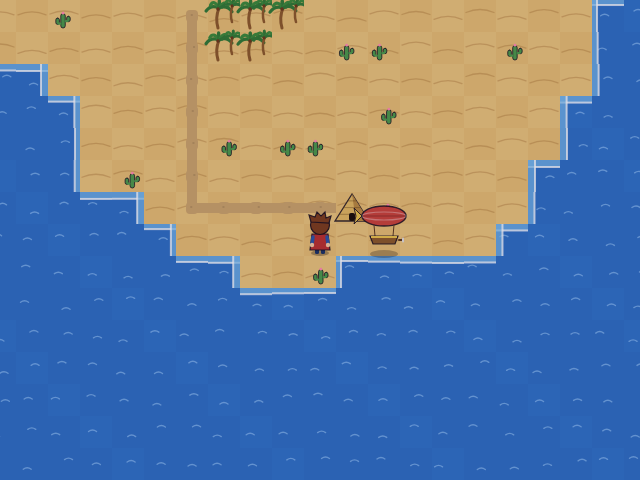
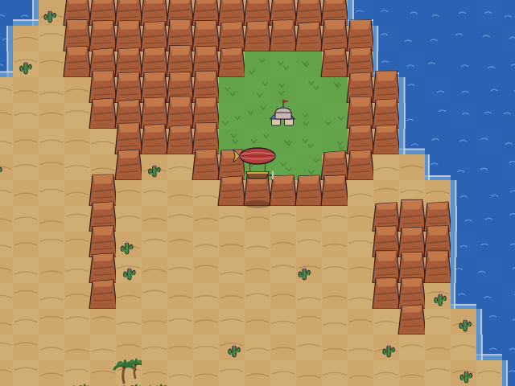
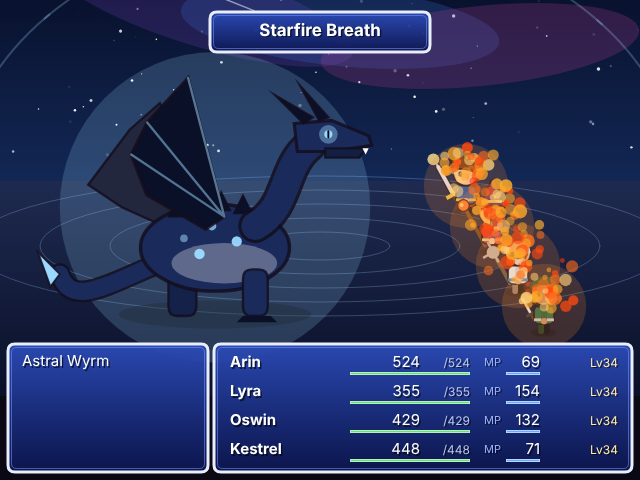
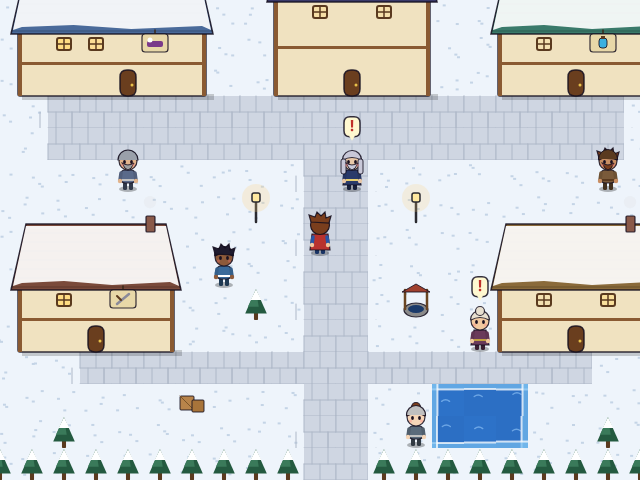
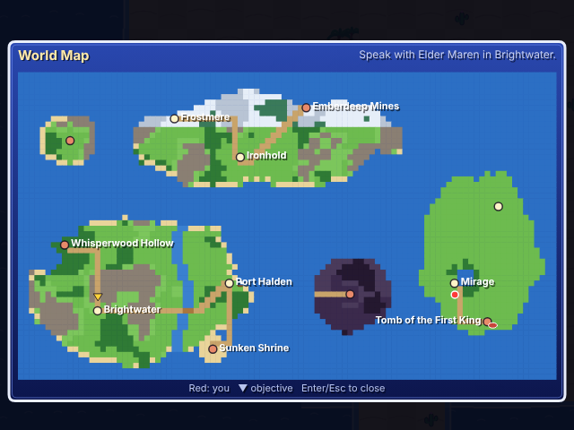
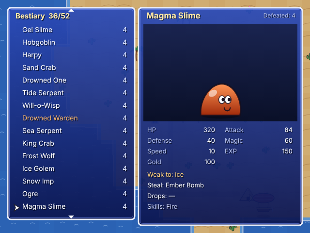

# Lanternfall — A Tale of the Four Flames

A classic 16-bit-style JRPG where **every pixel and every note is generated in code**. There are no image files, sprites or audio samples. Characters, monsters, tiles, buildings, interiors, spell effects and the chiptune soundtrack are all drawn and played at runtime with Canvas 2D paths and the Web Audio API.

## Play

Open `index.html` in any modern browser. It's one self-contained file with no dependencies and no build step needed to play.

To host it, enable **GitHub Pages** for this repo (Settings → Pages → deploy from branch `main`, root folder) and the game is served at `https://cptnope.github.io/Laternfall/`.

| Action | Keyboard | Touch |
| --- | --- | --- |
| Move | Arrow keys / WASD | D-pad |
| Confirm / talk / search / open | Enter, Space, Z, E | A |
| Menu / back | Esc, X, Backspace, Q | B |
| Walk faster | Hold Shift | — |
| Land the airship | Enter while flying | A |
| Sound on/off | M | (in menu) |

Your progress saves to the browser's local storage. Save from the menu anywhere, or when you rest at an inn.

## The story

> Long ago, the Hollow Night swallowed the world. Four Lanterns were lit to chain it beneath the earth — Ember, Tide, Stone, and Dawn. For a thousand years, their flames held. …Until tonight.

You play Arin, the young lamplighter of Brightwater. When the Ember Lantern goes dark, he and his oldest friend Lyra set out to rekindle it. A hooded woman is snuffing the Lanterns one by one, and her voice is one Lyra hasn't heard in seven years.

Beyond the main quest, the desert holds the tomb of the king who lit the first Lantern, and the truth about who the Hollow King really is.

**The party (5 playable characters; 4 fight at a time)**

- **Arin**, Lamplighter: sword, healing, holy strikes, party attack boost
- **Lyra**, Flamecaller: fire / ice / lightning, Sleep, up to Flare and Starfall
- **Oswin**, Tide Priest: healing, revive, Barrier, Renew, Holy
- **Kestrel**, Rogue: Steal, Twin Strike, Smoke Bomb, Shadowstep
- **Selene**, Duskmage: Shade, Drain, Gravity, Nightfall, Requiem. Joins after her story chapter.

## Features

**World**
- A large overworld: three continents, the Sunscar Desert, a corrupted isle, a star-island, and a mesa-walled valley you can only reach by air
- Travel on foot, by **ship**, and by **airship**
- **6 towns** (Brightwater, Port Halden, Ironhold, Frostmere, desert Mirage and sky-valley Aerie), with more than 50 NPCs whose dialogue changes as the story moves on
- **Walk inside every building**: inns, shops and smithies with keepers behind counters, homes, a chapel, a jail, a palace, an observatory hut. You can search barrels, pots and crates for hidden items.
- **6 dungeons, 16 floors**: Whisperwood Hollow, Sunken Shrine, Emberdeep Mines, Hollow Spire, the Tomb of the First King and the Starfall Observatory. They have torchlight, treasure, and a Lantern at the heart of each.

**Battle**
- Classic turn-based side-view combat: Attack / Skill / **Combo** / Item / Defend / Run
- **9 combo techs**: dual and triple attacks such as Flame Edge, Crossfang, Twin Stars and Lantern Light. They use every member's turn and MP.
- Elemental weaknesses, crits, stealing, buffs, poison / sleep / silence / regen, and auto-revive
- **52 monsters** in 20 drawn families, including **8 boss battles**: a two-phase final battle, a sea monster, the First King, and an optional superboss dragon

**Progression**
- Levels, learned spells, and weapon / armor / accessory slots, with 20 accessories
- **Formation** menu: four fight, and the reserve earns half EXP
- **The Aerie Arena**: five cups of back-to-back battles with unique prizes, up to the Grand Champion gauntlet
- **8 side quests** in a quest log, with the main objective always shown
- A **bestiary** with stats, weaknesses, steals and skills, and a **world map** with your next objective marked
- **New Game+**: finish the story to replay with your levels and gear against stronger enemies

**Sound**
- An original chiptune soundtrack (title, overworld, sea, desert, sky, town, dungeon, battle, boss, final battle, victory, ending), sequenced live in Web Audio

### Side quests

| Quest | Where it starts | Reward |
| --- | --- | --- |
| The Lost Cat | Pip, Brightwater | Pip's Candle |
| Nell's Locket | Nell, Port Halden | Tide Pendant |
| The Stonebrand | Orrin, Ironhold | Dwarven Band |
| Bounty: Leviathan | Brann, Port Halden (after you get the ship) | 4000 gold, Sailor's Compass |
| Stars Over Frostmere | Wren, Frostmere | Opens the Starfall Observatory and its superboss |
| Monster Scholar | Sable, Frostmere | Silk Ribbon |
| The First King | Sultana Imara, Mirage | The airship *Aurora* |
| Arena Legend | Arena Master, Aerie | Lantern Crown |

### Arena cups

| Cup | Suggested level | Prize |
| --- | --- | --- |
| Bronze | 24+ | Gale Sandals |
| Silver | 28+ | Champion Belt |
| Gold | 32+ | Sage Circlet |
| Platinum | 36+ | Phoenix Charm |
| Grand Champion | 42+ | Lantern Crown |

## Screenshots

| | |
| --- | --- |
|  |  |
|  |  |
|  |  |
|  |  |
|  |  |
|  |  |
|  |  |
|  |  |
|  |  |
|  | |

## Code layout

`index.html` is generated. Edit the files in `src/`, then run `python3 build.py` to inline them into it.

| File | What it does |
| --- | --- |
| `src/core.js` | Canvas scaling (sharp at any resolution), input and touch, UI windows / dialogue / menus, the async script runner, and the chiptune sequencer and sound effects |
| `src/data.js` | Heroes, spells, combo techs, items, equipment, accessories, monsters, encounter tables, shops, arena cups, XP curve |
| `src/art.js` | All vector art: world, town and dungeon tiles, buildings, characters, monsters, airship, battle backgrounds, title screen |
| `src/maps.js` | Seeded overworld generator (noise continents, river, desert, sky valley, roads, gated regions), town layouts, procedural dungeon floors with connectivity checks |
| `src/party.js` | Party stats, leveling, accessories, inventory, save/load |
| `src/field.js` | Exploration: movement, ship and airship, camera, NPCs, chests, stairs, random encounters, dungeon lighting |
| `src/interior.js` | Building interiors: layouts, furniture, counters, searchable containers |
| `src/battle.js` | Turn-based combat, targeting, combos, statuses, damage formulas, spell effects, rewards, New Game+ scaling |
| `src/menu.js` | Field menu (items, magic, equip, status, formation, quests, bestiary, world map, save), shops, inns |
| `src/story.js` | NPC dialogue, cutscenes, story flags, side quests, arena, boss events, title screen, ending, main loop |

Story events are written as plain `async` functions (`await say(...)`, `await startBattle(...)`), so adding a scene or quest is mostly writing dialogue.

**Debug:** add `?noenc` to the URL to turn off random encounters.

## License

MIT. See [LICENSE](LICENSE).
