# Lanternfall — A Tale of the Four Flames

A classic 16-bit-style JRPG where **every pixel and every note is generated in code**. There are no image files, sprites or audio samples. Characters, monsters, tiles, buildings, interiors, spell effects and the chiptune soundtrack are all drawn and played at runtime with Canvas 2D paths and the Web Audio API.

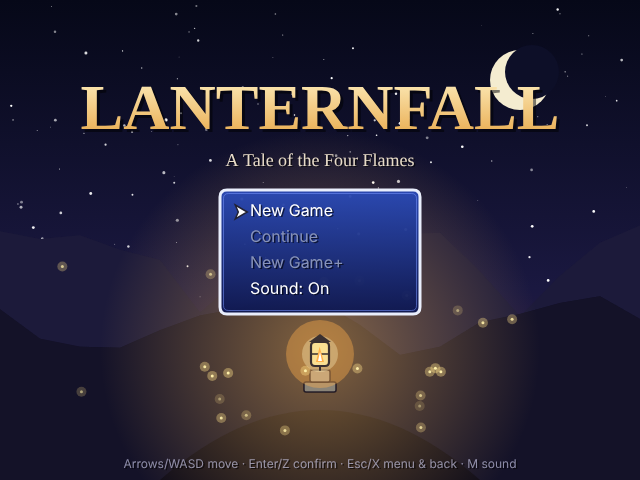

| | |
| --- | --- |
| 🎮 **[Play now](https://cptnope.itch.io/lanternfall)** | Free in your browser, on desktop or mobile |
| 📖 **[Game guide](docs/GAME_GUIDE.md)** | Walkthrough, every monster, item, quest, fish and recipe |
| 🗺️ **[Roadmap](ROADMAP.md)** | What's planned next |
| 📝 **[Changelog](CHANGELOG.md)** | What changed in each version |
| 🛠️ **[Docs for developers](#documentation)** | Architecture, modding, testing |

## Contents

- [Play](#play)
- [The story](#the-story)
- [By the numbers](#by-the-numbers)
- [The party](#the-party)
- [Features](#features)
- [The world](#the-world)
- [Side quests and the Arena](#side-quests-and-the-arena)
- [Screenshots](#screenshots)
- [How it's made](#how-its-made)
- [Documentation](#documentation)
- [What's next](#whats-next)
- [Contributing](#contributing)
- [Credits and license](#credits-and-license)

---

## Play

**[Play free on itch.io](https://cptnope.itch.io/lanternfall)** in your browser, on desktop or mobile. More about the game, plus help and support, is on the [Lanternfall project page](https://jeremyanderson.tech/project/lanternfall-browser-jrpg/). If you enjoy it, you can [support it with a donation on itch.io](https://cptnope.itch.io/lanternfall/purchase).

**Run it locally:** open `index.html` in any modern browser. It's one self-contained file with no dependencies, and no build step is needed to play.

**Host it yourself:** enable **GitHub Pages** for this repo (Settings → Pages → deploy from branch `main`, root folder), and the game is served at `https://cptnope.github.io/Laternfall/`.

### Controls

| Action | Keyboard | Touch | Gamepad |
| --- | --- | --- | --- |
| Move | Arrow keys / WASD | D-pad | D-pad / left stick |
| Confirm, talk, search, open | Enter, Space, Z, E | A | A |
| Menu, back | Esc, X, Backspace, Q | B | B, Y or Start |
| Walk faster | Hold Shift (or turn on auto-dash) | Hold R | Hold X |
| Repeat last battle turn | Shift | R | X |
| Land the airship | Enter while flying | A | A |
| Fish (with a rod) | Enter while facing water | A | A |
| Sound on/off | M | Menu → Config | Select |

**Config** (Menu → Config) has sound, **auto-dash**, **text speed** (Normal, Fast, Instant), **battle speed** (1×, 2×, 4×), **auto-save**, and (after the ending) **encounters on/off**. Settings are remembered between sessions.

**Saving:** three save slots plus an auto-save that writes whenever you enter a town or dungeon. Save from the menu anywhere, or with one press when you rest at an inn. On the title screen, *Continue* picks up your newest save and *Load Game* opens any slot. Saves from older versions move into slot 1 automatically.

---

## The story

> Long ago, the Hollow Night swallowed the world. Four Lanterns were lit to chain it beneath the earth — Ember, Tide, Stone, and Dawn. For a thousand years, their flames held. …Until tonight.

You play Arin, the young lamplighter of Brightwater. When the Ember Lantern goes dark, he and his oldest friend Lyra set out to rekindle it. A hooded woman is snuffing the Lanterns one by one, and her voice is one Lyra hasn't heard in seven years.

Beyond the main quest, the desert holds the tomb of the king who lit the first Lantern, and the truth about who the Hollow King really is.

**Chapter VI: The Crownless King** (post-game). After the credits, step back out into the world. An ash-covered island rises from the far northeast sea. On it is Lastlight, a village that waited a thousand years under the waves for the Hollow King's crown to fall. Descend the four floors of the Crownfall Abyss, piece together two brothers' memories, and face the crown that is looking for a new head. Recommended level: 42+.

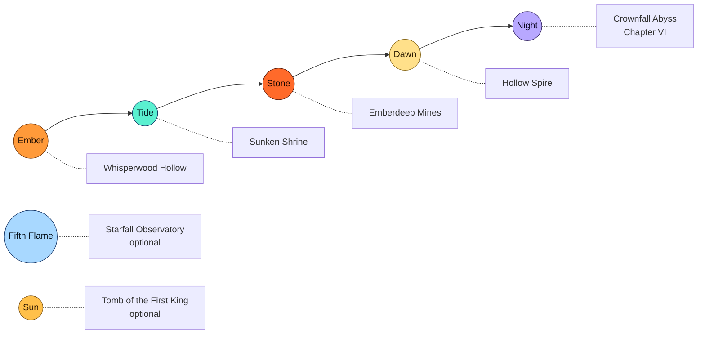

*The Lanterns, in the order you relight them. The [walkthrough](docs/GAME_GUIDE.md#walkthrough) has the full route.*

---

## By the numbers

| | Count | | Count |
| --- | --- | --- | --- |
| Playable heroes | **5** (4 fight at once) | Monsters | **63** in 21 drawn families |
| Towns | **7** | Boss battles | **10** |
| Dungeons | **7** (20 floors) | Skills and spells | **36**, plus **31** enemy abilities |
| Side quests | **10** | Combo techs | **12** |
| Arena cups | **6** | Weapons, armour, accessories | **38**, **17**, **27** |
| Fish | **13** | Forge recipes | **9** |
| Music tracks | **18** | Image or audio files | **0** |
| Level cap | **50** | Source lines | ~6,400 across 11 files |

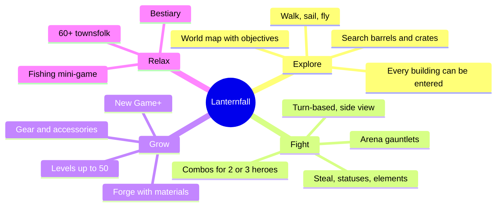

---

## The party

Four heroes fight at a time. The fifth waits in reserve and still earns half EXP.

| Hero | Class | Plays like | Signature skills | Final skill |
| --- | --- | --- | --- | --- |
| **Arin** | Lamplighter | Sturdy fighter with holy strikes and support | Cure, Sunstrike, Rally, Lionheart | Dawnbreak (Lv 42) |
| **Lyra** | Flamecaller | Elemental nuker | Fire, Ice, Bolt, Sleep, Flare, Starfall | Supernova (Lv 44) |
| **Oswin** | Tide Priest | Healer and protector | Cura, Raise, Barrier, Renew, Holy, Curaga | Sanctuary (Lv 42) |
| **Kestrel** | Rogue | Fastest hero; stealing and multi-hits | Steal, Twin Strike, Smoke Bomb, Shadowstep, Mug | Thousand Cuts (Lv 42) |
| **Selene** | Duskmage | Dark magic; joins after her story chapter | Shade, Drain, Gravity, Nightfall, Requiem | Eventide (Lv 44) |

Every skill and the level it's learned at is in the [game guide](docs/GAME_GUIDE.md#the-party).

---

## Features

**World**
- A large overworld: three continents, the Sunscar Desert, a corrupted isle, a star-island, a mesa-walled valley you can only reach by air, and (after the ending) the Ashen Isle
- Travel on foot, by **ship** and by **airship**
- **7 towns** (Brightwater, Port Halden, Ironhold, Frostmere, desert Mirage, sky-valley Aerie and ash-bound Lastlight), with more than 60 NPCs whose dialogue changes as the story moves on
- **Walk inside every building**: inns, shops and smithies with keepers behind counters, homes, chapels, a jail, a palace, an observatory hut. Search barrels, pots and crates for hidden items.
- **7 dungeons, 20 floors**: Whisperwood Hollow, Sunken Shrine, Emberdeep Mines, Hollow Spire, the Tomb of the First King, the Starfall Observatory and the Crownfall Abyss. They have torchlight, treasure, and a Lantern at the heart of each.

**Battle**
- Classic turn-based, side-view combat: Attack, Skill, **Combo**, Item, Defend, Run
- **12 combo techs**: dual and triple attacks such as Flame Edge, Crossfang, Twin Stars, Shadow Waltz, Lantern Light and Last Light (taught in Lastlight). They use every member's turn and MP.
- Elemental weaknesses, critical hits, stealing, buffs, poison, sleep, silence, regen and auto-revive. The [formulas](docs/GAME_GUIDE.md#formulas) are all documented.
- **63 monsters** in 21 drawn families, including **10 boss battles**: two two-phase finales, a sea monster, the First King and an optional superboss dragon

**Progression**
- Levels up to **50**, learned skills, and weapon, armour and accessory slots, with **27 accessories**
- **Formation** menu: four fight, and the reserve earns half EXP
- **Orrin's Forge**: monsters drop materials (Ember Cores, Frost Crystals, Sun Gold, Star Shards, Dusk Silk, Abyss Ash). Orrin in Ironhold forges them into 9 pieces of gear, including each hero's best weapon. The bestiary shows who drops what.
- **Fishing**: get a rod from the Ice Fisher in Frostmere, then fish any pond, river, harbour or sea. 13 kinds of fish, each with its own spots, and a timing mini-game that gets harder for rarer fish. One legend only rises once every Lantern burns.
- **The Aerie Arena**: six cups of back-to-back battles with unique prizes, up to the Grand Champion gauntlet and the post-game Eclipse Cup
- **10 side quests** in a quest log, with the main objective always shown
- A **bestiary** with stats, weaknesses, steals and drops, and a **world map** with your next objective marked
- **New Game+**: finish the story to replay with your levels and gear against stronger enemies

**Comfort**
- Three save slots and auto-save, with versioned saves that upgrade themselves
- Battle speed up to 4×, *repeat last turn* with one button, and a dialogue **Log**
- **Gamepad** support, a touch **R** button, auto-dash, and adjustable text speed
- **Equip → Optimise** puts on the best gear you own in one step

**Sound**
- An original chiptune soundtrack of 18 tracks (title, overworld, sea, sky, desert, towns, dungeons, the Spire, the Ashen Isle, the Abyss, battle, boss, two final battles, victory, ending, game over), sequenced live in Web Audio

---

## The world

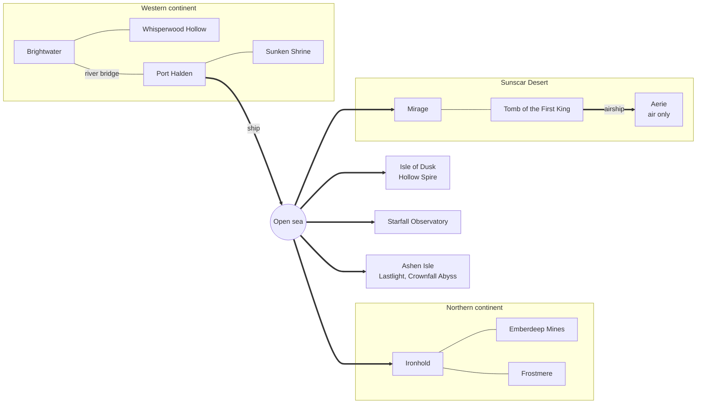

---

## Side quests and the Arena

| Quest | Where it starts | Reward |
| --- | --- | --- |
| The Lost Cat | Pip, Brightwater | Pip's Candle |
| Nell's Locket | Nell, Port Halden | Tide Pendant |
| The Stonebrand | Orrin, Ironhold | Dwarven Band |
| Bounty: Leviathan | Brann, Port Halden (after you get the ship) | 4000 gold, Sailor's Compass |
| Stars Over Frostmere | Wren, Frostmere | Opens the Starfall Observatory and its superboss |
| Monster Scholar | Sable, Frostmere | Silk Ribbon |
| The First King | Sultana Imara, Mirage | The airship *Aurora* |
| Arena Legend | Arena Master, Aerie | Lantern Crown |
| The Ones That Got Away | Ice Fisher, Frostmere | Angler's Ring (6 kinds), Moonfin Charm (all 13) |
| Orrin's Forge | Orrin, Ironhold (after The Stonebrand) | Orrin's Seal (forge 3 items) |

| Arena cup | Suggested level | Prize |
| --- | --- | --- |
| Bronze | 24+ | Gale Sandals |
| Silver | 28+ | Champion Belt |
| Gold | 32+ | Sage Circlet |
| Platinum | 36+ | Phoenix Charm |
| Grand Champion | 42+ | Lantern Crown |
| Eclipse Cup (after Chapter VI) | 46+ | Eclipse Mantle |

Every opponent, reward and requirement is in the [game guide](docs/GAME_GUIDE.md#side-quests).

---

## Screenshots

| | |
| --- | --- |
|  |  |
| 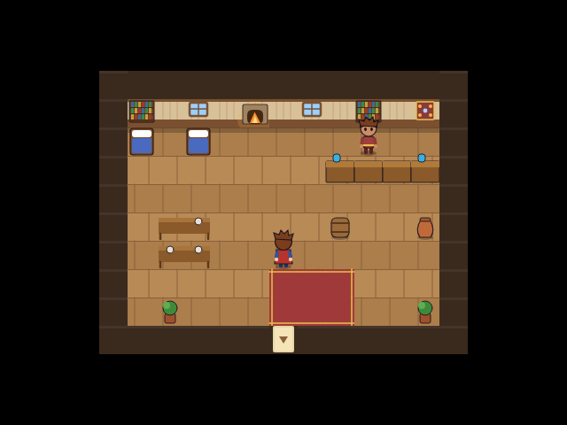 | 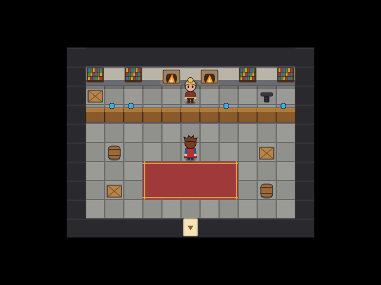 |
| 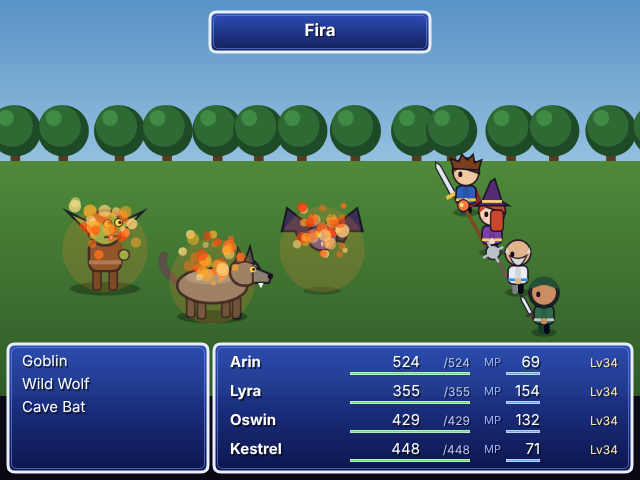 | 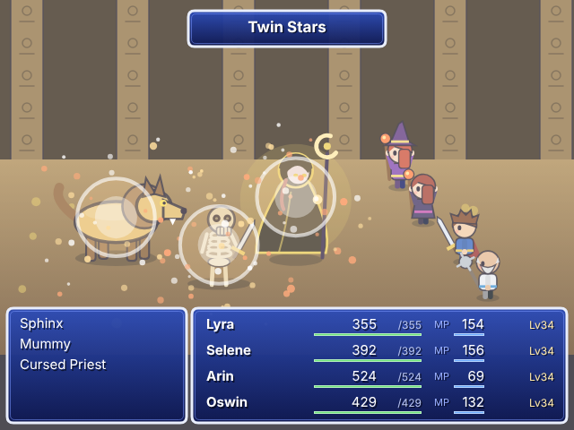 |
| 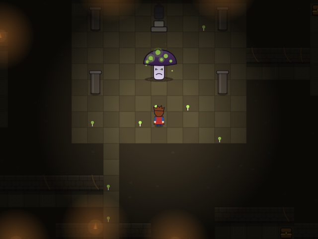 |  |
|  | 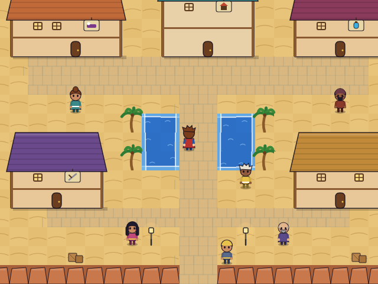 |
|  | 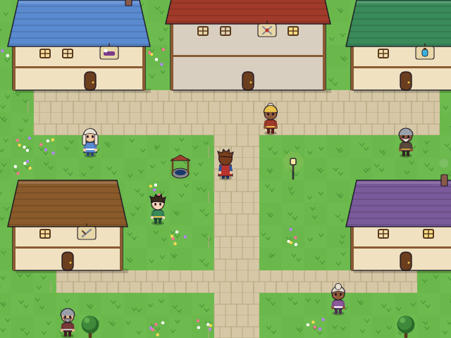 |
| 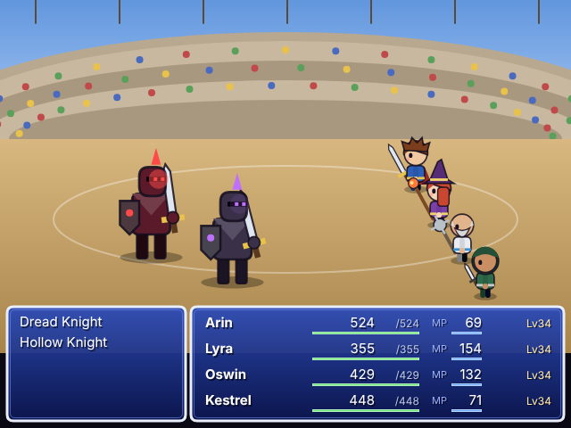 |  |
|  | 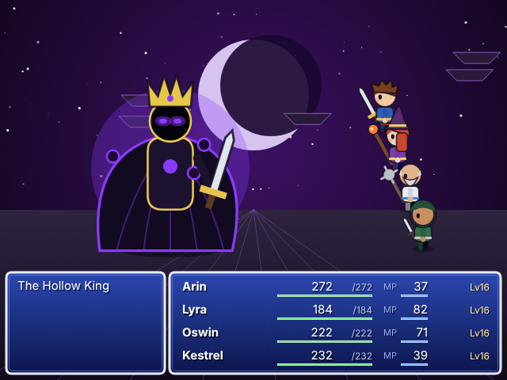 |
|  | 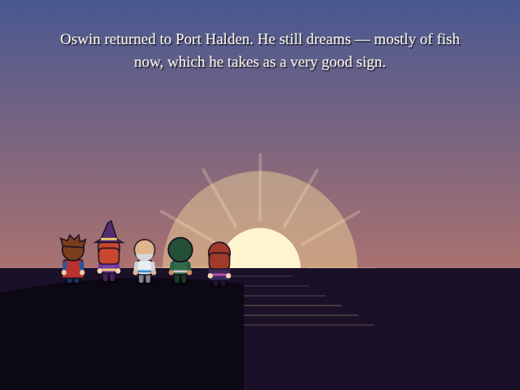 |
| 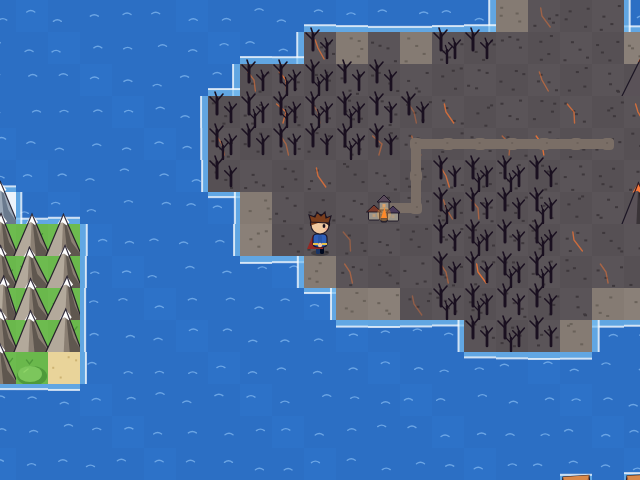 | 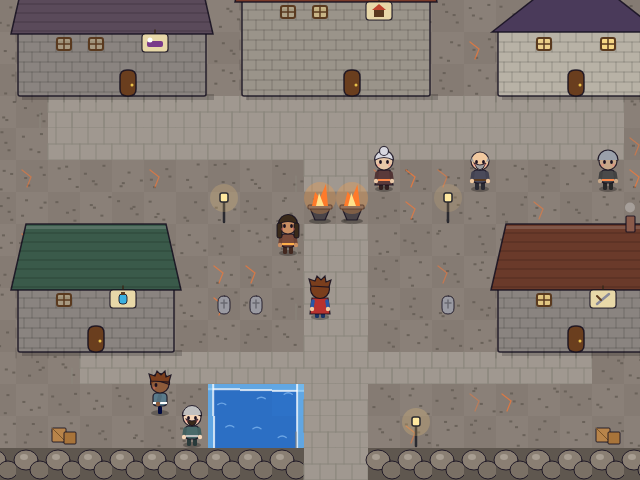 |
| 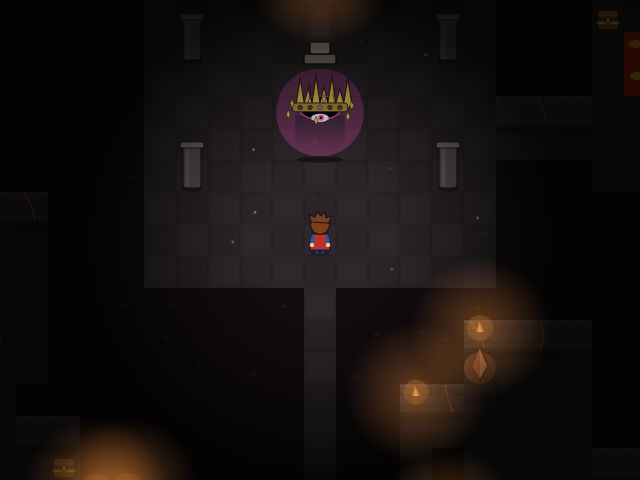 | 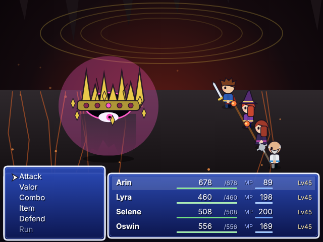 |
| 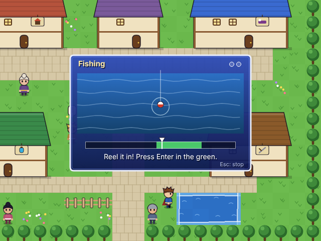 | |

---

## How it's made

Lanternfall is plain JavaScript split across eleven source files. `build.py` joins them into one `index.html`.

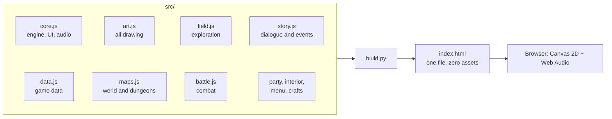

- **Art:** every tile, character and monster is a function that draws Canvas paths. Monsters share 21 "families" and get their look from colour palettes, so one drawing serves many monsters.
- **World:** the overworld comes from seeded noise and the dungeons from a seeded room-and-corridor generator, so layouts are the same for everyone and never need saving.
- **Music:** tracks are written in a tiny text notation (`'E5:4 G5:4 C6:8'`) and played by a scheduler on Web Audio oscillators.
- **Story:** events are plain `async` functions (`await say(...)`, `await startBattle(...)`), so adding a scene is mostly writing dialogue.

### Code layout

`index.html` is generated. Edit the files in `src/`, then run `python3 build.py`.

| File | What it does |
| --- | --- |
| `src/core.js` | Canvas scaling (sharp at any resolution), input and touch, UI windows, dialogue and menus, the async script runner, settings, and the chiptune sequencer and sound effects |
| `src/data.js` | Heroes, skills, combo techs, items, equipment, monsters, encounter tables, shops, arena cups, forge recipes, fish, the EXP curve |
| `src/art.js` | All vector art: world, town and dungeon tiles, buildings, characters, monsters, vehicles, battle backgrounds, the title screen |
| `src/maps.js` | The seeded overworld generator (continents, river, desert, sky valley, roads, the hidden Ashen Isle), town layouts, dungeon floors with reachability checks |
| `src/party.js` | Party stats, levelling, inventory, save and load |
| `src/field.js` | Exploration: movement, ship and airship, camera, NPCs, chests, stairs, random encounters, dungeon lighting, fishing spots |
| `src/interior.js` | Building interiors: layouts, furniture, counters, searchable containers |
| `src/battle.js` | Turn-based combat, targeting, combos, statuses, damage formulas, effects, rewards, New Game+ scaling |
| `src/menu.js` | Field menu (items, magic, equip, status, formation, quests, bestiary, world map, save, config), shops, inns |
| `src/crafts.js` | The fishing mini-game and Orrin's forge |
| `src/story.js` | NPC dialogue, cutscenes, story flags, quests, the arena, boss events, the title screen, the endings, the main loop |
| `tools/` | The play-test harness, the boss balance simulator, the guide-table generator and the diagram checker |

**Debug:** add `?noenc` to the URL to turn off random encounters. There are more tricks in [TESTING.md](docs/TESTING.md#debugging-tricks).

---

## Documentation

| Document | For | What's inside |
| --- | --- | --- |
| [Game guide](docs/GAME_GUIDE.md) | Players | Walkthrough, world, towns and shops, dungeons, every skill, combo, monster, boss, item, fish and recipe, battle formulas |
| [Architecture](docs/ARCHITECTURE.md) | Developers | Build pipeline, modules, main loop, scenes, the script runner, maps and generation, rendering, battles, audio, save format, story flags |
| [Modding guide](docs/MODDING.md) | Contributors | Step-by-step recipes for monsters, art, items, skills, combos, NPCs, quests, towns, dungeons, bosses, music, fish, recipes and cups |
| [Testing guide](docs/TESTING.md) | Contributors | The headless play-test harness and its scenarios, the boss balance simulator, CI, debugging tricks |
| [Roadmap](ROADMAP.md) | Everyone | Milestones 1.3.x to 2.0, the backlog, technical debt, the release process |
| [Changelog](CHANGELOG.md) | Everyone | Every version since 1.0.0 |
| [itch.io page copy](docs/itch/itch-page.md) | Store | Store text and assets |

---

## What's next

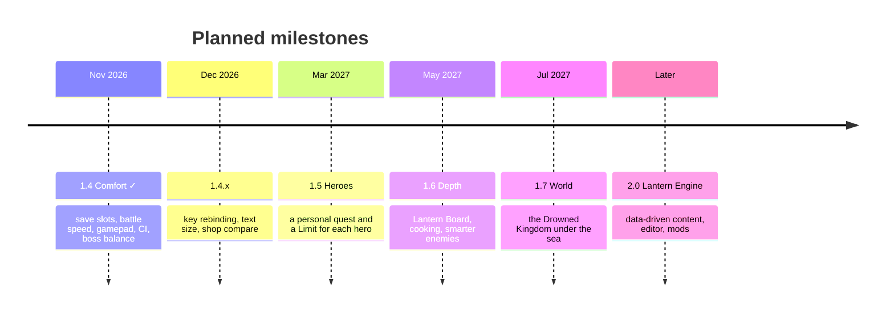

The full plan, with priorities and technical debt, is in [ROADMAP.md](ROADMAP.md).

---

## Contributing

1. Read the [modding guide](docs/MODDING.md) to find where your change goes.
2. Edit `src/`, then run `python3 build.py`.
3. Run `python3 tools/playtest.py`; it should end with `ERRORS: 0`. CI runs it on your pull request as well. If you touched a boss, run `python3 tools/balance_sim.py`.
4. Add a line to [CHANGELOG.md](CHANGELOG.md) under `[Unreleased]`, and open a pull request.

Ideas and bug reports are welcome as issues. [How to propose something](ROADMAP.md#how-to-propose-something) explains what helps.

---

## Credits and license

Made by **Jeremy Anderson** · [jeremyanderson.tech](https://jeremyanderson.tech) · [itch.io](https://cptnope.itch.io/lanternfall)

MIT. See [LICENSE](LICENSE).
