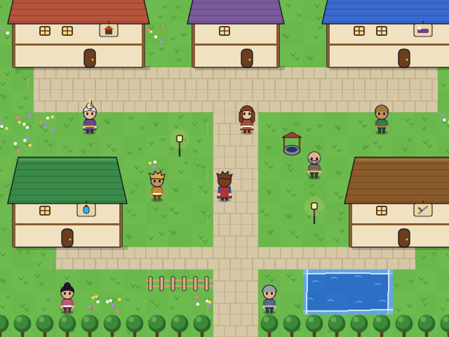

# Lanternfall — A Tale of the Four Flames

A classic, 16-bit-style JRPG where **every pixel is vector graphics drawn in code**. There are no image files, sprites or audio samples. Characters, monsters, tiles, buildings, spell effects and the chiptune soundtrack are all generated at runtime with Canvas 2D paths and the Web Audio API.

## Play

Open `index.html` in any modern browser. It's one self-contained file with no dependencies and no build step needed to play.

To host it, enable **GitHub Pages** for this repo (Settings → Pages → deploy from branch, root folder) and the game is served at `https://cptnope.github.io/Laternfall/`.

| Action | Keyboard | Touch |
| --- | --- | --- |
| Move | Arrow keys / WASD | D-pad |
| Confirm / talk / open | Enter, Space, Z, E | A |
| Menu / back | Esc, X, Backspace, Q | B |
| Walk faster | Hold Shift | — |
| Sound on/off | M | (in menu) |

Your progress saves to the browser's local storage. Save from the menu anywhere, or when you rest at an inn.

## The story

> Long ago, the Hollow Night swallowed the world. Four Lanterns were lit to chain it beneath the earth — Ember, Tide, Stone, and Dawn. For a thousand years, their flames held. …Until tonight.

You play Arin, the young lamplighter of Brightwater. When the Ember Lantern goes dark, he and his oldest friend Lyra set out to rekindle it. A hooded woman is snuffing the Lanterns one by one, and her voice is one Lyra hasn't heard in seven years.

**The party**

- **Arin**, Lamplighter: sword, healing, holy strikes, party attack boost
- **Lyra**, Flamecaller: fire / ice / lightning magic, up to Flare and Starfall
- **Oswin**, Tide Priest: healing, revive, Barrier, Holy. Dreams of things before they happen
- **Kestrel**, Rogue: Steal, Twin Strike, Smoke Bomb, Shadowstep

## Features

- **Overworld** with forests, mountains, snowfields, rivers, a corrupted island, and a **ship** you can sail once you earn it
- **3 towns** (Brightwater, Port Halden, Ironhold) with inns, item shops, armorers, a chapel and around 20 NPCs whose dialogue changes as the story progresses
- **4 dungeons, 10 floors** (Whisperwood Hollow, Sunken Shrine, Emberdeep Mines, Hollow Spire) with torchlight, treasure chests, and a Lantern to relight at each one's heart
- **Classic turn-based battles** in side view: Attack / Skill / Item / Defend / Run, elemental weaknesses, critical hits, poison, buffs, stealing, and floating damage numbers
- **About 35 monsters** in 15 drawn families, plus 5 boss fights including a two-phase final battle
- Levels and XP, learned spells, weapon and armor slots per character, stat-compare when shopping
- An **original chiptune soundtrack** (title, overworld, sea, town, dungeon, battle, boss, final battle, victory, ending), sequenced live in Web Audio
- A full ending with an epilogue for each character

| | |
| --- | --- |
|  |  |
|  |  |
|  |  |

## Code layout

`index.html` is generated. Edit the files in `src/`, then run `python3 build.py` to inline them into it.

| File | What it does |
| --- | --- |
| `src/core.js` | Canvas scaling (sharp at any resolution), input and touch, UI windows / dialogue / menus, the async script runner, and the chiptune sequencer and sound effects |
| `src/data.js` | Heroes, spells, items, equipment, monsters, encounter tables, shops, XP curve |
| `src/art.js` | All vector art: world, town and dungeon tiles, buildings, characters, monsters, battle backgrounds, title screen |
| `src/maps.js` | Seeded overworld generator (noise continents, river, roads, gated regions), town layouts, procedural dungeon floors with connectivity checks |
| `src/party.js` | Party stats, leveling, inventory, save/load |
| `src/field.js` | Exploration: movement, ship, camera, NPCs, chests, stairs, random encounters, dungeon lighting |
| `src/battle.js` | Turn-based combat, targeting, damage formulas, spell effects, rewards |
| `src/menu.js` | Field menu (items, magic, equip, status, save), shops, inns |
| `src/story.js` | NPC dialogue, cutscenes, story flags, boss events, title screen, ending, main loop |

Story events are written as plain `async` functions (`await say(...)`, `await startBattle(...)`), so adding a scene or quest is mostly writing dialogue.

**Debug:** add `?noenc` to the URL to turn off random encounters.

## License

MIT. See [LICENSE](LICENSE).
