# Lanternfall Roadmap

Where Lanternfall could go next. This is a **plan, not a promise**: milestones are ordered by priority, the dates are targets, and anything can move. Finished work moves to [CHANGELOG.md](CHANGELOG.md).

- **Current release:** 2.2.0 *Home and companions*. Every version from 1.0.0 to 2.2.0 is tagged and has a [GitHub Release](https://github.com/CptNope/Laternfall/releases). See [CHANGELOG.md](CHANGELOG.md).
- **Next up:** EN-7 (the *Lanternfall II* design document), the last 2.0 item; and a first real translation, if there's a translator. ST-2 (a real phone test) still needs a person with a phone, and matters more now that TD-4 is meant for phones.
- ✅ marks items that are done.

## Contents

1. [Guiding principles](#guiding-principles)
2. [Where the game is today](#where-the-game-is-today)
3. [Milestones at a glance](#milestones-at-a-glance)
4. [Milestone details](#milestone-details)
5. [Prioritised backlog](#prioritised-backlog)
6. [Technical debt](#technical-debt)
7. [Ideas parking lot](#ideas-parking-lot)
8. [Release process](#release-process)
9. [How to propose something](#how-to-propose-something)

---

## Guiding principles

These rules decide what makes the cut.

| # | Principle | In practice |
| --- | --- | --- |
| 1 | **Everything is made in code** | No image or audio files ship with the game. New art is Canvas paths; new music is a `TRACKS` entry. |
| 2 | **One file, no install** | `index.html` must keep running when opened straight from disk. A build step is fine; runtime dependencies are not. |
| 3 | **Story first** | Every system should serve a character or a place. Fishing has the Ice Fisher; forging has Orrin. |
| 4 | **Saves never break** | New content is gated by flags, and old saves load cleanly. A breaking change needs a migration and a major version. |
| 5 | **Plays on a phone** | Every feature works with the D-pad and A/B buttons. If it needs a third button, it needs a touch answer too. |
| 6 | **Respect the player's time** | Things that cost time but add nothing (slow text, backtracking, grinding walls) get an option or a fix. |

---

## Where the game is today

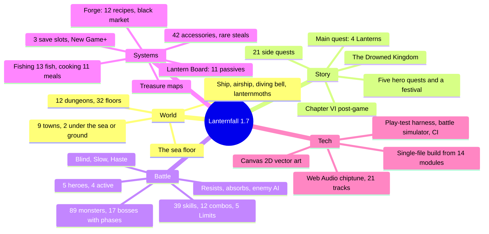

### Content by area

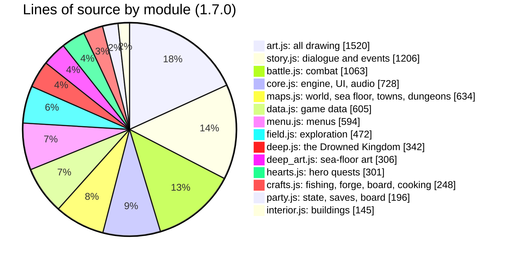

---

## Milestones at a glance

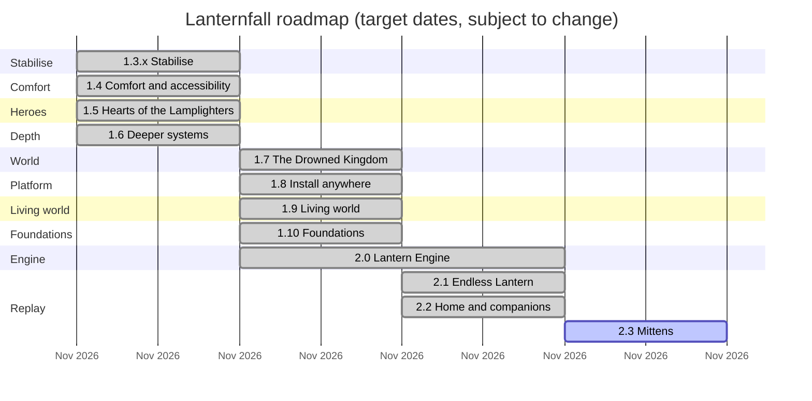

| Milestone | Theme | Headline | Target | Status |
| --- | --- | --- | --- | --- |
| **1.3.x** | Stabilise | Real-HP balance pass, mobile check, CI, tagged releases | Nov 2026 | ✅ Done in 1.4.0 (tags pushed for 1.6.0) except ST-2 |
| **1.4** | Comfort | Save slots, auto-save, battle speed, gamepad, accessibility | Nov 2026 | ✅ Done (1.4.0, finished in 1.5.0) |
| **1.5** | Heroes | A personal quest for each of the five heroes, with an ultimate weapon and a Limit | Dec 2026 | ✅ Done (1.5.0) |
| **1.6** | Depth | Lantern Board progression, cooking, smarter enemy AI, more statuses | Nov 2026 | ✅ Done (1.6.0: DS-1 to DS-7; 1.9.0: DS-4's last part and DS-8 to DS-11) |
| **1.7** | World | The Drowned Kingdom under the sea, the Ironhold Undercity, treasure maps | Jul 2027 | ✅ Done (1.7.0, merged in #13) |
| **1.8** | Platform | Offline PWA install, desktop builds, achievements | Feb 2027 (parallel) | ✅ Done (1.8.0, merged in #14; PL-5 not started) |
| **1.10** | Foundations | Per-family art files, a tile cache for phones, a load-order check | Nov 2026 | ✅ Done (1.10.0, merged in #16) |
| **2.0** | Engine | Data-driven content, a map editor, mod support, save migration | H2 2027 | ✅ Done (EN-1 to EN-6, merged in #17, #19, #20, #21; EN-7 open) |
| **2.1** | Replay | The Endless Lantern post-game dungeon and Hollow mode | Nov 2026 | ✅ Done (#22) |
| **2.2** | Home | Arin's house upgrades, the music box, Mittens following you, compass hints | Nov 2026 | ✅ Done (2.2.0, #23) |
| **2.3** | Mittens | The cat comes along everywhere, and into battle | Nov 2026 | 🟡 In review (#25, #27) |

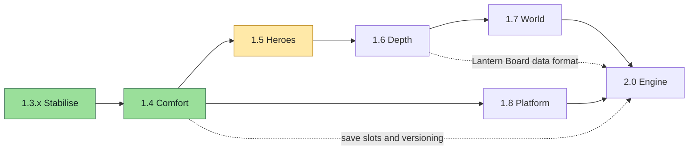

---

## Milestone details

### 1.3.x · Stabilise

Make 1.3.0 solid before building on it.

| ID | Item | Why | Size |
| --- | --- | --- | --- |
| ✅ ST-1 | **Balance pass at real HP**: play Chapter VI's finale at Lv 42, 45 and 50 without debug changes | The 1.3.0 tests shrank boss HP to finish quickly | M |
| ST-2 | **Touch-device pass**: fishing, forge and Config on a phone in landscape | The fishing timing window was only tested with a keyboard | S |
| ✅ ST-3 | **CI**: run `tools/playtest.py` on every pull request with GitHub Actions and attach screenshots | Catches broken saves and JS errors automatically | M |
| ✅ ST-4 | **Tag releases** `v1.0.0`–`v1.3.0` and publish GitHub Releases | The changelog and itch builds can then link to real tags | S |
| ✅ ST-5 | **itch.io update**: Chapter VI devlog, new screenshots, updated feature list | `docs/itch/itch-page.md` still describes 1.2 | S |
| ✅ ST-6 | **Lastlight barrels** may hand out Abyss Ash early; decide whether that's intended | Forge balance | XS |
| ✅ ST-7 | **Eclipse Cup EXP**: Orun gives 45,000 EXP on every rematch | Possible EXP farm; harmless at the level cap, but worth a decision | XS |
| ✅ ST-8 | **Map labels** for Lastlight and the Abyss before visiting | The world map hides names until visited, so the new isle reads as blank | XS |

**Done when:** a level-45 party can clear the finale in 12–20 rounds with no debug changes, the harness runs in CI, and `v1.3.1` is tagged.

**Result (1.5.0).** All five hero quests shipped, with Limits, campfire talks and the Festival of Lanterns. The new bosses were tuned with the simulator: the Lamp-Eater and the Abbot are the gentler two, the Hearth Warden and Vane the hardest (83–87% at Lv 44), and Selene's solo duel takes about 12 rounds.

**Result (1.4.0).** The simulator showed the finale was long (25–28 rounds) but harmless. Both bosses now act twice per round with less HP: Lv 42 wins 68–82% in about 22 rounds, Lv 45 wins every time in 19, and Lv 50 finishes in 13. ST-6 and ST-7 were kept as they are (see the changelog). **Still open:** ST-2 (try fishing and the new R button on a real phone). ST-4 is done: every version is tagged and has a GitHub Release.

> **Observation:** at the levels the simulator assumed, the Hollow King (Lv 32) and the Astral Wyrm (Lv 36) were never lost, with almost no healing items used. They were left alone because nobody has measured what level players actually reach them at. A good follow-up is to add play-time level checkpoints to the harness and re-run the simulator at those levels.

### 1.4 · Comfort and accessibility

```mermaid
flowchart TB
    subgraph Saving
      A1[3 save slots] --> A2[Auto-save on map change]
      A2 --> A3[Save versioning and migration]
    end
    subgraph Battle
      B1[Battle speed 1x 2x 4x] --> B2[Repeat last turn]
      B2 --> B3[Auto-battle toggle]
    end
    subgraph Input
      C1[Gamepad API support] --> C2[Key rebinding]
      C2 --> C3[Bigger touch buttons option]
    end
    subgraph Reading
      D1[Text size option] --> D2[High-contrast windows]
      D2 --> D3[Colour-blind-safe status icons]
      D3 --> D4[Dialogue backlog]
    end
```

| ID | Item | Notes | Size |
| --- | --- | --- | --- |
| ✅ QL-1 | **Three save slots** plus an auto-save slot | `SAVE_KEY` becomes `lanternfall_save_v2_<slot>`, and v1 saves migrate into slot 1 | M |
| ✅ QL-2 | **Auto-save** when entering a town or dungeon | A Config toggle, on by default | S |
| ✅ QL-3 | **Battle speed** (1×, 2×, 4×) | Scale the `wait()` timers inside battles | S |
| ✅ QL-4 | **Repeat last turn** (R / L button) | `lastCmd` already stores each hero's last menu choice | S |
| ✅ QL-5 | **Gamepad support** through the Gamepad API | Map to the existing `Input` actions | M |
| ✅ QL-6 | **Key rebinding** in Config | Edits `KEYMAP` and persists in `CFG` | S |
| ✅ QL-7 | **Text size and high-contrast windows** | `drawWindow` and `font()` are already central, so this is cheap | S |
| ✅ QL-8 | **Status icons** that don't rely on colour (PSN, SLP, SIL glyphs) | Already the case: statuses are shown as text tags | S |
| ✅ QL-9 | **Dialogue backlog**: press a key to reread the last 20 lines | Story-heavy game | S |
| ✅ QL-10 | **Optimise equipment** button in Equip | Picks the best stat total per slot | S |
| ✅ QL-11 | **Shop: compare** every party member at once for armour and accessories | Already the case: the shop's detail panel lists every member | S |
| ✅ QL-12 | **Encounter toggle** in Config, unlocked after the ending | Today it's only the `?noenc` debug flag | XS |

### 1.5 · Hearts of the Lamplighters

A personal chapter for each hero. Each one adds a short story, a small optional dungeon or set piece, an **ultimate weapon** (tier above the forge) and a **Limit**, a once-per-battle super move that charges as the hero takes damage.

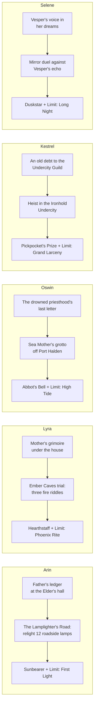

| ID | Item | Requirements | Size |
| --- | --- | --- | --- |
| ✅ HR-1 | **Limit gauge** in battle (fills on damage taken; one Limit per hero) | Battle UI space next to the MP bar | M |
| ✅ HR-2 | Arin: *The Lamplighter's Road*. Find and relight 12 roadside lamps across the world | New world entity type `lamp` | M |
| ✅ HR-3 | Lyra: *Mother's Grimoire*. A riddle mini-dungeon | Reuses `genDungeonFloor` with a fixed seed | M |
| ✅ HR-4 | Oswin: *The Sea Mother's Grotto*. A boss fight | New boss art | M |
| ✅ HR-5 | Kestrel: *Old Debts*. The Undercity under the Ironhold jail, and Guildmaster Vane | Shipped as a dungeon; **stealth with guard sight lines is still open** (moved to 1.6 as DS-11) | L |
| ✅ HR-6 | Selene: *Echo of Vesper*. A solo mirror battle | Solo battles need `BATTLE_PARTY` overrides | M |
| ✅ HR-7 | **Campfire conversations**: party banter when resting with a Tent | `say()` scenes keyed off story flags | S |
| ✅ HR-8 | **Epilogue additions** that change with completed personal quests | Shipped as the **Festival of Lanterns** scene (the quests are post-game, after the original epilogue) | S |

### 1.6 · Deeper systems

| ID | Item | Description | Outcome | Size |
| --- | --- | --- | --- | --- |
| ✅ DS-1 | **Lantern Board** | After level 30, a small node grid per hero spends "Embers" (earned with EXP) on stats and passive skills | Shipped: 12 nodes per hero, 11 passives, Embers past the cap too | L |
| ✅ DS-2 | **Cooking** | Combine fish with shop ingredients at inns into meals that buff the next 3 battles. Gives fish a use beyond selling | Shipped with fish only (11 meals); shop ingredients were left out to keep it simple | M |
| ✅ DS-3 | **Smarter enemy AI** | Targeting rules (focus the weakest hero, heal allies, counter-attack) and scripted boss phases | Shipped: weakest / casters / healer AI and phases for all 15 bosses. Counter-attacks went to the heroes (a Lantern Board passive) | M |
| ✅ DS-4 | **More statuses** | Blind (miss chance), Slow, Haste, Berserk, Stop. New accessories that prevent them | Shipped Blind, Slow and Haste in 1.6; **Berserk and Stop in 1.9**, with the Calm and Clockwork Charms | M |
| ✅ DS-5 | **Elemental resistances and absorbs** | Today monsters only have `weak`; add `resist` and `absorb` | Shipped: 23 monsters | S |
| ✅ DS-6 | **Steal tiers** | A rare steal slot per monster, more likely with Mug | Shipped: 13 monsters; the Thief's Gloves double the chance instead of Mug | S |
| ✅ DS-7 | **Monster codex rewards** | Sable gives a reward at 45 and at 63 creatures | Shipped at 45 and at all 75 | XS |
| ✅ DS-8 | **Day and night** | Visual tint, different night encounters, a few NPCs who only appear at night | Shipped in 1.9: a 24-minute day, five night monsters, night NPCs, inn and Tent pass time | M |
| ✅ DS-9 | **Weather** | Snow in Frostmere and sandstorms in the Sunscar, drawn in code; some affect battle | Shipped in 1.9: six kinds by region; they change elemental damage and physical misses | M |
| ✅ DS-10 | **"Lanterns & Lies"** | A small in-world card game against NPCs, for prizes | Shipped in 1.9: 36 cards, eight players, a once-a-game face-down Lie | L |
| ✅ DS-11 | **Stealth sections** | Guard sight lines on the field (from HR-5); a stealth replay of the Undercity | Shipped in 1.9 as a new heist in the Mirage vaults instead of a replay; the Undercity is unchanged | L |

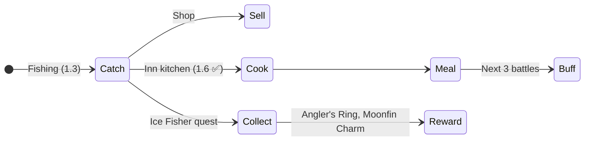

### 1.7 · The Drowned Kingdom

A new region and a sixth way to travel.

| ID | Item | Description | Outcome | Size |
| --- | --- | --- | --- | --- |
| ✅ WD-1 | **Diving bell** | The *Dawnrunner* can dive at dark-water spots, reaching an underwater layer of the world map | Shipped: four dive spots and a half-scale sea floor generated from the world map | L |
| ✅ WD-2 | **The Drowned Kingdom** | The Sea Mother's sunken city: a town and a 4-floor dungeon, tied to Oswin's order | Shipped: Nerith, the Drowned Palace and King Nereus, started from Oswin's quest | L |
| ✅ WD-3 | **Ironhold Undercity** | A town beneath Ironhold (Kestrel's home turf), with a black-market shop | Shipped as the Undermarket, through the jail trapdoor after Kestrel's quest | M |
| ✅ WD-4 | **Treasure maps** | Dropped by bandits; they point to dig spots marked on the world map | Shipped: five maps (bought, dropped and found in a wreck) | M |
| ✅ WD-5 | **Lanternmoths** | Ride-able giant moths in the Whisperwood: fast travel on foot, ignoring encounters | Shipped: they roost at Arin's roadside lamps rather than in the Whisperwood, so they're useful everywhere | M |
| ✅ WD-6 | **Secret superboss** | *The Tide That Remembers*, at the bottom of the Drowned Kingdom | Shipped in the Hadal Rift, which opens after the palace | M |

### 1.8 · Install anywhere

Can run alongside 1.5 to 1.7.

| ID | Item | Notes | Outcome | Size |
| --- | --- | --- | --- | --- |
| ✅ PL-1 | **PWA**: manifest and a service worker, so the game installs and runs offline | Generated in `build.py`. The single-file rule still holds for `index.html` | Shipped. Installs from GitHub Pages; the itch.io frame can't install. Plus **Transfer saves** to move saves between browsers, the app and the desktop build | S |
| ✅ PL-2 | **Desktop builds** (Tauri) for Windows, macOS and Linux | Ship on itch.io alongside the web version | Shipped as a CI workflow: every version tag attaches unsigned installers to its GitHub Release. Uploading them to itch.io is still manual. **Code signing is open** | M |
| ✅ PL-3 | **Achievements**, in-game first (a trophy room in Brightwater) and later on Steam | Hooks on existing flags | Shipped: 30 trophies, kept across saves; on the title screen and with Scribe Tam in Brightwater. Steam is still open | M |
| ✅ PL-4 | **Speedrun mode** with an on-screen timer and split markers at each Lantern | `G.playTime` already exists | Shipped. Play time now counts in battle too | S |
| PL-5 | **Mobile wrappers** (Capacitor) for Android and iOS | Only if there's demand | Not started: the installable app covers phones for now | L |

### 2.0 · Lantern Engine

Separate the engine from Lanternfall's content so a sequel or a modder can build on it.

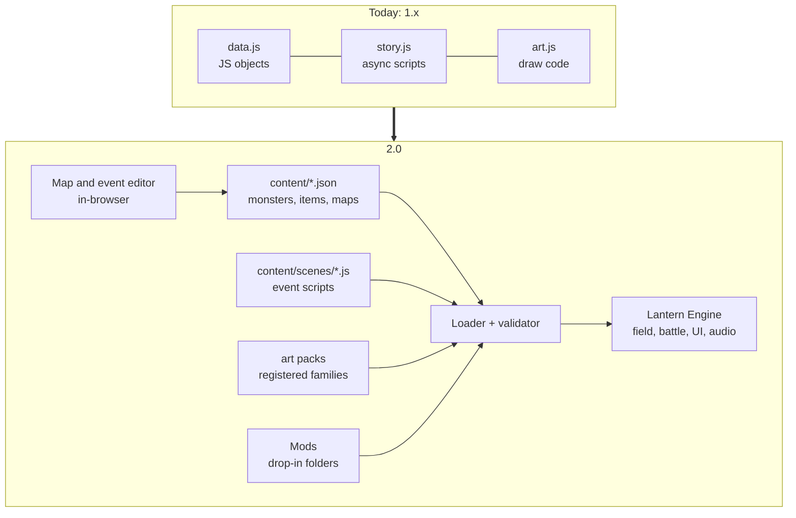

| ID | Item | Size |
| --- | --- | --- |
| ✅ EN-1 | Move monsters, items, shops and encounters to JSON with a schema and a validator. **Done:** `content/*.json`, a JSON Schema each, and `tools/content.js` checking shape and every reference before each build | L |
| ✅ EN-2 | **Save versioning** (done early, in 1.4): `version` in the save, plus an ordered list of migrations | M |
| ✅ EN-3 | **In-browser map editor** for towns and fixed dungeon floors. **Done for towns:** `index.html?edit`, towns in `content/towns.json`, a walk check shared with the build, export as a mod. Dungeon floors are generated from a seed, so there are no fixed floors to edit | L |
| ✅ EN-4 | **Mod loader**: content folders merged at build time. **Done:** `mods/<id>/` with `mod.json`, content patches (add, patch, remove; list `add` / `remove`) and code; `build.py --mod`; checked like the game's content; saves survive a missing mod | M |
| ✅ EN-5 | Split `art.js` into per-family files with a registry (`registerMonsterArt('crown', fn)`). **Done in 1.10:** one file per monster family in `src/monsters/` and per battle background in `src/backgrounds/`, registering in `MONSTER_ART`, `MONSTER_SIZE` and `BATTLE_BGS`; checked pixel for pixel | M |
| ✅ EN-6 | **Localisation**: move every dialogue line into a string table keyed by ID. **Done, keyed by the English instead of IDs** (readable code, English fallback): `tl()`, `content/lang/`, a template for translators, a pseudo language and a play-test | L |
| EN-7 | *Lanternfall II* design document (the Sixth Flame?) | M |

### 2.1 · Endless Lantern

Something to come back to after the ending. Both ideas come from the parking lot.

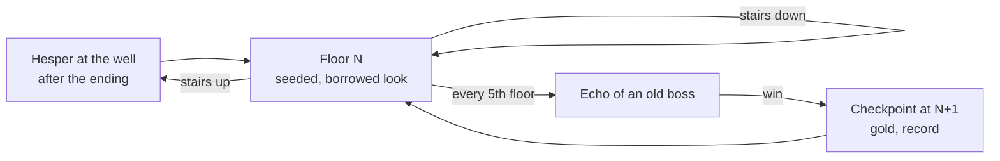

| ID | Item | Size |
| --- | --- | --- |
| RP-1 | **The Endless Lantern**: floors from the existing generator, one seed per floor; bands of five borrow an old dungeon's look and monsters | M |
| RP-2 | **Depth scaling**: each band's monsters matched to the Crownfall Abyss on 1F, then stronger every floor; echoes of old bosses matched to the Hollow Crown | M |
| RP-3 | **Checkpoints, a record and rising rewards**: start from the floor after the last echo you beat; the Endless Wick; two trophies | S |
| RP-4 | **Hollow mode**: picked at New Game; inns don't heal, no running, a third boss phase; a trophy for finishing it | M |

Not in 2.1: new monsters or art for the Endless Lantern (it reuses the old dungeons on purpose), and a leaderboard (there is no server).

### 2.2 · Home and companions

Four ideas from the parking lot, each paying off something the game already has: trophies, fish, songs, Mittens and the Sailor's Compass.

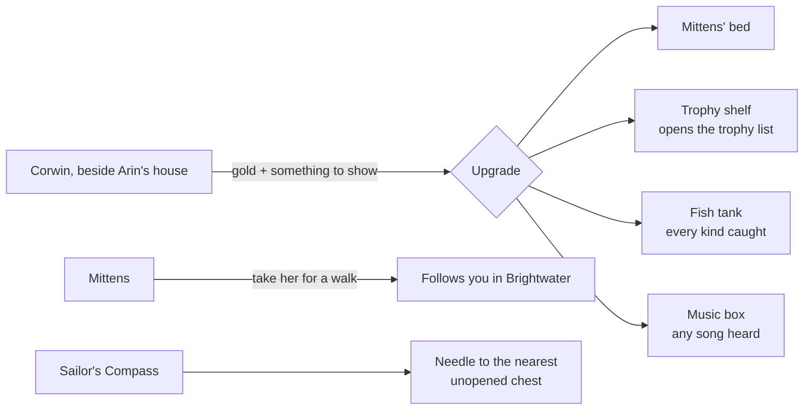

| ID | Item | Size |
| --- | --- | --- |
| HM-1 | **House upgrades**: Corwin builds Mittens' bed, a trophy shelf and a fish tank into Arin's house | M |
| HM-2 | **Music box**: plays any song you've heard, whenever you're home | S |
| HM-3 | **Mittens follows you** in Brightwater after The Lost Cat (everywhere since [2.3](#23--mittens)) | S |
| HM-4 | **Compass hints**: the Sailor's Compass points to the nearest unopened chest in dungeons | S |

### 2.3 · Mittens

Asked for after 2.2: the cat should be able to come anywhere.

| ID | Item | Size |
| --- | --- | --- |
| MT-1 | **Everywhere**: towns, houses, the world map, dungeons, the sea floor (in a bubble); unseen aboard vehicles; catches up after cutscenes | S |
| MT-2 | **In battle**: she sits behind the party; foes sometimes lose an action to her and she sometimes finds an item after a win; bosses ignore her | S |

---

## Prioritised backlog

Every item above, placed by impact and effort.

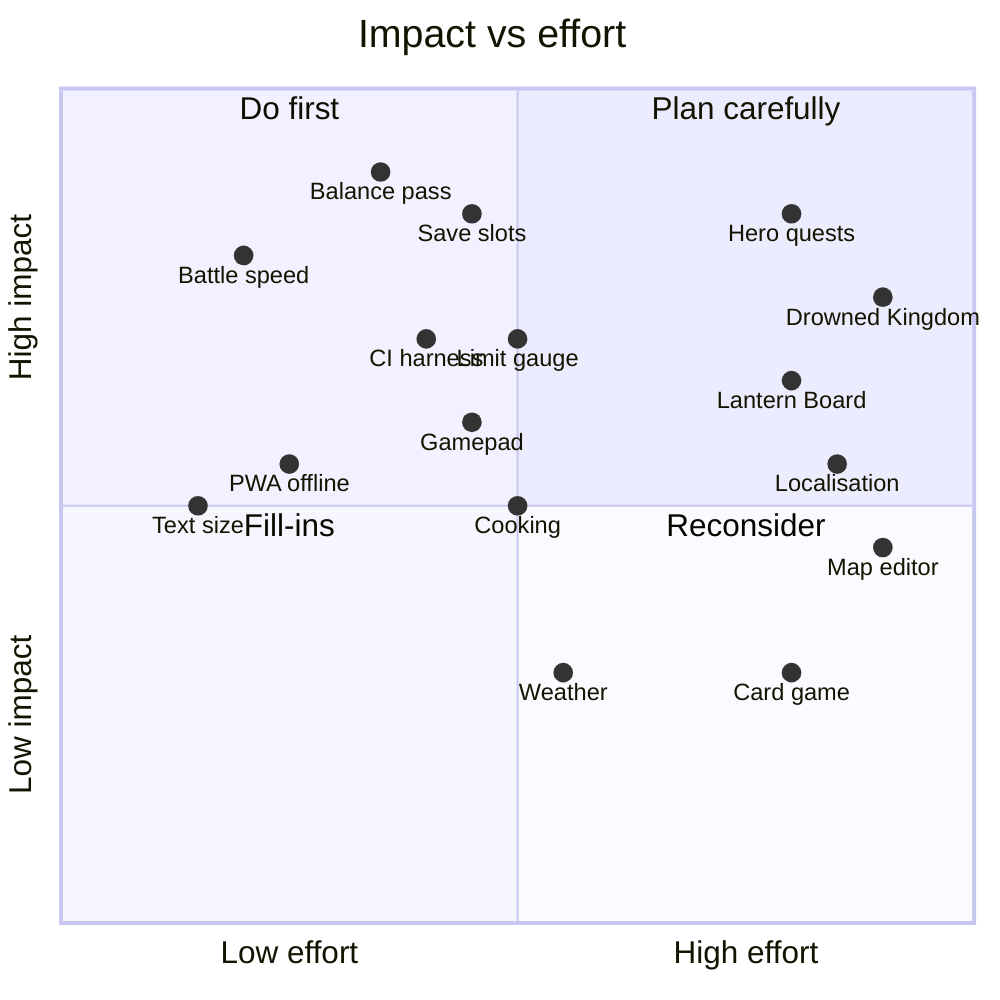

| Rank | ID | Item | Milestone | Impact | Effort |
| --- | --- | --- | --- | --- | --- |
| 1 | ST-1 | Real-HP balance pass for Chapter VI ✅ | 1.3.x | High | Medium |
| 2 | ST-3 | CI with the play-test harness ✅ | 1.3.x | High | Medium |
| 3 | QL-3 | Battle speed ✅ | 1.4 | High | Low |
| 4 | QL-1 | Save slots and migration ✅ | 1.4 | High | Medium |
| 5 | ST-2 | Touch-device pass | 1.3.x | High | Low |
| 6 | QL-4 | Repeat last turn ✅ | 1.4 | Medium | Low |
| 7 | PL-1 | PWA offline install ✅ | 1.8 | Medium | Low |
| 8 | QL-5 | Gamepad ✅ | 1.4 | Medium | Medium |
| 9 | HR-1 | Limit gauge ✅ | 1.5 | High | Medium |
| 10 | HR-2–6 | Hero quests ✅ | 1.5 | High | High |
| 11 | DS-2 | Cooking ✅ | 1.6 | Medium | Medium |
| 12 | DS-3 | Enemy AI ✅ | 1.6 | Medium | Medium |
| 13 | DS-1 | Lantern Board ✅ | 1.6 | Medium | High |
| 14 | WD-1–2 | Drowned Kingdom ✅ | 1.7 | High | High |
| 15 | EN-2 | Save versioning ✅ (moved up into 1.4 as TD-1) | 1.4 | High | Medium |

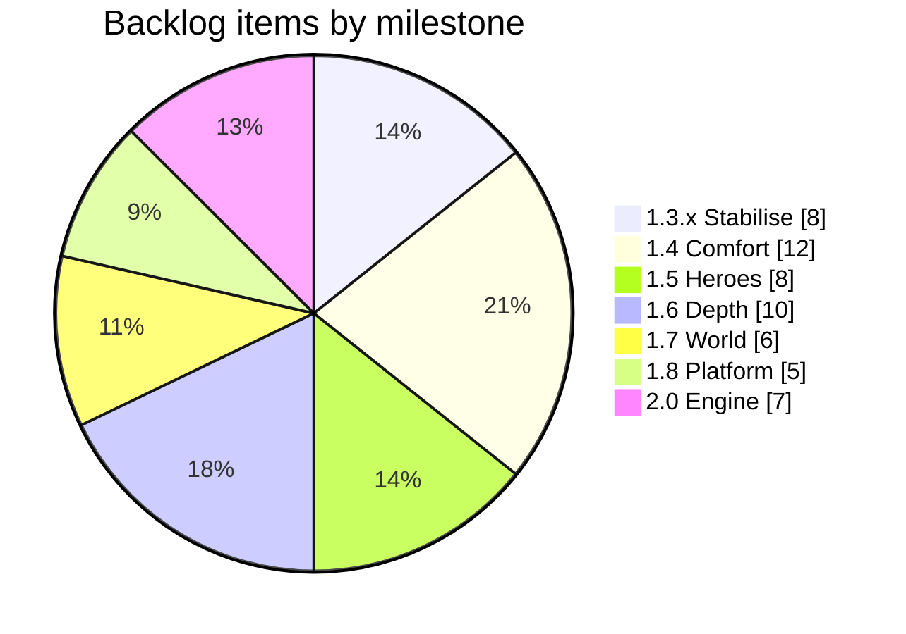

---

## Technical debt

Things in the code today that will slow future work down.

| ID | Debt | Where | Risk | Suggested fix | When |
| --- | --- | --- | --- | --- | --- |
| ✅ TD-1 | **No save version.** `lanternfall_save_v1` has no schema version | `party.js` | A future change to the save shape breaks old saves silently | Add `version`, plus a migration list | 1.4 |
| TD-2 | **Global state everywhere** (`G`, `Field`, `UI`) | all | Hard to test parts in isolation | Keep for 1.x; namespace in 2.0 | 2.0 |
| ✅ TD-3 | **`index.html` is generated but committed**, so pull requests show a huge diff | `build.py` | Merge conflicts; reviewers skim | CI checks that `index.html` matches `build.py` output | 1.3.x |
| ✅ TD-4 | **The world redraws every tile every frame** | `field.js`, `art.js` | Battery drain on phones | Cache static tiles on an offscreen canvas per screen. **Done:** the Battery saver (1.8) caps drawing at 30 fps, and `tilecache.js` (1.10) draws chunks once and redraws only moving squares | 1.10 |
| ✅ TD-5 | **The music scheduler uses `setInterval`**, which background tabs throttle | `core.js` | Stutter when switching tabs | Pause on `visibilitychange`; schedule further ahead | 1.4 |
| ✅ TD-6 | **Balance is checked by ad hoc simulation** | none | Regressions when stats change | Commit a battle simulator under `tools/` | 1.3.x |
| ✅ TD-7 | **`art.js` is about 1,480 lines** | `art.js` | Hard to navigate | Split by family (EN-5). **Done in 1.10:** about 960 lines, mostly tiles and characters | 1.10 |
| ✅ TD-8 | **Strings are inline in code** | `story.js` and others | Blocks localisation | String table (EN-6). **Done:** still inline, but every one goes through `tl()` | 2.0 |
| ✅ TD-9 | **Bosses fight with fixed weighted moves** | `battle.js` | Late bosses feel flat | Phase scripts (DS-3): `phases` on each boss | 1.6 |
| ✅ TD-10 | **Load-order bugs** | all of `src/` | A top-level value reading a name from a later file crashes the game on load (1.9's `LOOKS`) | `tools/load_check.js`, run by `build.py` and CI. **Done in 1.10** | 1.10 |

---

## Ideas parking lot

Not scheduled. Each needs a reason to exist (see [Guiding principles](#guiding-principles)).

- ✅ ~~🎵 **Music box**~~: in [2.2](#22--home-and-companions) (HM-2).
- ✅ ~~🏠 **Arin's house upgrades**~~: in [2.2](#22--home-and-companions) (HM-1).
- ✅ ~~🐈 **Mittens follows you**~~: in [2.2](#22--home-and-companions) (HM-3).
- ✅ ~~🌙 **A "Hollow" hard mode**~~: in [2.1](#21--endless-lantern) (RP-4).
- ✅ ~~🧭 **Compass hints**~~: in [2.2](#22--home-and-companions) (HM-4).
- 📜 **Old Bram's verses**: collect verse fragments to complete the Lantern rhyme. The reward is a new title-screen song.
- 🤝 **Guest party members** for single quests: Brann at sea, Wren in the Observatory, Ione in the Abyss.
- 🎨 **Photo mode**: hide the UI and pan the camera.
- 🧪 **Alchemy**: turn spare materials into consumables.
- ✅ ~~🗺️ **Procedural "Endless Lantern"**~~: in [2.1](#21--endless-lantern) (RP-1 to RP-3).

---

## Release process

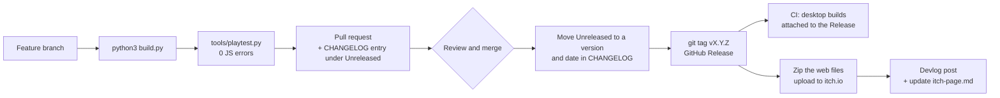

1. Work on a branch. Rebuild with `python3 build.py`, because `index.html` is generated.
2. Run the play-test harness ([docs/TESTING.md](docs/TESTING.md)). It should report `ERRORS: 0`. CI runs it on every pull request too.
3. Add your changes to the `[Unreleased]` section of [CHANGELOG.md](CHANGELOG.md).
4. After merging, choose the version:
   - a save-breaking change bumps the **major** number;
   - new content or systems bump the **minor** number;
   - fixes, balance or docs bump the **patch** number.
5. Tag it and publish a release:
   ```bash
   git tag -a v1.3.1 -m "Lanternfall 1.3.1"
   git push origin v1.3.1
   ```
6. Pushing the tag starts the **Desktop builds** workflow, which attaches Windows, macOS and Linux installers to the tag's GitHub Release (create the release first, or let the workflow create it). Bump `version` in `src-tauri/tauri.conf.json` and `src-tauri/Cargo.toml` before tagging.
7. Zip `index.html`, `manifest.webmanifest`, `sw.js` and `icons/` as `lanternfall-web.zip`, upload it to itch.io (tick "played in the browser"), optionally upload the desktop installers too, and post a devlog. GitHub Pages serves `main` directly, so the installable version updates on merge.

**Backfilled tags (ST-4, done).** Each tag below has a [GitHub Release](https://github.com/CptNope/Laternfall/releases) with that version's `index.html` attached:

| Tag | Commit |
| --- | --- |
| `v1.0.0` | `414bb8d` |
| `v1.1.0` | `d171795` (merge of #1) |
| `v1.2.0` | `1197c6d` (merge of #2) |
| `v1.2.1` | `f737c3b` (merge of #3) |
| `v1.3.0` | `a5dbeeb` (merge of #4) |
| `v1.3.1` | `f837072` (merge of #5) |
| `v1.4.0` | `4154a08` (merge of #6) |
| `v1.5.0` | `a8abeb1` (merge of #7) |
| `v1.6.0` | `162f23f` (merge of #11, the 1.6.0 changelog) |
| `v1.7.0` | `e29201e` (merge of #13) |
| `v1.8.0` | `15936c9` (merge of #14) |
| `v1.9.0` | `dbc9b34` (merge of #15) |
| `v1.10.0` | `a8706f4` (merge of #16) |
| `v2.0.0` | `3404b7b` (merge of #21, the last 2.0 part) |
| `v2.1.0` | `dc3ad99` (merge of #22) |
| `v2.2.0` | the merge of the 2.2.0 changelog pull request |

---

## How to propose something

- **Open an issue** titled `[Idea] …` or `[Bug] …`. For ideas, say which [principle](#guiding-principles) it serves and which milestone it fits.
- **Small fixes** can go straight to a pull request. Include a changelog line and a clean harness run.
- **Big features** (L size and above): write a short design note in the issue first (story hook, UI, save flags, touch controls).
- The [Modding guide](docs/MODDING.md) shows where each kind of content lives in the code.
