# Lanternfall Architecture

How the engine works, for anyone reading or changing the code. It covers how the single file is built, how the game loop, scenes and scripts fit together, how maps and battles are put together, how the music is sequenced, and what goes into a save.

**Related docs:** [MODDING.md](MODDING.md) (recipes for adding content) · [TESTING.md](TESTING.md) (the play-test harness) · [GAME_GUIDE.md](GAME_GUIDE.md) (what the player sees)

## Contents

- [Design constraints](#design-constraints)
- [Build pipeline](#build-pipeline)
- [Modules](#modules)
- [The main loop](#the-main-loop)
- [Scenes](#scenes)
- [Scripts, dialogue and the UI stack](#scripts-dialogue-and-the-ui-stack)
- [Input](#input)
- [Maps](#maps)
- [Entities](#entities)
- [Rendering](#rendering)
- [Battles](#battles)
- [Audio](#audio)
- [Game state and saves](#game-state-and-saves)
- [Story flags reference](#story-flags-reference)
- [Settings](#settings)

---

## Design constraints

| Constraint | Consequence |
| --- | --- |
| No asset files | All art is Canvas 2D paths (`art.js`), and all sound is oscillators and noise (`core.js`). |
| Runs from `file://` | No modules, no `fetch`, no workers. The scripts are concatenated into one inline `<script>`. |
| One global scope | Files share top-level `const`s and functions, so load order matters (see [Modules](#modules)). |
| 640×480 logical canvas | Drawing code uses fixed coordinates; `resize()` scales the canvas to fit the window at full device-pixel sharpness. |
| Plays on touch and gamepad | Every action maps to one of 8 inputs: `up`, `down`, `left`, `right`, `ok`, `cancel`, `mute`, `run`. |

---

## Build pipeline

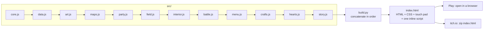

`build.py` joins the files in the order listed in its `order=[...]` and writes `index.html` with the page shell (canvas, touch D-pad, A/B buttons and CSS). **Always edit `src/` and rebuild.** Edits made directly to `index.html` are overwritten by the next build.

```bash
python3 build.py   # prints the byte size of the new index.html
```

---

## Modules

| File | Responsibility | Defines (main symbols) |
| --- | --- | --- |
| `core.js` | Canvas and scaling, utilities, input, timers and fades, the script runner, the UI stack, dialogue, list menus, toasts, settings, the chiptune sequencer and sound effects | `W` `H` `TS`, `hash` `mulberry` `weighted`, `Input`, `wait` `fadeTo`, `runScript`, `UI`, `say` `narrate` `choose` `listMenu`, `CFG`, `TRACKS`, `Audio_`, `isLoc` |
| `data.js` | Pure game data | `HEROES` `SPELLS` `ITEMS` `MONSTERS` `ENCOUNTERS` `SHOPS` `COMBOS` `ARENA_CUPS` `RECIPES` `FISH` `FISH_SPOTS` `MEALS` `BOARD_NODES` `BOARD_HERO` `PASSIVES` `STATUS_TURNS` `MAX_LEVEL` `xpForLevel` |
| `art.js` | Every drawing function: world, town and dungeon tiles, buildings, characters, weapons, monsters, battle backgrounds, title art | `drawWorldTile` `drawTownTile` `drawDungeonTile` `drawBuilding` `drawChar` `drawMonster` `drawBattleBG` `DTHEME` `WPAL` |
| `maps.js` | World generation, town layouts, dungeon floor generation | `GameMap` `WORLD_LOC` `genWorld` `TOWN_DEFS` `buildTown` `DUNGEONS` `genDungeonFloor` |
| `party.js` | Game state `G`, stats, levelling, Embers and the Lantern Board's effects, meals, inventory, save and load | `G` `makeMember` `stat` `gainXp` `boardBuy` `hasPassive` `spellCost` `mealNow` `immune` `cureAll` `addItem` `saveGame` `loadGame` |
| `field.js` | The exploration scene: movement, ship and airship, NPCs, encounters, lighting, map changes | `Field` `getMap` `populate` `changeMap` `enterLocation` `worldTrack` `fishingSpot` |
| `interior.js` | Building interiors from templates, plus searchable containers | `INT_TEMPLATES` `buildInterior` `enterInterior` `interiorInteract` |
| `battle.js` | The battle scene and combat rules | `Battle` `startBattle` `applyItemEffect` `ngScale` |
| `menu.js` | The field menu and its pages, shops, inns, quest log, bestiary, world map, config | `openMainMenu` `openShop` `innStay` `questMenu` `configMenu` |
| `crafts.js` | The fishing mini-game, Orrin's forge, the Lantern Board screen and cooking | `FishingUI` `goFishing` `forgeMenu` `lanternBoard` `cookMenu` |
| `hearts.js` | The five hero quests, Limits unlocking, campfire talks, the Festival of Lanterns | `learnLimit` `worldQuestEntities` `interiorQuestEntities` `innDream` `campfireTalk` `heartsQuests` |
| `story.js` | NPCs and dialogue, doors, cutscenes, bosses, quests, the title screen, the ending, **and the main loop** | `townNpcs` `bossEncounter` `questList` `mainObjective` `worldEvents` `titleMenu` `frame` |

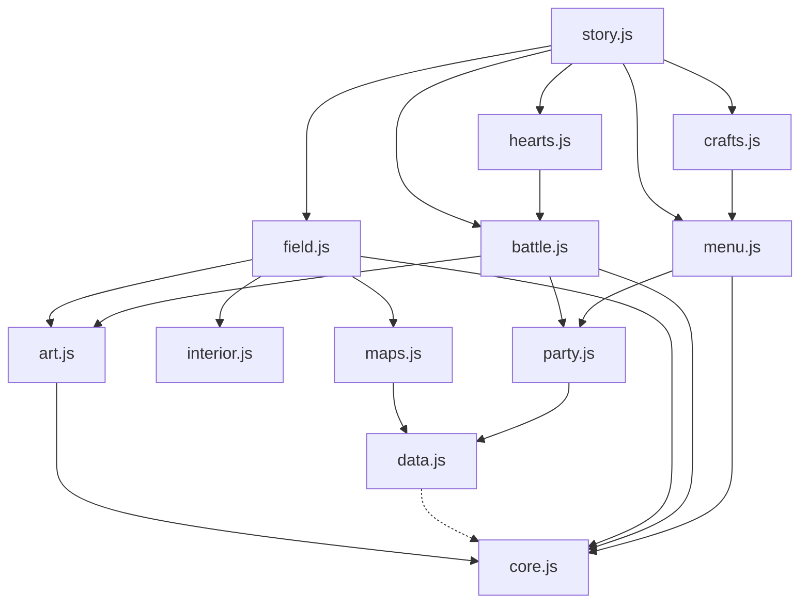

Arrows mean "calls into". Calls are resolved at **run time**, so a function can call one defined later in the build order. But a top-level `const` that *reads* another file's value at load time must come after that file. (`data.js` changing `MONSTERS` at load is one example.) `hearts.js` loads before `story.js`, so its campfire lines are built by a function (`campfires()`) rather than a top-level array: they use the speaker constants (`A`, `LY`, …) that `story.js` defines.

---

## The main loop

The loop lives at the bottom of `story.js` so that everything it touches is already defined.

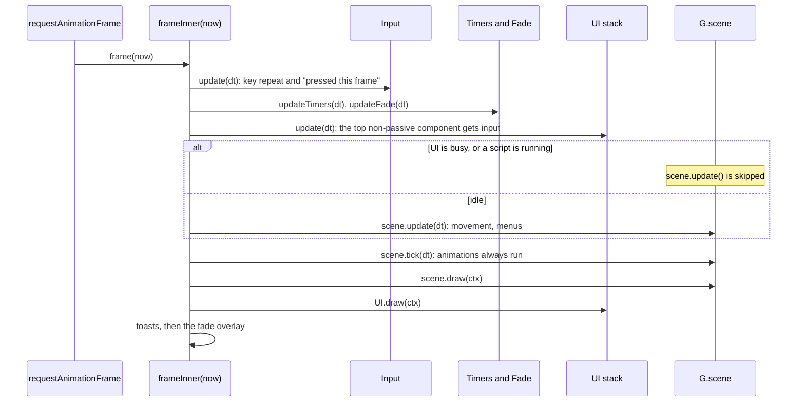

- `dt` is capped at 50 ms so a stall doesn't teleport anything.
- **Battle speed:** while `G.scene` is a `Battle`, timers and scene animation run at `dt × BATTLE_SPEEDS[CFG.battleSpeed]` (1×, 2× or 4×). Dialogue boxes keep normal speed so messages stay readable.
- `frame()` wraps everything in `try/catch` and logs each distinct error **once**, so one bad draw can't freeze the game.

---

## Scenes

A scene is any object with `tick(dt)`, `update(dt)` and `draw(g)`, assigned to `G.scene`.

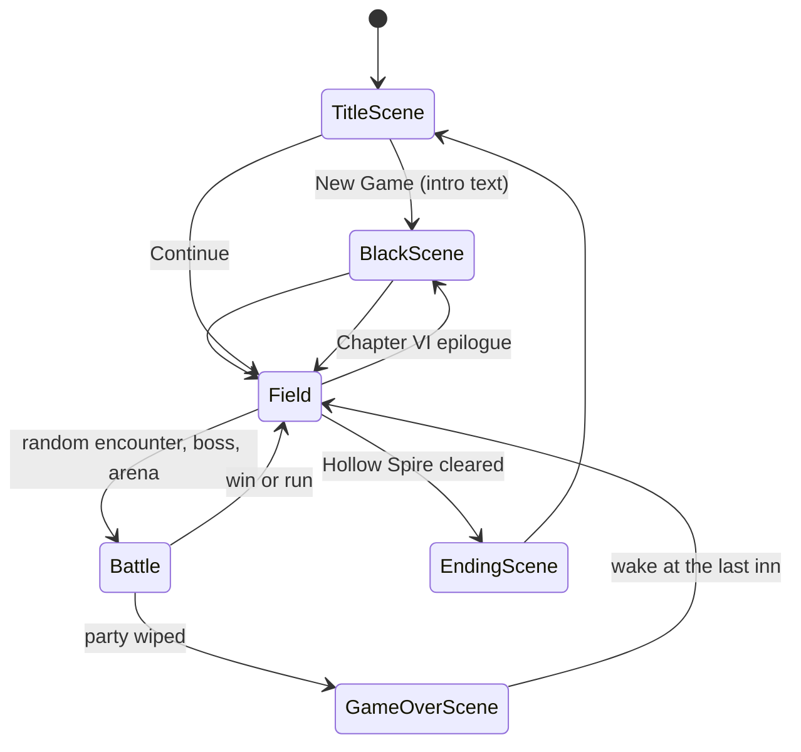

| Scene | File | Notes |
| --- | --- | --- |
| `TitleScene` | story.js | Animated sky; the menu is a `ListMenu` on top |
| `BlackScene` | story.js | Fading lines of serif text (intro, Chapter VI epilogue) |
| `Field` | field.js | One object reused for every map; `Field.enter(mapId, x, y, dir)` switches maps |
| `Battle` | battle.js | A new instance per fight; `startBattle(ids, opts)` returns `'win'`, `'lose'` or `'run'` |
| `GameOverScene` | field.js | Shown briefly before waking at the inn |
| `EndingScene` | story.js | Sunrise, party silhouettes and epilogue lines |

---

## Scripts, dialogue and the UI stack

Story logic is written as plain `async` functions. A script **awaits** UI components, which resolve when the player closes them.

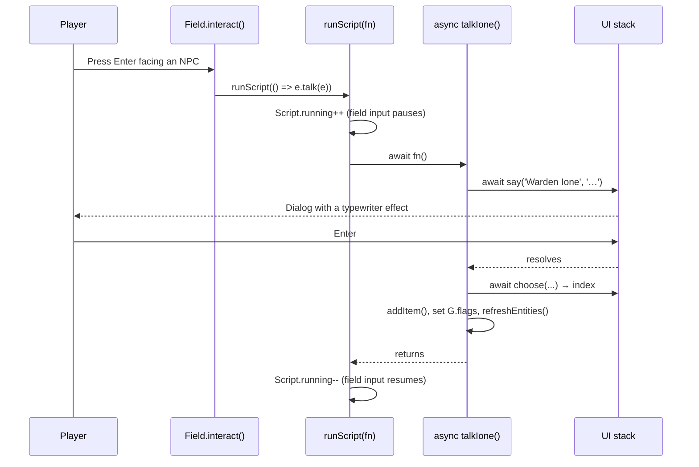

| Helper | Returns | Use it for |
| --- | --- | --- |
| `say(name, text)` | `0` | A line of dialogue with a speaker tag |
| `sayAll([[name, text], ...])` | — | A conversation |
| `narrate(text)` | `0` | Narration with no speaker |
| `choose(name, text, choices, cancelIndex)` | the chosen index | Yes/no and multiple choice |
| `listMenu({ items, title, help, onChange, lr, ... })` | an index, or `-1` | Every menu |
| `openPanel(fn)` / `closePanel(p)` | a panel | Passive drawings behind menus (stats, previews) |
| `toast(text)` | — | A brief banner at the top of the screen |
| `wait(ms)`, `fadeTo(alpha, ms, colour)` | a promise | Timing and screen fades |

**The UI stack.** `UI.push(component)` returns a promise. Only the top **non-passive** component receives input, and every component draws, bottom to top. A component closes itself with `UI.close(this, value)`, which resolves the promise. `FishingUI` in `crafts.js` is a complete example of a custom component.

---

## Input

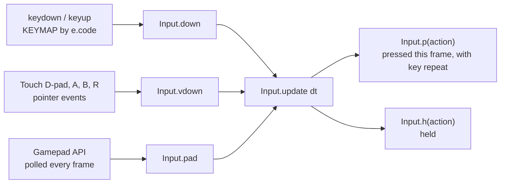

- Arrow keys repeat after 0.3 s, every 0.08 s.
- **Gamepads** (standard mapping) are read through `PAD_BUTTONS`: D-pad or left stick to move, A = ok, B/Y/Start = cancel, X = run, Select = mute.
- A `ListMenu` can take `hotkeys: { action: value }` to close with a value when that action is pressed. The battle menu uses `{ run: -10 }` for *repeat last turn*.
- `UI.update` clears pressed state after the top component reads it, so one press never triggers two things.
- **Run** is `Input.h('run') !== CFG.dash`: with auto-dash on, holding Shift walks instead.

---

## Maps

Every map is a `GameMap` with `tiles[y][x]` (one character per tile), a `kind`, and `entities`. `getMap(id)` builds a map on first use and caches it in `G.maps`. The cache is **not** saved: maps are rebuilt from their seeds and definitions after loading.

| `kind` | id format | Built by | Example |
| --- | --- | --- | --- |
| `world` | `world` | `genWorld()` | the overworld, 98×56 |
| `town` | town key | `buildTown(id)` from `TOWN_DEFS` | `lastlight` |
| `interior` | `in:<town>:<building>` | `buildInterior(id)` from `INT_TEMPLATES` | `in:lastlight:wardhall` |
| `dungeon` | `<dungeon>:<floor>` | `genDungeonFloor(did, f)` from `DUNGEONS` | `abyss:3` |

### World generation

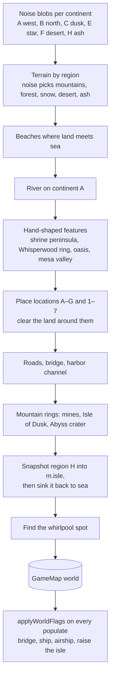

Generation is deterministic (seeded noise via `hash`), so the world never needs saving. Story changes are applied over the top by `applyWorldFlags`.

**World tile legend**

| Char | Tile | Walkable | Char | Tile | Walkable |
| --- | --- | --- | --- | --- | --- |
| `~` | Sea | Ship only | `r` | River | No |
| `.` | Grass, or ash on region H | ✓ | `s` | Beach | ✓ |
| `T` | Forest | ✓ (×1.5 encounters) | `P` | Snowy pines | ✓ (×1.5) |
| `n` | Hills | ✓ (×1.5) | `d` | Dead woods | ✓ (×1.5) |
| `^` | Mountain | No | `M` | Snowy mountain | No |
| `*` | Snow | ✓ | `q` | Corrupted ground | ✓ |
| `z` | Desert | ✓ | `v` | Cactus | ✓ |
| `m` | Mesa | No | `=` | Road | ✓ |
| `x` | Broken bridge | No | `b` | Repaired bridge | ✓ |
| `A`–`G` | Town entrance | ✓ | `1`–`9` | Dungeon entrance | ✓ |

**Regions** (`map.region[y][x]`) decide encounters, battle backgrounds and music:

| Region | Area | Encounter table | Battle background | Music |
| --- | --- | --- | --- | --- |
| `A` (west of the river) | Brightwater plains | `r1` | by tile | `world` |
| `A` (east of the river) | Eastern lowlands | `r2` | by tile | `world` |
| `B`, `E` | North, Observatory isle | `r3` | snow, forest, plains | `world` |
| `C` | Isle of Dusk | `r4` | `dusk` | `world` |
| `F`, `G` | Sunscar Desert, Aerie valley | `r5` | `desert` | `desert` |
| `H` | Ashen Isle | `r6` | `ash` | `ash` |
| sea | — | `sea` | `sea` | `sea` |

### Dungeon generation

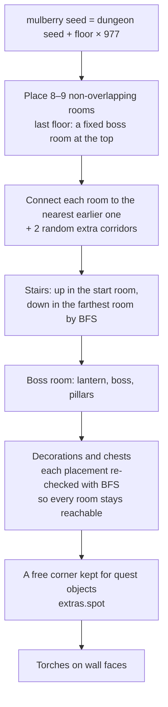

| Char | Dungeon tile | Char | Interior tile |
| --- | --- | --- | --- |
| `#` | Wall | `#` `=` | Wall top, wall face |
| `.` | Floor | `K` | Counter (talk across it) |
| `<` `>` | Stairs up, down | `b` `p` `x` | Barrel, pot, crate (searchable) |
| `~` | Water (fishable in the Shrine) | `B` `T` `c` | Bed, table, chair |
| `L` | Lava | `A` `W` | Altar, pew |
| `o` | Pillar | `I` | Bars |
| `k` | Crystal | `O` `a` | Telescope, anvil |
|  |  | `E` | Exit door |

---

## Entities

`populate(map)` rebuilds `map.entities` from story state every time a map is entered, and again after every script finishes (`refreshEntities()`). That's why NPC "!" marks and defeated bosses update by themselves.

| `kind` | Comes from | Interact |
| --- | --- | --- |
| `npc` | `townNpcs(id)`, `interiorNpcs(m)` | `talk()`; NPCs with `wander: true` drift up to 2 tiles from home; `mark: true` shows "!" |
| `chest` | `DUNGEONS[did].loot` | Opens once; remembered as `G.flags['chest:<map>:<x>,<y>']` |
| `lantern` | The boss room | Examine; glows once `G.flags['lantern_<did>']` is set |
| `boss` | The boss room, until `G.flags['boss_<did>']` | Starts `bossEncounter(did)` when you get within 2 tiles |
| `glint`, `cat` | `questEntities(map)` at `extras.spot` | Quest pick-ups and memories |
| `riddle` | `questEntities` in the Ember Caves | Lyra's riddle braziers |
| `roadlamp` | `worldQuestEntities(map)` on the world | Arin's 12 roadside lamps; they block movement like posts |
| `hatch` | `interiorQuestEntities(m)` in the Ironhold jail | The trapdoor to the Undercity |

---

## Rendering

- **Tiles** are drawn every frame for the visible window (20×15 tiles plus a margin).
- **Sprites** are collected into a list (buildings, entities, ship, airship, player), sorted by their bottom edge, then drawn. This gives correct overlap.
- **Dungeon light** is a radial gradient around the player, plus additive torch and Lantern glows.
- **Characters** are drawn by `drawChar(g, look, x, y, dir, step, scale, pose)` from a `look` object (`skin`, `hair`, `style`, `body`, `accent`, and optional `hat`, `robe`, `beard`, `cape`, `hood`, `weapon`). `npcLook(seed, overrides)` makes random villagers.
- **Monsters** are drawn by `drawMonster(g, def, x, y, {t, scale})`, dispatching on `def.fam`. Colours come from `def.c`, so one family covers many monsters (the Gloam Knight is a recoloured `knight`). `monsterHeight` and `monsterWidth` feed battle layout and targeting.

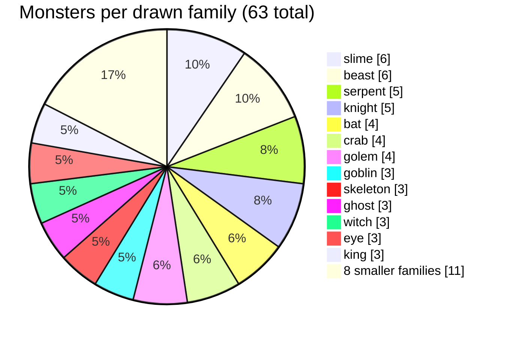

---

## Battles

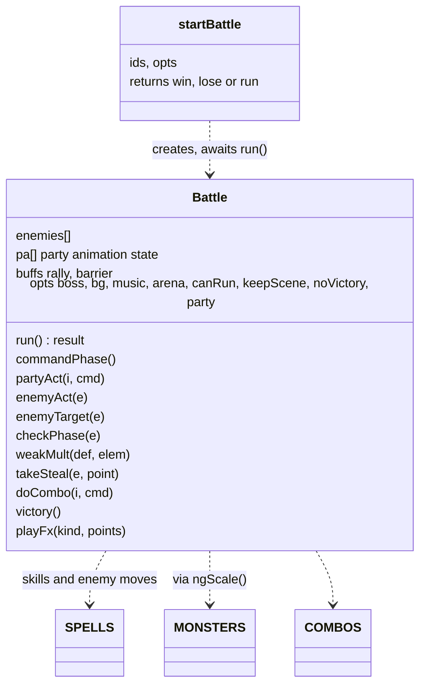

| Option | Effect |
| --- | --- |
| `boss: true` | No running, a boss intro line, boss music; sleep and silence don't work |
| *(monster)* `actions: 2` | The monster gets that many turns per round (the Hollow Crown and Orun) |
| `bg` | Battle background key (`plains`, `abyss`, `crownfall`, …) |
| `music` | Override the track (`final`, `crown`) |
| `arena: true`, `canRun: false` | Arena rules; a loss returns to the arena instead of a game over |
| `keepScene: true` | Don't fade back to the field; used between boss phases |
| `noVictory: true` | Skip the rewards screen; used for the first phase of two-phase bosses |
| `party: ['selene']` | Fight with only these heroes (Selene's dream duel). A loss returns `'lose'`; the caller decides whether that's a game over |

### Limits

Each hero's `m.limit` (0–100, saved with the party) rises by `damage ÷ max HP × 140` whenever they're hit, once `G.flags['limit_<id>']` is set. `limitReady(m)` adds a ★ command at the top of the battle menu, and `Battle.doLimit(i, cmd)` runs that hero's effect (defined in `LIMITS` in `data.js`, implemented in `battle.js`). *Repeat last turn* turns a spent Limit into an Attack.

### Enemy turns

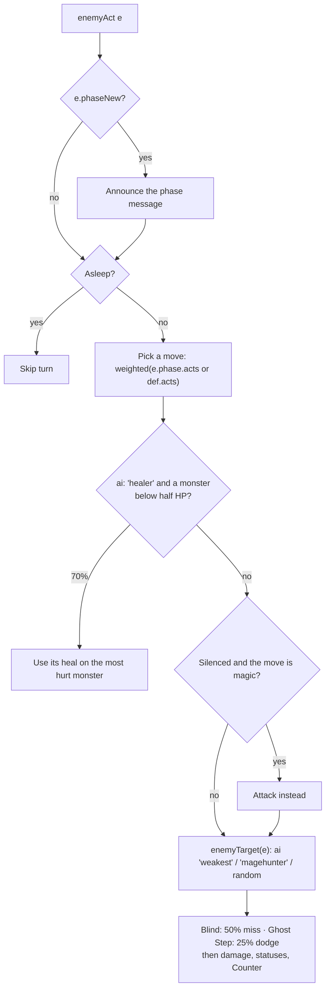

`damageEnemy(e, dmg, col, crit, elem)` handles absorbs (`weakMult` returns `-1`; the hit heals) and calls `checkPhase(e)`, which moves a boss into its next `phases` entry once its HP falls below that entry's `hp` share. The phase takes effect at once (its `actions` count from the next round); the message is shown on the boss's next turn. `ngScale(def)` applies New Game+ multipliers. The full formulas are in the [game guide](GAME_GUIDE.md#formulas).

### Lantern Board, passives and meals

- `stat(m, s)` is `(base + gear + board) × meal`. `maxHp` and `maxMp` add the board but not the meal.
- `hasPassive(m, id)` checks the lit `p1`/`p2`/`p3`/`cap` nodes against `BOARD_HERO[m.id]`. `battle.js` reads it in a few places: turn start (Auto-Regen, Auto-Haste, Lookout), `damageMember` (Quick Limit, Resolve), `enemyAct` (Ghost Step, Counter), damage and healing (Wildfire, Twilight, Tidal Grace) and `spellCost` (MP Saver).
- `G.meal = { id, left }` counts down at the end of every `Battle.run()`, whatever the result. `mealIs(effect)` and `mealMult(stat)` read it; `immune()` treats the Hotpot's `ward` as immunity to every ailment.

---

## Audio

Music is sequenced live. Each track in `TRACKS` has a tempo and up to four voices written in a small text notation.

```text
{ bpm: 104, voices: [
  { w: 'square',   g: 0.038, s: 'E5:4 F5:2 E5:2 B4:8 | ...' },   // lead
  { w: 'triangle', g: 0.13,  s: pump(['E2','C2', ...], 'half') }, // bass helper
  { w: 'drum',     g: 0.04,  s: 'k:4 h:4 s:4 h:4 '.repeat(8) }   // k kick, s snare, h hat
] }
```

- A token is `NOTE:STEPS`. A step is a 16th note, so `4` is a quarter note. `r` is a rest, and `|` is only a visual bar line.
- `pump(roots, 'oct' | 'half' | 'whole')` builds bass lines from one root per bar.
- `Audio_.play(name)` schedules notes 0.25 s ahead on a 60 ms timer. Tracks loop unless `loop: false`.
- `Audio_.sfx(name)` plays one-shot effects built from tones and filtered noise.

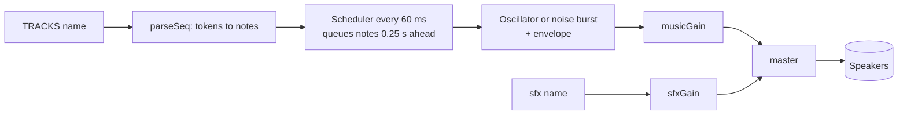

| Track | Plays in | Track | Plays in |
| --- | --- | --- | --- |
| `title` | Title screen | `battle` | Normal battles |
| `world` | Overworld | `boss` | Boss battles |
| `sea` | On the ship | `final` | The Hollow King |
| `sky` | On the airship | `crown` | The Hollow Crown and Orun |
| `desert` | Sunscar, Mirage | `victory` | Victory fanfare |
| `town` | Most towns | `ending` | Ending, Chapter VI epilogue |
| `ashtown` | Lastlight | `gameover` | Party wiped |
| `dungeon` | Most dungeons | `ash` | Ashen Isle |
| `spire` | Hollow Spire | `abyss` | Crownfall Abyss |

Browsers block audio until the first key press or tap (`Audio_.unlock()`).

---

## Game state and saves

Everything that persists lives in the global `G` (`party.js`). `saveGame(slot)` writes the fields below as JSON to `localStorage['lanternfall_save_v2_<slot>']`. There are three manual slots (`1`, `2`, `3`) and one auto-save slot (`auto`).

| Field | Type | Meaning |
| --- | --- | --- |
| `version` | number | Save format version (currently `3`) |
| `savedAt` | ms timestamp | Shown in slot menus; **Continue** picks the newest |
| `party` | `{id, level, xp, hp, mp, weapon, armor, acc, limit, board, embers, capxp}[]` | Heroes in formation order; the first four fight. `board` is the lit Lantern Board node ids |
| `meal` | `{id, left}` or null | The active meal and how many battles it has left |
| `inv` | `{itemId: count}` | Inventory, including key items |
| `gold`, `playTime` | number | |
| `flags` | `{key: any}` | **All story progress**; see below |
| `seen`, `killed` | `{monsterId: n}` | Bestiary |
| `mapId`, `x`, `y`, `dir` | | Where to resume |
| `ship`, `onShip`, `airship`, `inAir` | | Vehicle positions |
| `lastInn` | `{town}` | Where you wake after a game over |
| `carry` | object or null | New Game+ data |

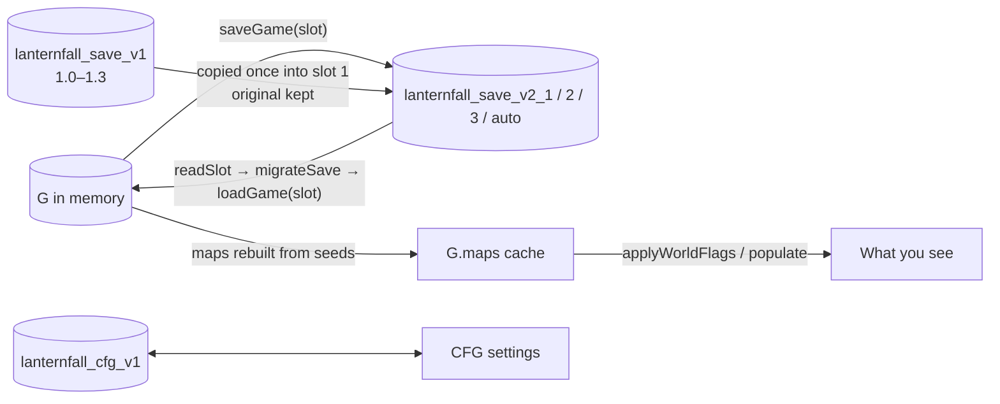

### Versioning and migrations

Every save carries a `version`. When a slot is read, `migrateSave` applies `MIGRATIONS[v]` step by step until the save reaches `SAVE_VERSION`. To change the save format:

1. Bump `SAVE_VERSION`.
2. Add `MIGRATIONS[oldVersion] = d => ({ ...d, version: oldVersion + 1, /* reshape */ })`.
3. Never delete old migrations: a player may skip several releases.

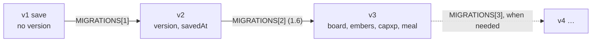

### When the game saves

| Trigger | Slot |
| --- | --- |
| Menu → Save | The slot you choose |
| Resting at an inn, the Chapter VI epilogue | Current slot (one press), or choose a slot |
| The ending credits | Current slot |
| Entering a town or dungeon (if Auto-save is on) | `auto` |

`G.slot` is the current slot. It's set when you load or save, and a new game picks the first empty slot.

## Story flags reference

`G.flags` is a flat object. New features add new keys; nothing is ever removed.

| Group | Flags | Set when |
| --- | --- | --- |
| Main quest | `q1` `lantern1` `bridge` `oswin` `lantern2` `ship` `metKestrel` `kestrel` `lantern3` `dawnkey` `lantern4` `ending` | Each step of the [walkthrough](GAME_GUIDE.md#walkthrough) |
| Party | `selene` | Selene joins |
| Doors | `shrineOpen` `mineOpen` `tombOpen` `obsOpen` `spireOpen` `abyssOpen` | A sealed dungeon is first opened |
| Bosses | `boss_<dungeon>` (`hollow` `shrine` `mine` `tomb` `observatory` `spire` `abyss`), `leviathan` | A boss is defeated |
| Lanterns | `lantern_<dungeon>`, `lantern5` (Fifth Flame), `lantern_sun` | A Lantern is relit |
| Optional story | `sunseal` `chart` `airship` `bounty` `bounty_done` | Tomb, Observatory, Leviathan bounty |
| Side quests | `q_cat` `cat_found` `cat_done`, `q_locket` `locket_done`, `q_hammer` `hammer_done`, `q_stars`, `q_scholar` `scholar_done` | Quest steps |
| Arena | `arenaMet`, `cup_<id>` | Cups won |
| Chapter VI | `isle` `seenLast` `q_crown` `combo_lastlight` `mem1` `mem2` `boss_abyss` `lantern_abyss` `chapter6` `ioneThanks` | Chapter steps |
| Hearts | `q_road` `lamp_0`…`lamp_11` `road_done`; `q_grimoire` `caveOpen` `riddle_0` `riddle_1` `grimoire_done`; `q_grotto` `grottoOpen` `grotto_done`; `q_debt` `seen_undercity` `debt_done`; `q_echo` `echo_done`; `limit_<hero>`; `camp_<n>` `heartsAll`; `festival` | The five hero quests, Limits, campfire talks, the festival |
| Fishing | `q_fish` `fish_r1` `fish_r2`, `fish_<fishId>` (count caught) | Fishing |
| Forge | `forgeMet` `forged` (count) `forge_done` | Forging |
| First visits | `seenHalden` `seenFrost` `seenIron` `seenAerie` `seen_<dungeon>`, `visit_<locationChar>` | Arrival lines; world map labels |
| Containers | `chest:<mapId>:<x>,<y>`, `srch:<mapId>:<x>,<y>` | A chest opened or a container searched |
| Meta | `ngplus` (cycle number), `noEnc` | New Game+, debugging |

---

## Settings

`CFG` (in `core.js`) holds player preferences. It's stored apart from the save, in `localStorage['lanternfall_cfg_v1']`, so settings survive New Game and NG+.

| Key | Values | Read by |
| --- | --- | --- |
| `muted` | boolean | `Audio_` |
| `dash` | boolean | `Field.startMove` |
| `textSpeed` | 0 Normal (55 chars/s), 1 Fast (120), 2 Instant | `Dialog` |
| `battleSpeed` | 0 (1×), 1 (2×), 2 (4×) | `frameInner` while in battle |
| `autosave` | boolean (default on) | `autoSave()` |
| `noEnc` | boolean; only takes effect after the ending | `Field.encounterCheck` |
| `bigText` | boolean | `Dialog` (21 px text, taller box) |
| `contrast` | boolean | `drawWindow` (solid black, yellow border) |
| `keys` | `{ code: action }` or `null` for the defaults | `applyKeymap()`; edited on the Controls page through `KeyCapture` |
