# Lanternfall Game Guide

A complete guide to Lanternfall 1.3: the walkthrough, every hero, skill, monster, boss, item, shop, quest, fish and forge recipe, plus the battle formulas.

> **Spoilers.** Everything is in here, including Chapter VI. The [Walkthrough](#walkthrough) keeps the story vague, but the tables don't.

> The data tables are generated from `content/*.json` and `src/data.js` with `tools/gentables.py`, so they match the game exactly. To change a number, edit the data file and regenerate; don't edit the tables by hand. See [MODDING.md](MODDING.md#regenerating-the-guide-tables).

## Contents

- [Walkthrough](#walkthrough)
- [Hearts of the Lamplighters](#hearts-of-the-lamplighters)
- [The Drowned Kingdom](#the-drowned-kingdom)
- [Day, night and weather](#day-night-and-weather)
- [Lanterns & Lies](#lanterns--lies)
- [The Sunset Opal](#the-sunset-opal)
- [The world](#the-world)
- [Towns, inns and shops](#towns-inns-and-shops)
- [Dungeons](#dungeons)
- [The party](#the-party)
- [Combo techs](#combo-techs)
- [Limits](#limits)
- [How battles work](#how-battles-work)
- [The Lantern Board](#the-lantern-board)
- [Bosses](#bosses)
- [Monsters by area](#monsters-by-area)
- [Side quests](#side-quests)
- [The Aerie Arena](#the-aerie-arena)
- [Fishing](#fishing)
- [Cooking](#cooking)
- [Orrin's Forge](#orrins-forge)
- [Equipment](#equipment)
- [Items](#items)
- [Levels and EXP](#levels-and-exp)
- [New Game+](#new-game)
- [Trophies](#trophies)
- [Speedrun mode](#speedrun-mode)

---

## Walkthrough

The main quest, in order. Each box is a goal from the quest log. Dashed lines are optional content, shown where it unlocks.

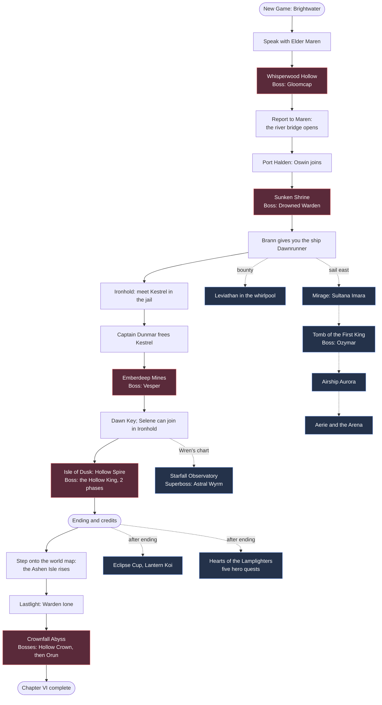

### Act by act

| Act | Goal | Where | Key unlock |
| --- | --- | --- | --- |
| I · Ember | Relight the Ember Lantern | Whisperwood Hollow, northwest of Brightwater | The river bridge east |
| II · Tide | Relight the Tide Lantern with Oswin | Sunken Shrine, south of Port Halden (only a tide priest can open it) | The ship *Dawnrunner* |
| III · Stone | Free Kestrel, then go down through the smugglers' tunnel | Emberdeep Mines, north of Ironhold | Dawn Key; Selene can join |
| IV · Dawn | Climb the Hollow Spire | Isle of Dusk, east across the sea | The ending |
| Optional | Open the First King's tomb with the Sun Seal | Tomb of the First King, south of Mirage (Lv 26+) | The airship *Aurora* |
| Optional | Find the Fifth Flame with Wren's Star Chart | Starfall Observatory, the island west of Frostmere (Lv 32+) | The Fifth Flame accessory |
| VI · Night | Bring the Hollow Crown down | Crownfall Abyss on the Ashen Isle (Lv 42+) | The Night Lantern, the Eclipse Cup |
| Hearts | Five personal quests, one per hero | All over the world (Lv 44+) | Limits, ultimate weapons, the Festival of Lanterns |

### Chapter VI in detail

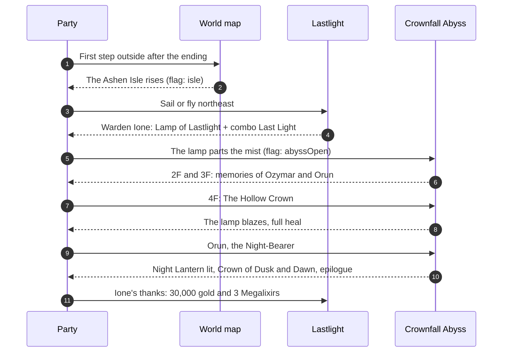

---

## Hearts of the Lamplighters

After the ending, each hero has something left unfinished. The quests can be done in any order, and each one needs its hero in the party. Finishing one teaches that hero a **[Limit](#limits)** and gives them an ultimate weapon. Finish all five for the **Festival of Lanterns**.

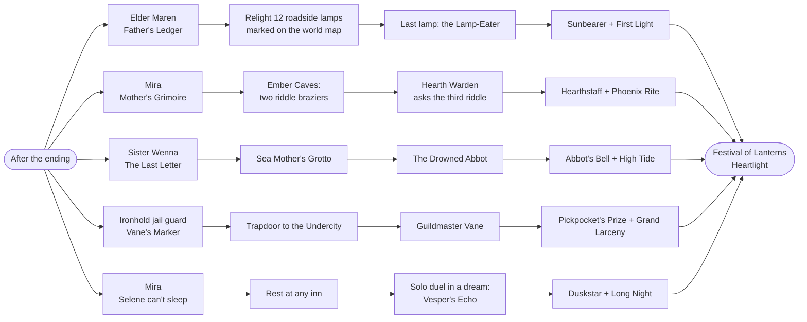

| Quest | Hero | Start | Where | Boss | Reward |
| --- | --- | --- | --- | --- | --- |
| The Lamplighter's Road | Arin | Elder Maren, Brightwater | 12 lamps beside the roads on every continent, including the Isle of Dusk and the Ashen Isle | The Lamp-Eater (appears at the last lamp) | Sunbearer, ★ First Light |
| Mother's Grimoire | Lyra | Mira, Brightwater | Ember Caves (`8`), in the hills north of the Brightwater road | Hearth Warden | Hearthstaff, ★ Phoenix Rite |
| The Drowned Priesthood | Oswin | Sister Wenna, Port Halden chapel | Sea Mother's Grotto (`9`), on the coast east of Port Halden | The Drowned Abbot | Abbot's Bell, ★ High Tide |
| Old Debts | Kestrel | The guard in the Ironhold jail | The Undercity, through a trapdoor in the jail | Guildmaster Vane (acts twice) | Pickpocket's Prize, ★ Grand Larceny |
| Echo of Vesper | Selene | Mira, Brightwater | A dream: rest at any inn | Vesper's Echo (**Selene fights alone**) | Duskstar, ★ Long Night |
| The Festival of Lanterns | Everyone | Elder Maren, after all five | Brightwater | — | Heartlight |

**Tips**

- **The riddles** in the Ember Caves are Lyra's mother's bedtime riddles. A wrong answer summons Kiln Imps; you can try again afterwards. Answering the Hearth Warden's riddle correctly fully restores the party before the fight.
- **Selene's dream** can't end in a game over. If she loses, she simply wakes up, and the dream returns at the next inn. Bring Ethers: her draining spells keep her alive, but they cost MP.
- **Campfire talks:** using a **Tent** on the world map sometimes starts a short conversation around the fire. There are eight, each heard once, depending on who is in the party and how far the story has gone.

---

## The Drowned Kingdom

Added in 1.7. It starts once **Oswin's quest is done** (The Drowned Priesthood): Sister Wenna in the Port Halden chapel has found a chart hidden in the Abbot's bell. Oswin must be in the party when you talk to her.

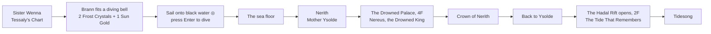

**The sea floor.** There are four patches of black water, marked ◎ on the world map once you have the chart. Diving from one puts you on the sea floor directly below it, which is drawn at half the world's scale. Walk onto a **bell line** (↑) to surface from any of the four. The bell's lamp only lights a few steps around you; the glows are vents, the bell lines and the city. Kelp beds raise the encounter rate by 50%. The **Map** screen has a Sea Floor view (press **Shift** to switch).

| Place | Where | What's there |
| --- | --- | --- |
| **Nerith** | The centre of the sea floor, below where the Leviathan's whirlpool was | Inn (500 G), temple (Mother Ysolde: free full heal), item shop, armory with the best shop gear in the game, an archive |
| **The Drowned Palace** | East of Nerith. Opens after you meet Mother Ysolde | 4 floors; boss **Nereus, the Drowned King** (acts twice, absorbs water). Recommended level 46+ |
| **The Hadal Rift** | The far southeast. Opens after Nereus, and Ysolde tells you about it | 2 floors; the secret superboss **The Tide That Remembers** (acts twice, two phases, absorbs water, resists dark and ice). Recommended: level 50, a full Lantern Board, the hero weapons and a meal |
| Three wrecks | Scattered on the sea floor | A chest beside each, one with the fifth treasure map |

### Treasure maps

Five maps, each pointing to a spot on the world map. Carried maps are marked ✕ on the world map. Stand on the spot and press **Enter** to dig. Dig up all five and Whisper pays 50,000 gold.

| Map | Where it points | Where to get it | Treasure |
| --- | --- | --- | --- |
| **Map: Smuggler's Cove** | X marks a beach south of Port Halden, where the causeway runs out to the Sunken Shrine. "Dig at the third palm." There are no palms. | Whisper sells it in the Undermarket | 25,000 gold, Megalixir, X-Potion |
| **Map: The Cold Cairn** | A cairn in the snowfields between Frostmere and Ironhold. Someone has drawn a very cold-looking face. | Dropped by Sand Bandits, Cutpurses and Abyssal Anglers | Frost Crystal, Frost Crystal, Frost Crystal, Megalixir |
| **Map: Dune Sea** | Deep in the Sunscar, south of Mirage and west of the Tomb. "Where the sand sings at noon." | Dropped by Sand Bandits, Cutpurses and Abyssal Anglers | Sun Gold, Sun Gold, Sun Gold, 30,000 gold |
| **Map: Hollow Root** | At the edge of the Whisperwood, north of Brightwater. The ink smells of moss. | Dropped by Sand Bandits, Cutpurses and Abyssal Anglers | Lucky Doubloon, Elixir, Elixir |
| **Map: Ash and Gold** | The Ashen Isle, south of Lastlight. Charred at the edges. Somebody wanted this burned. | A wreck on the sea floor | Admiral's Hat, Deep Pearl, Deep Pearl, Deep Pearl |

Sand Bandits, Cutpurses and Abyssal Anglers have a 20% chance per battle to drop the next map you're missing (2, then 3, then 4).

### The Undermarket

After Kestrel's quest, the trapdoor in the Ironhold jail also leads to **the Undermarket**, the Thieves' Guild's market. It has a cheap inn (40 G), Mags in the guild hall, Whisper the map-seller, and a black market that sells forge materials and rare goods at three times their price:

| Item | Black-market price | Normal price |
| --- | --- | --- |
| Megalixir | 20000 | — |
| Elixir | 6000 | — |
| Star Bomb | 2700 | 900 |
| Ember Core | 1200 | 400 |
| Frost Crystal | 1200 | 400 |
| Sun Gold | 1800 | 600 |
| Star Shard | 2400 | 800 |
| Dusk Silk | 2100 | 700 |
| Abyss Ash | 3600 | 1200 |
| Deep Pearl | 4500 | 1500 |
| Thief's Gloves | 60000 | — |

### Lanternmoths

Once all twelve roadside lamps are lit (Arin's quest), talk to **Old Ivy** in Brightwater for the **Moth Whistle**. After that, talk to any lit roadside lamp to ride a lanternmoth: it moves twice as fast as walking, crosses forests, and **meets no monsters**. Moths can't cross water or mountains. Press **Enter** to land; walking into a town or dungeon lands you too.

---

## Day, night and weather

Added in 1.9. A clock runs while you explore: one real second is one game minute, so a day lasts 24 minutes. The menu shows the day, the time and the weather where you are.

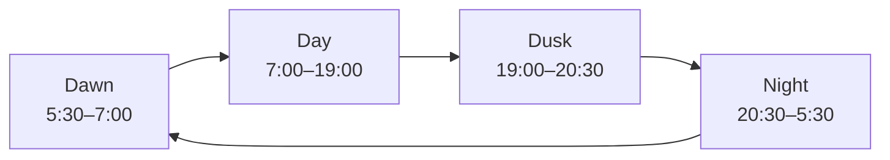

**At night** the sky darkens (lamps, braziers and windows glow), the townsfolk who wander go home, and a few night owls come out: a watchman in Brightwater, a fisher in Port Halden, a stargazer in Frostmere, a vendor in Mirage, and some of the card players. Half of the world's random battles come from night tables (see [Monsters by area](#monsters-by-area)), with five creatures you only meet after dark. Winning one earns the Night Owl trophy.

**Passing time.** An inn wakes you at 7:00, or at 21:00 if you choose **Stay until night**. A Tent moves the clock on 8 hours.

**Weather** is rolled for each region every six game hours, so it changes four times a day. It shows on the world map and in towns, and it changes battles fought there:

| Weather | Where | In battle |
| --- | --- | --- |
| Rain | Western continent, the northern lowlands, the open sea | Water and lightning +25%, fire −25% (for both sides) |
| Snow | The snowfields around Frostmere (about half the time) | Ice +25%, fire −25% |
| Sandstorm | The Sunscar Desert (about a third of the time) | Physical attacks miss 15% more often |
| Fog | The Isle of Dusk (half the time), sometimes the western continent | Physical attacks miss 10% more often |
| Ashfall | The Ashen Isle, always | Fire +25%, water −25% |

The sky valley of Aerie sits above the weather. There's no weather indoors, underground, under the sea or in the air.

---

## Lanterns & Lies

A card game played against people around the world. Tess in Brightwater (by day) explains it and gives you a 7-card starter deck.

**Rules.** Each player brings 5 cards and takes turns laying one on a 3×3 board. When you lay a card, every touching enemy card with a lower value flips to you; ties flip nothing. Flames give an edge to the attacker: **Ember beats Stone, Stone beats Tide, Tide beats Ember** (+2). Dawn has no edge, and nothing has an edge over it. Whoever owns more of the nine squares at the end wins.

**The Lie.** Once a game, press **Shift** on a card to lay it face-down. A veiled card flips nothing when it's laid. At the end of the game it turns over and flips everything weaker around it. A card that attacks a veiled card has to beat its real value, which the attacker can't see.

**Winning** takes one card from your opponent's deck that you don't have yet (or gold, once you have them all). Beat every player for the **Joker's Lantern** (all stats +10, rare steals twice as likely). Collecting all 36 cards earns the Full Deck trophy.

**Choosing a deck:** Enter picks or drops a card, Shift takes your five strongest, Esc starts the game once five are picked. The game remembers your last deck.

| Player | Where | When | Deck | Skill |
| --- | --- | --- | --- | --- |
| **Tess** | Brightwater | Day | Green Slime 1, Cave Bat 1, Goblin 2, Wild Wolf 2, Moonmoth 1 | 20% |
| **Sailor Odo** | Port Halden | Night | Gel Slime 2, Harpy 3, Sand Crab 3, Sea Serpent 5, Frost Wolf 4 | 40% |
| **Gorrim** | Ironhold | Day | Hobgoblin 3, Sand Crab 3, Death Scorpion 4, Ogre 5, Gloomcap 6 | 50% |
| **Trapper Yuki** | Frostmere | Night | Frost Wolf 4, Snow Imp 4, Shade Wraith 5, Drowned Warden 7, Oswin 7 | 60% |
| **Madame Nyx** | Mirage | Night | Chimera 5, Vesper 7, Hollow Knight 6, Ozymar, the First King 8, Selene 8 | 75% |
| **Bookie Lark** | Aerie | Day | Ember Golem 6, Kestrel 6, Lyra 7, Leviathan 8, Arin 8 | 80% |
| **The Dealer** | The Undermarket | Any time | Astral Wyrm 9, The Hollow King 9, The Hollow Crown 9, Ozymar, the First King 8, Vesper 7 | 90% |
| **Memory of a Gambler** | Nerith | Any time | Nereus, the Drowned King 9, The Lamp-Eater 9, Leviathan 8, Astral Wyrm 9, Selene 8 | 100% |

Skill is how carefully a player thinks: low-skill players sometimes make careless moves.

| Value | Cards |
| --- | --- |
| 1 | Green Slime (Tide), Cave Bat (Ember), Moonmoth (Dawn) |
| 2 | Goblin (Stone), Wild Wolf (Ember), Will-o-Wisp (Dawn), Gel Slime (Tide) |
| 3 | Harpy (Dawn), Sand Crab (Stone), Hobgoblin (Stone), Fire Bat (Ember) |
| 4 | Frost Wolf (Tide), Snow Imp (Tide), Death Scorpion (Stone), Cinder Serpent (Ember) |
| 5 | Ogre (Stone), Shade Wraith (Dawn), Sea Serpent (Tide), Chimera (Ember) |
| 6 | Hollow Knight (Dawn), Gloomcap (Stone), Kestrel (Stone), Ember Golem (Ember) |
| 7 | Drowned Warden (Tide), Vesper (Dawn), Lyra (Ember), Oswin (Tide) |
| 8 | Leviathan (Tide), Ozymar, the First King (Ember), Selene (Dawn), Arin (Ember) |
| 9 | Astral Wyrm (Dawn), The Hollow King (Dawn), Nereus, the Drowned King (Tide), The Hollow Crown (Stone), The Lamp-Eater (Ember) |

---

## The Sunset Opal

A heist for Kestrel. After Old Debts, **Mags** in the Undermarket guild hall asks Kestrel to steal back the Guild's Sunset Opal from the Mirage palace vaults. Kestrel must be in the party when you talk to her.

At **night**, a loose grate east of the Mirage palace leads into the vaults. Four guards walk fixed patrols. Each sees four squares ahead, widening to a cone three squares wide; walls and pillars block their sight. What they can see is drawn in red. Be seen once and the guards throw you out (you can try again at once). Take the Opal from the chest in the far corner, get back to the grate, and bring the Opal to Mags for the **Night Cloak** (ATK +10, SPD +16, prevents blind and stop).

The guards' patrols repeat every 1,092 steps, and there is a safe route in and out: the play-test checks it on every build.

---

## The world

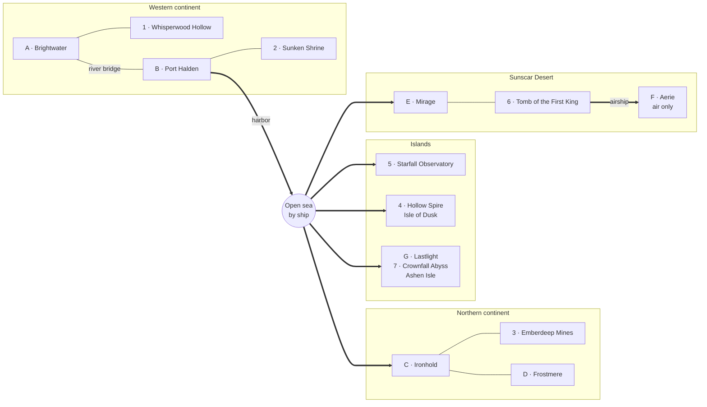

| Code | Place | Kind | How to reach | Battle area |
| --- | --- | --- | --- | --- |
| A | Brightwater | Town | Start | Plains |
| B | Port Halden | Town | East over the river bridge | Eastern lowlands |
| C | Ironhold | Town | By ship, north | Northern continent |
| D | Frostmere | Town | Road west of Ironhold | Northern snowfields |
| E | Mirage | Town | By ship, east | Sunscar Desert |
| F | Aerie | Town | **Airship only** (a mesa-walled valley) | Sunscar Desert |
| G | Lastlight | Town | Ship or airship, far northeast (after the ending) | Ashen Isle |
| 1 | Whisperwood Hollow | Dungeon, 2F | Road northwest of Brightwater | Whisperwood Hollow |
| 2 | Sunken Shrine | Dungeon, 2F | Coast road south of Port Halden | Sunken Shrine |
| 3 | Emberdeep Mines | Dungeon, 3F | Ring of mountains north of Ironhold | Emberdeep Mines |
| 4 | Hollow Spire | Dungeon, 3F | Isle of Dusk, east | Hollow Spire |
| 5 | Starfall Observatory | Dungeon, 3F | Small island west of Frostmere | Starfall Observatory |
| 6 | Tomb of the First King | Dungeon, 3F | South of Mirage | Tomb |
| 7 | Crownfall Abyss | Dungeon, 4F | The crater east of Lastlight | Crownfall Abyss |
| 8 | Ember Caves | Dungeon, 2F | Hills north of the Brightwater road (Lyra's quest) | Ember Caves |
| 9 | Sea Mother's Grotto | Dungeon, 2F | East coast of the Port Halden peninsula (Oswin's quest) | Sea Mother's Grotto |
| — | The Undercity | Dungeon, 2F | A trapdoor in the Ironhold jail (Kestrel's quest) | The Undercity |

### Saving

- **Three save slots** plus an **Auto** slot. Save from **Menu → Save** anywhere, or when you rest at an inn ("Save to slot N" is one press).
- **Auto-save** writes to the Auto slot every time you enter a town or dungeon. You can turn it off in Config.
- On the title screen, **Continue** loads your most recent save and **Load Game** lets you pick any slot. Saves from before 1.4 move into slot 1 automatically.

### Settings (Menu → Config)

| Setting | Options | What it does |
| --- | --- | --- |
| Sound | On / Off | Music and effects (also the M key) |
| Auto-dash | On / Off | Run everywhere; hold Shift, R or the gamepad's X to walk |
| Text speed | Normal / Fast / Instant | How fast dialogue appears |
| Battle speed | 1× / 2× / 4× | Speeds up battle animations; messages still wait for you |
| Auto-save | On / Off | Save to the Auto slot on entering towns and dungeons |
| Large text | On / Off | Bigger dialogue text |
| High contrast | On / Off | Solid black windows with bright yellow borders |
| Controls… | — | Rebind any action to any key (Confirm and Back always keep a key), or reset |
| Encounters | On / Off | Random battles; can only be turned off after the ending |

### Getting around

| Mode | Unlocked by | Notes |
| --- | --- | --- |
| On foot | Start | Hold **Shift** (or turn on **auto-dash**) to run. Forests, hills and dead woods raise the encounter rate by 50%. |
| Ship *Dawnrunner* | Brann, after the Tide Lantern | Walk onto it to sail and onto land to go ashore. Sea encounters. |
| Airship *Aurora* | Beating Ozymar | Fly anywhere with no encounters. Press **Enter** to land on open ground (not forest). |
| Diving bell | Brann, during The Drowned Kingdom | Sail onto black water and press **Enter** to dive to the sea floor; walk onto a bell line to surface. |
| Lanternmoth | Old Ivy's whistle, after Arin's quest | Talk to a lit roadside lamp. Fast, no encounters, land only. **Enter** to land. |

**Encounters** come every 14–30 steps. The Sailor's Compass and the Moonfin Charm halve the rate. After the ending, **Config → Encounters** can turn them off entirely.

---

## Towns, inns and shops

| Town | Inn (party) | Notable people | Services |
| --- | --- | --- | --- |
| Brightwater | 10 G | Elder Maren, Mira, Pip, Old Bram | Free rest at Arin's house; item and arms shops |
| Port Halden | 30 G | Oswin, Brann, Nell | Chapel (revive and cure); harbor |
| Ironhold | 80 G | Captain Dunmar, Orrin, Hilda, Selene | Jail, barracks, **Orrin's Forge** |
| Frostmere | 120 G | Wren, Sable, the Ice Fisher | Observatory hut; **fishing rod** |
| Mirage | 150 G | Sultana Imara, Scholar Hesper, Dalen | Palace |
| Aerie | 200 G | Elder Skye, the Arena Master | **The Arena** |
| Lastlight | 300 G | Warden Ione, Calla, Fennick, Moss | Chapel; endgame armory |
| Nerith (sea floor) | 500 G | Mother Ysolde, Captain Oriel, Archivist Thule | Temple (full heal); the best shop gear |
| The Undermarket (under Ironhold) | 40 G | Mags, Whisper, Stallkeeper Nim | Black market; treasure maps |

Every building can be entered. Search **barrels, pots and crates** (face one and press Enter) for hidden items; each container is searched once. Resting at an inn also offers to save.

| Town | Item shop | Arms and trinkets |
| --- | --- | --- |
| **Brightwater** | Potion, Antidote, Phoenix Plume, Tent | Bronze Sword, Oak Staff, Leather Armor, Cloth Robe |
| **Port Halden** | Potion, Hi-Potion, Ether, Antidote, Remedy, Phoenix Plume, Tent, Ember Bomb | Iron Sword, Mage Staff, Iron Mace, Chain Mail, Silk Robe, Power Ring, Guard Ring |
| **Ironhold** | Rage Tonic, Hi-Potion, X-Potion, Ether, Hi-Ether, Remedy, Phoenix Plume, Tent, Ember Bomb | Steel Sword, Rune Staff, Steel Mace, Steel Dagger, Plate Armor, Sage Robe, Thief Vest, Mage Ring, Wake Charm |
| **Mirage** | Hi-Potion, X-Potion, Hi-Ether, Remedy, Phoenix Plume, Tent, Ember Bomb | Sunsteel Blade, Sky Staff, Desert Veil, Swift Boots, Mage Ring, Wake Charm, Eye Charm |
| **Aerie** | X-Potion, Hi-Ether, Remedy, Phoenix Plume, Tent, Ember Bomb | Moon Scepter, Sunsteel Blade, Sky Staff, Scholar's Lens, Echo Bell, Desert Veil, Hourglass Pin, Calm Charm, Clockwork Charm |
| **Frostmere** | Hi-Potion, X-Potion, Hi-Ether, Remedy, Phoenix Plume, Tent, Ember Bomb | Swift Boots, Echo Bell, Wake Charm, Scholar's Lens, Guard Ring, Power Ring, Eye Charm, Hourglass Pin, Clockwork Charm |
| **Lastlight** | X-Potion, Hi-Ether, Remedy, Phoenix Plume, Tent, Ember Bomb, Star Bomb | Ashsteel Blade, Cinder Staff, Ashen Mace, Ash Kris, Umbral Rod, Ash Mail, Ash Robe, Ash Garb |
| **Nerith** | X-Potion, Hi-Ether, Remedy, Phoenix Plume, Tent, Star Bomb | Coral Blade, Pearl Staff, Reef Mace, Eel Fang, Abyss Orb, Nacre Mail, Kelp Robe, Sharkskin Garb, Pressure Ring |

---

## Dungeons

Each dungeon's floors are generated from a fixed seed, so every player gets the same layout. Torches light the walls, and the Lantern waits in the boss room on the last floor.

| Dungeon | Floors | Boss | Lantern | Treasure |
| --- | --- | --- | --- | --- |
| **Whisperwood Hollow** | 2 | Gloomcap | Ember Lantern | Antidote, Ether, Iron Sword, Phoenix Plume, Potion, 120 gold |
| **Sunken Shrine** | 2 | Drowned Warden | Tide Lantern | Chain Mail, Ether, Hi-Potion, Phoenix Plume, Silk Robe, Tide Mace, 400 gold |
| **Emberdeep Mines** | 3 | Vesper | Stone Lantern | Elixir, Ember Bomb, Ether, Hi-Potion, Mythril Knife, Mythril Mail, Mythril Sword, Phoenix Plume, Star Robe, Star Rod, 900 gold |
| **Hollow Spire** | 3 | The Hollow King | Dawn Lantern | Dawn Plate, Dawnblade, Elixir, Ember Scepter, Hi-Ether, Megalixir, Seraph Mace, Shadow Fang, Shadow Garb, X-Potion, 3000 gold |
| **Tomb of the First King** | 3 | Ozymar, the First King | Sun Lantern | Desert Veil, Elixir, Gilded Mace, Hi-Ether, Megalixir, Nocturne, Sand Kris, X-Potion, 5000 gold |
| **Starfall Observatory** | 3 | Astral Wyrm | Fifth Lantern | Astral Mace, Celestia, Comet Edge, Elixir, Ember Heart, Hi-Ether, Lightbringer, Megalixir, Swift Boots, X-Potion, 8000 gold |
| **Ember Caves** | 2 | Hearth Warden | — (hero quest) | Ember Core, Hi-Ether, Megalixir, Star Bomb, X-Potion, 6000 gold |
| **Sea Mother's Grotto** | 2 | The Drowned Abbot | — (hero quest) | Elixir, Frost Crystal, Hi-Ether, Megalixir, Sun Gold, X-Potion, 6000 gold |
| **The Undercity** | 2 | Guildmaster Vane | — (hero quest) | Dusk Silk, Elixir, Megalixir, X-Potion, 24000 gold |
| **The Drowned Palace** | 4 | Nereus, the Drowned King | — (hero quest) | Deep Pearl, Elixir, Hi-Ether, Kelp Robe, Megalixir, Pressure Ring, Star Bomb, X-Potion, 39000 gold |
| **The Hadal Rift** | 2 | The Tide That Remembers | — (hero quest) | Deep Pearl, Elixir, Megalixir, 30000 gold |
| **Crownfall Abyss** | 4 | The Hollow Crown | Night Lantern | Abyss Ash, Ash Mail, Ash Robe, Elixir, Hi-Ether, Megalixir, Nightglass Locket, Star Bomb, X-Potion, 32000 gold |

---

## The party

Four heroes fight at once. Arrange them in **Menu → Formation**; the fifth waits in reserve and earns **half EXP**.

| Hero | Class | Skill menu | HP | MP | ATK | DEF | MAG | SPD |
| --- | --- | --- | --- | --- | --- | --- | --- | --- |
| **Arin** | Lamplighter | Valor | 62 → 748 | 10 → 98 | 12 → 129 | 8 → 96 | 5 → 49 | 8 → 57 |
| **Lyra** | Flamecaller | Magic | 42 → 507 | 22 → 218 | 6 → 55 | 5 → 58 | 13 → 140 | 9 → 62 |
| **Oswin** | Tide Priest | Prayer | 50 → 613 | 20 → 186 | 9 → 82 | 8 → 86 | 11 → 118 | 7 → 51 |
| **Kestrel** | Rogue | Tricks | 52 → 640 | 12 → 100 | 11 → 123 | 6 → 69 | 6 → 55 | 14 → 92 |
| **Selene** | Duskmage | Dusk | 46 → 560 | 24 → 220 | 7 → 60 | 6 → 64 | 14 → 148 | 11 → 74 |

*Stats are shown at Lv 1 → Lv 50, before equipment.*

### Arin · Lamplighter

| Lv | Skill | MP | Element | Target | Effect |
| --- | --- | --- | --- | --- | --- |
| 3 | **Cure** | 4 | — | One ally | Restore HP to one ally. |
| 6 | **Sunstrike** | 5 | Holy | One foe | A blade of sunlight. Strong vs. undead. |
| 11 | **Rally** | 8 | — | All allies | Raise party attack for a time. |
| 18 | **Lionheart** | 14 | Holy | One foe | Arin's finest stroke. |
| 42 | **Dawnbreak** | 28 | Holy | One foe | The sunrise, swung. A lamplighter's last lesson. |

### Lyra · Flamecaller

| Lv | Skill | MP | Element | Target | Effect |
| --- | --- | --- | --- | --- | --- |
| 1 | **Fire** | 4 | Fire | One foe | Flames on one foe. |
| 2 | **Ice** | 4 | Ice | One foe | Frost on one foe. |
| 4 | **Bolt** | 5 | Bolt | One foe | Lightning on one foe. |
| 6 | **Sleep** | 4 | — | One foe | Put one foe to sleep. Bosses resist. |
| 9 | **Fira** | 10 | Fire | All foes | Flames on all foes. |
| 11 | **Blizzara** | 10 | Ice | All foes | Frost on all foes. |
| 13 | **Thundara** | 12 | Bolt | All foes | Lightning on all foes. |
| 20 | **Flare** | 24 | — | One foe | A star's heart, unleashed. |
| 24 | **Starfall** | 36 | — | All foes | Call down the sky. |
| 44 | **Supernova** | 52 | — | All foes | Lyra stops holding back. |

### Oswin · Tide Priest

| Lv | Skill | MP | Element | Target | Effect |
| --- | --- | --- | --- | --- | --- |
| 1 | **Cure** | 4 | — | One ally | Restore HP to one ally. |
| 1 | **Purify** | 2 | — | One ally | Cure every ailment: poison, sleep, silence, blind, slow, berserk and stop. |
| 7 | **Cura** | 9 | — | All allies | Restore HP to all allies. |
| 9 | **Raise** | 14 | — | One ally | Revive a fallen ally. |
| 12 | **Barrier** | 10 | — | All allies | Raise party defense for a time. |
| 15 | **Holy** | 16 | Holy | One foe | Searing holy light on one foe. |
| 16 | **Renew** | 10 | — | One ally | Slowly restore an ally's HP each round. |
| 19 | **Curaga** | 18 | — | All allies | Greatly restore all allies. |
| 24 | **Haste** | 10 | — | One ally | One ally acts much sooner for 4 rounds. |
| 42 | **Sanctuary** | 40 | — | All allies | Revive the fallen and restore the whole party. |

### Kestrel · Rogue

| Lv | Skill | MP | Element | Target | Effect |
| --- | --- | --- | --- | --- | --- |
| 1 | **Steal** | — | — | One foe | Lift an item from a foe. |
| 1 | **Twin Strike** | 4 | — | One foe | Two quick cuts. |
| 1 | **Smoke Bomb** | 3 | — | Self | Guaranteed escape (not from bosses). |
| 14 | **Venom Edge** | 7 | — | One foe | Strike and poison. |
| 18 | **Flash Powder** | 6 | — | All foes | Blind all foes: their attacks miss half the time. Bosses resist. |
| 20 | **Shadowstep** | 15 | — | One foe | Three strikes from nowhere. |
| 26 | **Mug** | 6 | — | One foe | Strike, and pocket something on the way out. |
| 42 | **Thousand Cuts** | 24 | — | One foe | Five strikes faster than thought. |

### Selene · Duskmage

| Lv | Skill | MP | Element | Target | Effect |
| --- | --- | --- | --- | --- | --- |
| 1 | **Shade** | 6 | Dark | One foe | A lance of shadow. |
| 1 | **Drain** | 9 | Dark | One foe | Steal HP from a foe. |
| 1 | **Gravity** | 12 | — | One foe | Crush a foe for a quarter of its HP (less on bosses). |
| 1 | **Slow** | 8 | — | One foe | One foe acts later for 4 rounds. Works on bosses half as often. |
| 1 | **Nightfall** | 16 | Dark | All foes | Darkness falls on all foes. |
| 28 | **Requiem** | 34 | Dark | All foes | The last song of the night. |
| 30 | **Stop** | 14 | — | One foe | Freeze one foe in time for 2 rounds. Bosses are immune. |
| 44 | **Eventide** | 46 | Dark | All foes | Night falls gently on all foes, and takes a little back. |

---

## Combo techs

Choose **Combo** in battle. Every member must be in the active four, awake, not silenced, and have the MP. A combo uses **all of their turns**.

| Combo | Members | MP each | Target | Element | Effect |
| --- | --- | --- | --- | --- | --- |
| **Flame Edge** | Arin + Lyra | 6 / 6 | One foe | Fire | Lyra sets Arin's blade alight. |
| **Sacred Cross** | Arin + Oswin | 8 / 10 | All foes | Holy | Holy damage to all foes; heals the party a little. |
| **Crossfang** | Arin + Kestrel | 6 / 6 | One foe | None | Three crossing strikes. |
| **Prism Nova** | Lyra + Oswin | 12 / 10 | All foes | None | Light split into every color. |
| **Firestorm** | Lyra + Kestrel | 10 / 6 | All foes | Fire | Kestrel scatters bombs; Lyra lights them. |
| **Tidebreaker** | Oswin + Kestrel | 8 / 6 | One foe | Water | A wave with a knife in it. |
| **Eclipse Blade** | Arin + Selene | 8 / 10 | One foe | Dark | A blade of night, swung by daylight. |
| **Twin Stars** | Lyra + Selene | 16 / 16 | All foes | None | The sisters' song. Devastates all foes. |
| **Lantern Light** | Arin + Lyra + Oswin | 14 / 18 / 18 | All foes | Holy | The first flame, remembered. Heals the party. |
| **Shadow Waltz** | Kestrel + Selene | 10 / 10 | One foe | Dark | Two shadows dancing. Four dark strikes. |
| **Twilight Psalm** | Oswin + Selene | 14 / 14 | All foes | None | A prayer sung in light and dark. Heals the party. |
| **Last Light** | Arin + Lyra + Selene | 20 / 24 / 24 | All foes | Holy | Lastlight's secret: three who carried the flame through the dark. *(learned in Lastlight)* |

---

## Limits

Each hero learns one **Limit** by finishing their [personal quest](#hearts-of-the-lamplighters). A gold gauge under the hero's name in battle fills as they **take damage**, and it stays full between battles. When it's full, a ★ command appears at the top of their battle menu. Using it is free, costs no MP, and empties the gauge.

| Hero | Limit | Target | Effect | Learned from |
| --- | --- | --- | --- | --- |
| **Arin** | ★ First Light | One foe | A blade of dawn on one foe. Revives and heals the whole party. | The Lamplighter's Road |
| **Lyra** | ★ Phoenix Rite | All foes | Fire on every foe, then the party gains Regen. | Mother's Grimoire |
| **Oswin** | ★ High Tide | All foes | A wave on every foe. Fully heals the party, cures ailments and raises Barrier. | The Drowned Priesthood |
| **Kestrel** | ★ Grand Larceny | One foe | Six lightning strikes, and steals from every foe. | Old Debts |
| **Selene** | ★ Long Night | All foes | Darkness on every foe; heals the party with what it takes. Puts ordinary foes to sleep. | Echo of Vesper |

---

## How battles work

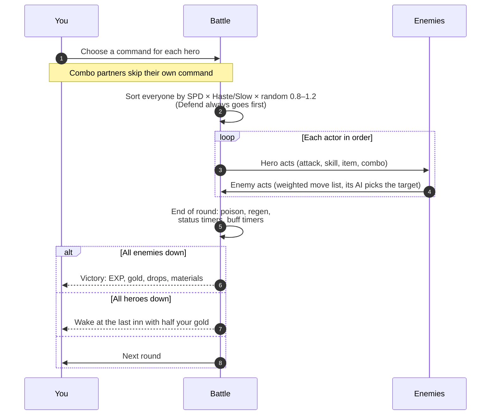

**Repeat last turn:** press **Shift**, **R** (touch) or **X** (gamepad) at the first hero's command menu to give everyone the same commands as last round. **Config → Battle speed** runs battles at 2× or 4×.

Some late bosses **act twice per round**. Every boss **changes tactics when hurt**: below a share of its HP it announces the change and switches to a new move list (see [Bosses](#bosses)).

### Elements: weak, resist, absorb

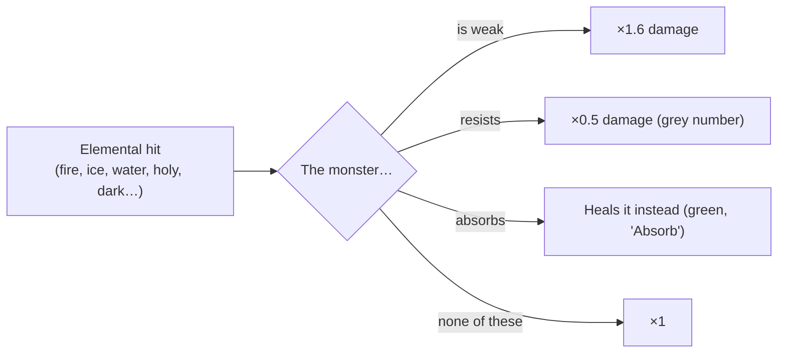

The bestiary shows each monster's weaknesses, resistances and absorbs once you've met it. Fire on a Magma Slime or water on the Leviathan heals them, so switch elements.

### Enemy behaviour

Most enemies pick a random target. Some are smarter, and the bestiary says so:

| AI | What it does | Examples |
| --- | --- | --- |
| Hunts the wounded | 60% of the time it attacks the hero lowest on HP | Wolves, Bandits, Deep Ones, Ozymar, the Hollow King, Orun, Vane |
| Hunts casters | 60% of the time it goes for Lyra, Oswin or Selene | Hollow Knights, Dread Knights, Cinder Knights, Vesper |
| Heals allies | Heals the most hurt monster (often not itself) when one is below half HP | Tomb Priests, Hollow Heralds, the Drowned Abbot |

### Formulas

| Thing | Formula |
| --- | --- |
| Physical damage | `(ATK − DEF ÷ 2) × multiplier × random(0.88–1.12)`, minimum 1 |
| Magic damage | `(spell power + MAG) × random(0.92–1.08) × weakness − target MAG × 0.4` |
| Weakness | Damage ×**1.6** if the target is weak to the element |
| Critical hit | Chance `6% + SPD × 0.1%`; damage ×**1.7** |
| Miss | Your attacks: 3%. Enemy attacks: `3% + (your SPD − their SPD) × 0.4%`, between 2% and 12% |
| Defend | Halves physical damage and cuts magic by 40% until your next turn |
| Rally | Party ATK ×1.35 for 4 rounds |
| Barrier | Party DEF ×1.4 and enemy magic ×0.6 for 4 rounds |
| Holy physical skills | ATK × `(1 + MAG ÷ 200)`, so Arin's MAG makes Sunstrike and Dawnbreak stronger |
| Gravity | 25% of the target's current HP (8% on bosses) |
| Poison | Heroes lose 6% of max HP per round (never below 1); enemies lose 5% (at most 250) |
| Regen | Renew: 8% of max HP per round for 5 rounds. Regen accessories: 5% per round |
| Steal | `55% + (your SPD − their SPD) × 2%`, between 25% and 92%; once per enemy. Some monsters carry a **rare item** (★): a successful steal takes it first with the listed chance, doubled by the Thief's Gloves or the Bestiary Seal |
| Run | `60% + (party SPD − enemy SPD) × 3%`, between 30% and 95%. Never from bosses or in the Arena |
| First strike | 8% of normal battles (25% with Lookout on the Lantern Board): the enemies lose their first round |
| Blind | Physical attacks and skills miss 50% of the time |
| Haste / Slow | Turn speed ×1.6 / ×0.6 |
| Sleep | Heroes sleep 2 rounds and enemies 3. Any hit wakes an enemy; a hit wakes a hero 60% of the time |

### Statuses

| Status | Effect | Cured by | Prevented by |
| --- | --- | --- | --- |
| Poison | Loses HP every round | Antidote, Remedy, Purify, Sanctuary | Tide Pendant, Desert Veil, Silk Ribbon, Orrin's Seal, and others |
| Sleep | Skips turns | Getting hit, Remedy, Purify | Wake Charm, Pip's Candle, Dwarven Band, Nightglass Locket, and others |
| Silence | Can't use skills or combos | Remedy, Purify, Sanctuary | Echo Bell, Sage Circlet, Dwarven Band, Eclipse Mantle, and others |
| Blind | Attacks and physical skills miss half the time | Remedy, Purify, Sanctuary | Eye Charm, Sun Circlet, Scholar's Monocle, all-ailment accessories |
| Slow | Acts later (speed ×0.6) | Remedy, Purify, Haste, Sanctuary | Hourglass Pin, Starlit Cloak, all-ailment accessories |
| Berserk | Attacks a random foe every turn with ATK ×1.5; you can't give orders | Remedy, Purify, wears off (3 rounds) | Calm Charm, all-ailment accessories |
| Stop | Loses every turn | Remedy, Purify, wears off (2 rounds) | Clockwork Charm, Night Cloak, all-ailment accessories |
| Haste | Acts sooner (speed ×1.6) for 4 rounds | Wears off; Slow cancels it | — |
| Regen | Heals every round | Wears off | — |

Heroes are blinded or slowed for 3 rounds, enemies for 4. Bosses are immune to Sleep and Silence, take Slow half as often and Blind 30% as often. Kestrel's Venom Edge poisons bosses 40% of the time. A **Hotpot meal** (see [Cooking](#cooking)) prevents every ailment.

New in 1.6: Oswin learns **Haste** at Lv 24, Kestrel **Flash Powder** (blind all foes) at Lv 18, and Selene starts with **Slow**.

---

## The Lantern Board

From **level 30** every level-up gives the hero an **Ember**. At the level cap, every **20,000 EXP** gives another. Spend Embers on the hero's **Lantern Board**: open **Status**, pick a hero and press **Enter**. A node can be lit once one of its neighbours is lit. Every hero starts with the Spark lit. Lighting the whole board takes 23 Embers.

Saves from before 1.6 get the Embers their heroes would already have earned (one per level from 30).

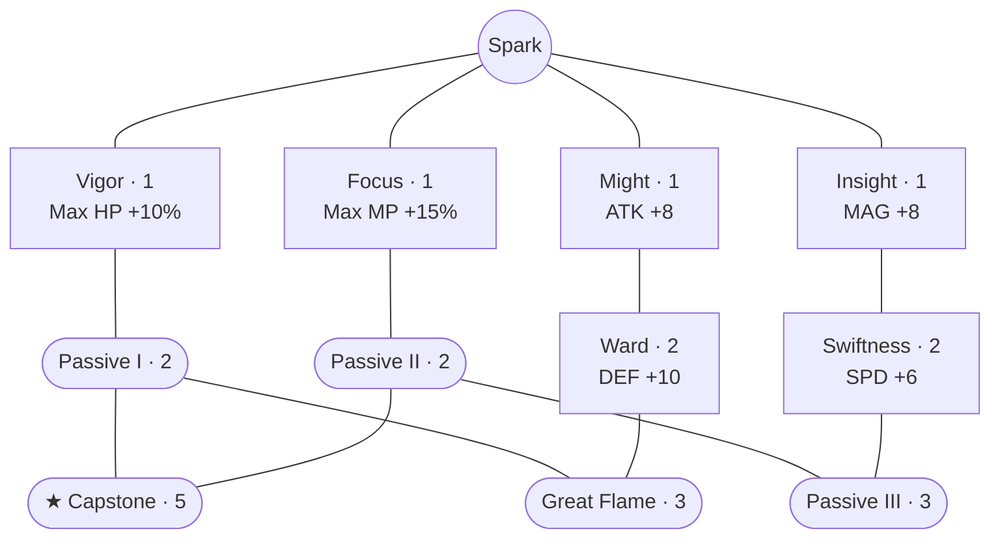

| Node | Embers | Effect | Linked to |
| --- | --- | --- | --- |
| **Vigor** | 1 | Max HP +10% | Passive I, the Spark |
| **Focus** | 1 | Max MP +15% | Passive II, the Spark |
| **Might** | 1 | ATK +8 | Ward, the Spark |
| **Insight** | 1 | MAG +8 | Swiftness, the Spark |
| **Passive I** | 2 | A passive (see below) | Vigor, Great Flame, ★ Capstone |
| **Passive II** | 2 | A passive (see below) | Focus, Passive III, ★ Capstone |
| **Ward** | 2 | DEF +10 | Might, Great Flame |
| **Swiftness** | 2 | SPD +6 | Insight, Passive III |
| **Great Flame** | 3 | +20 to the hero's main stat (see below) | Passive I, Ward |
| **Passive III** | 3 | A passive (see below) | Passive II, Swiftness |
| **★ Capstone** | 5 | A passive (see below) | Passive I, Passive II |

What the passives and the Great Flame do depends on the hero:

| Hero | Great Flame | Passive I | Passive II | Passive III | Capstone |
| --- | --- | --- | --- | --- | --- |
| **Arin** | ATK +20 | Counter: 20% chance to strike back when hit by an attack. | Quick Limit: The Limit gauge fills 50% faster. | Auto-Regen: Starts every battle with Regen. | **Lamplighter's Resolve**: Once per battle, survive a fatal blow with 1 HP. |
| **Lyra** | MAG +20 | MP Saver: Skills cost 25% less MP. | Quick Limit: The Limit gauge fills 50% faster. | Auto-Haste: Starts every battle with Haste. | **Wildfire**: Magic damage +20%. |
| **Oswin** | MAG +20 | MP Saver: Skills cost 25% less MP. | Auto-Regen: Starts every battle with Regen. | Lookout: The party gets the first strike far more often. | **Tidal Grace**: Healing +30%. |
| **Kestrel** | ATK +20 | Counter: 20% chance to strike back when hit by an attack. | Lookout: The party gets the first strike far more often. | Auto-Haste: Starts every battle with Haste. | **Ghost Step**: Dodge 25% of attacks. |
| **Selene** | MAG +20 | MP Saver: Skills cost 25% less MP. | Quick Limit: The Limit gauge fills 50% faster. | Auto-Haste: Starts every battle with Haste. | **Twilight**: Dark damage +25%. |

---

## Bosses

| Boss | Where | HP | ATK | MAG | SPD | Turns | Weak to | Resists | Steal | Special attacks | When hurt |
| --- | --- | --- | --- | --- | --- | --- | --- | --- | --- | --- | --- |
| **Gloomcap** | Whisperwood Hollow 2F | 520 | 35 | 22 | 8 | 1 | Fire | — | Ether | Spore Cloud, Slam | Below 50% HP: more aggressive |
| **Drowned Warden** | Sunken Shrine 2F | 1900 | 80 | 55 | 10 | 1 | Bolt | — | Hi-Ether | Tidal Wave, Cleave | Below 50% HP: more aggressive |
| **Vesper** | Emberdeep Mines 3F | 5000 | 115 | 104 | 24 | 1 | Holy | — | Elixir | Shadow Bolt, Hollow Night, Drain, Hush | Below 40% HP: adds Heavy Night |
| **Leviathan** | Whirlpool, open sea (bounty) | 3500 | 97 | 78 | 14 | 1 | Bolt | absorbs water | Hi-Ether | Maelstrom, Crushing Coil | Below 50% HP: more aggressive |
| **Ozymar, the First King** | Tomb of the First King 3F | 6200 | 138 | 110 | 24 | 1 | — | — | Megalixir · ★ Sun Circlet (25%) | Sandstorm, Hush, Drain, Cleave | Below 50% HP: adds Dazzle |
| **Astral Wyrm** | Starfall Observatory 3F (optional) | 12000 | 182 | 150 | 30 | 1 | — | — | Megalixir · ★ Starlit Cloak (20%) | Meteor Rain, Starfire Breath, Frost Breath, Dream Fog, Crushing Coil | Below 35% HP, 2 turns: adds Heavy Night |
| **The Hollow King** | Hollow Spire 3F (phase 1) | 6500 | 165 | 135 | 28 | 1 | — | — | Megalixir · ★ King's Signet (20%) | Crown of Ash, Eclipse, Cleave | Below 50% HP: adds Time Warp |
| **Hollow King, Unbound** | Hollow Spire 3F (phase 2) | 5200 | 175 | 148 | 32 | 1 | — | — | Megalixir | Crown of Ash, Eclipse, Drain, Frost Breath, Blaze | Below 35% HP, 2 turns: more aggressive |
| **The Hollow Crown** | Crownfall Abyss 4F (phase 1) | 8000 | 205 | 192 | 32 | 2 | — | — | Megalixir · ★ Megalixir (50%) | Crownfall, Shadow Bolt, Hollow Hush, Dream Fog, Meteor Rain | Below 40% HP: adds Dazzle |
| **Orun, the Night-Bearer** | Crownfall Abyss 4F (phase 2) | 9500 | 232 | 204 | 34 | 2 | — | — | Megalixir | Crown of Ash, Drain, Frost Breath, Night Song, Starfire Breath | Below 40% HP: adds Heavy Night |
| **The Lamp-Eater** | The last roadside lamp (Arin) | 12500 | 210 | 218 | 30 | 2 | Holy | — | Megalixir | Drain, Shadow Bolt, Meteor Rain, Hush | Below 50% HP: adds Dazzle |
| **Hearth Warden** | Ember Caves 2F (Lyra) | 9500 | 238 | 196 | 20 | 2 | Ice | — | Megalixir | Blaze, Ash Storm, Slam | Below 50% HP: adds Dazzle |
| **The Drowned Abbot** | Sea Mother's Grotto 2F (Oswin) | 9000 | 210 | 222 | 24 | 2 | Bolt | — | Megalixir | Maelstrom, Drain, Lullaby | Below 50% HP: adds Heavy Night |
| **Guildmaster Vane** | The Undercity 2F (Kestrel) | 8500 | 226 | 80 | 42 | 2 | — | — | Megalixir · ★ Thief's Gloves (30%) | Needle Storm, Venom Bite, Shatter | Below 50% HP: adds Blinding Sand |
| **Vesper's Echo** | Selene's dream, solo (Selene) | 2600 | 218 | 150 | 26 | 1 | Holy | — | Elixir | Shadow Bolt, Drain | Below 50% HP: adds Time Warp |
| **Nereus, the Drowned King** | The Drowned Palace 4F (sea floor) | 13000 | 225 | 210 | 28 | 2 | Bolt | absorbs water | Megalixir · ★ Siren Scale (30%) | Maelstrom, Drain, Heavy Night, Crown of Ash | Below 50% HP: adds Maelstrom |
| **The Tide That Remembers** | The Hadal Rift 2F (secret superboss) | 22000 | 238 | 240 | 34 | 2 | — | Dark, Ice, absorbs water | Megalixir · ★ Megalixir (100%) | Maelstrom, Undertow, Forget, Crushing Depths | Below 60% HP: adds Meteor Rain, Siren Song; Below 25% HP: adds Remember, Heavy Night |

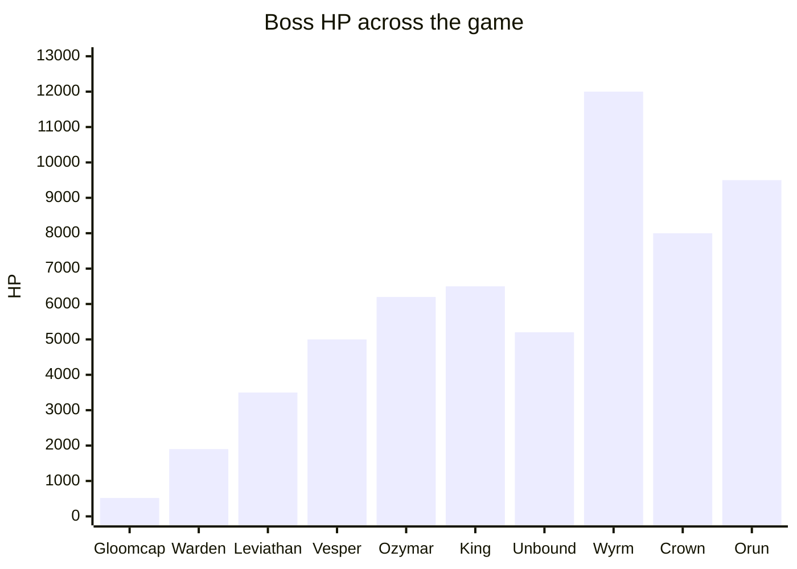

**Tips**

- **Gloomcap**: weak to Fire. Lyra's Fire is your main damage.
- **Drowned Warden**: weak to Bolt. Keep Oswin healing through Tidal Wave.
- **Vesper**: weak to Holy. Silence protection helps a lot against Hush.
- **Ozymar**: no weakness. Remedies for Hush; Barrier for Sandstorm.
- **The Hollow King**: two phases back to back. The light of the three Lanterns fully heals the party between them.
- **Astral Wyrm**: Dream Fog sends the whole party to sleep, so equip sleep immunity on at least two heroes.
- **The Hollow Crown and Orun**: both **act twice per round** (the *Turns* column). Crownfall hits everyone hard, so keep **Barrier** up, and carry **Remedies**: Hollow Hush can silence Oswin. The Lamp of Lastlight heals you between the phases. **Last Light** (Arin + Lyra + Selene) is the strongest combo in the game.

**How hard are the late bosses?** `tools/balance_sim.py`, 60 fights each, gear from the Spire and the tomb:

| Fight | Party | Win rate | Median rounds | Knockouts per fight |
| --- | --- | --- | --- | --- |
| The Lamp-Eater | Lv 44 | 100% | 12 | 0 |
| The Drowned Abbot | Lv 44 | 98% | 11 | 0.2 |
| Guildmaster Vane | Lv 44 (with Kestrel) | 87% | 9 | 1.8 |
| Hearth Warden | Lv 44 | 83% | 11 | 2.0 |
| Vesper's Echo | Selene alone, Lv 44 | 100% | 12 | 0 |

**How hard is the finale?** `tools/balance_sim.py` fights it 60 times per setup with the real battle code and a simple AI (no combos or Limits, since those come later):

| Party | Win rate | Median rounds | Knockouts per fight |
| --- | --- | --- | --- |
| Lv 42, Lastlight shop gear | 67% | 23 | 2.2 |
| Lv 42, gear from the Spire and tomb | 90% | 23 | 1.0 |
| Lv 45, gear from the Spire and tomb | 98% | 20 | 0.1 |
| Lv 50, forged weapons, arena prizes | 100% | 13 | 0 |

---

## Monsters by area

Ordered roughly as you meet them.

#### Brightwater plains (west of the river)

| Monster | HP | ATK | MAG | Weak to | Resists | Steal | Drops | EXP | Gold |
| --- | --- | --- | --- | --- | --- | --- | --- | --- | --- |
| Green Slime | 22 | 13 | 4 | Fire | — | Potion | Potion (12%) | 6 | 5 |
| Cave Bat | 18 | 15 | 2 | Bolt | — | Potion | — | 7 | 4 |
| Goblin | 34 | 17 | 2 | — | — | Antidote | Potion (15%) | 10 | 9 |
| Wild Wolf *(Hunts the wounded)* | 30 | 19 | 2 | Fire | — | Potion | — | 11 | 6 |

#### Whisperwood Hollow

| Monster | HP | ATK | MAG | Weak to | Resists | Steal | Drops | EXP | Gold |
| --- | --- | --- | --- | --- | --- | --- | --- | --- | --- |
| Spore Cap | 50 | 22 | 10 | Fire | — | Antidote | Antidote (25%) | 18 | 12 |
| Shade Bat | 42 | 26 | 4 | Bolt | — | Potion | — | 17 | 10 |
| Root Crawler | 66 | 25 | 4 | Fire | — | Potion | Potion (20%) | 22 | 15 |
| Goblin | 34 | 17 | 2 | — | — | Antidote | Potion (15%) | 10 | 9 |

#### Eastern lowlands (Port Halden)

| Monster | HP | ATK | MAG | Weak to | Resists | Steal | Drops | EXP | Gold |
| --- | --- | --- | --- | --- | --- | --- | --- | --- | --- |
| Gel Slime | 70 | 34 | 10 | Bolt | — | Potion | — | 26 | 20 |
| Hobgoblin | 95 | 41 | 4 | — | — | Hi-Potion | Hi-Potion (10%) | 34 | 28 |
| Harpy | 80 | 39 | 6 | Bolt | — | Potion | — | 30 | 22 |
| Sand Crab | 110 | 37 | 4 | Bolt | — | Antidote | — | 36 | 30 |

#### Sunken Shrine

| Monster | HP | ATK | MAG | Weak to | Resists | Steal | Drops | EXP | Gold |
| --- | --- | --- | --- | --- | --- | --- | --- | --- | --- |
| Drowned One | 140 | 49 | 8 | Holy, Fire | Water | Ether | Hi-Potion (15%) | 50 | 35 |
| Tide Serpent | 160 | 53 | 20 | Bolt | absorbs water | Hi-Potion | — | 58 | 40 |
| Will-o-Wisp | 100 | 30 | 38 | Holy, Fire | — | Ether | — | 52 | 32 |

#### Open sea

| Monster | HP | ATK | MAG | Weak to | Resists | Steal | Drops | EXP | Gold |
| --- | --- | --- | --- | --- | --- | --- | --- | --- | --- |
| Sea Serpent | 200 | 60 | 30 | Bolt | absorbs water | Hi-Potion | — | 70 | 50 |
| King Crab | 240 | 62 | 6 | Bolt | — | Hi-Potion | — | 78 | 60 |
| Harpy | 80 | 39 | 6 | Bolt | — | Potion | — | 30 | 22 |

#### Northern continent (Ironhold, Frostmere)

| Monster | HP | ATK | MAG | Weak to | Resists | Steal | Drops | EXP | Gold |
| --- | --- | --- | --- | --- | --- | --- | --- | --- | --- |
| Frost Wolf *(Hunts the wounded)* | 220 | 68 | 20 | Fire | Ice | Hi-Potion | Frost Crystal (22%) | 85 | 55 |
| Ice Golem | 340 | 76 | 10 | Fire | absorbs ice | Ether | Frost Crystal (22%) | 110 | 80 |
| Snow Imp | 180 | 52 | 58 | Fire | Ice | Ether | Frost Crystal (22%) | 90 | 70 |
| Ogre | 300 | 86 | 5 | — | — | Hi-Potion | Hi-Potion (25%) | 120 | 110 |

#### Emberdeep Mines

| Monster | HP | ATK | MAG | Weak to | Resists | Steal | Drops | EXP | Gold |
| --- | --- | --- | --- | --- | --- | --- | --- | --- | --- |
| Magma Slime | 320 | 84 | 60 | Ice | absorbs fire | Ember Bomb | Ember Core (22%) | 150 | 100 |
| Fire Bat | 260 | 88 | 40 | Ice | Fire | Ember Bomb | Ember Core (22%) | 140 | 90 |
| Dwarf Revenant | 420 | 98 | 20 | Holy | — | Hi-Ether | Ether (15%) | 180 | 130 |
| Ember Golem | 520 | 104 | 50 | Ice | absorbs fire | X-Potion | Ember Core (22%) | 220 | 160 |

#### Sunscar Desert and the Aerie valley

| Monster | HP | ATK | MAG | Weak to | Resists | Steal | Drops | EXP | Gold |
| --- | --- | --- | --- | --- | --- | --- | --- | --- | --- |
| Sandworm | 420 | 96 | 30 | Ice | — | Hi-Potion | — | 170 | 120 |
| Death Scorpion | 330 | 100 | 20 | Ice | — | Antidote | — | 160 | 110 |
| Sand Bandit *(Hunts the wounded)* | 360 | 98 | 20 | — | — | Ember Bomb · ★ X-Potion (15%) | Hi-Potion (30%) | 165 | 220 |
| Cactoid | 300 | 90 | 40 | Fire | — | Remedy | — | 150 | 100 |

#### Tomb of the First King

| Monster | HP | ATK | MAG | Weak to | Resists | Steal | Drops | EXP | Gold |
| --- | --- | --- | --- | --- | --- | --- | --- | --- | --- |
| Mummy | 640 | 128 | 60 | Fire, Holy | — | Remedy | Sun Gold (22%) | 260 | 180 |
| Gilded Scarab | 520 | 120 | 30 | Ice | — | Hi-Ether · ★ Megalixir (8%) | Sun Gold (22%) | 240 | 260 |
| Sphinx | 940 | 142 | 120 | Bolt | — | X-Potion | Sun Gold (22%) | 320 | 240 |
| Cursed Priest *(Heals allies)* | 680 | 90 | 132 | Holy | — | Elixir · ★ Elixir (20%) | — | 280 | 230 |
| Gilded Golem | 1050 | 146 | 40 | Bolt | — | X-Potion · ★ Sun Gold (30%) | Sun Gold (22%) | 340 | 400 |

#### Isle of Dusk

| Monster | HP | ATK | MAG | Weak to | Resists | Steal | Drops | EXP | Gold |
| --- | --- | --- | --- | --- | --- | --- | --- | --- | --- |
| Hollow Knight *(Hunts casters)* | 700 | 138 | 30 | Holy | Dark | X-Potion | Hi-Potion (25%), Dusk Silk (22%) | 300 | 220 |
| Night Gaze | 520 | 80 | 118 | Bolt | — | Hi-Ether | Dusk Silk (22%) | 280 | 200 |
| Shade Wraith | 600 | 118 | 100 | Holy | Dark | Ether | Dusk Silk (22%) | 290 | 210 |
| Chimera *(Hunts the wounded)* | 900 | 148 | 90 | Ice | — | X-Potion | Dusk Silk (22%) | 350 | 260 |

#### Hollow Spire

| Monster | HP | ATK | MAG | Weak to | Resists | Steal | Drops | EXP | Gold |
| --- | --- | --- | --- | --- | --- | --- | --- | --- | --- |
| Void Slime | 780 | 140 | 110 | Holy | absorbs dark | Hi-Ether | Dusk Silk (22%) | 320 | 240 |
| Shade Wraith | 600 | 118 | 100 | Holy | Dark | Ether | Dusk Silk (22%) | 290 | 210 |
| Dread Knight *(Hunts casters)* | 1000 | 160 | 40 | Holy | Dark | Megalixir · ★ Megalixir (10%) | X-Potion (15%), Dusk Silk (22%) | 420 | 320 |
| Night Gaze | 520 | 80 | 118 | Bolt | — | Hi-Ether | Dusk Silk (22%) | 280 | 200 |
| Hollow Knight *(Hunts casters)* | 700 | 138 | 30 | Holy | Dark | X-Potion | Hi-Potion (25%), Dusk Silk (22%) | 300 | 220 |
| Chimera *(Hunts the wounded)* | 900 | 148 | 90 | Ice | — | X-Potion | Dusk Silk (22%) | 350 | 260 |

#### Starfall Observatory

| Monster | HP | ATK | MAG | Weak to | Resists | Steal | Drops | EXP | Gold |
| --- | --- | --- | --- | --- | --- | --- | --- | --- | --- |
| Starspawn | 1100 | 120 | 150 | Bolt | — | Hi-Ether · ★ Star Shard (30%) | Star Shard (22%) | 520 | 380 |
| Astral Knight *(Hunts casters)* | 1400 | 182 | 60 | Holy | — | Megalixir | X-Potion (20%), Star Shard (22%) | 600 | 420 |
| Void Drake | 1500 | 175 | 130 | Holy | — | X-Potion | Star Shard (22%) | 650 | 480 |
| Nebula Slime | 1000 | 160 | 140 | Ice | — | Hi-Ether | Star Shard (22%) | 480 | 360 |
| Comet Imp | 900 | 140 | 150 | Ice | — | Elixir | Star Shard (22%) | 450 | 340 |

#### Ashen Isle

| Monster | HP | ATK | MAG | Weak to | Resists | Steal | Drops | EXP | Gold |
| --- | --- | --- | --- | --- | --- | --- | --- | --- | --- |
| Ash Hound *(Hunts the wounded)* | 1500 | 196 | 60 | Ice | — | X-Potion | Abyss Ash (12%) | 640 | 420 |
| Cinder Wisp | 1200 | 120 | 176 | Ice, Holy | absorbs fire | Hi-Ether | Ember Core (20%) | 600 | 400 |
| Cinder Knight *(Hunts casters)* | 2000 | 212 | 60 | Ice | Fire | Megalixir | X-Potion (20%), Abyss Ash (15%) | 760 | 520 |
| Ash Colossus | 2600 | 220 | 40 | Bolt | Fire | X-Potion | Ember Core (25%) | 820 | 600 |

#### Crownfall Abyss

| Monster | HP | ATK | MAG | Weak to | Resists | Steal | Drops | EXP | Gold |
| --- | --- | --- | --- | --- | --- | --- | --- | --- | --- |
| Crown Shard | 1500 | 140 | 196 | Bolt | — | Hi-Ether | Abyss Ash (20%) | 700 | 500 |
| Gloam Knight *(Hunts casters)* | 2800 | 240 | 70 | Holy | Dark | Megalixir | Megalixir (10%), Abyss Ash (25%) | 960 | 680 |
| Nightmare *(Hunts the wounded)* | 2600 | 232 | 90 | Holy | absorbs dark | Megalixir | Dusk Silk (25%) | 880 | 600 |
| Abyss Ooze | 2000 | 196 | 188 | Holy | absorbs dark | Hi-Ether | Abyss Ash (20%) | 760 | 520 |
| Hollow Herald *(Heals allies)* | 2100 | 140 | 206 | Holy | Dark | Elixir | Dusk Silk (20%) | 820 | 560 |

#### Ember Caves (Lyra's quest)

| Monster | HP | ATK | MAG | Weak to | Resists | Steal | Drops | EXP | Gold |
| --- | --- | --- | --- | --- | --- | --- | --- | --- | --- |
| Kiln Imp | 1600 | 150 | 190 | Ice | Fire | Hi-Ether | Ember Core (25%) | 650 | 450 |
| Cinder Serpent | 1900 | 205 | 120 | Ice | — | X-Potion | Ember Core (20%) | 700 | 480 |
| Cinder Wisp | 1200 | 120 | 176 | Ice, Holy | absorbs fire | Hi-Ether | Ember Core (20%) | 600 | 400 |
| Ash Colossus | 2600 | 220 | 40 | Bolt | Fire | X-Potion | Ember Core (25%) | 820 | 600 |

#### Sea Mother's Grotto (Oswin's quest)

| Monster | HP | ATK | MAG | Weak to | Resists | Steal | Drops | EXP | Gold |
| --- | --- | --- | --- | --- | --- | --- | --- | --- | --- |
| Deep One *(Hunts the wounded)* | 2000 | 200 | 170 | Bolt | absorbs water | Hi-Ether | Frost Crystal (20%) | 720 | 500 |
| Pearl Guard | 2300 | 215 | 60 | Bolt | — | Megalixir · ★ Megalixir (12%) | Sun Gold (20%) | 760 | 900 |
| Abyss Ooze | 2000 | 196 | 188 | Holy | absorbs dark | Hi-Ether | Abyss Ash (20%) | 760 | 520 |
| Hollow Herald *(Heals allies)* | 2100 | 140 | 206 | Holy | Dark | Elixir | Dusk Silk (20%) | 820 | 560 |

#### The Undercity (Kestrel's quest)

| Monster | HP | ATK | MAG | Weak to | Resists | Steal | Drops | EXP | Gold |
| --- | --- | --- | --- | --- | --- | --- | --- | --- | --- |
| Guild Cutpurse *(Hunts the wounded)* | 1500 | 200 | 60 | — | — | Elixir · ★ Thief's Gloves (4%) | X-Potion (25%), Dusk Silk (20%) | 640 | 1200 |
| Guild Enforcer | 2700 | 235 | 40 | — | — | Megalixir | Sun Gold (15%) | 820 | 900 |
| Sewer Ooze | 1700 | 180 | 170 | Fire | — | Remedy | Dusk Silk (20%) | 640 | 420 |

#### The sea floor (1.7)

| Monster | HP | ATK | MAG | Weak to | Resists | Steal | Drops | EXP | Gold |
| --- | --- | --- | --- | --- | --- | --- | --- | --- | --- |
| Lantern Jelly | 2400 | 190 | 210 | Bolt | absorbs water | Hi-Ether | Deep Pearl (15%) | 900 | 600 |
| Abyssal Angler *(Hunts the wounded)* | 3000 | 240 | 80 | Bolt | Water | X-Potion | Deep Pearl (20%) | 1000 | 700 |
| Kelp Horror | 2800 | 210 | 150 | Fire | Water | X-Potion | — | 950 | 600 |
| Trench Crab | 3200 | 230 | 40 | Bolt | — | Hi-Ether · ★ Megalixir (10%) | Deep Pearl (25%) | 1000 | 900 |
| Drowned Sentinel *(Hunts casters)* | 3600 | 245 | 60 | Bolt | Water | Elixir | Sun Gold (15%) | 1100 | 800 |

#### The Drowned Palace

| Monster | HP | ATK | MAG | Weak to | Resists | Steal | Drops | EXP | Gold |
| --- | --- | --- | --- | --- | --- | --- | --- | --- | --- |
| Drowned Courtier | 3000 | 235 | 120 | Holy | Water | X-Potion | — | 1100 | 900 |
| Siren of Nerith *(Heals allies)* | 2600 | 150 | 230 | Bolt | absorbs water | Hi-Ether · ★ Siren Scale (15%) | — | 1150 | 950 |
| Coral Golem | 4200 | 250 | 40 | Bolt | Water, Fire | X-Potion | Deep Pearl (30%) | 1300 | 1000 |
| Tide Wraith | 2200 | 160 | 240 | Holy | absorbs water | Hi-Ether | — | 1050 | 800 |
| Deep Gazer | 2400 | 140 | 220 | Holy | — | Remedy | — | 1000 | 750 |
| Drowned Sentinel *(Hunts casters)* | 3600 | 245 | 60 | Bolt | Water | Elixir | Sun Gold (15%) | 1100 | 800 |

#### The Hadal Rift

| Monster | HP | ATK | MAG | Weak to | Resists | Steal | Drops | EXP | Gold |
| --- | --- | --- | --- | --- | --- | --- | --- | --- | --- |
| Void Jelly | 3200 | 200 | 255 | Holy | absorbs dark, absorbs water | Megalixir | Deep Pearl (30%) | 1400 | 1000 |
| Hadal Angler *(Hunts the wounded)* | 4000 | 265 | 90 | Bolt | Water | Elixir · ★ Megalixir (15%) | Deep Pearl (35%) | 1500 | 1100 |
| Deep Gazer | 2400 | 140 | 220 | Holy | — | Remedy | — | 1000 | 750 |
| Drowned Sentinel *(Hunts casters)* | 3600 | 245 | 60 | Bolt | Water | Elixir | Sun Gold (15%) | 1100 | 800 |

#### At night

Between 20:30 and 5:30, half of the world's random battles come from these tables instead.

| Area | Night monsters |
| --- | --- |
| Brightwater plains | Moonmoth, Shade Bat |
| Eastern lowlands | Gravewight, Will-o-Wisp, Shade Bat |
| Open sea | Ghostlight, Harpy |
| Northern continent | Frost Wraith, Dwarf Revenant, Snow Imp |
| Isle of Dusk | Shade Wraith, Hollow Knight, Night Gaze |
| Sunscar Desert | Night Jackal, Mummy, Death Scorpion |
| Ashen Isle | Cinder Wisp, Nightmare, Ash Hound |

---

## Side quests

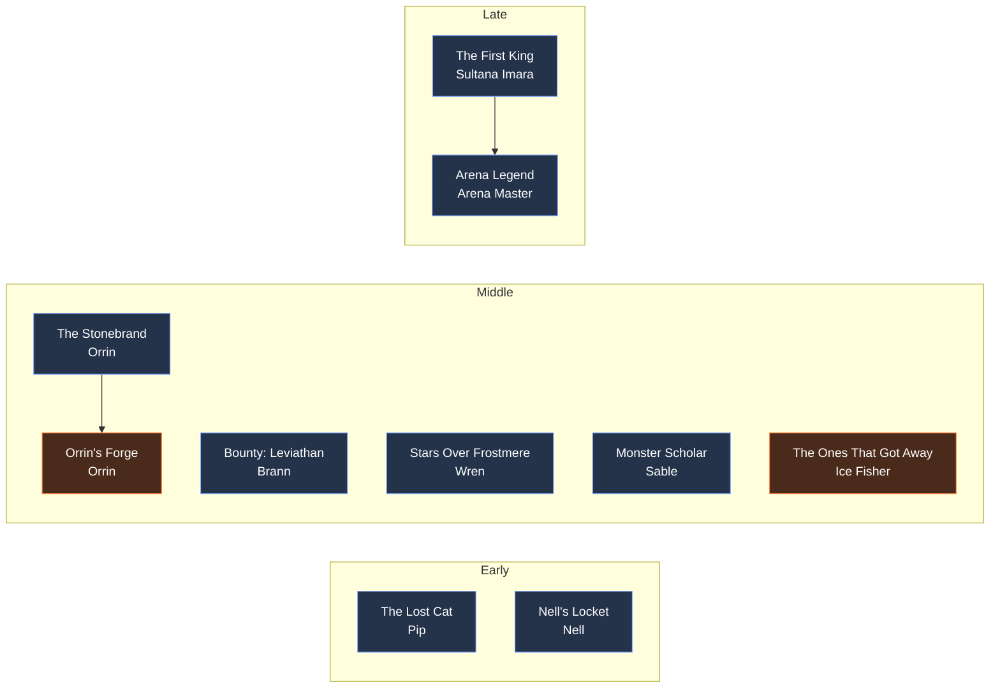

| Quest | Giver | What to do | Reward |
| --- | --- | --- | --- |
| The Lost Cat | Pip, Brightwater | Find Mittens on Whisperwood Hollow 1F | Pip's Candle |
| Nell's Locket | Nell, Port Halden | Find the locket on Sunken Shrine 1F | Tide Pendant |
| The Stonebrand | Orrin, Ironhold | Find the hammer on Emberdeep Mines 2F | Dwarven Band |
| Bounty: Leviathan | Brann, Port Halden (after the ship) | Sail into the whirlpool (Lv 16+) | 4000 G, Sailor's Compass |
| Stars Over Frostmere | Wren, Frostmere | Relight 3 Lanterns, then open the Observatory (Lv 32+) | The Fifth Flame |
| Monster Scholar | Sable, Frostmere | Record 30 creatures in the bestiary | Silk Ribbon |
| The First King | Sultana Imara, Mirage | Open the Tomb with the Sun Seal (Lv 26+) | The airship *Aurora* |
| Arena Legend | Arena Master, Aerie | Win the first five cups | Lantern Crown |
| **The Ones That Got Away** | Ice Fisher, Frostmere | Catch every kind of fish (6 kinds for the first reward) | Angler's Ring, Moonfin Charm |
| **Orrin's Forge** | Orrin, Ironhold (after The Stonebrand) | Forge three items | Orrin's Seal |
| **The Lamplighter's Road** | Elder Maren (after the ending) | Relight 12 roadside lamps | Sunbearer, ★ First Light |
| **Mother's Grimoire** | Mira (after the ending) | Ember Caves riddles and the Hearth Warden | Hearthstaff, ★ Phoenix Rite |
| **The Drowned Priesthood** | Sister Wenna (after the ending) | The Drowned Abbot in the Sea Mother's Grotto | Abbot's Bell, ★ High Tide |
| **Old Debts** | Ironhold jail guard (after the ending) | Guildmaster Vane in the Undercity | Pickpocket's Prize, ★ Grand Larceny |
| **Echo of Vesper** | Mira (after the ending) | Selene's solo dream duel | Duskstar, ★ Long Night |
| **The Festival of Lanterns** | Elder Maren | Finish all five hero quests | Heartlight |
| **The Complete Bestiary** | Sable, Frostmere (after Monster Scholar) | Record 45 creatures, then every one | Scholar's Monocle, Bestiary Seal |
| **The Drowned Kingdom** | Sister Wenna (after The Drowned Priesthood) | Dive to Nerith and face Nereus in the Drowned Palace | Crown of Nerith |
| **The Tide That Remembers** | Mother Ysolde, Nerith | The superboss in the Hadal Rift | Tidesong |
| **Lanternmoths** | Old Ivy, Brightwater (after The Lamplighter's Road) | Talk to her | Moth Whistle |
| **Buried Treasure** | Whisper, the Undermarket | Dig up all five treasure maps | 50,000 G |
| **Lanterns & Lies** | Tess, Brightwater (by day) | Beat all eight card players | Joker's Lantern |
| **The Sunset Opal** | Mags, the Undermarket (after Old Debts, with Kestrel) | The night heist in the Mirage palace vaults | Night Cloak |

---

## The Aerie Arena

Cups are gauntlets: several battles in a row with no inn in between. You can use items but can't run, and losing costs nothing. The prize is awarded once; rematches pay gold only.

| Cup | Level | Rounds | Opponents | Prize | Gold |
| --- | --- | --- | --- | --- | --- |
| **Bronze Cup** | 24+ | 3 | Hobgoblin + Hobgoblin + Hobgoblin → Ogre + Ogre → Magma Slime + Fire Bat + Magma Slime | Gale Sandals | 2000 |
| **Silver Cup** | 28+ | 3 | Dwarf Revenant + Dwarf Revenant → Ember Golem + Sphinx → Mummy + Cursed Priest + Mummy | Champion Belt | 4000 |
| **Gold Cup** | 32+ | 3 | Hollow Knight + Night Gaze → Chimera + Shade Wraith → Dread Knight + Dread Knight | Sage Circlet | 7000 |
| **Platinum Cup** | 36+ | 3 | Astral Knight + Starspawn → Void Drake + Void Drake → Ozymar, the First King | Phoenix Charm | 12000 |
| **Grand Champion** | 42+ | 4 | Drowned Warden → Vesper → Leviathan + Leviathan → Astral Wyrm | Lantern Crown | 30000 |
| **Eclipse Cup** | 46+ | 4 | Gloam Knight + Gloam Knight → Nightmare + Hollow Herald → Cinder Knight + Ash Colossus + Cinder Knight → Orun, the Night-Bearer | Eclipse Mantle | 50000 |

---

## Fishing

Get the **Old Fishing Rod** from the Ice Fisher in Frostmere. Then face any water (a pond, the river, a harbor, the sea from the shore, or the Shrine's pools) and press **Enter**.

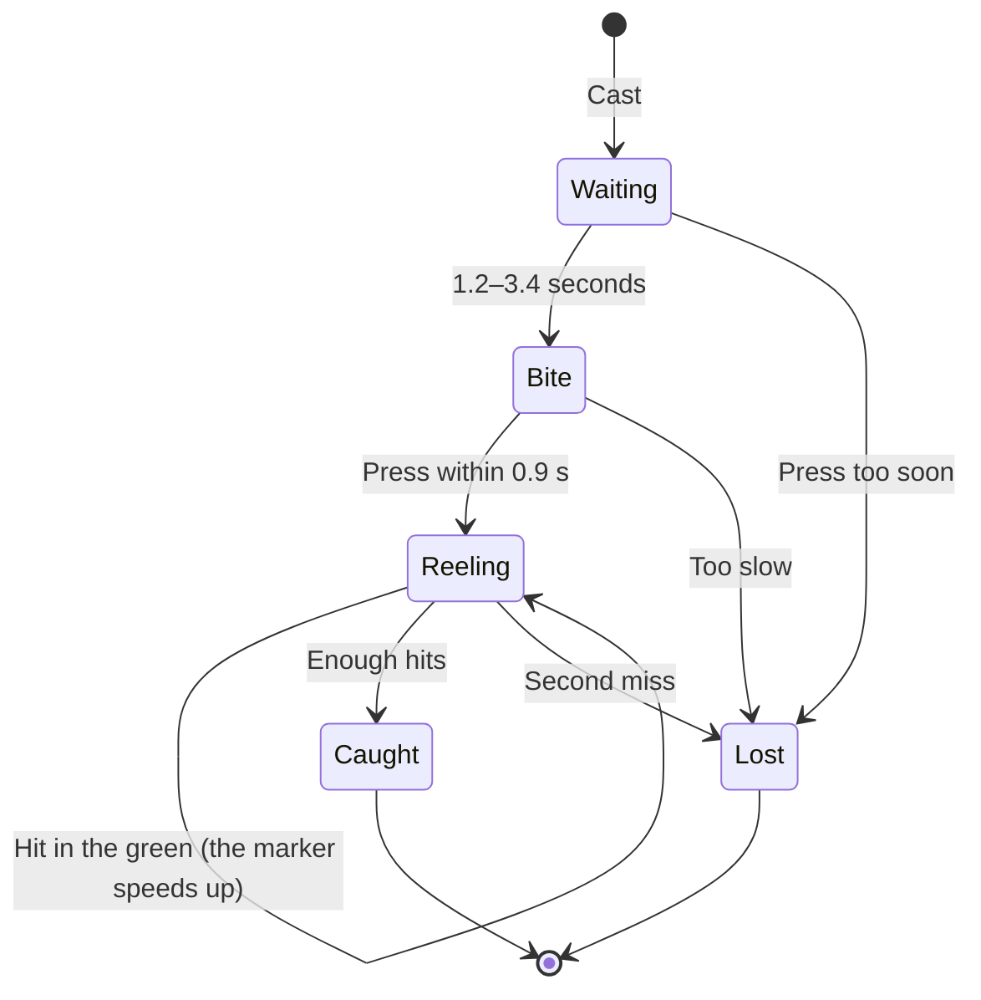

Harder fish need more hits and have a narrower green zone (30% of the bar for ★, 22% for ★★, 15% for ★★★).

| Fish | Difficulty | Reel hits | Value (shops pay half) | Where |
| --- | --- | --- | --- | --- |
| **Brook Minnow** | ★ | 2 | 20 | Brightwater pond (55%) The river (50%) |
| **River Trout** | ★ | 2 | 80 | Brightwater pond (36%) The river (50%) Lastlight pond (20%) |
| **Golden Carp** | ★★★ | 4 | 600 | Brightwater pond (9%) |
| **Sea Bass** | ★ | 2 | 90 | Port Halden harbor (50%) Open sea (from the shore) (55%) Sunken Shrine pools (20%) Ashen Isle shore (50%) |
| **Silver Mackerel** | ★★ | 3 | 140 | Port Halden harbor (30%) Open sea (from the shore) (36%) Sunken Shrine pools (40%) Ashen Isle shore (20%) |
| **Harbor Eel** | ★★ | 3 | 220 | Port Halden harbor (20%) Open sea (from the shore) (9%) Sunken Shrine pools (40%) |
| **Ice Pike** | ★★ | 3 | 260 | Frostmere pond (50%) |
| **Frost Char** | ★★ | 3 | 320 | Frostmere pond (40%) |
| **Snow Sturgeon** | ★★★ | 4 | 1200 | Frostmere pond (10%) |
| **Oasis Catfish** | ★★ | 3 | 300 | Mirage oasis (88%) Lastlight pond (40%) |
| **Mirage Pearlfish** | ★★★ | 4 | 1500 | Mirage oasis (12%) |
| **Ember Eel** | ★★★ | 4 | 900 | Lastlight pond (40%) Ashen Isle shore (30%) |
| **Lantern Koi** | ★★★ | 4 | 5000 | Anywhere, 3% per cast, after the ending |

---

## Cooking

Any innkeeper will cook your catch. Choose **Cook a meal** when you talk to them (it only appears when you're carrying fish). A meal lasts for the next **3 battles**, win, lose or run, and shows under the menu. Cooking a new meal replaces the old one.

| Meal | Ingredients | Effect (next 3 battles) |
| --- | --- | --- |
| **Minnow Fry** | Brook Minnow ×3 | Start battles with Regen. |
| **Grilled Trout** | River Trout ×2 | ATK +12%. |
| **Sea Bass Stew** | Sea Bass ×1, Silver Mackerel ×1 | DEF +12%. |
| **Eel Skewers** | Harbor Eel ×2 | SPD +15%. |
| **Frost Char Sashimi** | Frost Char ×1, Ice Pike ×1 | MAG +12%. |
| **Catfish Gumbo** | Oasis Catfish ×2 | Start battles with Haste. |
| **Ember Eel Hotpot** | Ember Eel ×2 | No ailments can take hold. |
| **Golden Carp Feast** | Golden Carp ×1, Brook Minnow ×1 | EXP +25%. |
| **Pearl Pilaf** | Mirage Pearlfish ×1 | Gold +50%. |
| **Snow Sturgeon Roast** | Snow Sturgeon ×1 | ATK and MAG +15%. |
| **Lantern Koi Banquet** | Lantern Koi ×1 | All stats +15%, and Regen. |

---

## Orrin's Forge

After *The Stonebrand*, talk to Orrin in Ironhold and choose **Forge**. Materials drop from monsters (the bestiary lists who drops what) and a few come from Abyss chests.

| Material | Value (shops pay half) | Dropped by |
| --- | --- | --- |
| **Ember Core** | 400 | Magma Slime, Fire Bat, Ember Golem, Cinder Wisp, Ash Colossus, Kiln Imp, Cinder Serpent |
| **Frost Crystal** | 400 | Frost Wolf, Ice Golem, Snow Imp, Deep One, Frost Wraith |
| **Sun Gold** | 600 | Mummy, Gilded Scarab, Sphinx, Gilded Golem, Pearl Guard, Guild Enforcer, Drowned Sentinel |
| **Star Shard** | 800 | Starspawn, Astral Knight, Nebula Slime, Void Drake, Comet Imp |
| **Dusk Silk** | 700 | Hollow Knight, Night Gaze, Shade Wraith, Chimera, Void Slime, Dread Knight, Nightmare, Hollow Herald, Guild Cutpurse, Sewer Ooze |
| **Abyss Ash** | 1200 | Ash Hound, Cinder Knight, Crown Shard, Abyss Ooze, Gloam Knight |
| **Deep Pearl** | 1500 | Lantern Jelly, Abyssal Angler, Trench Crab, Coral Golem, Void Jelly, Hadal Angler |

| Forges | Type | Materials | Gold | Stats |
| --- | --- | --- | --- | --- |
| **Forgeheart Ring** | accessory | Ember Core ×2, Frost Crystal ×2 | 3000 G | ATK+14 DEF+14 |
| **Emberforged Plate** | armor | Ember Core ×4, Sun Gold ×3 | 8000 G | DEF+48 |
| **Night Weave** | armor | Dusk Silk ×3, Frost Crystal ×3 | 8000 G | DEF+34 MAG+24 |
| **Gloam Leathers** | armor | Dusk Silk ×3, Star Shard ×2 | 8000 G | DEF+36 SPD+12 |
| **Lamplighter's Oath** | weapon | Star Shard ×3, Sun Gold ×2, Abyss Ash ×3 | 20000 G | ATK+88 MAG+20 |
| **Phoenix Staff** | weapon | Ember Core ×4, Star Shard ×3, Abyss Ash ×2 | 18000 G | ATK+20 MAG+66 |
| **Tidecaller** | weapon | Frost Crystal ×3, Sun Gold ×2, Abyss Ash ×2 | 18000 G | ATK+62 MAG+48 |
| **Gloamfang** | weapon | Dusk Silk ×4, Abyss Ash ×3 | 18000 G | ATK+80 SPD+14 |
| **Evenstar** | weapon | Dusk Silk ×3, Star Shard ×3, Abyss Ash ×2 | 18000 G | ATK+22 MAG+66 |
| **Abyssal Plate** | armor | Deep Pearl ×4, Abyss Ash ×2, Sun Gold ×2 | 24000 G | DEF+56 |
| **Pearl Veil** | armor | Deep Pearl ×4, Dusk Silk ×3 | 22000 G | DEF+42 MAG+30 |
| **Marlin Garb** | armor | Deep Pearl ×3, Dusk Silk ×2, Star Shard ×2 | 22000 G | DEF+44 SPD+16 |

---

## Equipment

### Weapons

**Arin**

| Weapon | Stats | Price | Where | Notes |
| --- | --- | --- | --- | --- |
| **Bronze Sword** | ATK+5 | 60 | Brightwater shop | A village blade. |
| **Iron Sword** | ATK+13 | 380 | Halden shop | Honest iron. |
| **Steel Sword** | ATK+24 | 1600 | Ironhold shop | Dwarf-forged steel. |
| **Mythril Sword** | ATK+36 | — | Chest, quest or boss | Light as a feather. |
| **Sunsteel Blade** | ATK+46 | 9000 | Mirage shop, Aerie shop | Forged in desert heat. |
| **Dawnblade** | ATK+54 MAG+8 | — | Chest, quest or boss | Forged from the first light. |
| **Ashsteel Blade** | ATK+62 | 22000 | Lastlight shop | Quenched in the Ashen Isle's cinders. |
| **Coral Blade** | ATK+74 MAG+10 | 30000 | Nerith shop | Red coral over steel. It never rusts. |
| **Lightbringer** | ATK+70 MAG+14 | — | Chest, quest or boss | Starlight given an edge. |
| **Lamplighter's Oath** | ATK+88 MAG+20 | — | Orrin's forge | Forged by Orrin. It burns brighter in the dark. |
| **Sunbearer** | ATK+100 MAG+28 | — | Chest, quest or boss | Lit from twelve roadside lamps. Arin's father's blade, reforged. |

**Lyra**

| Weapon | Stats | Price | Where | Notes |
| --- | --- | --- | --- | --- |
| **Oak Staff** | ATK+2 MAG+3 | 50 | Brightwater shop | Gnarled and warm. |
| **Mage Staff** | ATK+4 MAG+8 | 360 | Halden shop | Channels the arcane. |
| **Rune Staff** | ATK+7 MAG+15 | 1500 | Ironhold shop | Carved with old runes. |
| **Star Rod** | ATK+10 MAG+25 | — | Chest, quest or boss | Hums with starlight. |
| **Sky Staff** | ATK+12 MAG+34 | 8500 | Mirage shop, Aerie shop | Light as a cloud. |
| **Ember Scepter** | ATK+14 MAG+38 | — | Chest, quest or boss | The first flame, tamed. |
| **Cinder Staff** | ATK+14 MAG+44 | 20000 | Lastlight shop | The tip never stops smouldering. |
| **Celestia** | ATK+18 MAG+52 | — | Chest, quest or boss | Every star, in one staff. |
| **Pearl Staff** | ATK+18 MAG+56 | 28000 | Nerith shop | A black pearl that holds a flame underwater. |
| **Phoenix Staff** | ATK+20 MAG+66 | — | Orrin's forge | Forged by Orrin. Its flame relights itself. |
| **Hearthstaff** | ATK+26 MAG+84 | — | Chest, quest or boss | Lyra's mother's staff. It is always warm. |

**Oswin**

| Weapon | Stats | Price | Where | Notes |
| --- | --- | --- | --- | --- |
| **Iron Mace** | ATK+9 MAG+4 | 320 | Halden shop | Blessed iron. |
| **Steel Mace** | ATK+17 MAG+8 | 1400 | Ironhold shop | Heavy and sure. |
| **Tide Mace** | ATK+27 MAG+16 | — | Chest, quest or boss | Sings like the sea. |
| **Gilded Mace** | ATK+34 MAG+22 | — | Chest, quest or boss | Gold from the First King's tomb. |
| **Seraph Mace** | ATK+38 MAG+26 | — | Chest, quest or boss | Shines in the dark. |
| **Ashen Mace** | ATK+42 MAG+30 | 20000 | Lastlight shop | Grey iron, blessed in Lastlight. |
| **Astral Mace** | ATK+50 MAG+36 | — | Chest, quest or boss | Rings like a temple bell. |
| **Reef Mace** | ATK+50 MAG+40 | 28000 | Nerith shop | Struck from Nerith's old temple bell. |
| **Tidecaller** | ATK+62 MAG+48 | — | Orrin's forge | Forged by Orrin. The sea answers it. |
| **Abbot's Bell** | ATK+72 MAG+64 | — | Chest, quest or boss | The drowned priesthood's bell. It rings like the tide coming in. |

**Kestrel**

| Weapon | Stats | Price | Where | Notes |
| --- | --- | --- | --- | --- |
| **Steel Dagger** | ATK+20 | 1200 | Ironhold shop | Quick and quiet. |
| **Mythril Knife** | ATK+32 SPD+3 | — | Chest, quest or boss | A whisper of an edge. |
| **Sand Kris** | ATK+40 SPD+5 | — | Chest, quest or boss | Wavy and wicked. |
| **Shadow Fang** | ATK+46 SPD+6 | — | Chest, quest or boss | Cuts the space between moments. |
| **Ash Kris** | ATK+54 SPD+8 | 21000 | Lastlight shop | Leaves a trail of sparks. |
| **Comet Edge** | ATK+62 SPD+10 | — | Chest, quest or boss | Gone before you see it. |
| **Eel Fang** | ATK+66 SPD+10 | 29000 | Nerith shop | A knife that bends like an eel. It always finds the gap. |
| **Gloamfang** | ATK+80 SPD+14 | — | Orrin's forge | Forged by Orrin. Cuts twice for every swing you see. |
| **Pickpocket's Prize** | ATK+94 SPD+20 | — | Chest, quest or boss | Vane's own knife. Kestrel says she found it. |

**Selene**

| Weapon | Stats | Price | Where | Notes |
| --- | --- | --- | --- | --- |
| **Crescent Rod** | ATK+8 MAG+20 | — | Chest, quest or boss | Vesper's staff, cleansed. |
| **Moon Scepter** | ATK+12 MAG+32 | 6000 | Aerie shop | Silver and patient. |
| **Nocturne** | ATK+16 MAG+46 | — | Chest, quest or boss | Plays the dark like an instrument. |
| **Umbral Rod** | ATK+14 MAG+50 | 24000 | Lastlight shop | Shadow, held gently. |
| **Abyss Orb** | ATK+16 MAG+60 | 30000 | Nerith shop | Black water, held in a glass ball. Something swims in it. |
| **Evenstar** | ATK+22 MAG+66 | — | Orrin's forge | Forged by Orrin. The first star of evening. |
| **Duskstar** | ATK+28 MAG+84 | — | Chest, quest or boss | The first star after sunset, held in Selene's hand. |

### Armour

| Armor | Who | Stats | Price | Where |
| --- | --- | --- | --- | --- |
| **Cloth Robe** | Lyra, Oswin, Selene | DEF+2 MAG+1 | 40 | Brightwater shop |
| **Leather Armor** | Arin, Kestrel, Oswin | DEF+3 | 50 | Brightwater shop |
| **Silk Robe** | Lyra, Oswin, Selene | DEF+6 MAG+3 | 340 | Halden shop |
| **Chain Mail** | Arin, Oswin | DEF+9 | 450 | Halden shop |
| **Sage Robe** | Lyra, Oswin, Selene | DEF+12 MAG+7 | 1500 | Ironhold shop |
| **Thief Vest** | Kestrel | DEF+12 SPD+3 | 1300 | Ironhold shop |
| **Plate Armor** | Arin, Oswin | DEF+16 | 2000 | Ironhold shop |
| **Star Robe** | Lyra, Oswin, Selene | DEF+20 MAG+14 | — | Chest, quest or boss |
| **Shadow Garb** | Kestrel | DEF+22 SPD+7 | — | Chest, quest or boss |
| **Ash Robe** | Lyra, Oswin, Selene | DEF+24 MAG+16 | 16000 | Lastlight shop |
| **Mythril Mail** | Arin, Oswin | DEF+25 | — | Chest, quest or boss |
| **Ash Garb** | Kestrel | DEF+26 SPD+8 | 17000 | Lastlight shop |
| **Kelp Robe** | Lyra, Oswin, Selene | DEF+30 MAG+20 | 24000 | Nerith shop |
| **Sharkskin Garb** | Kestrel | DEF+32 SPD+10 | 25000 | Nerith shop |
| **Ash Mail** | Arin, Oswin | DEF+32 | 18000 | Lastlight shop |
| **Night Weave** | Lyra, Oswin, Selene | DEF+34 MAG+24 | — | Orrin's forge |
| **Dawn Plate** | Arin, Oswin | DEF+35 | — | Chest, quest or boss |
| **Gloam Leathers** | Kestrel | DEF+36 SPD+12 | — | Orrin's forge |
| **Nacre Mail** | Arin, Oswin | DEF+40 | 26000 | Nerith shop |
| **Pearl Veil** | Lyra, Oswin, Selene | DEF+42 MAG+30 | — | Orrin's forge |
| **Marlin Garb** | Kestrel | DEF+44 SPD+16 | — | Orrin's forge |
| **Emberforged Plate** | Arin, Oswin | DEF+48 | — | Orrin's forge |
| **Abyssal Plate** | Arin, Oswin | DEF+56 | — | Orrin's forge |

### Accessories

Anyone can wear any accessory. Only one is worn at a time.

| Accessory | Effect | Price | Where |
| --- | --- | --- | --- |
| **Gale Sandals** | SPD +12. Arena prize. | — | Quest, chest or prize |
| **Champion Belt** | ATK +12, DEF +12. Arena prize. | — | Quest, chest or prize |
| **Sage Circlet** | MAG +22. Prevents silence. Arena prize. | — | Quest, chest or prize |
| **Phoenix Charm** | DEF +6. Revives the wearer once per battle. Arena prize. | — | Quest, chest or prize |
| **Lantern Crown** | All +20, regen, +50% EXP, no ailments. Grand Champion's prize. | — | Quest, chest or prize |
| **Desert Veil** | DEF +8. Prevents poison. | 2400 | Mirage shop, Aerie shop |
| **Power Ring** | ATK +6. | 600 | Halden shop, Frostmere shop |
| **Guard Ring** | DEF +6. | 600 | Halden shop, Frostmere shop |
| **Mage Ring** | MAG +8. | 1400 | Ironhold shop, Mirage shop |
| **Swift Boots** | SPD +6. | 1600 | Mirage shop, Frostmere shop |
| **Wake Charm** | DEF +2. Prevents sleep. | 900 | Ironhold shop, Mirage shop, Frostmere shop |
| **Echo Bell** | MAG +3. Prevents silence. | 1100 | Aerie shop, Frostmere shop |
| **Scholar's Lens** | Wearer gains 50% more EXP. | 3500 | Aerie shop, Frostmere shop |
| **Pip's Candle** | MAG +4. Prevents sleep. "It's very small." | — | Quest, chest or prize |
| **Tide Pendant** | DEF +6, MAG +6. Prevents poison. | — | Quest, chest or prize |
| **Dwarven Band** | DEF +12. Prevents sleep and silence. | — | Quest, chest or prize |
| **Sailor's Compass** | SPD +4. Halves random encounters. | — | Quest, chest or prize |
| **Ember Heart** | ATK +5. Restores HP every round. | — | Quest, chest or prize |
| **Silk Ribbon** | DEF +8, MAG +8. Prevents all ailments. | — | Quest, chest or prize |
| **The Fifth Flame** | All stats +15. Regen. Prevents all ailments. | — | Quest, chest or prize |
| **Angler's Ring** | ATK +8, SPD +8. +50% gold from battles. | — | Quest, chest or prize |
| **Moonfin Charm** | All +12. Regen. Halves random encounters. | — | Quest, chest or prize |
| **Forgeheart Ring** | ATK +14, DEF +14. Forged by Orrin. | — | Orrin's forge |
| **Orrin's Seal** | ATK +6, DEF +18. Prevents all ailments. | — | Quest, chest or prize |
| **Eclipse Mantle** | DEF +24, MAG +24. Revives once per battle. Prevents silence. | — | Quest, chest or prize |
| **Nightglass Locket** | All +18. Prevents sleep. A drop of gentle night. | — | Quest, chest or prize |
| **Thief's Gloves** | SPD +10. Rare steals are twice as likely. Rare steal: Guildmaster Vane. | — | Blackmarket shop |
| **Starlit Cloak** | DEF +20, MAG +20. Prevents sleep and slow. Rare steal: Astral Wyrm. | — | Quest, chest or prize |
| **King's Signet** | ATK +18, MAG +18. Rare steal: the Hollow King. | — | Quest, chest or prize |
| **Sun Circlet** | MAG +16. Prevents blind and silence. Rare steal: Ozymar. | — | Quest, chest or prize |
| **Calm Charm** | DEF +6. Prevents berserk. | 2400 | Aerie shop |
| **Clockwork Charm** | SPD +6. Prevents stop. | 3000 | Aerie shop, Frostmere shop |
| **Eye Charm** | DEF +4. Prevents blind. | 2200 | Mirage shop, Frostmere shop |
| **Hourglass Pin** | SPD +4. Prevents slow. | 2600 | Aerie shop, Frostmere shop |
| **Scholar's Monocle** | MAG +14. +25% EXP. Prevents blind. Sable's reward. | — | Quest, chest or prize |
| **Bestiary Seal** | All +14. Rare steals twice as likely. Sable's reward for every creature. | — | Quest, chest or prize |
| **Siren Scale** | MAG +18. Prevents sleep and silence. Rare steal: Sirens of Nerith. | — | Quest, chest or prize |
| **Pressure Ring** | DEF +14, HP +300. Made to survive the deep. | 9000 | Nerith shop |
| **Lucky Doubloon** | All +6. +50% gold from battles. Buried treasure. | — | Quest, chest or prize |
| **Admiral's Hat** | SPD +10, DEF +8. Halves random encounters. Buried treasure. | — | Quest, chest or prize |
| **Crown of Nerith** | All +16. Prevents slow and sleep. The last king's crown, freely given. | — | Quest, chest or prize |
| **Tidesong** | All +26. Regen. No ailments. The sea remembers you now. | — | Quest, chest or prize |
| **Joker's Lantern** | All +10. Rare steals twice as likely. Every card player in the world, beaten. | — | Quest, chest or prize |
| **Night Cloak** | ATK +10, SPD +16. Prevents blind and stop. The Guild's finest. | — | Quest, chest or prize |
| **Heartlight** | All +20. Revives once per battle. No ailments. Five lights, one lantern. | — | Quest, chest or prize |
| **Crown of Dusk & Dawn** | All +25. Regen. No ailments. Both halves of the first crown, at peace. | — | Quest, chest or prize |

---

## Items

| Item | Price | Effect |
| --- | --- | --- |
| **Potion** | 20 | Restores 60 HP. |
| **Hi-Potion** | 120 | Restores 180 HP. |
| **X-Potion** | 600 | Fully restores HP. |
| **Ether** | 160 | Restores 40 MP. |
| **Hi-Ether** | 700 | Fully restores MP. |
| **Antidote** | 15 | Cures poison. |
| **Phoenix Plume** | 180 | Revives a fallen ally. |
| **Tent** | 120 | Rest on the world map. Restores the party. |
| **Elixir** | — | Fully restores HP and MP. |
| **Megalixir** | — | Fully restores the whole party. |
| **Remedy** | 60 | Cures every ailment, berserk and stop included. |
| **Rage Tonic** | 400 | Berserks an ally for 3 rounds: ATK ×1.5, but they attack on their own. |
| **Ember Bomb** | 90 | Deals fire damage to all foes. |
| **Star Bomb** | 900 | Bursts with holy light on all foes. |

### Key items

| Key item | Description |
| --- | --- |
| **Nell's Locket** | A silver locket with a tiny painted gull inside. |
| **Stonebrand** | Orrin's ancestral forge-hammer. Heavier than it looks. |
| **Sun Seal** | The royal seal of Mirage. It opens the First King's tomb. |
| **Star Chart** | Wren's chart. One constellation is circled: the Fifth Flame. |
| **Lamp of Lastlight** | Lit from Lastlight's thousand-year fire. The Abyss's mist fears it. |
| **Father's Ledger** | Arin's father's rounds: twelve roadside lamps on the four roads, all dark now. |
| **Mother's Grimoire** | Lyra and Selene's mother's book of flames. The last page is a riddle. |
| **The Last Letter** | From the drowned priesthood of the Sea Mother. It names a grotto on the east coast. |
| **Vane's Marker** | Kestrel's old debt to the Undercity Guild, with interest. A lot of interest. |
| **Old Fishing Rod** | Face water and press Enter to fish. Stand by the shore, a pond or a pier. |
| **Tessaly's Chart** | An old sea chart in the Abbot's hand. Four patches of black water are circled. |
| **Moth Whistle** | Old Ivy's bone whistle. Blow it at a lit roadside lamp and a lanternmoth comes down to carry you. |
| **Map: Smuggler's Cove** | X marks a beach south of Port Halden, where the causeway runs out to the Sunken Shrine. "Dig at the third palm." There are no palms. |
| **Map: The Cold Cairn** | A cairn in the snowfields between Frostmere and Ironhold. Someone has drawn a very cold-looking face. |
| **Map: Dune Sea** | Deep in the Sunscar, south of Mirage and west of the Tomb. "Where the sand sings at noon." |
| **Map: Hollow Root** | At the edge of the Whisperwood, north of Brightwater. The ink smells of moss. |
| **Map: Ash and Gold** | The Ashen Isle, south of Lastlight. Charred at the edges. Somebody wanted this burned. |
| **Sunset Opal** | A fist-sized opal the colour of a desert evening. The Guild says it was theirs first. |

---

## Levels and EXP

The level cap is **50**. Every surviving active hero gets the full EXP from a battle; reserve heroes get half. The Lantern Crown and the Scholar's Lens add +50% EXP for their wearer.

| Level | 5 | 10 | 15 | 20 | 25 | 30 | 35 | 40 | 45 | 50 |
| --- | --- | --- | --- | --- | --- | --- | --- | --- | --- | --- |
| Total EXP | 242 | 1,361 | 3,629 | 7,214 | 12,244 | 18,824 | 27,045 | 36,989 | 48,726 | 62,324 |

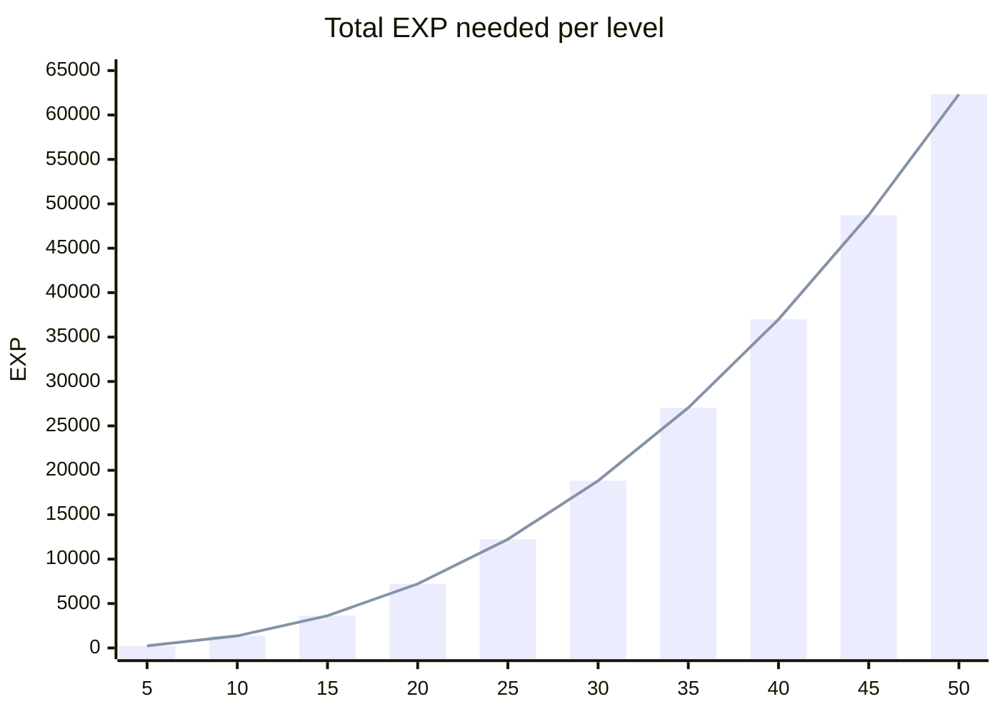

---

## New Game+

After the ending, the title screen offers **New Game+**. You keep your levels, equipment, items (except key items), gold and bestiary. Each cycle makes enemies stronger:

| Stat | Change per cycle |
| --- | --- |
| HP | +60% |
| ATK and MAG | +22% |
| DEF | +12% |
| EXP and gold | +50% |

---

## Trophies

Trophies (added in 1.8) belong to you, not to a save: earn one once and it stays, whichever slot you play and through New Game+. A toast appears when you earn one. See them from **Trophies** on the title screen, or ask **Scribe Tam** in Elder Maren's hall in Brightwater.

| Trophy | How to earn it |
| --- | --- |
| 🏆 **First Light** | Relight the Ember Lantern. |
| 🏆 **High Water** | Relight the Tide Lantern. |
| 🏆 **Heart of Stone** | Relight the Stone Lantern. |
| 🏆 **Lanternfall** | Finish the story. |
| 🏆 **The Crown Falls** | Finish Chapter VI in the Crownfall Abyss. |
| 🏆 **Sky-Bound** | Win the skyship Aurora from the First King. |
| 🏆 **The Fifth Flame** | Find the Fifth Flame in the Starfall Observatory. |
| 🏆 **Calm Waters** | Defeat the Leviathan. |
| 🏆 **Starslayer** | Defeat the Astral Wyrm. |
| 🏆 **His Father's Rounds** | Light all twelve roadside lamps. |
| 🏆 **Five Hearts** | Finish every hero's personal quest. |
| 🏆 **Let Go** | Free Nerith from its drowned king. |
| 🏆 **Unforgettable** | Defeat the Tide That Remembers. *(hidden in the game until earned)* |
| 🏆 **Grand Champion** | Win the first five cups at the Aerie Arena. |
| 🏆 **Eclipse** | Win the Eclipse Cup. |
| 🏆 **The One That Didn't Get Away** | Catch every kind of fish. |
| 🏆 **Family of the Forge** | Forge three pieces of gear with Orrin. |
| 🏆 **Natural Historian** | Record every creature in the bestiary. |
| 🏆 **X Marks Every Spot** | Dig up all five treasure maps. |
| 🏆 **Light Fingers** | Steal a rare (★) item. |
| 🏆 **Second Helpings** | Eat a meal cooked at an inn. |
| 🏆 **Moth to a Flame** | Ride a lanternmoth. |
| 🏆 **Into the Deep** | Dive to the sea floor. |
| 🏆 **Lamplighter's Fortune** | Carry 500,000 gold. |
| 🏆 **Past the Limit** | Use a Limit in battle. |
| 🏆 **Together** | Use a combo tech in battle. |
| 🏆 **Fifty** | Raise a hero to level 50. |
| 🏆 **Every Lamp Lit** | Light a hero's whole Lantern Board. |
| 🏆 **Once More, With Feeling** | Start New Game+. |
| 🏆 **Night Owl** | Win a battle at night. |
| 🏆 **Card Shark** | Beat every Lanterns & Lies player. |
| 🏆 **Full Deck** | Collect every Lanterns & Lies card. |
| 🏆 **Ghost of Mirage** | Steal the Sunset Opal without being caught. *(hidden in the game until earned)* |
| 🏆 **Lamplighter's Dash** | Finish the story in under 5 hours of play time. |

---

## Speedrun mode

Turn on **Config → Speedrun timer** to show your play time in the top-right corner. Play time counts on the field and, since 1.8, in battle too (real time, so a faster battle speed saves time). Each main Lantern is a split:

| Split | When it's taken |
| --- | --- |
| Ember Lantern | Relighting the Ember Lantern in Whisperwood Hollow |
| Tide Lantern | Relighting the Tide Lantern in the Sunken Shrine |
| Stone Lantern | Relighting the Stone Lantern in Emberdeep Mines |
| Dawn Lantern | The ending |

When a split is taken, a panel shows its time and the difference from your best run (green ahead, red behind). Your best run is saved when you finish faster than before. Runs on New Game+, and Lanterns lit before a save existed (saves from before 1.8), don't count.

