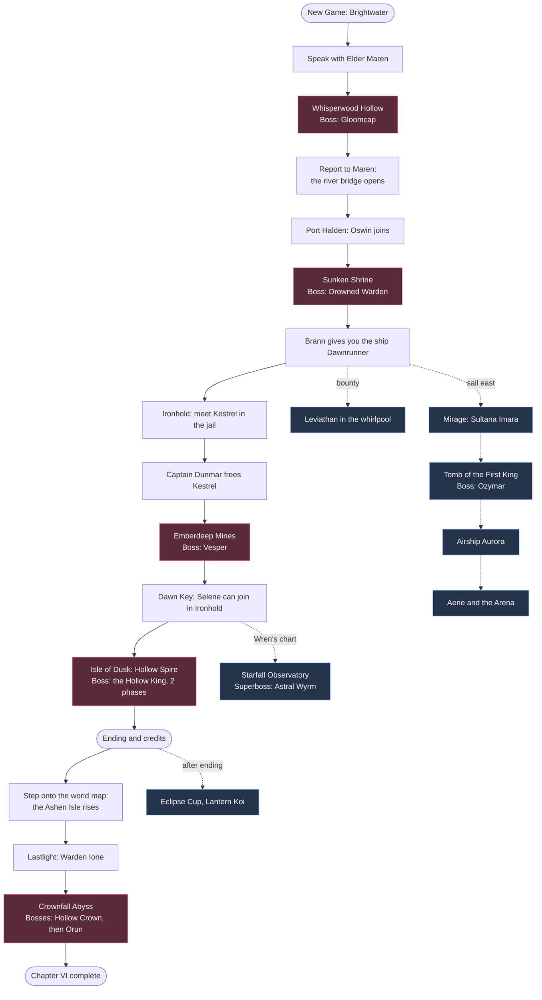
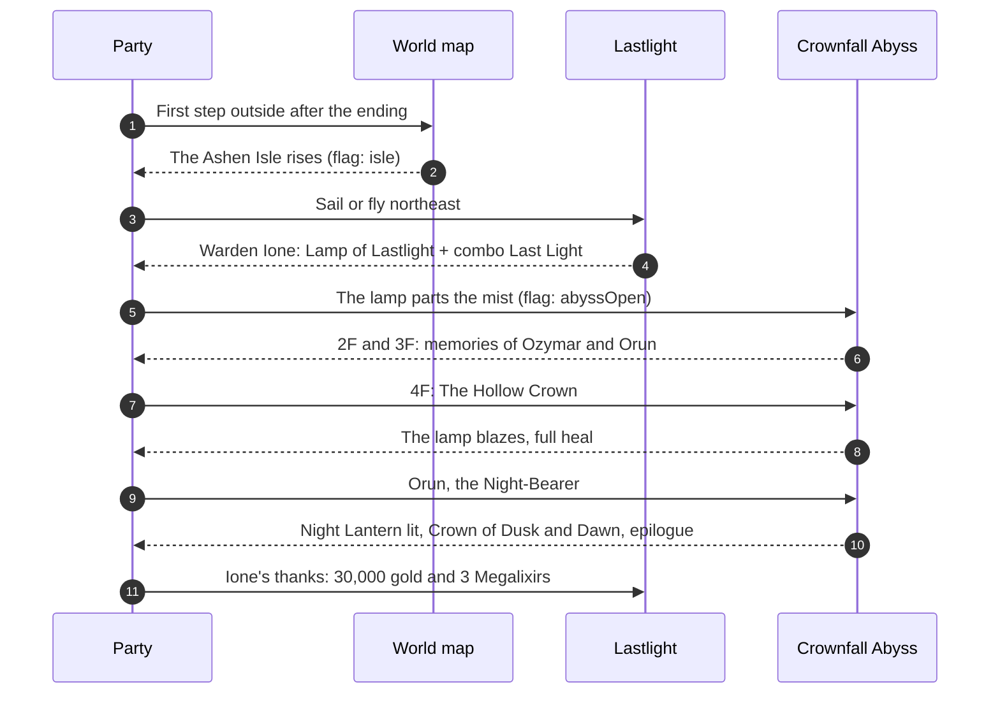
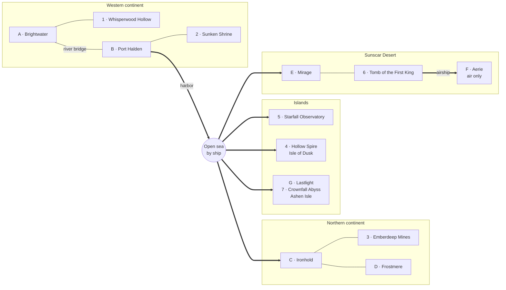
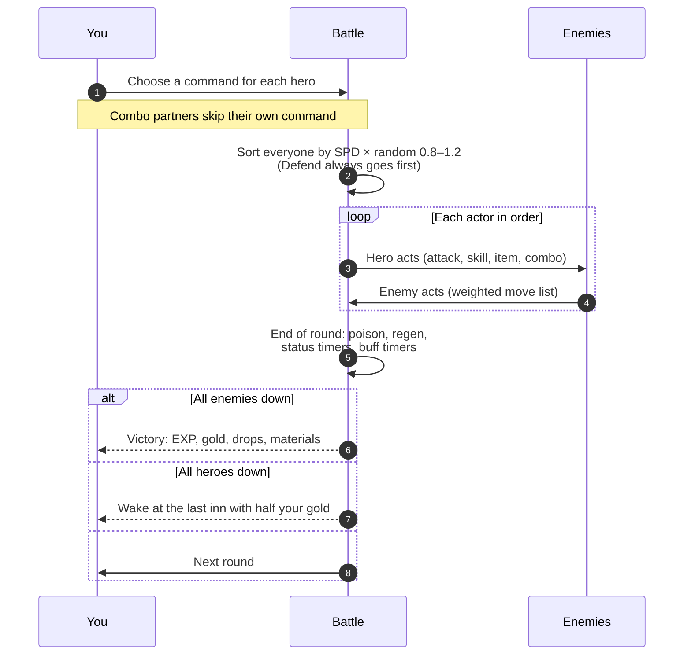
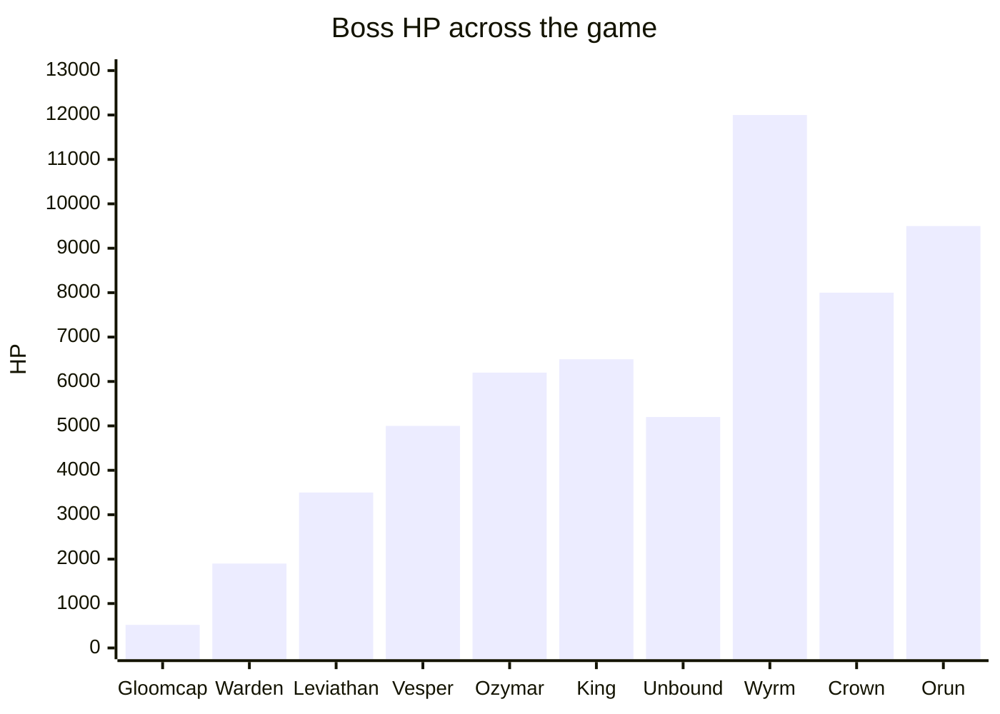
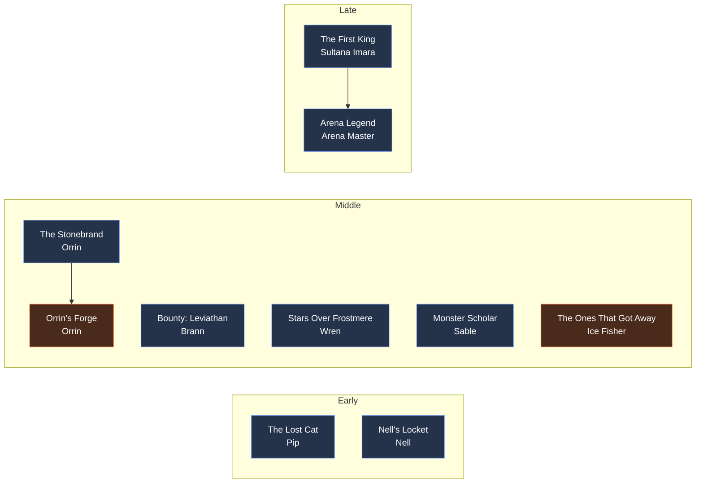
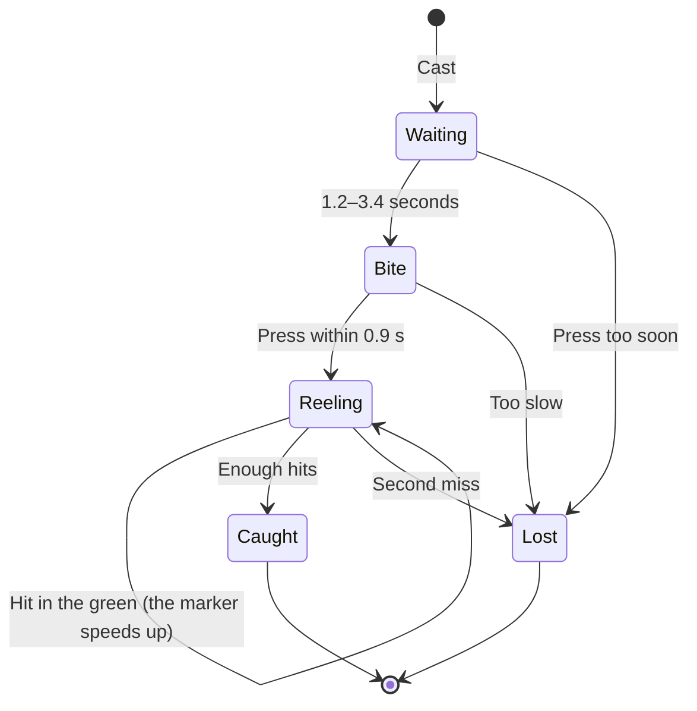
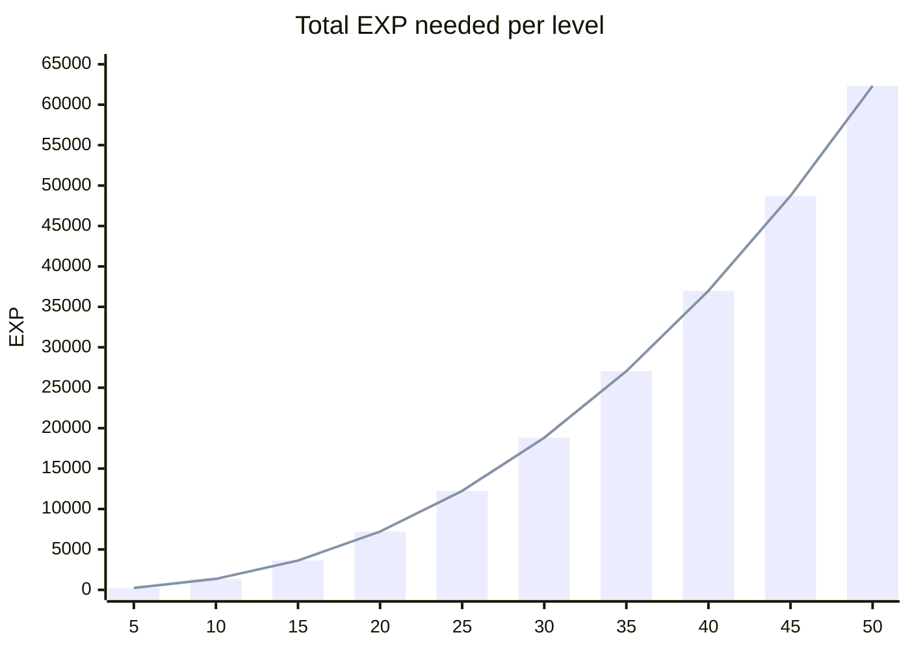

# Lanternfall Game Guide

A complete guide to Lanternfall 1.3: the walkthrough, every hero, skill, monster, boss, item, shop, quest, fish and forge recipe, plus the battle formulas.

> **Spoilers.** Everything is in here, including Chapter VI. The [Walkthrough](#walkthrough) keeps the story vague, but the tables don't.

> The data tables are generated from `src/data.js` with `tools/gentables.py`, so they match the game exactly. To change a number, edit the data file and regenerate; don't edit the tables by hand. See [MODDING.md](MODDING.md#regenerating-the-guide-tables).

## Contents

- [Walkthrough](#walkthrough)
- [The world](#the-world)
- [Towns, inns and shops](#towns-inns-and-shops)
- [Dungeons](#dungeons)
- [The party](#the-party)
- [Combo techs](#combo-techs)
- [How battles work](#how-battles-work)
- [Bosses](#bosses)
- [Monsters by area](#monsters-by-area)
- [Side quests](#side-quests)
- [The Aerie Arena](#the-aerie-arena)
- [Fishing](#fishing)
- [Orrin's Forge](#orrins-forge)
- [Equipment](#equipment)
- [Items](#items)
- [Levels and EXP](#levels-and-exp)
- [New Game+](#new-game)

---

## Walkthrough

The main quest, in order. Each box is a goal from the quest log. Dashed lines are optional content, shown where it unlocks.

### Act by act

| Act | Goal | Where | Key unlock |
| --- | --- | --- | --- |
| I · Ember | Relight the Ember Lantern | Whisperwood Hollow, northwest of Brightwater | The river bridge east |
| II · Tide | Relight the Tide Lantern with Oswin | Sunken Shrine, south of Port Halden (only a tide priest can open it) | The ship *Dawnrunner* |
| III · Stone | Free Kestrel, then go down through the smugglers' tunnel | Emberdeep Mines, north of Ironhold | Dawn Key; Selene can join |
| IV · Dawn | Climb the Hollow Spire | Isle of Dusk, east across the sea | The ending |
| Optional | Open the First King's tomb with the Sun Seal | Tomb of the First King, south of Mirage (Lv 26+) | The airship *Aurora* |
| Optional | Find the Fifth Flame with Wren's Star Chart | Starfall Observatory, the island west of Frostmere (Lv 32+) | The Fifth Flame accessory |
| VI · Night | Bring the Hollow Crown down | Crownfall Abyss on the Ashen Isle (Lv 42+) | The Night Lantern, the Eclipse Cup |

### Chapter VI in detail

---

## The world

| Code | Place | Kind | How to reach | Battle area |
| --- | --- | --- | --- | --- |
| A | Brightwater | Town | Start | Plains |
| B | Port Halden | Town | East over the river bridge | Eastern lowlands |
| C | Ironhold | Town | By ship, north | Northern continent |
| D | Frostmere | Town | Road west of Ironhold | Northern snowfields |
| E | Mirage | Town | By ship, east | Sunscar Desert |
| F | Aerie | Town | **Airship only** (a mesa-walled valley) | Sunscar Desert |
| G | Lastlight | Town | Ship or airship, far northeast (after the ending) | Ashen Isle |
| 1 | Whisperwood Hollow | Dungeon, 2F | Road northwest of Brightwater | Whisperwood Hollow |
| 2 | Sunken Shrine | Dungeon, 2F | Coast road south of Port Halden | Sunken Shrine |
| 3 | Emberdeep Mines | Dungeon, 3F | Ring of mountains north of Ironhold | Emberdeep Mines |
| 4 | Hollow Spire | Dungeon, 3F | Isle of Dusk, east | Hollow Spire |
| 5 | Starfall Observatory | Dungeon, 3F | Small island west of Frostmere | Starfall Observatory |
| 6 | Tomb of the First King | Dungeon, 3F | South of Mirage | Tomb |
| 7 | Crownfall Abyss | Dungeon, 4F | The crater east of Lastlight | Crownfall Abyss |

### Saving

- **Three save slots** plus an **Auto** slot. Save from **Menu → Save** anywhere, or when you rest at an inn ("Save to slot N" is one press).
- **Auto-save** writes to the Auto slot every time you enter a town or dungeon. You can turn it off in Config.
- On the title screen, **Continue** loads your most recent save and **Load Game** lets you pick any slot. Saves from before 1.4 move into slot 1 automatically.

### Getting around

| Mode | Unlocked by | Notes |
| --- | --- | --- |
| On foot | Start | Hold **Shift** (or turn on **auto-dash**) to run. Forests, hills and dead woods raise the encounter rate by 50%. |
| Ship *Dawnrunner* | Brann, after the Tide Lantern | Walk onto it to sail and onto land to go ashore. Sea encounters. |
| Airship *Aurora* | Beating Ozymar | Fly anywhere with no encounters. Press **Enter** to land on open ground (not forest). |

**Encounters** come every 14–30 steps. The Sailor's Compass and the Moonfin Charm halve the rate. After the ending, **Config → Encounters** can turn them off entirely.

---

## Towns, inns and shops

| Town | Inn (party) | Notable people | Services |
| --- | --- | --- | --- |
| Brightwater | 10 G | Elder Maren, Mira, Pip, Old Bram | Free rest at Arin's house; item and arms shops |
| Port Halden | 30 G | Oswin, Brann, Nell | Chapel (revive and cure); harbor |
| Ironhold | 80 G | Captain Dunmar, Orrin, Hilda, Selene | Jail, barracks, **Orrin's Forge** |
| Frostmere | 120 G | Wren, Sable, the Ice Fisher | Observatory hut; **fishing rod** |
| Mirage | 150 G | Sultana Imara, Scholar Hesper, Dalen | Palace |
| Aerie | 200 G | Elder Skye, the Arena Master | **The Arena** |
| Lastlight | 300 G | Warden Ione, Calla, Fennick, Moss | Chapel; endgame armory |

Every building can be entered. Search **barrels, pots and crates** (face one and press Enter) for hidden items; each container is searched once. Resting at an inn also offers to save.

| Town | Item shop | Arms and trinkets |
| --- | --- | --- |
| **Brightwater** | Potion, Antidote, Phoenix Plume, Tent | Bronze Sword, Oak Staff, Leather Armor, Cloth Robe |
| **Port Halden** | Potion, Hi-Potion, Ether, Antidote, Remedy, Phoenix Plume, Tent, Ember Bomb | Iron Sword, Mage Staff, Iron Mace, Chain Mail, Silk Robe, Power Ring, Guard Ring |
| **Ironhold** | Hi-Potion, X-Potion, Ether, Hi-Ether, Remedy, Phoenix Plume, Tent, Ember Bomb | Steel Sword, Rune Staff, Steel Mace, Steel Dagger, Plate Armor, Sage Robe, Thief Vest, Mage Ring, Wake Charm |
| **Mirage** | Hi-Potion, X-Potion, Hi-Ether, Remedy, Phoenix Plume, Tent, Ember Bomb | Sunsteel Blade, Sky Staff, Desert Veil, Swift Boots, Mage Ring, Wake Charm |
| **Aerie** | X-Potion, Hi-Ether, Remedy, Phoenix Plume, Tent, Ember Bomb | Moon Scepter, Sunsteel Blade, Sky Staff, Scholar's Lens, Echo Bell, Desert Veil |
| **Frostmere** | Hi-Potion, X-Potion, Hi-Ether, Remedy, Phoenix Plume, Tent, Ember Bomb | Swift Boots, Echo Bell, Wake Charm, Scholar's Lens, Guard Ring, Power Ring |
| **Lastlight** | X-Potion, Hi-Ether, Remedy, Phoenix Plume, Tent, Ember Bomb, Star Bomb | Ashsteel Blade, Cinder Staff, Ashen Mace, Ash Kris, Umbral Rod, Ash Mail, Ash Robe, Ash Garb |

---

## Dungeons

Each dungeon's floors are generated from a fixed seed, so every player gets the same layout. Torches light the walls, and the Lantern waits in the boss room on the last floor.

| Dungeon | Floors | Boss | Lantern | Treasure |
| --- | --- | --- | --- | --- |
| **Whisperwood Hollow** | 2 | Gloomcap | Ember Lantern | Antidote, Ether, Iron Sword, Phoenix Plume, Potion, 120 gold |
| **Sunken Shrine** | 2 | Drowned Warden | Tide Lantern | Chain Mail, Ether, Hi-Potion, Phoenix Plume, Silk Robe, Tide Mace, 400 gold |
| **Emberdeep Mines** | 3 | Vesper | Stone Lantern | Elixir, Ember Bomb, Ether, Hi-Potion, Mythril Knife, Mythril Mail, Mythril Sword, Phoenix Plume, Star Robe, Star Rod, 900 gold |
| **Hollow Spire** | 3 | The Hollow King | Dawn Lantern | Dawn Plate, Dawnblade, Elixir, Ember Scepter, Hi-Ether, Megalixir, Seraph Mace, Shadow Fang, Shadow Garb, X-Potion, 3000 gold |
| **Tomb of the First King** | 3 | Ozymar, the First King | Sun Lantern | Desert Veil, Elixir, Gilded Mace, Hi-Ether, Megalixir, Nocturne, Sand Kris, X-Potion, 5000 gold |
| **Starfall Observatory** | 3 | Astral Wyrm | Fifth Lantern | Astral Mace, Celestia, Comet Edge, Elixir, Ember Heart, Hi-Ether, Lightbringer, Megalixir, Swift Boots, X-Potion, 8000 gold |
| **Crownfall Abyss** | 4 | The Hollow Crown | Night Lantern | Abyss Ash, Ash Mail, Ash Robe, Elixir, Hi-Ether, Megalixir, Nightglass Locket, Star Bomb, X-Potion, 32000 gold |

---

## The party

Four heroes fight at once. Arrange them in **Menu → Formation**; the fifth waits in reserve and earns **half EXP**.

| Hero | Class | Skill menu | HP | MP | ATK | DEF | MAG | SPD |
| --- | --- | --- | --- | --- | --- | --- | --- | --- |
| **Arin** | Lamplighter | Valor | 62 → 748 | 10 → 98 | 12 → 129 | 8 → 96 | 5 → 49 | 8 → 57 |
| **Lyra** | Flamecaller | Magic | 42 → 507 | 22 → 218 | 6 → 55 | 5 → 58 | 13 → 140 | 9 → 62 |
| **Oswin** | Tide Priest | Prayer | 50 → 613 | 20 → 186 | 9 → 82 | 8 → 86 | 11 → 118 | 7 → 51 |
| **Kestrel** | Rogue | Tricks | 52 → 640 | 12 → 100 | 11 → 123 | 6 → 69 | 6 → 55 | 14 → 92 |
| **Selene** | Duskmage | Dusk | 46 → 560 | 24 → 220 | 7 → 60 | 6 → 64 | 14 → 148 | 11 → 74 |

*Stats are shown at Lv 1 → Lv 50, before equipment.*

### Arin · Lamplighter

| Lv | Skill | MP | Element | Target | Effect |
| --- | --- | --- | --- | --- | --- |
| 3 | **Cure** | 4 | — | One ally | Restore HP to one ally. |
| 6 | **Sunstrike** | 5 | Holy | One foe | A blade of sunlight. Strong vs. undead. |
| 11 | **Rally** | 8 | — | All allies | Raise party attack for a time. |
| 18 | **Lionheart** | 14 | Holy | One foe | Arin's finest stroke. |
| 42 | **Dawnbreak** | 28 | Holy | One foe | The sunrise, swung. A lamplighter's last lesson. |

### Lyra · Flamecaller

| Lv | Skill | MP | Element | Target | Effect |
| --- | --- | --- | --- | --- | --- |
| 1 | **Fire** | 4 | Fire | One foe | Flames on one foe. |
| 2 | **Ice** | 4 | Ice | One foe | Frost on one foe. |
| 4 | **Bolt** | 5 | Bolt | One foe | Lightning on one foe. |
| 6 | **Sleep** | 4 | — | One foe | Put one foe to sleep. Bosses resist. |
| 9 | **Fira** | 10 | Fire | All foes | Flames on all foes. |
| 11 | **Blizzara** | 10 | Ice | All foes | Frost on all foes. |
| 13 | **Thundara** | 12 | Bolt | All foes | Lightning on all foes. |
| 20 | **Flare** | 24 | — | One foe | A star's heart, unleashed. |
| 24 | **Starfall** | 36 | — | All foes | Call down the sky. |
| 44 | **Supernova** | 52 | — | All foes | Lyra stops holding back. |

### Oswin · Tide Priest

| Lv | Skill | MP | Element | Target | Effect |
| --- | --- | --- | --- | --- | --- |
| 1 | **Cure** | 4 | — | One ally | Restore HP to one ally. |
| 1 | **Purify** | 2 | — | One ally | Cure poison, sleep and silence. |
| 7 | **Cura** | 9 | — | All allies | Restore HP to all allies. |
| 9 | **Raise** | 14 | — | One ally | Revive a fallen ally. |
| 12 | **Barrier** | 10 | — | All allies | Raise party defense for a time. |
| 15 | **Holy** | 16 | Holy | One foe | Searing holy light on one foe. |
| 16 | **Renew** | 10 | — | One ally | Slowly restore an ally's HP each round. |
| 19 | **Curaga** | 18 | — | All allies | Greatly restore all allies. |
| 42 | **Sanctuary** | 40 | — | All allies | Revive the fallen and restore the whole party. |

### Kestrel · Rogue

| Lv | Skill | MP | Element | Target | Effect |
| --- | --- | --- | --- | --- | --- |
| 1 | **Steal** | — | — | One foe | Lift an item from a foe. |
| 1 | **Twin Strike** | 4 | — | One foe | Two quick cuts. |
| 1 | **Smoke Bomb** | 3 | — | Self | Guaranteed escape (not from bosses). |
| 14 | **Venom Edge** | 7 | — | One foe | Strike and poison. |
| 20 | **Shadowstep** | 15 | — | One foe | Three strikes from nowhere. |
| 26 | **Mug** | 6 | — | One foe | Strike, and pocket something on the way out. |
| 42 | **Thousand Cuts** | 24 | — | One foe | Five strikes faster than thought. |

### Selene · Duskmage

| Lv | Skill | MP | Element | Target | Effect |
| --- | --- | --- | --- | --- | --- |
| 1 | **Shade** | 6 | Dark | One foe | A lance of shadow. |
| 1 | **Drain** | 9 | Dark | One foe | Steal HP from a foe. |
| 1 | **Gravity** | 12 | — | One foe | Crush a foe for a quarter of its HP (less on bosses). |
| 1 | **Nightfall** | 16 | Dark | All foes | Darkness falls on all foes. |
| 28 | **Requiem** | 34 | Dark | All foes | The last song of the night. |
| 44 | **Eventide** | 46 | Dark | All foes | Night falls gently on all foes, and takes a little back. |

---

## Combo techs

Choose **Combo** in battle. Every member must be in the active four, awake, not silenced, and have the MP. A combo uses **all of their turns**.

| Combo | Members | MP each | Target | Element | Effect |
| --- | --- | --- | --- | --- | --- |
| **Flame Edge** | Arin + Lyra | 6 / 6 | One foe | Fire | Lyra sets Arin's blade alight. |
| **Sacred Cross** | Arin + Oswin | 8 / 10 | All foes | Holy | Holy damage to all foes; heals the party a little. |
| **Crossfang** | Arin + Kestrel | 6 / 6 | One foe | None | Three crossing strikes. |
| **Prism Nova** | Lyra + Oswin | 12 / 10 | All foes | None | Light split into every color. |
| **Firestorm** | Lyra + Kestrel | 10 / 6 | All foes | Fire | Kestrel scatters bombs; Lyra lights them. |
| **Tidebreaker** | Oswin + Kestrel | 8 / 6 | One foe | Water | A wave with a knife in it. |
| **Eclipse Blade** | Arin + Selene | 8 / 10 | One foe | Dark | A blade of night, swung by daylight. |
| **Twin Stars** | Lyra + Selene | 16 / 16 | All foes | None | The sisters' song. Devastates all foes. |
| **Lantern Light** | Arin + Lyra + Oswin | 14 / 18 / 18 | All foes | Holy | The first flame, remembered. Heals the party. |
| **Shadow Waltz** | Kestrel + Selene | 10 / 10 | One foe | Dark | Two shadows dancing. Four dark strikes. |
| **Twilight Psalm** | Oswin + Selene | 14 / 14 | All foes | None | A prayer sung in light and dark. Heals the party. |
| **Last Light** | Arin + Lyra + Selene | 20 / 24 / 24 | All foes | Holy | Lastlight's secret: three who carried the flame through the dark. *(learned in Lastlight)* |

---

## How battles work

**Repeat last turn:** press **Shift**, **R** (touch) or **X** (gamepad) at the first hero's command menu to give everyone the same commands as last round. **Config → Battle speed** runs battles at 2× or 4×.

Some late bosses **act twice per round**.

### Formulas

| Thing | Formula |
| --- | --- |
| Physical damage | `(ATK − DEF ÷ 2) × multiplier × random(0.88–1.12)`, minimum 1 |
| Magic damage | `(spell power + MAG) × random(0.92–1.08) × weakness − target MAG × 0.4` |
| Weakness | Damage ×**1.6** if the target is weak to the element |
| Critical hit | Chance `6% + SPD × 0.1%`; damage ×**1.7** |
| Miss | Your attacks: 3%. Enemy attacks: `3% + (your SPD − their SPD) × 0.4%`, between 2% and 12% |
| Defend | Halves physical damage and cuts magic by 40% until your next turn |
| Rally | Party ATK ×1.35 for 4 rounds |
| Barrier | Party DEF ×1.4 and enemy magic ×0.6 for 4 rounds |
| Holy physical skills | ATK × `(1 + MAG ÷ 200)`, so Arin's MAG makes Sunstrike and Dawnbreak stronger |
| Gravity | 25% of the target's current HP (8% on bosses) |
| Poison | Heroes lose 6% of max HP per round (never below 1); enemies lose 5% (at most 250) |
| Regen | Renew: 8% of max HP per round for 5 rounds. Regen accessories: 5% per round |
| Steal | `55% + (your SPD − their SPD) × 2%`, between 25% and 92%; once per enemy |
| Run | `60% + (party SPD − enemy SPD) × 3%`, between 30% and 95%. Never from bosses or in the Arena |
| First strike | 8% of normal battles: the enemies lose their first round |
| Sleep | Heroes sleep 2 rounds and enemies 3. Any hit wakes an enemy; a hit wakes a hero 60% of the time |

### Statuses

| Status | Effect | Cured by | Prevented by |
| --- | --- | --- | --- |
| Poison | Loses HP every round | Antidote, Remedy, Purify, Sanctuary | Tide Pendant, Desert Veil, Silk Ribbon, Orrin's Seal, and others |
| Sleep | Skips turns | Getting hit, Remedy, Purify | Wake Charm, Pip's Candle, Dwarven Band, Nightglass Locket, and others |
| Silence | Can't use skills or combos | Remedy, Purify, Sanctuary | Echo Bell, Sage Circlet, Dwarven Band, Eclipse Mantle, and others |
| Regen | Heals every round | Wears off | — |

Bosses are immune to Sleep and Silence. Kestrel's Venom Edge poisons bosses 40% of the time.

---

## Bosses

| Boss | Where | HP | ATK | MAG | SPD | Turns | Weak to | Steal | Special attacks |
| --- | --- | --- | --- | --- | --- | --- | --- | --- | --- |
| **Gloomcap** | Whisperwood Hollow 2F | 520 | 35 | 22 | 8 | 1 | Fire | Ether | Spore Cloud, Slam |
| **Drowned Warden** | Sunken Shrine 2F | 1900 | 80 | 55 | 10 | 1 | Bolt | Hi-Ether | Tidal Wave, Cleave |
| **Vesper** | Emberdeep Mines 3F | 5000 | 115 | 104 | 24 | 1 | Holy | Elixir | Shadow Bolt, Hollow Night, Drain, Hush |
| **Leviathan** | Whirlpool, open sea (bounty) | 3500 | 97 | 78 | 14 | 1 | Bolt | Hi-Ether | Maelstrom, Crushing Coil |
| **Ozymar, the First King** | Tomb of the First King 3F | 6200 | 138 | 110 | 24 | 1 | — | Megalixir | Sandstorm, Hush, Drain, Cleave |
| **Astral Wyrm** | Starfall Observatory 3F (optional) | 12000 | 182 | 150 | 30 | 1 | — | Megalixir | Meteor Rain, Starfire Breath, Frost Breath, Dream Fog, Crushing Coil |
| **The Hollow King** | Hollow Spire 3F (phase 1) | 6500 | 165 | 135 | 28 | 1 | — | Megalixir | Crown of Ash, Eclipse, Cleave |
| **Hollow King, Unbound** | Hollow Spire 3F (phase 2) | 5200 | 175 | 148 | 32 | 1 | — | Megalixir | Crown of Ash, Eclipse, Drain, Frost Breath, Blaze |
| **The Hollow Crown** | Crownfall Abyss 4F (phase 1) | 8000 | 205 | 192 | 32 | 2 | — | Megalixir | Crownfall, Shadow Bolt, Hollow Hush, Dream Fog, Meteor Rain |
| **Orun, the Night-Bearer** | Crownfall Abyss 4F (phase 2) | 9500 | 232 | 204 | 34 | 2 | — | Megalixir | Crown of Ash, Drain, Frost Breath, Night Song, Starfire Breath |

**Tips**

- **Gloomcap**: weak to Fire. Lyra's Fire is your main damage.
- **Drowned Warden**: weak to Bolt. Keep Oswin healing through Tidal Wave.
- **Vesper**: weak to Holy. Silence protection helps a lot against Hush.
- **Ozymar**: no weakness. Remedies for Hush; Barrier for Sandstorm.
- **The Hollow King**: two phases back to back. The light of the three Lanterns fully heals the party between them.
- **Astral Wyrm**: Dream Fog sends the whole party to sleep, so equip sleep immunity on at least two heroes.
- **The Hollow Crown and Orun**: both **act twice per round** (the *Turns* column). Crownfall hits everyone hard, so keep **Barrier** up, and carry **Remedies**: Hollow Hush can silence Oswin. The Lamp of Lastlight heals you between the phases. **Last Light** (Arin + Lyra + Selene) is the strongest combo in the game.

**How hard is the finale?** `tools/balance_sim.py` fights it 40 times per setup with the real battle code and a simple AI (no combos):

| Party | Win rate | Median rounds | Knockouts per fight |
| --- | --- | --- | --- |
| Lv 42, Lastlight shop gear | 68% | 22 | 2.4 |
| Lv 42, gear from the Spire and tomb | 82% | 22 | 1.4 |
| Lv 45, gear from the Spire and tomb | 100% | 19 | 0.2 |
| Lv 50, forged weapons, arena prizes | 100% | 13 | 0 |

---

## Monsters by area

Ordered roughly as you meet them.

#### Brightwater plains (west of the river)

| Monster | HP | ATK | MAG | Weak to | Steal | Drops | EXP | Gold |
| --- | --- | --- | --- | --- | --- | --- | --- | --- |
| Green Slime | 22 | 13 | 4 | Fire | Potion | Potion (12%) | 6 | 5 |
| Cave Bat | 18 | 15 | 2 | Bolt | Potion | — | 7 | 4 |
| Goblin | 34 | 17 | 2 | — | Antidote | Potion (15%) | 10 | 9 |
| Wild Wolf | 30 | 19 | 2 | Fire | Potion | — | 11 | 6 |

#### Whisperwood Hollow

| Monster | HP | ATK | MAG | Weak to | Steal | Drops | EXP | Gold |
| --- | --- | --- | --- | --- | --- | --- | --- | --- |
| Spore Cap | 50 | 22 | 10 | Fire | Antidote | Antidote (25%) | 18 | 12 |
| Shade Bat | 42 | 26 | 4 | Bolt | Potion | — | 17 | 10 |
| Root Crawler | 66 | 25 | 4 | Fire | Potion | Potion (20%) | 22 | 15 |
| Goblin | 34 | 17 | 2 | — | Antidote | Potion (15%) | 10 | 9 |

#### Eastern lowlands (Port Halden)

| Monster | HP | ATK | MAG | Weak to | Steal | Drops | EXP | Gold |
| --- | --- | --- | --- | --- | --- | --- | --- | --- |
| Gel Slime | 70 | 34 | 10 | Bolt | Potion | — | 26 | 20 |
| Hobgoblin | 95 | 41 | 4 | — | Hi-Potion | Hi-Potion (10%) | 34 | 28 |
| Harpy | 80 | 39 | 6 | Bolt | Potion | — | 30 | 22 |
| Sand Crab | 110 | 37 | 4 | Bolt | Antidote | — | 36 | 30 |

#### Sunken Shrine

| Monster | HP | ATK | MAG | Weak to | Steal | Drops | EXP | Gold |
| --- | --- | --- | --- | --- | --- | --- | --- | --- |
| Drowned One | 140 | 49 | 8 | Holy, Fire | Ether | Hi-Potion (15%) | 50 | 35 |
| Tide Serpent | 160 | 53 | 20 | Bolt | Hi-Potion | — | 58 | 40 |
| Will-o-Wisp | 100 | 30 | 38 | Holy, Fire | Ether | — | 52 | 32 |

#### Open sea

| Monster | HP | ATK | MAG | Weak to | Steal | Drops | EXP | Gold |
| --- | --- | --- | --- | --- | --- | --- | --- | --- |
| Sea Serpent | 200 | 60 | 30 | Bolt | Hi-Potion | — | 70 | 50 |
| King Crab | 240 | 62 | 6 | Bolt | Hi-Potion | — | 78 | 60 |
| Harpy | 80 | 39 | 6 | Bolt | Potion | — | 30 | 22 |

#### Northern continent (Ironhold, Frostmere)

| Monster | HP | ATK | MAG | Weak to | Steal | Drops | EXP | Gold |
| --- | --- | --- | --- | --- | --- | --- | --- | --- |
| Frost Wolf | 220 | 68 | 20 | Fire | Hi-Potion | Frost Crystal (22%) | 85 | 55 |
| Ice Golem | 340 | 76 | 10 | Fire | Ether | Frost Crystal (22%) | 110 | 80 |
| Snow Imp | 180 | 52 | 58 | Fire | Ether | Frost Crystal (22%) | 90 | 70 |
| Ogre | 300 | 86 | 5 | — | Hi-Potion | Hi-Potion (25%) | 120 | 110 |

#### Emberdeep Mines

| Monster | HP | ATK | MAG | Weak to | Steal | Drops | EXP | Gold |
| --- | --- | --- | --- | --- | --- | --- | --- | --- |
| Magma Slime | 320 | 84 | 60 | Ice | Ember Bomb | Ember Core (22%) | 150 | 100 |
| Fire Bat | 260 | 88 | 40 | Ice | Ember Bomb | Ember Core (22%) | 140 | 90 |
| Dwarf Revenant | 420 | 98 | 20 | Holy | Hi-Ether | Ether (15%) | 180 | 130 |
| Ember Golem | 520 | 104 | 50 | Ice | X-Potion | Ember Core (22%) | 220 | 160 |

#### Sunscar Desert and the Aerie valley

| Monster | HP | ATK | MAG | Weak to | Steal | Drops | EXP | Gold |
| --- | --- | --- | --- | --- | --- | --- | --- | --- |
| Sandworm | 420 | 96 | 30 | Ice | Hi-Potion | — | 170 | 120 |
| Death Scorpion | 330 | 100 | 20 | Ice | Antidote | — | 160 | 110 |
| Sand Bandit | 360 | 98 | 20 | — | Ember Bomb | Hi-Potion (30%) | 165 | 220 |
| Cactoid | 300 | 90 | 40 | Fire | Remedy | — | 150 | 100 |

#### Tomb of the First King

| Monster | HP | ATK | MAG | Weak to | Steal | Drops | EXP | Gold |
| --- | --- | --- | --- | --- | --- | --- | --- | --- |
| Mummy | 640 | 128 | 60 | Fire, Holy | Remedy | Sun Gold (22%) | 260 | 180 |
| Gilded Scarab | 520 | 120 | 30 | Ice | Hi-Ether | Sun Gold (22%) | 240 | 260 |
| Sphinx | 940 | 142 | 120 | Bolt | X-Potion | Sun Gold (22%) | 320 | 240 |
| Cursed Priest | 680 | 90 | 132 | Holy | Elixir | — | 280 | 230 |
| Gilded Golem | 1050 | 146 | 40 | Bolt | X-Potion | Sun Gold (22%) | 340 | 400 |

#### Isle of Dusk

| Monster | HP | ATK | MAG | Weak to | Steal | Drops | EXP | Gold |
| --- | --- | --- | --- | --- | --- | --- | --- | --- |
| Hollow Knight | 700 | 138 | 30 | Holy | X-Potion | Hi-Potion (25%), Dusk Silk (22%) | 300 | 220 |
| Night Gaze | 520 | 80 | 118 | Bolt | Hi-Ether | Dusk Silk (22%) | 280 | 200 |
| Shade Wraith | 600 | 118 | 100 | Holy | Ether | Dusk Silk (22%) | 290 | 210 |
| Chimera | 900 | 148 | 90 | Ice | X-Potion | Dusk Silk (22%) | 350 | 260 |

#### Hollow Spire

| Monster | HP | ATK | MAG | Weak to | Steal | Drops | EXP | Gold |
| --- | --- | --- | --- | --- | --- | --- | --- | --- |
| Void Slime | 780 | 140 | 110 | Holy | Hi-Ether | Dusk Silk (22%) | 320 | 240 |
| Shade Wraith | 600 | 118 | 100 | Holy | Ether | Dusk Silk (22%) | 290 | 210 |
| Dread Knight | 1000 | 160 | 40 | Holy | Megalixir | X-Potion (15%), Dusk Silk (22%) | 420 | 320 |
| Night Gaze | 520 | 80 | 118 | Bolt | Hi-Ether | Dusk Silk (22%) | 280 | 200 |
| Hollow Knight | 700 | 138 | 30 | Holy | X-Potion | Hi-Potion (25%), Dusk Silk (22%) | 300 | 220 |
| Chimera | 900 | 148 | 90 | Ice | X-Potion | Dusk Silk (22%) | 350 | 260 |

#### Starfall Observatory

| Monster | HP | ATK | MAG | Weak to | Steal | Drops | EXP | Gold |
| --- | --- | --- | --- | --- | --- | --- | --- | --- |
| Starspawn | 1100 | 120 | 150 | Bolt | Hi-Ether | Star Shard (22%) | 520 | 380 |
| Astral Knight | 1400 | 182 | 60 | Holy | Megalixir | X-Potion (20%), Star Shard (22%) | 600 | 420 |
| Void Drake | 1500 | 175 | 130 | Holy | X-Potion | Star Shard (22%) | 650 | 480 |
| Nebula Slime | 1000 | 160 | 140 | Ice | Hi-Ether | Star Shard (22%) | 480 | 360 |
| Comet Imp | 900 | 140 | 150 | Ice | Elixir | Star Shard (22%) | 450 | 340 |

#### Ashen Isle

| Monster | HP | ATK | MAG | Weak to | Steal | Drops | EXP | Gold |
| --- | --- | --- | --- | --- | --- | --- | --- | --- |
| Ash Hound | 1500 | 196 | 60 | Ice | X-Potion | Abyss Ash (12%) | 640 | 420 |
| Cinder Wisp | 1200 | 120 | 176 | Ice, Holy | Hi-Ether | Ember Core (20%) | 600 | 400 |
| Cinder Knight | 2000 | 212 | 60 | Ice | Megalixir | X-Potion (20%), Abyss Ash (15%) | 760 | 520 |
| Ash Colossus | 2600 | 220 | 40 | Bolt | X-Potion | Ember Core (25%) | 820 | 600 |

#### Crownfall Abyss

| Monster | HP | ATK | MAG | Weak to | Steal | Drops | EXP | Gold |
| --- | --- | --- | --- | --- | --- | --- | --- | --- |
| Crown Shard | 1500 | 140 | 196 | Bolt | Hi-Ether | Abyss Ash (20%) | 700 | 500 |
| Gloam Knight | 2800 | 240 | 70 | Holy | Megalixir | Megalixir (10%), Abyss Ash (25%) | 960 | 680 |
| Nightmare | 2600 | 232 | 90 | Holy | Megalixir | Dusk Silk (25%) | 880 | 600 |
| Abyss Ooze | 2000 | 196 | 188 | Holy | Hi-Ether | Abyss Ash (20%) | 760 | 520 |
| Hollow Herald | 2100 | 140 | 206 | Holy | Elixir | Dusk Silk (20%) | 820 | 560 |

---

## Side quests

| Quest | Giver | What to do | Reward |
| --- | --- | --- | --- |
| The Lost Cat | Pip, Brightwater | Find Mittens on Whisperwood Hollow 1F | Pip's Candle |
| Nell's Locket | Nell, Port Halden | Find the locket on Sunken Shrine 1F | Tide Pendant |
| The Stonebrand | Orrin, Ironhold | Find the hammer on Emberdeep Mines 2F | Dwarven Band |
| Bounty: Leviathan | Brann, Port Halden (after the ship) | Sail into the whirlpool (Lv 16+) | 4000 G, Sailor's Compass |
| Stars Over Frostmere | Wren, Frostmere | Relight 3 Lanterns, then open the Observatory (Lv 32+) | The Fifth Flame |
| Monster Scholar | Sable, Frostmere | Record 30 creatures in the bestiary | Silk Ribbon |
| The First King | Sultana Imara, Mirage | Open the Tomb with the Sun Seal (Lv 26+) | The airship *Aurora* |
| Arena Legend | Arena Master, Aerie | Win the first five cups | Lantern Crown |
| **The Ones That Got Away** | Ice Fisher, Frostmere | Catch every kind of fish (6 kinds for the first reward) | Angler's Ring, Moonfin Charm |
| **Orrin's Forge** | Orrin, Ironhold (after The Stonebrand) | Forge three items | Orrin's Seal |

---

## The Aerie Arena

Cups are gauntlets: several battles in a row with no inn in between. You can use items but can't run, and losing costs nothing. The prize is awarded once; rematches pay gold only.

| Cup | Level | Rounds | Opponents | Prize | Gold |
| --- | --- | --- | --- | --- | --- |
| **Bronze Cup** | 24+ | 3 | Hobgoblin + Hobgoblin + Hobgoblin → Ogre + Ogre → Magma Slime + Fire Bat + Magma Slime | Gale Sandals | 2000 |
| **Silver Cup** | 28+ | 3 | Dwarf Revenant + Dwarf Revenant → Ember Golem + Sphinx → Mummy + Cursed Priest + Mummy | Champion Belt | 4000 |
| **Gold Cup** | 32+ | 3 | Hollow Knight + Night Gaze → Chimera + Shade Wraith → Dread Knight + Dread Knight | Sage Circlet | 7000 |
| **Platinum Cup** | 36+ | 3 | Astral Knight + Starspawn → Void Drake + Void Drake → Ozymar, the First King | Phoenix Charm | 12000 |
| **Grand Champion** | 42+ | 4 | Drowned Warden → Vesper → Leviathan + Leviathan → Astral Wyrm | Lantern Crown | 30000 |
| **Eclipse Cup** | 46+ | 4 | Gloam Knight + Gloam Knight → Nightmare + Hollow Herald → Cinder Knight + Ash Colossus + Cinder Knight → Orun, the Night-Bearer | Eclipse Mantle | 50000 |

---

## Fishing

Get the **Old Fishing Rod** from the Ice Fisher in Frostmere. Then face any water (a pond, the river, a harbor, the sea from the shore, or the Shrine's pools) and press **Enter**.

Harder fish need more hits and have a narrower green zone (30% of the bar for ★, 22% for ★★, 15% for ★★★).

| Fish | Difficulty | Reel hits | Value (shops pay half) | Where |
| --- | --- | --- | --- | --- |
| **Brook Minnow** | ★ | 2 | 20 | Brightwater pond (55%) The river (50%) |
| **River Trout** | ★ | 2 | 80 | Brightwater pond (36%) The river (50%) Lastlight pond (20%) |
| **Golden Carp** | ★★★ | 4 | 600 | Brightwater pond (9%) |
| **Sea Bass** | ★ | 2 | 90 | Port Halden harbor (50%) Open sea (from the shore) (55%) Sunken Shrine pools (20%) Ashen Isle shore (50%) |
| **Silver Mackerel** | ★★ | 3 | 140 | Port Halden harbor (30%) Open sea (from the shore) (36%) Sunken Shrine pools (40%) Ashen Isle shore (20%) |
| **Harbor Eel** | ★★ | 3 | 220 | Port Halden harbor (20%) Open sea (from the shore) (9%) Sunken Shrine pools (40%) |
| **Ice Pike** | ★★ | 3 | 260 | Frostmere pond (50%) |
| **Frost Char** | ★★ | 3 | 320 | Frostmere pond (40%) |
| **Snow Sturgeon** | ★★★ | 4 | 1200 | Frostmere pond (10%) |
| **Oasis Catfish** | ★★ | 3 | 300 | Mirage oasis (88%) Lastlight pond (40%) |
| **Mirage Pearlfish** | ★★★ | 4 | 1500 | Mirage oasis (12%) |
| **Ember Eel** | ★★★ | 4 | 900 | Lastlight pond (40%) Ashen Isle shore (30%) |
| **Lantern Koi** | ★★★ | 4 | 5000 | Anywhere, 3% per cast, after the ending |

---

## Orrin's Forge

After *The Stonebrand*, talk to Orrin in Ironhold and choose **Forge**. Materials drop from monsters (the bestiary lists who drops what) and a few come from Abyss chests.

| Material | Value (shops pay half) | Dropped by |
| --- | --- | --- |
| **Ember Core** | 400 | Magma Slime, Fire Bat, Ember Golem, Cinder Wisp, Ash Colossus |
| **Frost Crystal** | 400 | Frost Wolf, Ice Golem, Snow Imp |
| **Sun Gold** | 600 | Mummy, Gilded Scarab, Sphinx, Gilded Golem |
| **Star Shard** | 800 | Starspawn, Astral Knight, Nebula Slime, Void Drake, Comet Imp |
| **Dusk Silk** | 700 | Hollow Knight, Night Gaze, Shade Wraith, Chimera, Void Slime, Dread Knight, Nightmare, Hollow Herald |
| **Abyss Ash** | 1200 | Ash Hound, Cinder Knight, Crown Shard, Abyss Ooze, Gloam Knight |

| Forges | Type | Materials | Gold | Stats |
| --- | --- | --- | --- | --- |
| **Forgeheart Ring** | accessory | Ember Core ×2, Frost Crystal ×2 | 3000 G | ATK+14 DEF+14 |
| **Emberforged Plate** | armor | Ember Core ×4, Sun Gold ×3 | 8000 G | DEF+48 |
| **Night Weave** | armor | Dusk Silk ×3, Frost Crystal ×3 | 8000 G | DEF+34 MAG+24 |
| **Gloam Leathers** | armor | Dusk Silk ×3, Star Shard ×2 | 8000 G | DEF+36 SPD+12 |
| **Lamplighter's Oath** | weapon | Star Shard ×3, Sun Gold ×2, Abyss Ash ×3 | 20000 G | ATK+88 MAG+20 |
| **Phoenix Staff** | weapon | Ember Core ×4, Star Shard ×3, Abyss Ash ×2 | 18000 G | ATK+20 MAG+66 |
| **Tidecaller** | weapon | Frost Crystal ×3, Sun Gold ×2, Abyss Ash ×2 | 18000 G | ATK+62 MAG+48 |
| **Gloamfang** | weapon | Dusk Silk ×4, Abyss Ash ×3 | 18000 G | ATK+80 SPD+14 |
| **Evenstar** | weapon | Dusk Silk ×3, Star Shard ×3, Abyss Ash ×2 | 18000 G | ATK+22 MAG+66 |

---

## Equipment

### Weapons

**Arin**

| Weapon | Stats | Price | Where | Notes |
| --- | --- | --- | --- | --- |
| **Bronze Sword** | ATK+5 | 60 | Brightwater shop | A village blade. |
| **Iron Sword** | ATK+13 | 380 | Halden shop | Honest iron. |
| **Steel Sword** | ATK+24 | 1600 | Ironhold shop | Dwarf-forged steel. |
| **Mythril Sword** | ATK+36 | — | Chest, quest or boss | Light as a feather. |
| **Sunsteel Blade** | ATK+46 | 9000 | Mirage shop, Aerie shop | Forged in desert heat. |
| **Dawnblade** | ATK+54 MAG+8 | — | Chest, quest or boss | Forged from the first light. |
| **Ashsteel Blade** | ATK+62 | 22000 | Lastlight shop | Quenched in the Ashen Isle's cinders. |
| **Lightbringer** | ATK+70 MAG+14 | — | Chest, quest or boss | Starlight given an edge. |
| **Lamplighter's Oath** | ATK+88 MAG+20 | — | Orrin's forge | Forged by Orrin. It burns brighter in the dark. |

**Lyra**

| Weapon | Stats | Price | Where | Notes |
| --- | --- | --- | --- | --- |
| **Oak Staff** | ATK+2 MAG+3 | 50 | Brightwater shop | Gnarled and warm. |
| **Mage Staff** | ATK+4 MAG+8 | 360 | Halden shop | Channels the arcane. |
| **Rune Staff** | ATK+7 MAG+15 | 1500 | Ironhold shop | Carved with old runes. |
| **Star Rod** | ATK+10 MAG+25 | — | Chest, quest or boss | Hums with starlight. |
| **Sky Staff** | ATK+12 MAG+34 | 8500 | Mirage shop, Aerie shop | Light as a cloud. |
| **Ember Scepter** | ATK+14 MAG+38 | — | Chest, quest or boss | The first flame, tamed. |
| **Cinder Staff** | ATK+14 MAG+44 | 20000 | Lastlight shop | The tip never stops smouldering. |
| **Celestia** | ATK+18 MAG+52 | — | Chest, quest or boss | Every star, in one staff. |
| **Phoenix Staff** | ATK+20 MAG+66 | — | Orrin's forge | Forged by Orrin. Its flame relights itself. |

**Oswin**

| Weapon | Stats | Price | Where | Notes |
| --- | --- | --- | --- | --- |
| **Iron Mace** | ATK+9 MAG+4 | 320 | Halden shop | Blessed iron. |
| **Steel Mace** | ATK+17 MAG+8 | 1400 | Ironhold shop | Heavy and sure. |
| **Tide Mace** | ATK+27 MAG+16 | — | Chest, quest or boss | Sings like the sea. |
| **Gilded Mace** | ATK+34 MAG+22 | — | Chest, quest or boss | Gold from the First King's tomb. |
| **Seraph Mace** | ATK+38 MAG+26 | — | Chest, quest or boss | Shines in the dark. |
| **Ashen Mace** | ATK+42 MAG+30 | 20000 | Lastlight shop | Grey iron, blessed in Lastlight. |
| **Astral Mace** | ATK+50 MAG+36 | — | Chest, quest or boss | Rings like a temple bell. |
| **Tidecaller** | ATK+62 MAG+48 | — | Orrin's forge | Forged by Orrin. The sea answers it. |

**Kestrel**

| Weapon | Stats | Price | Where | Notes |
| --- | --- | --- | --- | --- |
| **Steel Dagger** | ATK+20 | 1200 | Ironhold shop | Quick and quiet. |
| **Mythril Knife** | ATK+32 SPD+3 | — | Chest, quest or boss | A whisper of an edge. |
| **Sand Kris** | ATK+40 SPD+5 | — | Chest, quest or boss | Wavy and wicked. |
| **Shadow Fang** | ATK+46 SPD+6 | — | Chest, quest or boss | Cuts the space between moments. |
| **Ash Kris** | ATK+54 SPD+8 | 21000 | Lastlight shop | Leaves a trail of sparks. |
| **Comet Edge** | ATK+62 SPD+10 | — | Chest, quest or boss | Gone before you see it. |
| **Gloamfang** | ATK+80 SPD+14 | — | Orrin's forge | Forged by Orrin. Cuts twice for every swing you see. |

**Selene**

| Weapon | Stats | Price | Where | Notes |
| --- | --- | --- | --- | --- |
| **Crescent Rod** | ATK+8 MAG+20 | — | Chest, quest or boss | Vesper's staff, cleansed. |
| **Moon Scepter** | ATK+12 MAG+32 | 6000 | Aerie shop | Silver and patient. |
| **Nocturne** | ATK+16 MAG+46 | — | Chest, quest or boss | Plays the dark like an instrument. |
| **Umbral Rod** | ATK+14 MAG+50 | 24000 | Lastlight shop | Shadow, held gently. |
| **Evenstar** | ATK+22 MAG+66 | — | Orrin's forge | Forged by Orrin. The first star of evening. |

### Armour

| Armor | Who | Stats | Price | Where |
| --- | --- | --- | --- | --- |
| **Cloth Robe** | Lyra, Oswin, Selene | DEF+2 MAG+1 | 40 | Brightwater shop |
| **Leather Armor** | Arin, Kestrel, Oswin | DEF+3 | 50 | Brightwater shop |
| **Silk Robe** | Lyra, Oswin, Selene | DEF+6 MAG+3 | 340 | Halden shop |
| **Chain Mail** | Arin, Oswin | DEF+9 | 450 | Halden shop |
| **Sage Robe** | Lyra, Oswin, Selene | DEF+12 MAG+7 | 1500 | Ironhold shop |
| **Thief Vest** | Kestrel | DEF+12 SPD+3 | 1300 | Ironhold shop |
| **Plate Armor** | Arin, Oswin | DEF+16 | 2000 | Ironhold shop |
| **Star Robe** | Lyra, Oswin, Selene | DEF+20 MAG+14 | — | Chest, quest or boss |
| **Shadow Garb** | Kestrel | DEF+22 SPD+7 | — | Chest, quest or boss |
| **Ash Robe** | Lyra, Oswin, Selene | DEF+24 MAG+16 | 16000 | Lastlight shop |
| **Mythril Mail** | Arin, Oswin | DEF+25 | — | Chest, quest or boss |
| **Ash Garb** | Kestrel | DEF+26 SPD+8 | 17000 | Lastlight shop |
| **Ash Mail** | Arin, Oswin | DEF+32 | 18000 | Lastlight shop |
| **Night Weave** | Lyra, Oswin, Selene | DEF+34 MAG+24 | — | Orrin's forge |
| **Dawn Plate** | Arin, Oswin | DEF+35 | — | Chest, quest or boss |
| **Gloam Leathers** | Kestrel | DEF+36 SPD+12 | — | Orrin's forge |
| **Emberforged Plate** | Arin, Oswin | DEF+48 | — | Orrin's forge |

### Accessories

Anyone can wear any accessory. Only one is worn at a time.

| Accessory | Effect | Price | Where |
| --- | --- | --- | --- |
| **Gale Sandals** | SPD +12. Arena prize. | — | Quest, chest or prize |
| **Champion Belt** | ATK +12, DEF +12. Arena prize. | — | Quest, chest or prize |
| **Sage Circlet** | MAG +22. Prevents silence. Arena prize. | — | Quest, chest or prize |
| **Phoenix Charm** | DEF +6. Revives the wearer once per battle. Arena prize. | — | Quest, chest or prize |
| **Lantern Crown** | All +20, regen, +50% EXP, no ailments. Grand Champion's prize. | — | Quest, chest or prize |
| **Desert Veil** | DEF +8. Prevents poison. | 2400 | Mirage shop, Aerie shop |
| **Power Ring** | ATK +6. | 600 | Halden shop, Frostmere shop |
| **Guard Ring** | DEF +6. | 600 | Halden shop, Frostmere shop |
| **Mage Ring** | MAG +8. | 1400 | Ironhold shop, Mirage shop |
| **Swift Boots** | SPD +6. | 1600 | Mirage shop, Frostmere shop |
| **Wake Charm** | DEF +2. Prevents sleep. | 900 | Ironhold shop, Mirage shop, Frostmere shop |
| **Echo Bell** | MAG +3. Prevents silence. | 1100 | Aerie shop, Frostmere shop |
| **Scholar's Lens** | Wearer gains 50% more EXP. | 3500 | Aerie shop, Frostmere shop |
| **Pip's Candle** | MAG +4. Prevents sleep. "It's very small." | — | Quest, chest or prize |
| **Tide Pendant** | DEF +6, MAG +6. Prevents poison. | — | Quest, chest or prize |
| **Dwarven Band** | DEF +12. Prevents sleep and silence. | — | Quest, chest or prize |
| **Sailor's Compass** | SPD +4. Halves random encounters. | — | Quest, chest or prize |
| **Ember Heart** | ATK +5. Restores HP every round. | — | Quest, chest or prize |
| **Silk Ribbon** | DEF +8, MAG +8. Prevents all ailments. | — | Quest, chest or prize |
| **The Fifth Flame** | All stats +15. Regen. Prevents all ailments. | — | Quest, chest or prize |
| **Angler's Ring** | ATK +8, SPD +8. +50% gold from battles. | — | Quest, chest or prize |
| **Moonfin Charm** | All +12. Regen. Halves random encounters. | — | Quest, chest or prize |
| **Forgeheart Ring** | ATK +14, DEF +14. Forged by Orrin. | — | Orrin's forge |
| **Orrin's Seal** | ATK +6, DEF +18. Prevents all ailments. | — | Quest, chest or prize |
| **Eclipse Mantle** | DEF +24, MAG +24. Revives once per battle. Prevents silence. | — | Quest, chest or prize |
| **Nightglass Locket** | All +18. Prevents sleep. A drop of gentle night. | — | Quest, chest or prize |
| **Crown of Dusk & Dawn** | All +25. Regen. No ailments. Both halves of the first crown, at peace. | — | Quest, chest or prize |

---

## Items

| Item | Price | Effect |
| --- | --- | --- |
| **Potion** | 20 | Restores 60 HP. |
| **Hi-Potion** | 120 | Restores 180 HP. |
| **X-Potion** | 600 | Fully restores HP. |
| **Ether** | 160 | Restores 40 MP. |
| **Hi-Ether** | 700 | Fully restores MP. |
| **Antidote** | 15 | Cures poison. |
| **Phoenix Plume** | 180 | Revives a fallen ally. |
| **Tent** | 120 | Rest on the world map. Restores the party. |
| **Elixir** | — | Fully restores HP and MP. |
| **Megalixir** | — | Fully restores the whole party. |
| **Remedy** | 60 | Cures poison, sleep and silence. |
| **Ember Bomb** | 90 | Deals fire damage to all foes. |
| **Star Bomb** | 900 | Bursts with holy light on all foes. |

### Key items

| Key item | Description |
| --- | --- |
| **Nell's Locket** | A silver locket with a tiny painted gull inside. |
| **Stonebrand** | Orrin's ancestral forge-hammer. Heavier than it looks. |
| **Sun Seal** | The royal seal of Mirage. It opens the First King's tomb. |
| **Star Chart** | Wren's chart. One constellation is circled: the Fifth Flame. |
| **Lamp of Lastlight** | Lit from Lastlight's thousand-year fire. The Abyss's mist fears it. |
| **Old Fishing Rod** | Face water and press Enter to fish. Stand by the shore, a pond or a pier. |

---

## Levels and EXP

The level cap is **50**. Every surviving active hero gets the full EXP from a battle; reserve heroes get half. The Lantern Crown and the Scholar's Lens add +50% EXP for their wearer.

| Level | 5 | 10 | 15 | 20 | 25 | 30 | 35 | 40 | 45 | 50 |
| --- | --- | --- | --- | --- | --- | --- | --- | --- | --- | --- |
| Total EXP | 242 | 1,361 | 3,629 | 7,214 | 12,244 | 18,824 | 27,045 | 36,989 | 48,726 | 62,324 |

---

## New Game+

After the ending, the title screen offers **New Game+**. You keep your levels, equipment, items (except key items), gold and bestiary. Each cycle makes enemies stronger:

| Stat | Change per cycle |
| --- | --- |
| HP | +60% |
| ATK and MAG | +22% |
| DEF | +12% |
| EXP and gold | +50% |
