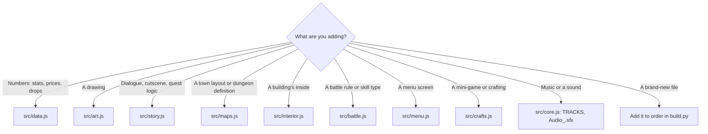
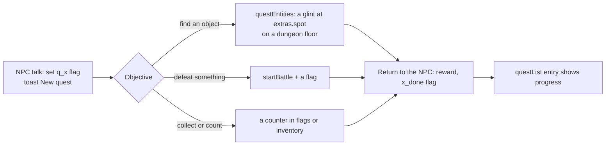
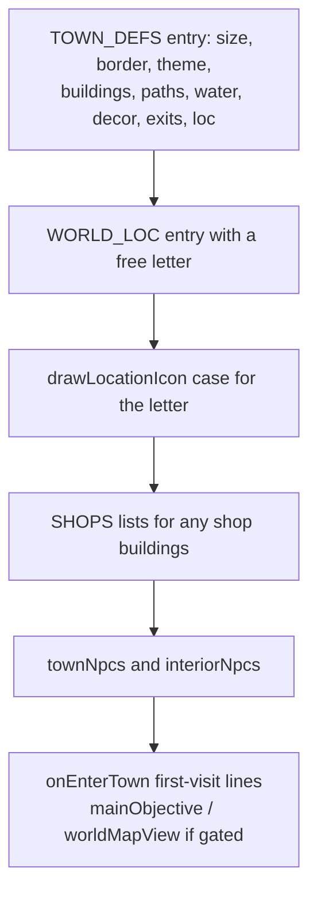
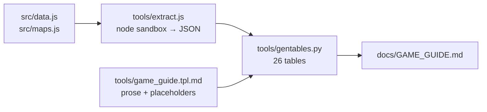

# Modding and Content Guide

Step-by-step recipes for adding things to Lanternfall: monsters, items, quests, towns, dungeons, skills, music and more. Each recipe lists exactly which files to touch. For how the engine works underneath, see [ARCHITECTURE.md](ARCHITECTURE.md).

> **Golden rules**
> 1. Edit `src/`, then run `python3 build.py`. Never edit `index.html` by hand.
> 2. Gate new content behind **new** `G.flags` keys so old saves keep working.
> 3. Draw it in code. No image or audio files.
> 4. Run the [play-test harness](TESTING.md) before opening a pull request, and add a line to [CHANGELOG.md](../CHANGELOG.md) under `[Unreleased]`.

## Where does it go?



## Contents

- [Add a monster](#add-a-monster)
- [Add a new monster art family](#add-a-new-monster-art-family)
- [Add an item, weapon, armour or accessory](#add-an-item-weapon-armour-or-accessory)
- [Add a skill](#add-a-skill)
- [Add a combo tech](#add-a-combo-tech)
- [Add an NPC and dialogue](#add-an-npc-and-dialogue)
- [Add a side quest](#add-a-side-quest)
- [Add a town](#add-a-town)
- [Add a dungeon](#add-a-dungeon)
- [Add a boss](#add-a-boss)
- [Change the world map](#change-the-world-map)
- [Add music or a sound effect](#add-music-or-a-sound-effect)
- [Add a fish or a forge recipe](#add-a-fish-or-a-forge-recipe)
- [Add an arena cup](#add-an-arena-cup)
- [Regenerating the guide tables](#regenerating-the-guide-tables)
- [Pull request checklist](#pull-request-checklist)

---

## Add a monster

**Files:** `src/data.js`

1. Add an entry to `MONSTERS`:

```js
emberfox: {
  name: 'Ember Fox', fam: 'beast',              // which drawing to use (see art.js drawMonster)
  c: ['#e8602a', '#7a2a10'],                    // colours; families read c[0], c[1], sometimes c[2]
  size: 0.9,                                    // optional scale
  hp: 900, atk: 150, def: 60, mag: 80, spd: 24,
  xp: 400, gold: 300,
  weak: ['ice'],                                // fire, ice, bolt, holy, dark, water
  acts: [{ w: 3, a: 'attack' }, { w: 1, a: 'e_blaze' }],  // weighted moves; 'attack' or an e_* skill
  drop: ['hipotion', 0.2],                      // item and chance after the battle
  mat: ['ember_core', 0.2],                     // forge material and chance (optional)
  steal: 'ether'                                // what Kestrel can steal
},
```

2. Put it in an encounter table in `ENCOUNTERS` (each entry is a weighted group):

```js
d3: [ ..., { w: 2, g: ['emberfox', 'emberfox'] } ],
```

The bestiary picks it up automatically. Its total, the quest log and Sable's quest all count `MONSTERS`.

### Balancing

Use a monster from the same area as a baseline. Final-area enemies sit at roughly HP 1,500–2,800 and ATK 196–240 (see the [game guide](GAME_GUIDE.md#monsters-by-area)).

| Stat | What it does |
| --- | --- |
| `atk` | Physical damage dealt: `atk − hero DEF ÷ 2` |
| `def` | Halved and subtracted from hero physical damage |
| `mag` | Added to skill power, **and** reduces hero spell damage by `mag × 0.4` |
| `spd` | Turn order, run chance, steal chance, and how often heroes dodge |

---

## Add a new monster art family

**Files:** `src/art.js`

1. Add a `case` to the `switch (def.fam)` in `drawMonster`. The origin `(0, 0)` is the monster's **feet**, it faces **right**, and `t` is time in seconds, for animation.

```js
case 'lantern': { // a hovering haunted lantern
  const bob = Math.sin(t * 2) * 4;
  ellipse(g, 0, -1, 20, 4, 'rgba(0,0,0,.3)');          // shadow
  g.translate(0, bob);
  rrect(g, -14, -60, 28, 36, 6, c[0], OUT, 2);          // body
  circle(g, 0, -42, 9, c[2] || '#ffd27a');              // flame
  line(g, 0, -60, 0, -72, '#333', 2);                   // handle
  break;
}
```

2. Give its size in `monsterHeight` and `monsterWidth` (unscaled pixels). These drive battle layout and target arrows.

```js
const base = { ..., lantern: 80 }[def.fam] || 60;   // monsterHeight
const base = { ..., lantern: 40 }[def.fam] || 60;   // monsterWidth
```

**Drawing helpers** (from `art.js`): `circle`, `ellipse`, `poly`, `line`, `rrect`, `shade(hex, ±amount)`, `rgba(hex, alpha)` and the outline colour `OUT`.

---

## Add an item, weapon, armour or accessory

**Files:** `src/data.js` (and `SHOPS` to sell it)

```js
// usable item
sunpetal: { name: 'Sun Petal', price: 300, kind: 'use', effect: 'hp', amount: 400, target: 'ally', desc: 'Restores 400 HP.' },
// weapon (who: heroes who can equip it)
emberbrand: { name: 'Emberbrand', price: 12000, kind: 'weapon', who: ['arin'], atk: 50, mag: 6, desc: 'Warm to hold.' },
// armour
ember_coat: { name: 'Ember Coat', price: 9000, kind: 'armor', who: ['lyra', 'selene'], def: 18, mag: 8, desc: '...' },
// accessory (anyone)
ember_ring: { name: 'Ember Ring', price: 0, kind: 'acc', atk: 10, immune: ['poison'], regen: true, desc: '...' },
```

| Field | Kinds | Meaning |
| --- | --- | --- |
| `price` | all | Buy price; shops pay half. `0` means it can't be bought or sold |
| `effect` | use | `hp`, `mp`, `cure`, `remedy`, `revive`, `elixir`, `megalixir`, `tent`, `bomb` |
| `elem`, `fx` | use (bomb) | Damage element and visual effect (Star Bomb uses `holy`) |
| `target` | use | `ally`, `allies`, `enemies`, `none` |
| `battleOnly` | use | Hidden from the field item menu |
| `atk` `def` `mag` `spd` `all` | gear | Stat bonuses (`all` adds to all four) |
| `immune` | acc | Any of `poison`, `sleep`, `silence` |
| `regen` `reraise` `fewer` `xp` `goldx` | acc | Regen; revive once per battle; half encounters; EXP multiplier; +50% gold |
| `kind: 'mat'` | material | A forge ingredient |
| `kind: 'fish'` | fish | Caught by fishing; can be sold |
| `kind: 'key'` | key item | Can't be sold; not carried into NG+ |

Sell it by adding the id to a list in `SHOPS` (for example `lastlight_arms`), or hand it out with `addItem('ember_ring')` in a script or chest loot.

---

## Add a skill

**Files:** `src/data.js` (plus `src/battle.js` only if you need a new `type`)

```js
// 1. In SPELLS
emberwave: { name: 'Ember Wave', mp: 18, type: 'dmg', elem: 'fire', power: 60, target: 'enemies', fx: 'fire', desc: 'Fire on all foes.' },
// 2. In the hero's spells list, with the level it's learned
spells: [ ..., ['emberwave', 30] ],
```

| `type` | Behaviour | Key fields |
| --- | --- | --- |
| `dmg` | Magic damage | `power`, `elem`, `drain` |
| `phys` | Physical skill | `power` (multiplier), `hits`, `elem`, `poison`, `mug` |
| `heal` | Heals | `power`, `scale` |
| `revive` | Revives one ally | — |
| `sanctuary` | Revives and heals everyone | `power`, `scale` |
| `cure` | Clears ailments | — |
| `regen` | Applies Regen | — |
| `buff` | Party buff | `buff: 'rally' \| 'barrier'` |
| `status` | Sleep or silence a foe | `status`, `chance` |
| `gravity` | Percentage damage | — |
| `steal`, `escape` | Kestrel's tricks | — |

Effects (`fx`): `slash`, `hit`, `fire`, `ice`, `bolt`, `holy`, `dark`, `water`, `heal`, `buff`, `poison`, `sleep`, `sand`, `flare`.

**Enemy skills** use the same format, prefixed `e_`, and are referenced from a monster's `acts`.

---

## Add a combo tech

**Files:** `src/data.js`

```js
{ id: 'ember_vow', name: 'Ember Vow', members: ['arin', 'kestrel', 'selene'], mp: [12, 10, 14],
  type: 'dmg', elem: 'fire', power: 140, heal: 0.1, target: 'enemies', fx: 'fire',
  flag: 'combo_embervow',                      // optional: only usable once this flag is set
  desc: 'A promise kept in fire.' },
```

The `members` list holds 2 or 3 hero ids. A `phys` combo uses `power` as a multiplier on the members' combined ATK × 0.75. A `dmg` combo adds 0.75 × their combined MAG to `power`. `heal` restores that fraction of max HP to the party afterwards. Teach a gated combo in a script with `G.flags.combo_embervow = true`.

---

## Add an NPC and dialogue

**Files:** `src/story.js`

Outdoor NPCs are listed per town in `townNpcs(id)`:

```js
N(x, y, seed, look, talkFunction, { name, wander, mark })
```

```js
if (id === 'frostmere') return [
  ...,
  N(6, 13, 37, { style: 'bun', body: '#7a3a5a', hat: 'cap' }, talkMarta, { wander: true, mark: !f.q_scarf }),
];

async function talkMarta() {
  const f = G.flags;
  if (!f.q_scarf) {
    await sayAll([
      ['Marta', 'My scarf blew away toward the Observatory island.'],
      [LY, 'We could look for it.']
    ]);
    f.q_scarf = true; toast('New quest: The Red Scarf');
    return;
  }
  await say('Marta', f.scarf_done ? 'Warm at last!' : 'Any sign of it?');
}
```

- `look` is either a full look object (with `skin`, `hair` and `body`) or **partial overrides**, which `npcLook(seed)` fills in with random villager details.
- `mark: true` shows the red "!" bubble. Base it on flags so it disappears when there's nothing new to say.
- Indoor NPCs go in `interiorNpcs(m)`. Branch on `m.town` and `m.ikind` (`inn`, `shop`, `hall`, `house`, `chapel`, …).
- Speakers can use the constants `A`, `LY`, `OS`, `KE` and `SE`. Selene is optional, so use `withSelene(seleneLine, fallbackLine)`.

**Script toolbox:** `say`, `sayAll`, `narrate`, `choose`, `toast`, `addItem`, `hasItem`, `addMember`, `inParty`, `startBattle`, `fadeTo`, `wait`, `Audio_.sfx`, `refreshEntities`, `changeMap`.

---

## Add a side quest

**Files:** `src/story.js` (and `src/data.js` for the reward)



1. **Start it** in an NPC's talk function (see above). Use flag names `q_<name>` and `<name>_done`.
2. **Place a pick-up** in `questEntities(map)`. Every generated floor reserves a reachable corner, `map.extras.spot`:

```js
if (map.id === 'observatory:0' && f.q_scarf && !hasItem('red_scarf') && !f.scarf_done)
  out.push({ kind: 'glint', x: sp.x, y: sp.y, talk: async () => {
    addItem('red_scarf'); Audio_.sfx('chest'); await narrate('Found a red scarf caught on a crystal!');
  } });
```

3. **List it** in `questList()`, so it appears in Menu → Quests:

```js
if (f.q_scarf) q.push({ title: 'The Red Scarf', giver: 'Marta, Frostmere', done: !!f.scarf_done,
  reward: 'Wool Charm', desc: f.scarf_done ? 'Marta is warm.' : hasItem('red_scarf') ? 'Return it to Marta.' : 'Search the Starfall Observatory 1F.' });
```

4. **Reward it** in the NPC's talk function: `addItem('wool_charm'); f.scarf_done = true;`.
5. Update the guide template (`tools/game_guide.tpl.md`) and the changelog.

---

## Add a town

**Files:** `src/maps.js`, `src/story.js`, `src/data.js` (shops), optionally `src/art.js` (an icon or theme) and `src/interior.js`



```js
TOWN_DEFS.saltmarsh = {
  name: 'Saltmarsh', w: 24, h: 18, border: 't', theme: 'grass', music: 'town', loc: 'H',
  exits: [[11, 17], [12, 17]],                       // edge tiles that lead back to the world
  buildings: [
    { x: 2, y: 2, w: 6, h: 4, kind: 'inn', roof: '#3a6ad0', sign: 'inn', id: 'inn', price: 90 },
    { x: 17, y: 10, w: 5, h: 4, kind: 'shop', roof: '#3a8a4a', sign: 'item', id: 'items', shop: 'saltmarsh_items' }
  ],
  paths: [[11, 6, 12, 17], [3, 6, 20, 7]],           // [x0, y0, x1, y1] rectangles of path
  water: [[15, 15, 4, 2]],                           // [x, y, w, h]; also a fishing spot if FISH_SPOTS.saltmarsh exists
  decor: [[9, 9, 'l'], [14, 9, 'w']]                 // l lamp, w well, f flowers, c crates, g grave, b brazier, t tree, P pine
};
```

- **Themes:** `grass`, `stone`, `snow`, `sand`, `ash`. A theme sets the ground, path colour and interior palette.
- **Building kinds** (and their interiors): `inn`, `shop`, `hall`, `house`, `chapel`, `jail`, `arena`. The door is always at the bottom-centre of the building.
- **Location letters.** `A`–`G` are taken. To add `H`, widen `LOC_RE` in `core.js` to `/^[A-H1-7]$/`, then add `'H'` to the `case` list in `drawWorldTile` and to the road-pad check (`/^[A-G]$/`) in `art.js`.
- Place it in `WORLD_LOC` (`H: { x, y, town: 'saltmarsh', name: 'Saltmarsh' }`) on reachable land, and optionally add a `road(...)` in `genWorld`.

---

## Add a dungeon

**Files:** `src/maps.js`, `src/data.js`, `src/art.js`, `src/story.js`, optionally `src/core.js` (music)

```js
// maps.js
DUNGEONS.reef = { name: 'Coral Labyrinth', theme: 'reef', floors: 3, w: 36, h: 28, seed: 808,
  enc: 'd8', bg: 'shrine', loc: '8', deco: '~', deco2: 'k',
  loot: [['hipotion', 'gold:2000'], ['ether', 'star_bomb'], ['elixir', 'tidecaller']],  // one list per floor
  boss: 'reefqueen', lantern: 'reef', lanternCol: '#5af0d0' };
```

| Step | Where | What |
| --- | --- | --- |
| 1 | `maps.js` | Add the `DUNGEONS` entry and a `WORLD_LOC` digit (widen `LOC_RE` for `8`) |
| 2 | `art.js` | Add a `DTHEME.reef` palette (`wall`, `top`, `floor`, `floor2`, `acc`, `light`, `bg`) and optional details in `drawDungeonTile` |
| 3 | `art.js` | Add a `drawLocationIcon` case for the digit; optionally a `drawBattleBG` case |
| 4 | `data.js` | Add `ENCOUNTERS.d8` and the boss in `MONSTERS` |
| 5 | `story.js` | Gate it in `canEnterDungeon` (return `false` with a message), add first-entry lines in `onEnterDungeon`, and the fight in `bossEncounter` |
| 6 | `story.js` | Add the Lantern's name to `examineLantern`'s `names` map |
| 7 | `field.js` | Choose the music in `Field.playMusic` (optional) |

`seed` fixes the layout. Change it to reroll the floors; the generator guarantees every room stays reachable.

---

## Add a boss

```js
// story.js, inside bossEncounter(did) or a helper it calls
if (did === 'reef') {
  await sayAll([['Reef Queen', 'You trespass in my garden.'], [OS, 'We will be gentle with the coral.']]);
  const r = await startBattle(['reefqueen'], { boss: true, bg: 'shrine' });
  if (r === 'lose') return gameOver();
  f.boss_reef = true; refreshEntities();
  await relightLantern('reef');           // sets G.flags.lantern_reef and lights it
  return;
}
```

For **two phases**, start the first battle with `{ keepScene: true, noVictory: true }`, play a scene, then start the second (see `abyssFinale()`). Boss monsters need `boss: true` in `MONSTERS`, which blocks running and makes them immune to sleep and silence.

---

## Change the world map

The world is generated by `genWorld()` and changed by story flags in `applyWorldFlags(m)`:

```js
// Reveal something only after a flag, without breaking old saves:
function applyWorldFlags(m) {
  ...
  if (G.flags.reef_open && !m.reefUp) { m.set(70, 50, '.'); m.reefUp = true; }
}
```

Hide whole regions the way the Ashen Isle does: generate them, snapshot them into a list, sink them back to sea, and restore them in `applyWorldFlags`. To print the map while you work, run `genWorld().tiles.map(r => r.join('')).join('\n')` in the browser console.

---

## Add music or a sound effect

**Files:** `src/core.js`

```js
TRACKS.reef = {
  bpm: 96, voices: [
    { w: 'square',   g: 0.04, s: 'E5:4 G5:4 B5:8 | A5:4 G5:4 E5:8 | ...' },
    { w: 'triangle', g: 0.13, s: pump(['E2', 'C2', 'D2', 'E2'], 'half') },
    { w: 'drum',     g: 0.04, s: 'k:4 h:4 s:4 h:4 '.repeat(4) }
  ]
};
```

- Waves: `square`, `triangle`, `sawtooth`, `sine`, `drum` (`k` kick, `s` snare, `h` hi-hat).
- Keep `g` (gain) around 0.03–0.05 for leads and 0.13–0.15 for triangle bass.
- Play it with `Audio_.play('reef')`, or wire it into `Field.playMusic` or `worldTrack()`.
- Sound effects are `case`s in `Audio_.sfx(name)`, built from `tone(type, f1, f2, dur, gain, delay)` and `noise(dur, gain, freq, filter, delay)`.

---

## Add a fish or a forge recipe

```js
// data.js: a fish
ITEMS.reefsnapper = { name: 'Reef Snapper', price: 700, kind: 'fish', desc: 'Striped like the coral.' };
FISH.reefsnapper = { diff: 2 };                          // 1–3: hits needed = diff + 1; narrower green zone
FISH_SPOTS.reef = [{ w: 5, f: 'reefsnapper' }, { w: 5, f: 'eel' }];   // town id, dungeon id, 'sea', 'river' or 'ash'

// data.js: a forge recipe
RECIPES.push({ out: 'emberbrand', mats: { ember_core: 3, sun_gold: 1 }, gold: 9000 });
```

Water inside a dungeon is fishable when `FISH_SPOTS[dungeonId]` exists. The fishing quest's target ("every kind") is `Object.keys(FISH).length`, so it grows on its own. Keep the Ice Fisher's dialogue hints in step.

---

## Add an arena cup

```js
ARENA_CUPS.push({ id: 'tidal', name: 'Tidal Cup', level: 40, unlock: 'boss_reef',
  rounds: [['seaserpent', 'seaserpent'], ['kingcrab', 'leviathan']], prize: 'pearl_band', gold: 20000 });
```

`unlock` hides the cup until that flag is set. *Arena Legend* only counts the first five cups.

---

## Regenerating the guide tables

[GAME_GUIDE.md](GAME_GUIDE.md) is generated. Its prose lives in `tools/game_guide.tpl.md`, and its tables come from `src/data.js`.

```bash
python3 tools/gentables.py            # rewrites docs/GAME_GUIDE.md (needs node)
tools/check_mermaid.sh docs/*.md README.md ROADMAP.md CHANGELOG.md
```



To add a table, write a function in `gentables.py` that stores markdown in `out['name']`, then put `{{name}}` in the template.

---

## Pull request checklist

- [ ] Edited `src/` and ran `python3 build.py`
- [ ] New progress is stored in **new** flags; old saves still load
- [ ] Works with the touch D-pad and A/B buttons
- [ ] `python3 tools/playtest.py` reports `ERRORS: 0` (add a scenario for big features; see [TESTING.md](TESTING.md))
- [ ] `python3 tools/gentables.py` re-run if `data.js` changed
- [ ] `tools/check_mermaid.sh` passes if you touched diagrams
- [ ] [CHANGELOG.md](../CHANGELOG.md) has a line under `[Unreleased]`
- [ ] README feature counts updated if they changed
