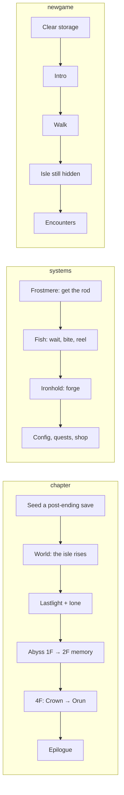
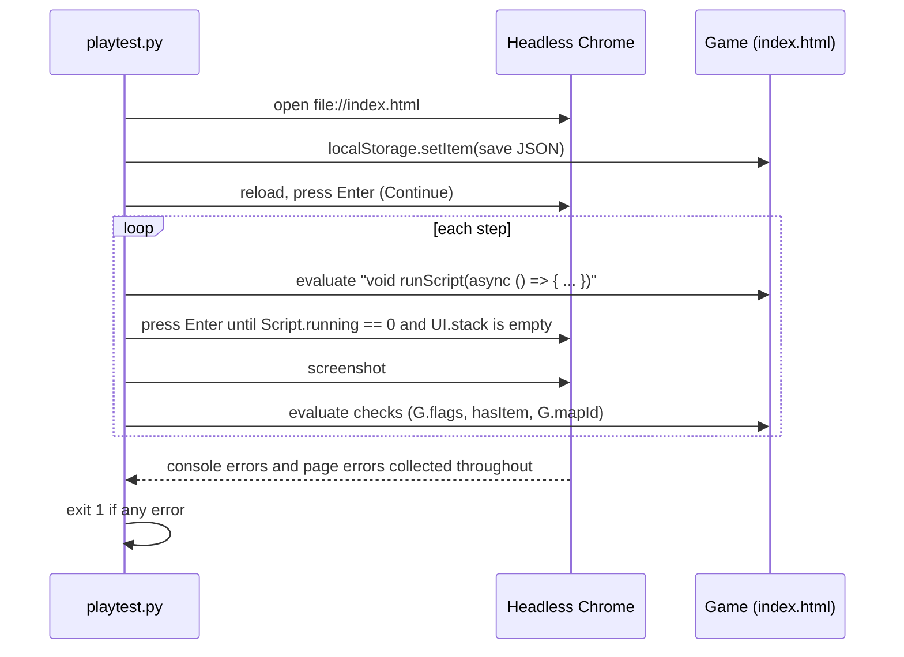

# Testing Lanternfall

Lanternfall has no unit tests. It's tested by **playing it**: either by hand in a browser, or automatically with a headless browser that presses keys for you. This page covers both.

## Contents

- [Quick checks by hand](#quick-checks-by-hand)
- [The play-test harness](#the-play-test-harness)
- [Scenarios](#scenarios)
- [How the harness works](#how-the-harness-works)
- [Writing a new scenario](#writing-a-new-scenario)
- [Debugging tricks](#debugging-tricks)
- [Docs checks](#docs-checks)
- [Continuous integration](#continuous-integration)

---

## Quick checks by hand

1. `python3 build.py`
2. Open `index.html` in a browser and open the developer console (F12).
3. Add `?noenc` to the URL to turn off random encounters while you walk around.
4. Nothing should appear in red in the console.

| Check | How |
| --- | --- |
| New Game starts | Title → New Game → the intro text → Brightwater |
| Old saves load | Keep an old save in your browser, then Continue |
| Touch controls | Use the browser's device toolbar (Ctrl+Shift+M) with a touch device selected |
| Audio | Press a key first (browsers block audio until you do), then M to toggle |

---

## The play-test harness

`tools/playtest.py` drives the real game in headless Chrome. It seeds a save, presses keys, takes screenshots, and **fails if the page logs any JavaScript error**.

```bash
pip install playwright
playwright install chromium            # or set CHROME=/path/to/chrome to use one you have

python3 build.py
python3 tools/playtest.py                                  # default scenarios, screenshots in playtest-shots/
python3 tools/playtest.py index.html /tmp/shots chapter    # one scenario, chosen output folder
```

The output looks like this:

```text
shot 01_isle_cutscene
isle cutscene presses 12 isle= True obj= Chapter VI: Sail or fly to the island that rose in the far northeast sea.
...
finale presses 422 boss_abyss True chapter6 True crown item True
ERRORS: 0
```

The exit code is `0` when there were no errors and `1` otherwise, so it can gate CI.

---

## Scenarios

| Scenario | What it does | Checks | Screenshots |
| --- | --- | --- | --- |
| `chapter` | Loads a post-ending save at Lv 45 and plays Chapter VI from start to end: the isle rising, Lastlight, Warden Ione, the Ward Hall, the Abyss, a memory scene, both boss phases (HP shrunk to 400) and the epilogue | `isle`, `q_crown`, `combo_lastlight`, `mem1`, `boss_abyss`, `chapter6` flags; the Crown of Dusk & Dawn received | `01`–`09` |
| `orun` | Real battles against Orun, Ashen Isle monsters and Abyss monsters on their own backgrounds | Battles finish; materials drop | `10`–`12` |
| `systems` | Gets the fishing rod, fishes until a catch, forges at Orrin's, toggles Config, opens the quest log and the Lastlight shop | A fish in the inventory; the Forgeheart Ring forged; `CFG` saved | `13`–`19` |
| `newgame` | Starts a fresh game, walks with auto-dash, checks the isle is still underwater, fights an early encounter and an isle encounter | Party is Arin and Lyra at Lv 1; isle tiles are `~` before the ending; isle encounters use the `ash` background | `20`–`21` |
| `readme` | Takes clean screenshots for the README | — | Lastlight, Ashen Isle, Abyss, Hollow Crown, fishing |



---

## How the harness works



**Key helpers**

| Helper | Purpose |
| --- | --- |
| `boot(save)` | Writes a save to `localStorage`, reloads, and presses Enter to Continue |
| `run(js)` | Starts a game script, such as `await talkIone()` or `await enterLocation('G')`. It uses `void runScript(...)` so `evaluate` doesn't wait on the game's promise |
| `until_idle()` | Presses Enter until no script is running and no UI is open (it skips through dialogue) |
| `ev(js)` | Reads game state: `G.flags.isle`, `hasItem('forge_ring')`, `fishKinds()` |
| `shot(name)` | Saves a screenshot |

**Seeding saves.** `POST` in the script is a post-ending save at Lv 45 with the whole party. Copy it and adjust the `flags`, `mapId`, `x`, `y` and `inv` to start anywhere. The save format is documented in [ARCHITECTURE.md](ARCHITECTURE.md#game-state-and-saves).

**Fast bosses.** Before a fight, `ev("MONSTERS.crown.hp = 400")` shrinks a boss so a scenario finishes quickly. This tests the flow, not the balance. For balance, see [ROADMAP ST-1](../ROADMAP.md#13x--stabilise).

**Mini-games.** The fishing scenario reads the UI component's state (`UI.top().state`, `.pos`, `.zone`) and presses Enter at the right moment, so it's deterministic.

---

## Writing a new scenario

```python
if want('myquest'):
    s = json.loads(json.dumps(POST))                    # copy the base save
    s['flags'].update({'q_scarf': True}); s['mapId'] = 'frostmere'; s['x'] = 6; s['y'] = 14
    await boot(s); await until_idle()
    await run("await talkMarta()"); await until_idle()
    assert await ev("G.flags.scarf_done") is not True   # not finished yet
    await run("const m = getMap('observatory:0'); await changeMap(m.id, m.extras.spot.x, m.extras.spot.y + 1, 'up')", 800)
    await run("await Field.map.entities.find(e => e.kind === 'glint').talk()"); await until_idle()
    print('scarf', await ev("hasItem('red_scarf')"))
    await shot('30_scarf')
```

Run it with `python3 tools/playtest.py index.html /tmp/shots myquest`.

**Tips**

- Always wrap game calls in `run(...)`. Never `await` a game promise directly in `evaluate`.
- After any `run`, call `until_idle()` before the next step.
- Use `G.x`, `G.y`, `G.dir` and `Field.anim = null` to place the player exactly; use `changeMap(...)` to move between maps with all the hooks.
- `ev("G.scene.enemies.forEach(e => e.hp = 1)")` ends a battle on the next hit.

---

## Debugging tricks

Paste these into the browser console while playing.

| Goal | Console |
| --- | --- |
| No encounters | Open `index.html?noenc`, or `G.flags.noEnc = true` |
| Teleport on the world map | `G.x = 79; G.y = 10` |
| Go to a map | `runScript(() => changeMap('abyss:3', 18, 14, 'up'))` |
| Enter a location | `runScript(() => enterLocation('G'))` |
| Give an item | `addItem('fishing_rod')` |
| Set a flag | `G.flags.isle = true; applyWorldFlags(getMap('world'))` |
| Level up | `G.party.forEach(m => { m.level = 45; m.xp = xpForLevel(45); }); healAll()` |
| Start a battle | `runScript(() => startBattle(['crown'], { boss: true, bg: 'crownfall' }))` |
| Print the world | `console.log(getMap('world').tiles.map(r => r.join('')).join('\n'))` |
| Current objective | `mainObjective()` |
| Wipe the save | `localStorage.removeItem('lanternfall_save_v1')` |

---

## Docs checks

```bash
python3 tools/gentables.py                                  # regenerate docs/GAME_GUIDE.md from data.js
tools/check_mermaid.sh README.md ROADMAP.md CHANGELOG.md docs/*.md
```

`check_mermaid.sh` renders every diagram with the Mermaid CLI and lists any that fail to parse. GitHub would show those as an error box. Set `CHROME=/path/to/chrome` to skip downloading a browser.

---

## Continuous integration

Planned as [ROADMAP ST-3](../ROADMAP.md#13x--stabilise). A workflow like this would run the harness on every pull request:

```yaml
# .github/workflows/playtest.yml
name: Play-test
on: [pull_request]
jobs:
  playtest:
    runs-on: ubuntu-latest
    steps:
      - uses: actions/checkout@v4
      - uses: actions/setup-python@v5
        with: { python-version: '3.12' }
      - run: pip install playwright && playwright install --with-deps chromium
      - name: Build and check that index.html is up to date
        run: python3 build.py && git diff --exit-code index.html
      - run: python3 tools/playtest.py index.html shots chapter systems newgame
      - uses: actions/upload-artifact@v4
        if: always()
        with: { name: screenshots, path: shots }
```
