# Lanternfall Game Guide

A complete guide to Lanternfall 1.3: the walkthrough, every hero, skill, monster, boss, item, shop, quest, fish and forge recipe, plus the battle formulas.

> **Spoilers.** Everything is in here, including Chapter VI. The [Walkthrough](#walkthrough) keeps the story vague, but the tables don't.

> The data tables are generated from `src/data.js` with `tools/gentables.py`, so they match the game exactly. To change a number, edit the data file and regenerate; don't edit the tables by hand. See [MODDING.md](MODDING.md#regenerating-the-guide-tables).

## Contents

- [Walkthrough](#walkthrough)
- [Hearts of the Lamplighters](#hearts-of-the-lamplighters)
- [The Drowned Kingdom](#the-drowned-kingdom)
- [Day, night and weather](#day-night-and-weather)
- [Lanterns & Lies](#lanterns--lies)
- [The Sunset Opal](#the-sunset-opal)
- [The world](#the-world)
- [Towns, inns and shops](#towns-inns-and-shops)
- [Dungeons](#dungeons)
- [The party](#the-party)
- [Combo techs](#combo-techs)
- [Limits](#limits)
- [How battles work](#how-battles-work)
- [The Lantern Board](#the-lantern-board)
- [Bosses](#bosses)
- [Monsters by area](#monsters-by-area)
- [Side quests](#side-quests)
- [The Aerie Arena](#the-aerie-arena)
- [Fishing](#fishing)
- [Cooking](#cooking)
- [Orrin's Forge](#orrins-forge)
- [Equipment](#equipment)
- [Items](#items)
- [Levels and EXP](#levels-and-exp)
- [New Game+](#new-game)
- [Trophies](#trophies)
- [Speedrun mode](#speedrun-mode)

---

## Walkthrough

The main quest, in order. Each box is a goal from the quest log. Dashed lines are optional content, shown where it unlocks.

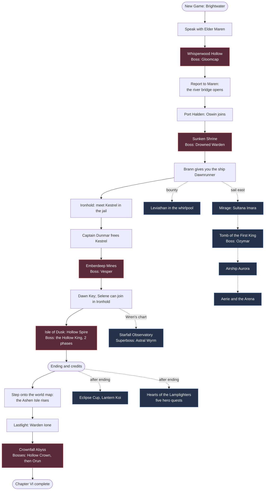

### Act by act

| Act | Goal | Where | Key unlock |
| --- | --- | --- | --- |
| I · Ember | Relight the Ember Lantern | Whisperwood Hollow, northwest of Brightwater | The river bridge east |
| II · Tide | Relight the Tide Lantern with Oswin | Sunken Shrine, south of Port Halden (only a tide priest can open it) | The ship *Dawnrunner* |
| III · Stone | Free Kestrel, then go down through the smugglers' tunnel | Emberdeep Mines, north of Ironhold | Dawn Key; Selene can join |
| IV · Dawn | Climb the Hollow Spire | Isle of Dusk, east across the sea | The ending |
| Optional | Open the First King's tomb with the Sun Seal | Tomb of the First King, south of Mirage (Lv 26+) | The airship *Aurora* |
| Optional | Find the Fifth Flame with Wren's Star Chart | Starfall Observatory, the island west of Frostmere (Lv 32+) | The Fifth Flame accessory |
| VI · Night | Bring the Hollow Crown down | Crownfall Abyss on the Ashen Isle (Lv 42+) | The Night Lantern, the Eclipse Cup |
| Hearts | Five personal quests, one per hero | All over the world (Lv 44+) | Limits, ultimate weapons, the Festival of Lanterns |

### Chapter VI in detail

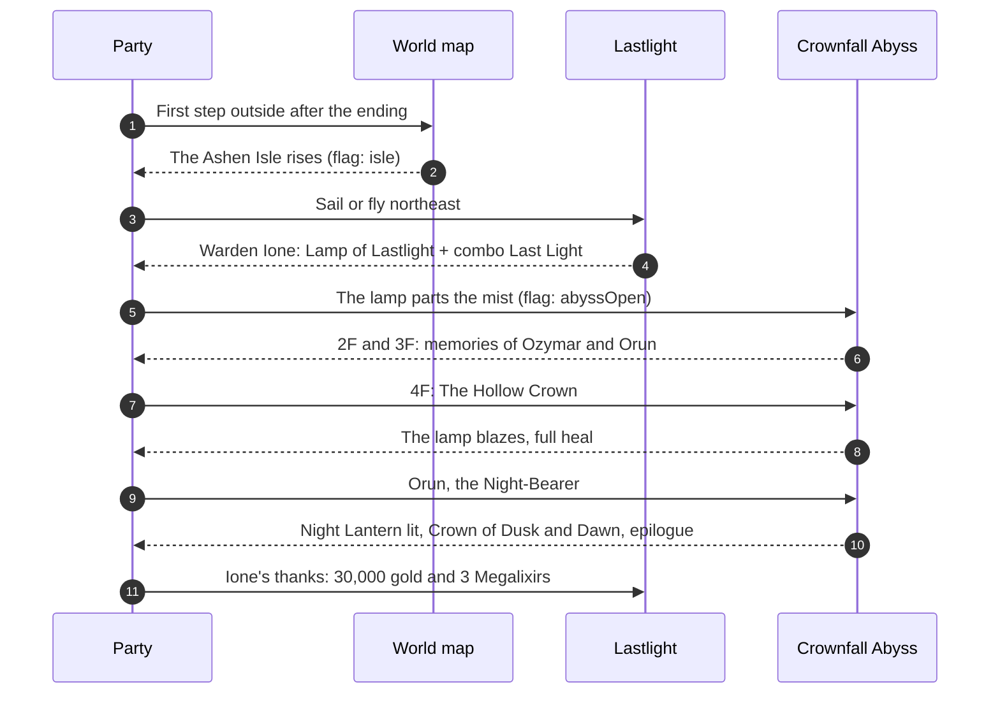

---

## Hearts of the Lamplighters

After the ending, each hero has something left unfinished. The quests can be done in any order, and each one needs its hero in the party. Finishing one teaches that hero a **[Limit](#limits)** and gives them an ultimate weapon. Finish all five for the **Festival of Lanterns**.

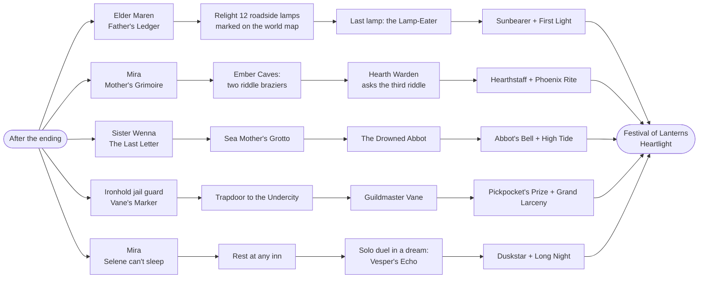

| Quest | Hero | Start | Where | Boss | Reward |
| --- | --- | --- | --- | --- | --- |
| The Lamplighter's Road | Arin | Elder Maren, Brightwater | 12 lamps beside the roads on every continent, including the Isle of Dusk and the Ashen Isle | The Lamp-Eater (appears at the last lamp) | Sunbearer, ★ First Light |
| Mother's Grimoire | Lyra | Mira, Brightwater | Ember Caves (`8`), in the hills north of the Brightwater road | Hearth Warden | Hearthstaff, ★ Phoenix Rite |
| The Drowned Priesthood | Oswin | Sister Wenna, Port Halden chapel | Sea Mother's Grotto (`9`), on the coast east of Port Halden | The Drowned Abbot | Abbot's Bell, ★ High Tide |
| Old Debts | Kestrel | The guard in the Ironhold jail | The Undercity, through a trapdoor in the jail | Guildmaster Vane (acts twice) | Pickpocket's Prize, ★ Grand Larceny |
| Echo of Vesper | Selene | Mira, Brightwater | A dream: rest at any inn | Vesper's Echo (**Selene fights alone**) | Duskstar, ★ Long Night |
| The Festival of Lanterns | Everyone | Elder Maren, after all five | Brightwater | — | Heartlight |

**Tips**

- **The riddles** in the Ember Caves are Lyra's mother's bedtime riddles. A wrong answer summons Kiln Imps; you can try again afterwards. Answering the Hearth Warden's riddle correctly fully restores the party before the fight.
- **Selene's dream** can't end in a game over. If she loses, she simply wakes up, and the dream returns at the next inn. Bring Ethers: her draining spells keep her alive, but they cost MP.
- **Campfire talks:** using a **Tent** on the world map sometimes starts a short conversation around the fire. There are eight, each heard once, depending on who is in the party and how far the story has gone.

---

## The Drowned Kingdom

Added in 1.7. It starts once **Oswin's quest is done** (The Drowned Priesthood): Sister Wenna in the Port Halden chapel has found a chart hidden in the Abbot's bell. Oswin must be in the party when you talk to her.

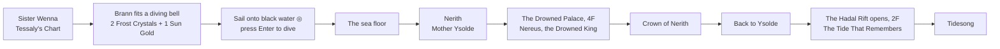

**The sea floor.** There are four patches of black water, marked ◎ on the world map once you have the chart. Diving from one puts you on the sea floor directly below it, which is drawn at half the world's scale. Walk onto a **bell line** (↑) to surface from any of the four. The bell's lamp only lights a few steps around you; the glows are vents, the bell lines and the city. Kelp beds raise the encounter rate by 50%. The **Map** screen has a Sea Floor view (press **Shift** to switch).

| Place | Where | What's there |
| --- | --- | --- |
| **Nerith** | The centre of the sea floor, below where the Leviathan's whirlpool was | Inn (500 G), temple (Mother Ysolde: free full heal), item shop, armory with the best shop gear in the game, an archive |
| **The Drowned Palace** | East of Nerith. Opens after you meet Mother Ysolde | 4 floors; boss **Nereus, the Drowned King** (acts twice, absorbs water). Recommended level 46+ |
| **The Hadal Rift** | The far southeast. Opens after Nereus, and Ysolde tells you about it | 2 floors; the secret superboss **The Tide That Remembers** (acts twice, two phases, absorbs water, resists dark and ice). Recommended: level 50, a full Lantern Board, the hero weapons and a meal |
| Three wrecks | Scattered on the sea floor | A chest beside each, one with the fifth treasure map |

### Treasure maps

Five maps, each pointing to a spot on the world map. Carried maps are marked ✕ on the world map. Stand on the spot and press **Enter** to dig. Dig up all five and Whisper pays 50,000 gold.

{{treasures}}

Sand Bandits, Cutpurses and Abyssal Anglers have a 20% chance per battle to drop the next map you're missing (2, then 3, then 4).

### The Undermarket

After Kestrel's quest, the trapdoor in the Ironhold jail also leads to **the Undermarket**, the Thieves' Guild's market. It has a cheap inn (40 G), Mags in the guild hall, Whisper the map-seller, and a black market that sells forge materials and rare goods at three times their price:

{{blackmarket}}

### Lanternmoths

Once all twelve roadside lamps are lit (Arin's quest), talk to **Old Ivy** in Brightwater for the **Moth Whistle**. After that, talk to any lit roadside lamp to ride a lanternmoth: it moves twice as fast as walking, crosses forests, and **meets no monsters**. Moths can't cross water or mountains. Press **Enter** to land; walking into a town or dungeon lands you too.

---

## Day, night and weather

Added in 1.9. A clock runs while you explore: one real second is one game minute, so a day lasts 24 minutes. The menu shows the day, the time and the weather where you are.

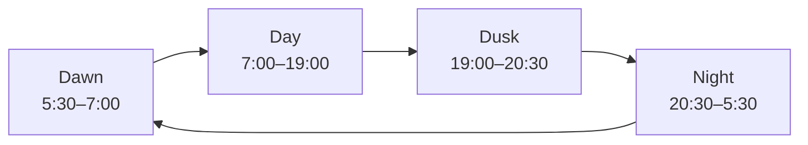

**At night** the sky darkens (lamps, braziers and windows glow), the townsfolk who wander go home, and a few night owls come out: a watchman in Brightwater, a fisher in Port Halden, a stargazer in Frostmere, a vendor in Mirage, and some of the card players. Half of the world's random battles come from night tables (see [Monsters by area](#monsters-by-area)), with five creatures you only meet after dark. Winning one earns the Night Owl trophy.

**Passing time.** An inn wakes you at 7:00, or at 21:00 if you choose **Stay until night**. A Tent moves the clock on 8 hours.

**Weather** is rolled for each region every six game hours, so it changes four times a day. It shows on the world map and in towns, and it changes battles fought there:

| Weather | Where | In battle |
| --- | --- | --- |
| Rain | Western continent, the northern lowlands, the open sea | Water and lightning +25%, fire −25% (for both sides) |
| Snow | The snowfields around Frostmere (about half the time) | Ice +25%, fire −25% |
| Sandstorm | The Sunscar Desert (about a third of the time) | Physical attacks miss 15% more often |
| Fog | The Isle of Dusk (half the time), sometimes the western continent | Physical attacks miss 10% more often |
| Ashfall | The Ashen Isle, always | Fire +25%, water −25% |

The sky valley of Aerie sits above the weather. There's no weather indoors, underground, under the sea or in the air.

---

## Lanterns & Lies

A card game played against people around the world. Tess in Brightwater (by day) explains it and gives you a 7-card starter deck.

**Rules.** Each player brings 5 cards and takes turns laying one on a 3×3 board. When you lay a card, every touching enemy card with a lower value flips to you; ties flip nothing. Flames give an edge to the attacker: **Ember beats Stone, Stone beats Tide, Tide beats Ember** (+2). Dawn has no edge, and nothing has an edge over it. Whoever owns more of the nine squares at the end wins.

**The Lie.** Once a game, press **Shift** on a card to lay it face-down. A veiled card flips nothing when it's laid. At the end of the game it turns over and flips everything weaker around it. A card that attacks a veiled card has to beat its real value, which the attacker can't see.

**Winning** takes one card from your opponent's deck that you don't have yet (or gold, once you have them all). Beat every player for the **Joker's Lantern** (all stats +10, rare steals twice as likely). Collecting all 36 cards earns the Full Deck trophy.

**Choosing a deck:** Enter picks or drops a card, Shift takes your five strongest, Esc starts the game once five are picked. The game remembers your last deck.

{{card_foes}}

Skill is how carefully a player thinks: low-skill players sometimes make careless moves.

{{cards}}

---

## The Sunset Opal

A heist for Kestrel. After Old Debts, **Mags** in the Undermarket guild hall asks Kestrel to steal back the Guild's Sunset Opal from the Mirage palace vaults. Kestrel must be in the party when you talk to her.

At **night**, a loose grate east of the Mirage palace leads into the vaults. Four guards walk fixed patrols. Each sees four squares ahead, widening to a cone three squares wide; walls and pillars block their sight. What they can see is drawn in red. Be seen once and the guards throw you out (you can try again at once). Take the Opal from the chest in the far corner, get back to the grate, and bring the Opal to Mags for the **Night Cloak** (ATK +10, SPD +16, prevents blind and stop).

The guards' patrols repeat every 1,092 steps, and there is a safe route in and out: the play-test checks it on every build.

---

## The world

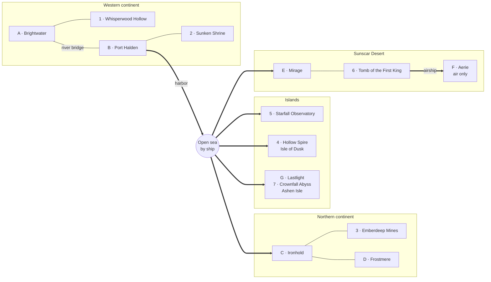

| Code | Place | Kind | How to reach | Battle area |
| --- | --- | --- | --- | --- |
| A | Brightwater | Town | Start | Plains |
| B | Port Halden | Town | East over the river bridge | Eastern lowlands |
| C | Ironhold | Town | By ship, north | Northern continent |
| D | Frostmere | Town | Road west of Ironhold | Northern snowfields |
| E | Mirage | Town | By ship, east | Sunscar Desert |
| F | Aerie | Town | **Airship only** (a mesa-walled valley) | Sunscar Desert |
| G | Lastlight | Town | Ship or airship, far northeast (after the ending) | Ashen Isle |
| 1 | Whisperwood Hollow | Dungeon, 2F | Road northwest of Brightwater | Whisperwood Hollow |
| 2 | Sunken Shrine | Dungeon, 2F | Coast road south of Port Halden | Sunken Shrine |
| 3 | Emberdeep Mines | Dungeon, 3F | Ring of mountains north of Ironhold | Emberdeep Mines |
| 4 | Hollow Spire | Dungeon, 3F | Isle of Dusk, east | Hollow Spire |
| 5 | Starfall Observatory | Dungeon, 3F | Small island west of Frostmere | Starfall Observatory |
| 6 | Tomb of the First King | Dungeon, 3F | South of Mirage | Tomb |
| 7 | Crownfall Abyss | Dungeon, 4F | The crater east of Lastlight | Crownfall Abyss |
| 8 | Ember Caves | Dungeon, 2F | Hills north of the Brightwater road (Lyra's quest) | Ember Caves |
| 9 | Sea Mother's Grotto | Dungeon, 2F | East coast of the Port Halden peninsula (Oswin's quest) | Sea Mother's Grotto |
| — | The Undercity | Dungeon, 2F | A trapdoor in the Ironhold jail (Kestrel's quest) | The Undercity |

### Saving

- **Three save slots** plus an **Auto** slot. Save from **Menu → Save** anywhere, or when you rest at an inn ("Save to slot N" is one press).
- **Auto-save** writes to the Auto slot every time you enter a town or dungeon. You can turn it off in Config.
- On the title screen, **Continue** loads your most recent save and **Load Game** lets you pick any slot. Saves from before 1.4 move into slot 1 automatically.

### Settings (Menu → Config)

| Setting | Options | What it does |
| --- | --- | --- |
| Sound | On / Off | Music and effects (also the M key) |
| Auto-dash | On / Off | Run everywhere; hold Shift, R or the gamepad's X to walk |
| Text speed | Normal / Fast / Instant | How fast dialogue appears |
| Battle speed | 1× / 2× / 4× | Speeds up battle animations; messages still wait for you |
| Auto-save | On / Off | Save to the Auto slot on entering towns and dungeons |
| Large text | On / Off | Bigger dialogue text |
| High contrast | On / Off | Solid black windows with bright yellow borders |
| Controls… | — | Rebind any action to any key (Confirm and Back always keep a key), or reset |
| Encounters | On / Off | Random battles; can only be turned off after the ending |

### Getting around

| Mode | Unlocked by | Notes |
| --- | --- | --- |
| On foot | Start | Hold **Shift** (or turn on **auto-dash**) to run. Forests, hills and dead woods raise the encounter rate by 50%. |
| Ship *Dawnrunner* | Brann, after the Tide Lantern | Walk onto it to sail and onto land to go ashore. Sea encounters. |
| Airship *Aurora* | Beating Ozymar | Fly anywhere with no encounters. Press **Enter** to land on open ground (not forest). |
| Diving bell | Brann, during The Drowned Kingdom | Sail onto black water and press **Enter** to dive to the sea floor; walk onto a bell line to surface. |
| Lanternmoth | Old Ivy's whistle, after Arin's quest | Talk to a lit roadside lamp. Fast, no encounters, land only. **Enter** to land. |

**Encounters** come every 14–30 steps. The Sailor's Compass and the Moonfin Charm halve the rate. After the ending, **Config → Encounters** can turn them off entirely.

---

## Towns, inns and shops

| Town | Inn (party) | Notable people | Services |
| --- | --- | --- | --- |
| Brightwater | 10 G | Elder Maren, Mira, Pip, Old Bram | Free rest at Arin's house; item and arms shops |
| Port Halden | 30 G | Oswin, Brann, Nell | Chapel (revive and cure); harbor |
| Ironhold | 80 G | Captain Dunmar, Orrin, Hilda, Selene | Jail, barracks, **Orrin's Forge** |
| Frostmere | 120 G | Wren, Sable, the Ice Fisher | Observatory hut; **fishing rod** |
| Mirage | 150 G | Sultana Imara, Scholar Hesper, Dalen | Palace |
| Aerie | 200 G | Elder Skye, the Arena Master | **The Arena** |
| Lastlight | 300 G | Warden Ione, Calla, Fennick, Moss | Chapel; endgame armory |
| Nerith (sea floor) | 500 G | Mother Ysolde, Captain Oriel, Archivist Thule | Temple (full heal); the best shop gear |
| The Undermarket (under Ironhold) | 40 G | Mags, Whisper, Stallkeeper Nim | Black market; treasure maps |

Every building can be entered. Search **barrels, pots and crates** (face one and press Enter) for hidden items; each container is searched once. Resting at an inn also offers to save.

{{shops}}

---

## Dungeons

Each dungeon's floors are generated from a fixed seed, so every player gets the same layout. Torches light the walls, and the Lantern waits in the boss room on the last floor.

{{dungeons}}

---

## The party

Four heroes fight at once. Arrange them in **Menu → Formation**; the fifth waits in reserve and earns **half EXP**.

{{heroes}}

*Stats are shown at Lv 1 → Lv 50, before equipment.*

### Arin · Lamplighter

{{spells_arin}}

### Lyra · Flamecaller

{{spells_lyra}}

### Oswin · Tide Priest

{{spells_oswin}}

### Kestrel · Rogue

{{spells_kestrel}}

### Selene · Duskmage

{{spells_selene}}

---

## Combo techs

Choose **Combo** in battle. Every member must be in the active four, awake, not silenced, and have the MP. A combo uses **all of their turns**.

{{combos}}

---

## Limits

Each hero learns one **Limit** by finishing their [personal quest](#hearts-of-the-lamplighters). A gold gauge under the hero's name in battle fills as they **take damage**, and it stays full between battles. When it's full, a ★ command appears at the top of their battle menu. Using it is free, costs no MP, and empties the gauge.

{{limits}}

---

## How battles work

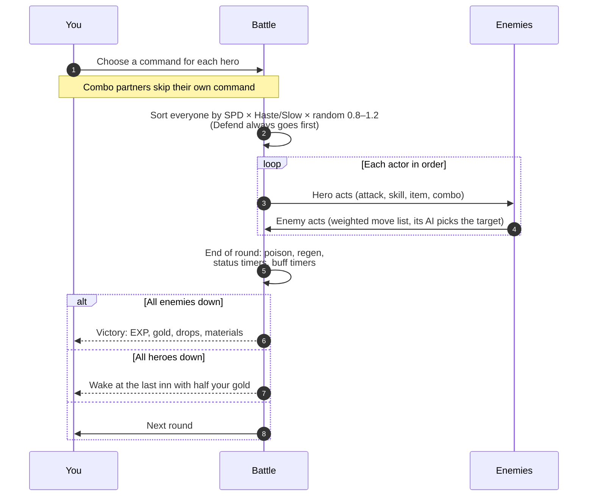

**Repeat last turn:** press **Shift**, **R** (touch) or **X** (gamepad) at the first hero's command menu to give everyone the same commands as last round. **Config → Battle speed** runs battles at 2× or 4×.

Some late bosses **act twice per round**. Every boss **changes tactics when hurt**: below a share of its HP it announces the change and switches to a new move list (see [Bosses](#bosses)).

### Elements: weak, resist, absorb

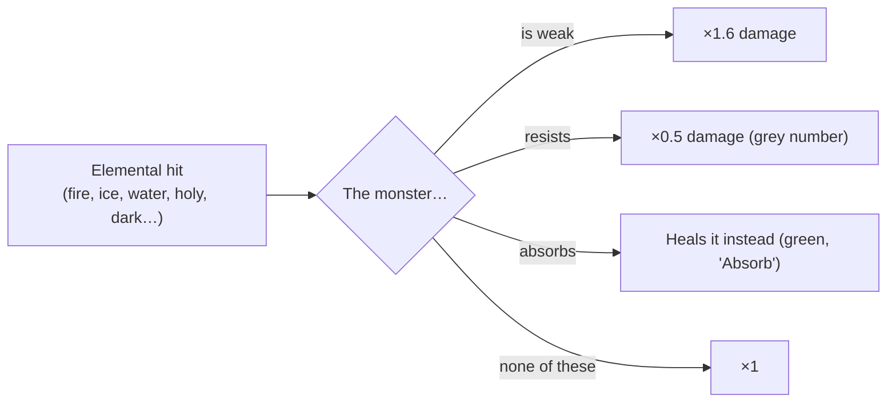

The bestiary shows each monster's weaknesses, resistances and absorbs once you've met it. Fire on a Magma Slime or water on the Leviathan heals them, so switch elements.

### Enemy behaviour

Most enemies pick a random target. Some are smarter, and the bestiary says so:

| AI | What it does | Examples |
| --- | --- | --- |
| Hunts the wounded | 60% of the time it attacks the hero lowest on HP | Wolves, Bandits, Deep Ones, Ozymar, the Hollow King, Orun, Vane |
| Hunts casters | 60% of the time it goes for Lyra, Oswin or Selene | Hollow Knights, Dread Knights, Cinder Knights, Vesper |
| Heals allies | Heals the most hurt monster (often not itself) when one is below half HP | Tomb Priests, Hollow Heralds, the Drowned Abbot |

### Formulas

| Thing | Formula |
| --- | --- |
| Physical damage | `(ATK − DEF ÷ 2) × multiplier × random(0.88–1.12)`, minimum 1 |
| Magic damage | `(spell power + MAG) × random(0.92–1.08) × weakness − target MAG × 0.4` |
| Weakness | Damage ×**1.6** if the target is weak to the element |
| Critical hit | Chance `6% + SPD × 0.1%`; damage ×**1.7** |
| Miss | Your attacks: 3%. Enemy attacks: `3% + (your SPD − their SPD) × 0.4%`, between 2% and 12% |
| Defend | Halves physical damage and cuts magic by 40% until your next turn |
| Rally | Party ATK ×1.35 for 4 rounds |
| Barrier | Party DEF ×1.4 and enemy magic ×0.6 for 4 rounds |
| Holy physical skills | ATK × `(1 + MAG ÷ 200)`, so Arin's MAG makes Sunstrike and Dawnbreak stronger |
| Gravity | 25% of the target's current HP (8% on bosses) |
| Poison | Heroes lose 6% of max HP per round (never below 1); enemies lose 5% (at most 250) |
| Regen | Renew: 8% of max HP per round for 5 rounds. Regen accessories: 5% per round |
| Steal | `55% + (your SPD − their SPD) × 2%`, between 25% and 92%; once per enemy. Some monsters carry a **rare item** (★): a successful steal takes it first with the listed chance, doubled by the Thief's Gloves or the Bestiary Seal |
| Run | `60% + (party SPD − enemy SPD) × 3%`, between 30% and 95%. Never from bosses or in the Arena |
| First strike | 8% of normal battles (25% with Lookout on the Lantern Board): the enemies lose their first round |
| Blind | Physical attacks and skills miss 50% of the time |
| Haste / Slow | Turn speed ×1.6 / ×0.6 |
| Sleep | Heroes sleep 2 rounds and enemies 3. Any hit wakes an enemy; a hit wakes a hero 60% of the time |

### Statuses

| Status | Effect | Cured by | Prevented by |
| --- | --- | --- | --- |
| Poison | Loses HP every round | Antidote, Remedy, Purify, Sanctuary | Tide Pendant, Desert Veil, Silk Ribbon, Orrin's Seal, and others |
| Sleep | Skips turns | Getting hit, Remedy, Purify | Wake Charm, Pip's Candle, Dwarven Band, Nightglass Locket, and others |
| Silence | Can't use skills or combos | Remedy, Purify, Sanctuary | Echo Bell, Sage Circlet, Dwarven Band, Eclipse Mantle, and others |
| Blind | Attacks and physical skills miss half the time | Remedy, Purify, Sanctuary | Eye Charm, Sun Circlet, Scholar's Monocle, all-ailment accessories |
| Slow | Acts later (speed ×0.6) | Remedy, Purify, Haste, Sanctuary | Hourglass Pin, Starlit Cloak, all-ailment accessories |
| Berserk | Attacks a random foe every turn with ATK ×1.5; you can't give orders | Remedy, Purify, wears off (3 rounds) | Calm Charm, all-ailment accessories |
| Stop | Loses every turn | Remedy, Purify, wears off (2 rounds) | Clockwork Charm, Night Cloak, all-ailment accessories |
| Haste | Acts sooner (speed ×1.6) for 4 rounds | Wears off; Slow cancels it | — |
| Regen | Heals every round | Wears off | — |

Heroes are blinded or slowed for 3 rounds, enemies for 4. Bosses are immune to Sleep and Silence, take Slow half as often and Blind 30% as often. Kestrel's Venom Edge poisons bosses 40% of the time. A **Hotpot meal** (see [Cooking](#cooking)) prevents every ailment.

New in 1.6: Oswin learns **Haste** at Lv 24, Kestrel **Flash Powder** (blind all foes) at Lv 18, and Selene starts with **Slow**.

---

## The Lantern Board

From **level 30** every level-up gives the hero an **Ember**. At the level cap, every **20,000 EXP** gives another. Spend Embers on the hero's **Lantern Board**: open **Status**, pick a hero and press **Enter**. A node can be lit once one of its neighbours is lit. Every hero starts with the Spark lit. Lighting the whole board takes 23 Embers.

Saves from before 1.6 get the Embers their heroes would already have earned (one per level from 30).

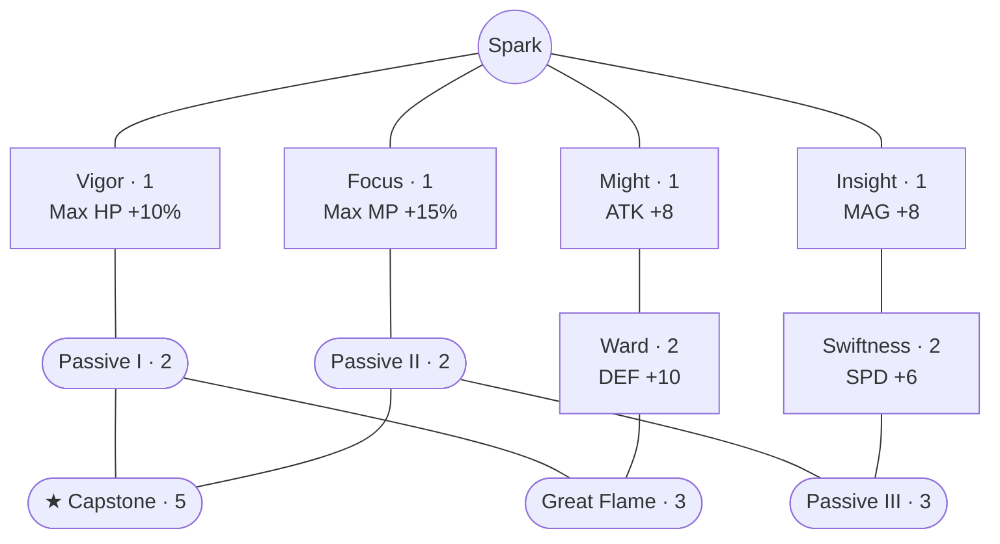

{{board_nodes}}

What the passives and the Great Flame do depends on the hero:

{{board_heroes}}

---

## Bosses

{{bosses}}

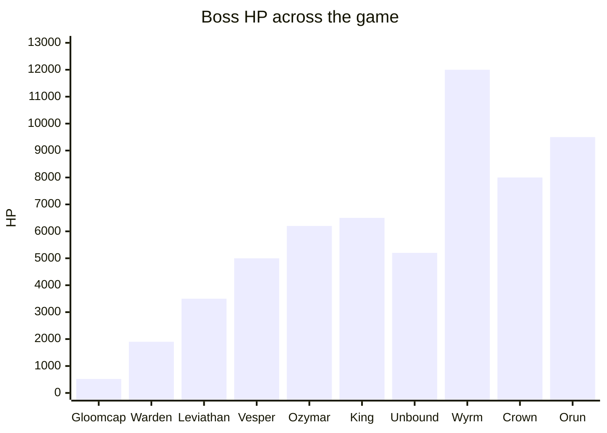

**Tips**

- **Gloomcap**: weak to Fire. Lyra's Fire is your main damage.
- **Drowned Warden**: weak to Bolt. Keep Oswin healing through Tidal Wave.
- **Vesper**: weak to Holy. Silence protection helps a lot against Hush.
- **Ozymar**: no weakness. Remedies for Hush; Barrier for Sandstorm.
- **The Hollow King**: two phases back to back. The light of the three Lanterns fully heals the party between them.
- **Astral Wyrm**: Dream Fog sends the whole party to sleep, so equip sleep immunity on at least two heroes.
- **The Hollow Crown and Orun**: both **act twice per round** (the *Turns* column). Crownfall hits everyone hard, so keep **Barrier** up, and carry **Remedies**: Hollow Hush can silence Oswin. The Lamp of Lastlight heals you between the phases. **Last Light** (Arin + Lyra + Selene) is the strongest combo in the game.

**How hard are the late bosses?** `tools/balance_sim.py`, 60 fights each, gear from the Spire and the tomb:

| Fight | Party | Win rate | Median rounds | Knockouts per fight |
| --- | --- | --- | --- | --- |
| The Lamp-Eater | Lv 44 | 100% | 12 | 0 |
| The Drowned Abbot | Lv 44 | 98% | 11 | 0.2 |
| Guildmaster Vane | Lv 44 (with Kestrel) | 87% | 9 | 1.8 |
| Hearth Warden | Lv 44 | 83% | 11 | 2.0 |
| Vesper's Echo | Selene alone, Lv 44 | 100% | 12 | 0 |

**How hard is the finale?** `tools/balance_sim.py` fights it 60 times per setup with the real battle code and a simple AI (no combos or Limits, since those come later):

| Party | Win rate | Median rounds | Knockouts per fight |
| --- | --- | --- | --- |
| Lv 42, Lastlight shop gear | 67% | 23 | 2.2 |
| Lv 42, gear from the Spire and tomb | 90% | 23 | 1.0 |
| Lv 45, gear from the Spire and tomb | 98% | 20 | 0.1 |
| Lv 50, forged weapons, arena prizes | 100% | 13 | 0 |

---

## Monsters by area

Ordered roughly as you meet them.

{{monsters}}

---

## Side quests

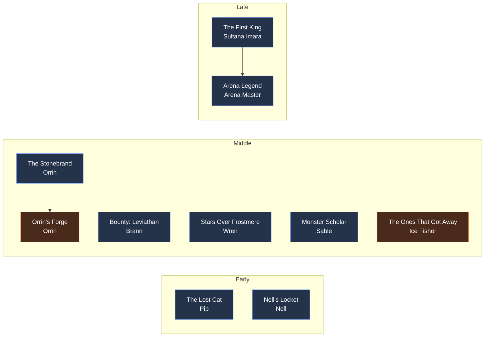

| Quest | Giver | What to do | Reward |
| --- | --- | --- | --- |
| The Lost Cat | Pip, Brightwater | Find Mittens on Whisperwood Hollow 1F | Pip's Candle |
| Nell's Locket | Nell, Port Halden | Find the locket on Sunken Shrine 1F | Tide Pendant |
| The Stonebrand | Orrin, Ironhold | Find the hammer on Emberdeep Mines 2F | Dwarven Band |
| Bounty: Leviathan | Brann, Port Halden (after the ship) | Sail into the whirlpool (Lv 16+) | 4000 G, Sailor's Compass |
| Stars Over Frostmere | Wren, Frostmere | Relight 3 Lanterns, then open the Observatory (Lv 32+) | The Fifth Flame |
| Monster Scholar | Sable, Frostmere | Record 30 creatures in the bestiary | Silk Ribbon |
| The First King | Sultana Imara, Mirage | Open the Tomb with the Sun Seal (Lv 26+) | The airship *Aurora* |
| Arena Legend | Arena Master, Aerie | Win the first five cups | Lantern Crown |
| **The Ones That Got Away** | Ice Fisher, Frostmere | Catch every kind of fish (6 kinds for the first reward) | Angler's Ring, Moonfin Charm |
| **Orrin's Forge** | Orrin, Ironhold (after The Stonebrand) | Forge three items | Orrin's Seal |
| **The Lamplighter's Road** | Elder Maren (after the ending) | Relight 12 roadside lamps | Sunbearer, ★ First Light |
| **Mother's Grimoire** | Mira (after the ending) | Ember Caves riddles and the Hearth Warden | Hearthstaff, ★ Phoenix Rite |
| **The Drowned Priesthood** | Sister Wenna (after the ending) | The Drowned Abbot in the Sea Mother's Grotto | Abbot's Bell, ★ High Tide |
| **Old Debts** | Ironhold jail guard (after the ending) | Guildmaster Vane in the Undercity | Pickpocket's Prize, ★ Grand Larceny |
| **Echo of Vesper** | Mira (after the ending) | Selene's solo dream duel | Duskstar, ★ Long Night |
| **The Festival of Lanterns** | Elder Maren | Finish all five hero quests | Heartlight |
| **The Complete Bestiary** | Sable, Frostmere (after Monster Scholar) | Record 45 creatures, then every one | Scholar's Monocle, Bestiary Seal |
| **The Drowned Kingdom** | Sister Wenna (after The Drowned Priesthood) | Dive to Nerith and face Nereus in the Drowned Palace | Crown of Nerith |
| **The Tide That Remembers** | Mother Ysolde, Nerith | The superboss in the Hadal Rift | Tidesong |
| **Lanternmoths** | Old Ivy, Brightwater (after The Lamplighter's Road) | Talk to her | Moth Whistle |
| **Buried Treasure** | Whisper, the Undermarket | Dig up all five treasure maps | 50,000 G |
| **Lanterns & Lies** | Tess, Brightwater (by day) | Beat all eight card players | Joker's Lantern |
| **The Sunset Opal** | Mags, the Undermarket (after Old Debts, with Kestrel) | The night heist in the Mirage palace vaults | Night Cloak |

---

## The Aerie Arena

Cups are gauntlets: several battles in a row with no inn in between. You can use items but can't run, and losing costs nothing. The prize is awarded once; rematches pay gold only.

{{arena}}

---

## Fishing

Get the **Old Fishing Rod** from the Ice Fisher in Frostmere. Then face any water (a pond, the river, a harbor, the sea from the shore, or the Shrine's pools) and press **Enter**.

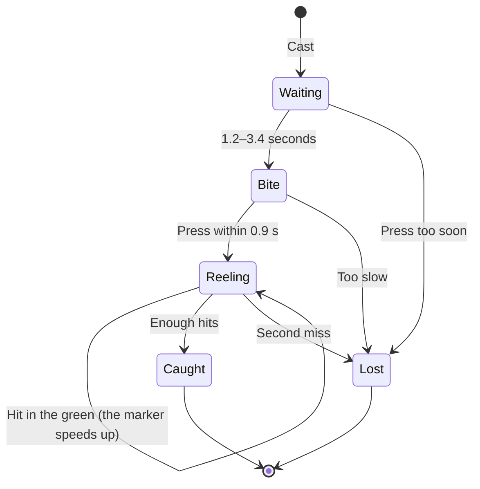

Harder fish need more hits and have a narrower green zone (30% of the bar for ★, 22% for ★★, 15% for ★★★).

{{fish}}

---

## Cooking

Any innkeeper will cook your catch. Choose **Cook a meal** when you talk to them (it only appears when you're carrying fish). A meal lasts for the next **3 battles**, win, lose or run, and shows under the menu. Cooking a new meal replaces the old one.

{{meals}}

---

## Orrin's Forge

After *The Stonebrand*, talk to Orrin in Ironhold and choose **Forge**. Materials drop from monsters (the bestiary lists who drops what) and a few come from Abyss chests.

{{mats}}

{{forge}}

---

## Equipment

### Weapons

**Arin**

{{weapons_arin}}

**Lyra**

{{weapons_lyra}}

**Oswin**

{{weapons_oswin}}

**Kestrel**

{{weapons_kestrel}}

**Selene**

{{weapons_selene}}

### Armour

{{armor}}

### Accessories

Anyone can wear any accessory. Only one is worn at a time.

{{acc}}

---

## Items

{{items}}

### Key items

{{keys}}

---

## Levels and EXP

The level cap is **50**. Every surviving active hero gets the full EXP from a battle; reserve heroes get half. The Lantern Crown and the Scholar's Lens add +50% EXP for their wearer.

{{xp}}

```mermaid
{{xpchart}}
```

---

## New Game+

After the ending, the title screen offers **New Game+**. You keep your levels, equipment, items (except key items), gold and bestiary. Each cycle makes enemies stronger:

| Stat | Change per cycle |
| --- | --- |
| HP | +60% |
| ATK and MAG | +22% |
| DEF | +12% |
| EXP and gold | +50% |

---

## Trophies

Trophies (added in 1.8) belong to you, not to a save: earn one once and it stays, whichever slot you play and through New Game+. A toast appears when you earn one. See them from **Trophies** on the title screen, or ask **Scribe Tam** in Elder Maren's hall in Brightwater.

{{trophies}}

---

## Speedrun mode

Turn on **Config → Speedrun timer** to show your play time in the top-right corner. Play time counts on the field and, since 1.8, in battle too (real time, so a faster battle speed saves time). Each main Lantern is a split:

| Split | When it's taken |
| --- | --- |
| Ember Lantern | Relighting the Ember Lantern in Whisperwood Hollow |
| Tide Lantern | Relighting the Tide Lantern in the Sunken Shrine |
| Stone Lantern | Relighting the Stone Lantern in Emberdeep Mines |
| Dawn Lantern | The ending |

When a split is taken, a panel shows its time and the difference from your best run (green ahead, red behind). Your best run is saved when you finish faster than before. Runs on New Game+, and Lanterns lit before a save existed (saves from before 1.8), don't count.

